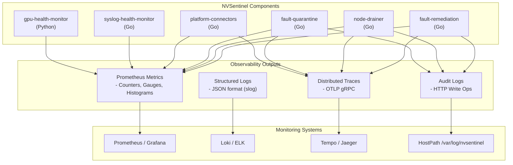
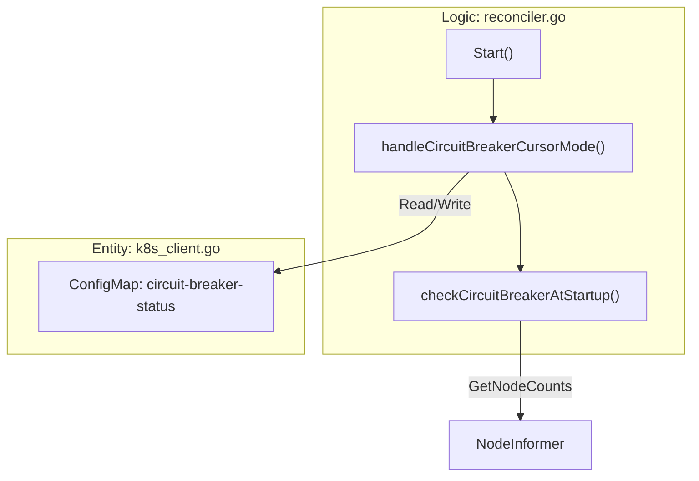

<!-- source: DeepWiki mcp.deepwiki.com · repo NVIDIA/NVSentinel · page 12 Operations and Observability · fetched 2026-10-26 -->

# Operations and Observability

Relevant source files

The following files were used as context for generating this wiki page:

- [docs/DATA_FLOW.md](docs/DATA_FLOW.md)
- [docs/METRICS.md](docs/METRICS.md)
- [docs/README.md](docs/README.md)
- [docs/audit-logging.md](docs/audit-logging.md)
- [docs/configuration/README.md](docs/configuration/README.md)
- [docs/index.yml](docs/index.yml)
- [docs/tracing.md](docs/tracing.md)
- [fault-quarantine/main.go](fault-quarantine/main.go)
- [fault-quarantine/pkg/common/common.go](fault-quarantine/pkg/common/common.go)
- [fault-quarantine/pkg/informer/k8s_client.go](fault-quarantine/pkg/informer/k8s_client.go)
- [fault-quarantine/pkg/informer/node_informer.go](fault-quarantine/pkg/informer/node_informer.go)
- [fault-quarantine/pkg/metrics/metrics.go](fault-quarantine/pkg/metrics/metrics.go)
- [fault-quarantine/pkg/reconciler/reconciler.go](fault-quarantine/pkg/reconciler/reconciler.go)
- [fault-quarantine/pkg/reconciler/reconciler_e2e_test.go](fault-quarantine/pkg/reconciler/reconciler_e2e_test.go)
- [node-drainer/pkg/metrics/metrics.go](node-drainer/pkg/metrics/metrics.go)
- [store-client/pkg/client/postgresql_client.go](store-client/pkg/client/postgresql_client.go)
- [tests/fault_management_test.go](tests/fault_management_test.go)
- [tests/fault_quarantine_test.go](tests/fault_quarantine_test.go)

This page provides an overview of operating NVSentinel in production environments, including monitoring, troubleshooting, and performance tuning. NVSentinel is designed with production operations in mind, providing comprehensive observability through Prometheus metrics, structured logging, distributed tracing, and audit trails.

**Scope:** This page covers operational concepts and workflows. For detailed information, see:
- **[Metrics and Observability](#12.1)** - Prometheus metrics reference, monitoring queries, and alerting
- **[Troubleshooting Guide](#12.2)** - Common issues, debugging techniques, and resolution procedures
- **[Performance Tuning](#12.3)** - Scalability considerations, resource optimization, and circuit breaker configuration
- **[Scale Testing](#12.4)** - Large-scale deployment validation, KWOK testing, and capacity planning

---

## Observability Architecture

NVSentinel provides comprehensive observability through four complementary mechanisms: Prometheus metrics for quantitative monitoring, structured logs for qualitative analysis, distributed tracing for event lifecycle visibility, and audit logs for compliance.

**Observability Architecture: Multi-Layer Monitoring**

**Observability Layers:**

| Layer | Purpose | Access Method | Source |
|-------|---------|---------------|--------|
| **Prometheus Metrics** | Quantitative monitoring and alerting | `/metrics` endpoint | [docs/METRICS.md:1-200]() |
| **Structured Logs** | Detailed debugging and event context | `kubectl logs` (JSON) | [docs/tracing.md:108-119]() |
| **Distributed Tracing** | End-to-end event lifecycle visibility | OTLP / Tempo / Jaeger | [docs/tracing.md:1-50]() |
| **Audit Logging** | Durable trail of HTTP write operations | `/var/log/nvsentinel/*.log` | [docs/audit-logging.md:1-18]() |

**Sources:** [docs/METRICS.md:1-50](), [docs/tracing.md:1-23](), [docs/audit-logging.md:1-33]()

---

## Distributed Tracing and Audit

### Distributed Tracing
NVSentinel uses OpenTelemetry to follow a health event from detection through remediation. Trace context is propagated across module boundaries via MongoDB metadata and Kubernetes CR annotations [docs/tracing.md:92-103]().

### Audit Logging
For security and forensics, NVSentinel records a file-based audit trail of all POST, PUT, PATCH, and DELETE operations against Kubernetes and CSP APIs [docs/audit-logging.md:5-12](). These logs are stored on the host at `/var/log/nvsentinel` [docs/audit-logging.md:32-33]().

**Sources:** [docs/tracing.md:92-103](), [docs/audit-logging.md:1-18]()

---

## Prometheus Metrics Overview

NVSentinel exposes comprehensive Prometheus metrics for all components. Metrics are organized into functional categories for monitoring different aspects of system operation.

**Critical Metrics for Production Monitoring:**

| Category | Metric Name | Description |
|-----------|---------------|-----------------|
| **Quarantine** | `fault_quarantine_event_backlog_count` | Events pending processing [fault-quarantine/pkg/metrics/metrics.go:162-167]() |
| **Quarantine** | `fault_quarantine_breaker_state` | Current state of circuit breaker [fault-quarantine/pkg/metrics/metrics.go:170-176]() |
| **Drainer** | `node_drainer_queue_depth` | Pending drain operations [docs/METRICS.md:83-83]() |
| **Drainer** | `node_drainer_pod_eviction_duration_seconds` | Latency of pod evictions [docs/METRICS.md:84-84]() |
| **Remediation** | `fault_remediation_cr_generate_duration_seconds` | Time to create maintenance CR [docs/METRICS.md:106-106]() |

For complete metrics reference with descriptions and labels, see **[Metrics and Observability](#12.1)**.

**Sources:** [docs/METRICS.md:1-125](), [fault-quarantine/pkg/metrics/metrics.go:28-215]()

---

## Operational Modes and Safety Features

### Dry-Run Mode
Dry-run mode allows operators to validate detection and rule evaluation without taking any actions on the cluster. 

- **Fault Quarantine:** Skips cordoning and taints [tests/fault_management_test.go:69-95]().
- **Node Drainer:** Skips pod eviction [tests/fault_management_test.go:120-128]().
- **Fault Remediation:** Skips CR creation [tests/fault_management_test.go:130-138]().

**Sources:** [docs/configuration/README.md:19-26](), [tests/fault_management_test.go:37-189]()

### Circuit Breaker Protection
The `FaultQuarantine` module includes a circuit breaker to prevent mass cordoning. It tracks node quarantine utilization and halts processing if a threshold is exceeded [fault-quarantine/pkg/metrics/metrics.go:170-182]().

**Circuit Breaker Logic Space**

**Sources:** [fault-quarantine/pkg/reconciler/reconciler.go:169-206](), [fault-quarantine/pkg/informer/k8s_client.go:85-120]()

---

## Troubleshooting and Performance

### Troubleshooting Guide
When nodes are cordoned, operators should follow structured runbooks. Key states like `skipped`, `halted`, or `partial_recovery` are used to track event processing outcomes [fault-quarantine/pkg/reconciler/reconciler.go:49-53]().

For detailed resolution steps, see **[Troubleshooting Guide](#12.2)**.

### Performance Tuning
Performance tuning focuses on event processing throughput and datastore interaction. FQ waits for `NodeInformer` cache sync before starting processing to ensure accurate node counts for the circuit breaker [fault-quarantine/pkg/reconciler/reconciler.go:196-201]().

For optimization parameters, see **[Performance Tuning](#12.3)**.

**Sources:** [fault-quarantine/pkg/reconciler/reconciler.go:49-53](), [fault-quarantine/pkg/reconciler/reconciler.go:186-201]()

---

