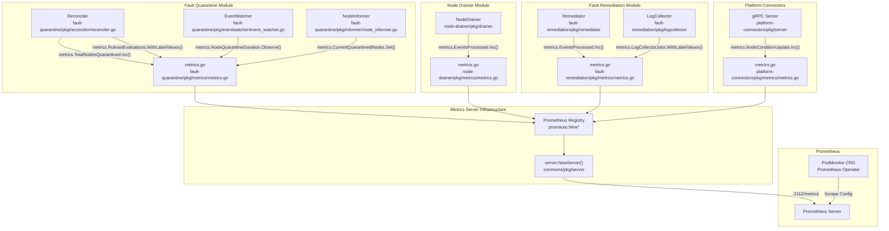
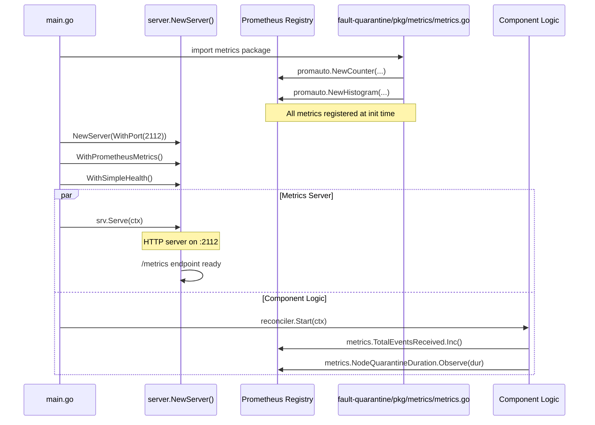
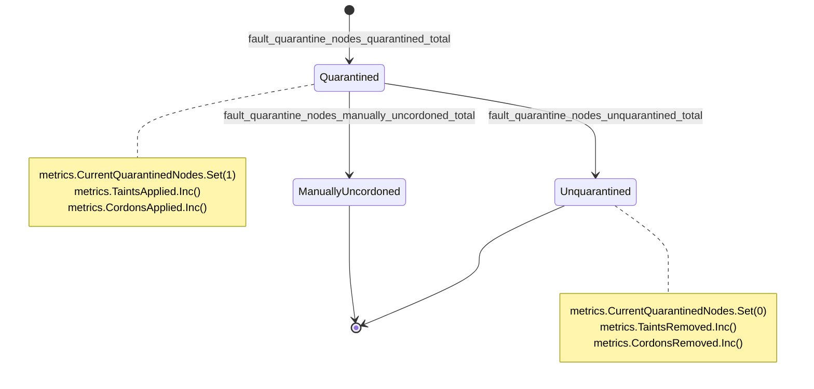

<!-- source: DeepWiki mcp.deepwiki.com · repo NVIDIA/NVSentinel · page 12.1 Metrics and Observability · fetched 2026-10-26 -->

# Metrics and Observability

Relevant source files

The following files were used as context for generating this wiki page:

- [commons/pkg/tracing/tracing.go](commons/pkg/tracing/tracing.go)
- [docs/DATA_FLOW.md](docs/DATA_FLOW.md)
- [docs/METRICS.md](docs/METRICS.md)
- [docs/README.md](docs/README.md)
- [docs/audit-logging.md](docs/audit-logging.md)
- [docs/configuration/README.md](docs/configuration/README.md)
- [docs/index.yml](docs/index.yml)
- [docs/tracing.md](docs/tracing.md)
- [fault-quarantine/main.go](fault-quarantine/main.go)
- [fault-quarantine/pkg/common/common.go](fault-quarantine/pkg/common/common.go)
- [fault-quarantine/pkg/informer/k8s_client.go](fault-quarantine/pkg/informer/k8s_client.go)
- [fault-quarantine/pkg/informer/node_informer.go](fault-quarantine/pkg/informer/node_informer.go)
- [fault-quarantine/pkg/metrics/metrics.go](fault-quarantine/pkg/metrics/metrics.go)
- [fault-quarantine/pkg/reconciler/reconciler.go](fault-quarantine/pkg/reconciler/reconciler.go)
- [fault-quarantine/pkg/reconciler/reconciler_e2e_test.go](fault-quarantine/pkg/reconciler/reconciler_e2e_test.go)
- [node-drainer/pkg/metrics/metrics.go](node-drainer/pkg/metrics/metrics.go)
- [store-client/pkg/client/postgresql_client.go](store-client/pkg/client/postgresql_client.go)
- [tests/fault_management_test.go](tests/fault_management_test.go)
- [tests/fault_quarantine_test.go](tests/fault_quarantine_test.go)

This document describes the observability infrastructure in NVSentinel, covering Prometheus metrics exposure, collection, and usage across all components. For information about troubleshooting operational issues, see [Troubleshooting Guide](). For performance tuning based on metrics, see [Performance Tuning]().

## Overview

NVSentinel exposes comprehensive Prometheus metrics from all components to enable monitoring, alerting, and operational analysis. Each component runs a metrics server on port 2112 (by default) exposing metrics at the `/metrics` endpoint. Metrics track event processing, node quarantine lifecycle, remediation duration, API latency, and error rates. [docs/configuration/README.md:28-35]().

The metrics system provides three primary capabilities:
1. **Operational visibility**: Track event processing, errors, and component health.
2. **Performance analysis**: Measure durations and latencies across the event lifecycle.
3. **Capacity planning**: Monitor queue depths, backlog sizes, and resource utilization.

**Sources**: [docs/METRICS.md:1-17](), [docs/configuration/README.md:28-35](), [fault-quarantine/pkg/metrics/metrics.go:1-25]()

## Metrics Architecture

Each component initializes its metrics using `promauto` (prometheus auto-registration) at package initialization [fault-quarantine/pkg/metrics/metrics.go:30-205](). The metrics server configuration is globally defined in the Helm chart, defaulting to port 2112 [docs/configuration/README.md:33-35]().

**Sources**: [fault-quarantine/pkg/metrics/metrics.go:30-205](), [docs/METRICS.md:1-17](), [docs/configuration/README.md:28-35]()

## Metrics Server Initialization

The metrics server starts as an independent service using the configured `metricsPort` [docs/configuration/README.md:33-35](). All metrics are pre-registered using `promauto` package functions, which automatically register with the default Prometheus registry at package initialization time [fault-quarantine/pkg/metrics/metrics.go:30-41]().

**Sources**: [docs/configuration/README.md:28-35](), [fault-quarantine/pkg/metrics/metrics.go:18-205]()

## Fault Quarantine Metrics

### Event Processing Metrics

| Metric | Type | Code Location |
|--------|------|---------------|
| `fault_quarantine_events_received_total` | Counter | [fault-quarantine/pkg/metrics/metrics.go:30-35]() |
| `fault_quarantine_events_successfully_processed_total` | Counter | [fault-quarantine/pkg/metrics/metrics.go:36-41]() |
| `fault_quarantine_processing_errors_total` | Counter (label: `error_type`) | [fault-quarantine/pkg/metrics/metrics.go:42-49]() |
| `fault_quarantine_event_backlog_count` | Gauge | [fault-quarantine/pkg/metrics/metrics.go:162-168]() |
| `fault_quarantine_event_handling_duration_seconds` | Histogram | [fault-quarantine/pkg/metrics/metrics.go:126-132]() |

These metrics track the throughput and health of the Fault Quarantine processing pipeline. `TotalEventsReceived` counts every event ingested from the datastore change stream, while `ProcessingErrors` segments failures by their cause (e.g., database connection or validation errors) [fault-quarantine/pkg/metrics/metrics.go:42-49]().

**Sources**: [fault-quarantine/pkg/metrics/metrics.go:30-49](), [docs/METRICS.md:24-31]()

### Node Quarantine Lifecycle Metrics

**Metric Update Locations**:
- `TotalNodesQuarantined`: Segments by node name to track which nodes have entered quarantine [fault-quarantine/pkg/metrics/metrics.go:51-57]().
- `CurrentQuarantinedNodes`: Tracks the active population of nodes currently in a non-healthy state [fault-quarantine/pkg/metrics/metrics.go:80-87]().
- `TaintsApplied`/`CordonsApplied`: Direct counts of remediation actions taken on the Kubernetes cluster [fault-quarantine/pkg/metrics/metrics.go:89-114]().

**Sources**: [fault-quarantine/pkg/metrics/metrics.go:50-114](), [docs/METRICS.md:32-48]()

### Remediation Duration Metrics

NVSentinel tracks critical duration metrics for measuring remediation performance [docs/METRICS.md:49-51]():

| Metric | Description | Buckets |
|--------|-------------|---------|
| `fault_quarantine_node_quarantine_duration_seconds` | Time from health event generation to node quarantine completion. | Prometheus DefBuckets [fault-quarantine/pkg/metrics/metrics.go:135-141]() |
| `fault_quarantine_node_remediation_duration_seconds` | End-to-end time from health event generation to node unquarantine. | Exponential: 10s start, 1.5 factor, 27 count [fault-quarantine/pkg/metrics/metrics.go:143-150]() |
| `fault_quarantine_node_remediation_duration_excluding_drain_seconds` | Remediation time excluding node-drainer duration. | Exponential: 10s start, 1.5 factor, 19 count [fault-quarantine/pkg/metrics/metrics.go:152-159]() |

**Sources**: [fault-quarantine/pkg/metrics/metrics.go:134-159](), [docs/METRICS.md:49-51]()

### Circuit Breaker Metrics

| Metric | Type | Labels | Purpose |
|--------|------|--------|---------|
| `fault_quarantine_breaker_state` | Gauge | `state` | Current breaker state (open/closed/half-open) [fault-quarantine/pkg/metrics/metrics.go:170-176]() |
| `fault_quarantine_breaker_utilization` | Gauge | - | Percentage of nodes quarantined vs the threshold [fault-quarantine/pkg/metrics/metrics.go:177-182]() |
| `fault_quarantine_get_total_nodes_duration_seconds` | Histogram | `result` | Latency of querying the node informer for total node counts [fault-quarantine/pkg/metrics/metrics.go:183-190]() |

The circuit breaker status is also stored in a ConfigMap for persistence across restarts [fault-quarantine/pkg/informer/k8s_client.go:85-120]().

**Sources**: [fault-quarantine/pkg/metrics/metrics.go:169-204](), [docs/METRICS.md:59-67](), [fault-quarantine/pkg/informer/k8s_client.go:190-206]()

## Distributed Tracing

NVSentinel uses OpenTelemetry for distributed tracing to provide end-to-end visibility of health events as they flow through the system [docs/configuration/README.md:62-74]().

- **Initialization**: Services call `tracing.InitTracing` with a service name [commons/pkg/tracing/tracing.go:71-136]().
- **Context Propagation**: Trace IDs are stored in health event metadata as `trace_id` [commons/pkg/tracing/tracing.go:61-64]().
- **Child Spans**: The system uses `StartChildSpanIfParentTraceActive` to ensure background operations (like DB polling) do not create noisy root traces [commons/pkg/tracing/tracing.go:186-196]().

**Sources**: [commons/pkg/tracing/tracing.go:1-196](), [docs/configuration/README.md:62-74]()

## Audit Logging

For security and compliance, NVSentinel maintains a durable file-based audit trail of all HTTP write operations (POST, PUT, PATCH, DELETE) against Kubernetes and CSP APIs [docs/audit-logging.md:3-12]().

- **Implementation**: Uses `auditlogger.NewAuditingRoundTripper` to wrap the HTTP client [docs/audit-logging.md:13-18]().
- **Persistence**: Logs are written to `/var/log/nvsentinel/` and rotated using a lumberjack-style strategy [docs/audit-logging.md:52-71]().
- **Configuration**: Managed via `global.auditLogging` in Helm [docs/audit-logging.md:72-85]().

**Sources**: [docs/audit-logging.md:1-120](), [docs/configuration/README.md:76-91]()

## Metrics Reference Table (Common Labels)

| Label | Description |
|-------|-------------|
| `node` | The Kubernetes node name associated with the event/metric. |
| `error_type` | Category of error (e.g., `unmarshal_error`, `mark_processed_error`). |
| `ruleset` | The name of the Fault Quarantine CEL ruleset being evaluated. |
| `state` | The state of the circuit breaker (`closed`, `open`). |

**Sources**: [fault-quarantine/pkg/metrics/metrics.go:23-205](), [docs/METRICS.md:24-67]()

---

