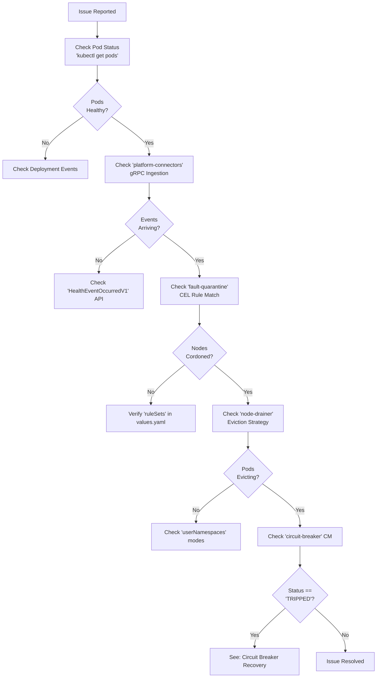
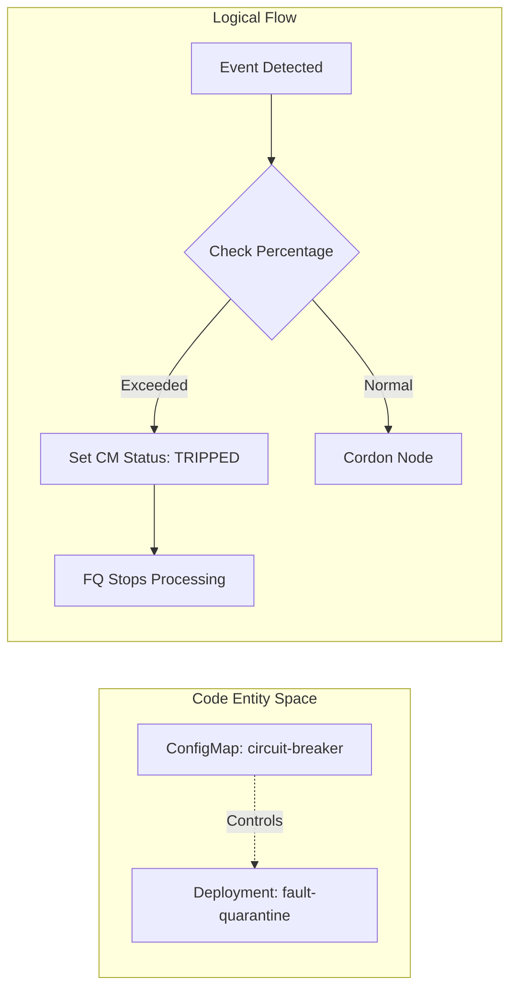

<!-- source: DeepWiki mcp.deepwiki.com · repo NVIDIA/NVSentinel · page 12.2 Troubleshooting Guide · fetched 2026-10-26 -->

# Troubleshooting Guide

<details>
<summary>Relevant source files</summary>

The following files were used as context for generating this wiki page:

- [.lychee.toml](.lychee.toml)
- [distros/kubernetes/nvsentinel/charts/csp-health-monitor/templates/serviceaccount.yaml](distros/kubernetes/nvsentinel/charts/csp-health-monitor/templates/serviceaccount.yaml)
- [distros/kubernetes/nvsentinel/charts/csp-health-monitor/values.yaml](distros/kubernetes/nvsentinel/charts/csp-health-monitor/values.yaml)
- [docs/configuration/csp-health-monitor.md](docs/configuration/csp-health-monitor.md)
- [docs/csp-health-monitor-iam.md](docs/csp-health-monitor-iam.md)
- [docs/designs/013-mongodb-bitnami-migration.md](docs/designs/013-mongodb-bitnami-migration.md)
- [docs/designs/014-workflow-XID-13-and-31.md](docs/designs/014-workflow-XID-13-and-31.md)
- [docs/runbooks/README.md](docs/runbooks/README.md)
- [docs/runbooks/circuit-breaker.md](docs/runbooks/circuit-breaker.md)
- [docs/runbooks/cordoned-nodes.md](docs/runbooks/cordoned-nodes.md)
- [docs/runbooks/csp-health-monitor-iam.md](docs/runbooks/csp-health-monitor-iam.md)
- [docs/runbooks/datastore-connection.md](docs/runbooks/datastore-connection.md)
- [docs/runbooks/driver-upgrades.md](docs/runbooks/driver-upgrades.md)
- [docs/runbooks/node-conditions.md](docs/runbooks/node-conditions.md)
- [docs/runbooks/stale-events.md](docs/runbooks/stale-events.md)
- [health-monitors/csp-health-monitor/pkg/triggerengine/trigger.go](health-monitors/csp-health-monitor/pkg/triggerengine/trigger.go)
- [health-monitors/csp-health-monitor/pkg/triggerengine/trigger_test.go](health-monitors/csp-health-monitor/pkg/triggerengine/trigger_test.go)
- [scripts/mongodb-shell.sh](scripts/mongodb-shell.sh)

</details>


This guide provides diagnostic procedures and resolution steps for common issues encountered when operating NVSentinel in production. It covers component-level failures, event processing problems, circuit breaker triggers, and manual recovery procedures.

For general system architecture and component interactions, see [System Overview](3.1). For configuration adjustments and tuning, see [Performance Tuning](12.3). For metrics reference and alerting setup, see [Metrics and Observability](12.1).

---

## Diagnostic Tools and Commands

### Essential kubectl Commands

```bash
# Check pod health across all components
kubectl get pods -n nvsentinel -o wide

# View logs for specific components
kubectl logs -n nvsentinel deployment/fault-quarantine --tail=100 -f
kubectl logs -n nvsentinel deployment/platform-connectors --tail=100 -f
kubectl logs -n nvsentinel deployment/node-drainer --tail=100 -f

# Check node quarantine status
kubectl get nodes --show-labels | grep nvsentinel-state
kubectl get nodes -o custom-columns=NAME:.metadata.name,SCHEDULABLE:.spec.unschedulable,QUARANTINE:.metadata.annotations.quarantineHealthEvent

# Inspect health event annotations on nodes
kubectl get node $NODE_NAME -o jsonpath='{.metadata.annotations.quarantineHealthEvent}' | jq .

# View circuit breaker state
kubectl get cm circuit-breaker -n nvsentinel -o jsonpath='{.data.status}'
```

### Key Metrics to Monitor

| Component | Metric | What It Indicates |
|-----------|--------|-------------------|
| Fault Quarantine | `fault_quarantine_events_received_total` | Events arriving from database |
| Fault Quarantine | `fault_quarantine_breaker_state{state="tripped"}` | Circuit breaker activation |
| Node Drainer | `node_drainer_processing_errors_total` | Drain operation failures |
| Platform Connectors | `k8s_platform_connector_node_condition_update_total{status="failed"}` | Failed node updates |
| CSP Monitor | `trigger_poll_errors_total` | Errors in maintenance polling cycle |

**Sources**: [docs/runbooks/circuit-breaker.md:14-20](), [docs/runbooks/cordoned-nodes.md:14-44](), [health-monitors/csp-health-monitor/pkg/triggerengine/trigger.go:107-110]()

---

## Troubleshooting Flow Diagram

### Natural Language to Code Entity Space: Event Flow
This diagram maps high-level troubleshooting steps to specific code components and Kubernetes resources.



**Sources**: [docs/runbooks/circuit-breaker.md:1-20](), [docs/runbooks/cordoned-nodes.md:1-12]()

---

## Component-Specific Issues

### 1. Fault Quarantine Issues

#### Symptom: Events received but nodes not quarantined

**Common Causes:**

1. **Rules not matching events**: Check CEL expression evaluation. The evaluator runs expressions defined in `fault-quarantine.ruleSets` configuration.
   - Solution: Review and adjust CEL expressions in `values.yaml`.

2. **Circuit breaker tripped**: Safety mechanism preventing mass quarantines.
   - Check: `kubectl get cm circuit-breaker -n nvsentinel -o jsonpath='{.data.status}'`
   - If status is `TRIPPED`, see [Circuit Breaker Recovery](#circuit-breaker-recovery) below.
   - [docs/runbooks/circuit-breaker.md:14-20]()

3. **ManagedByNVSentinel Label**: Nodes with `k8saas.nvidia.com/ManagedByNVSentinel=false` are ignored.
   - [docs/runbooks/driver-upgrades.md:24-32]()
   - Solution: Remove the label to re-enable management.

**Sources**: [docs/runbooks/driver-upgrades.md:24-32](), [docs/runbooks/circuit-breaker.md:14-20]()

---

### 2. Node Drainer Issues

#### Symptom: Nodes cordoned but pods not evicted

**Common Causes:**

1. **PodDisruptionBudget violations**: PDBs preventing eviction.
   - [docs/runbooks/cordoned-nodes.md:68-72]()
   - Solution: Review PDB configuration or force delete stuck pods.

2. **Namespace strategy mismatch**: Pods in namespaces configured for `AllowCompletion` mode.
   - Strategy `AllowCompletion` waits for pod completion before eviction.
   - Solution: Change strategy to `Immediate` for faster draining.

**Sources**: [docs/runbooks/cordoned-nodes.md:58-77]()

---

### 3. Fault Remediation Issues

#### Symptom: Node stuck in `remediation-failed` state

**Common Causes:**

1. **Unsupported Recommended Action**: The action recommended by the HealthEvent cannot be mapped to a CR template.
   - [docs/runbooks/cordoned-nodes.md:90-105]()
   - Solution: Check `fault-remediation` logs for "unsupported action" errors.

2. **Template Rendering Error**: Invalid Go template in `fault-remediation` configuration.
   - [docs/runbooks/cordoned-nodes.md:106-114]()
   - Solution: Validate template variables like `.NodeName` and `.HealthEventID`.

**Sources**: [docs/runbooks/cordoned-nodes.md:90-115]()

---

### 4. CSP Health Monitor Issues

#### Symptom: Cloud maintenance events not detected

**Common Causes:**

1. **IAM Permission Denied**:
   - **GCP**: Missing `logging.logEntries.list` permission. [docs/csp-health-monitor-iam.md:11-12]()
   - **AWS**: Missing `health:DescribeEvents` or `health:DescribeAffectedEntities`. [docs/csp-health-monitor-iam.md:64-66]()
   - Check logs for `PERMISSION_DENIED` (GCP) or `AccessDeniedException` (AWS). [docs/runbooks/csp-health-monitor-iam.md:9-14](), [docs/runbooks/csp-health-monitor-iam.md:75-80]()

2. **Node Mapping Failures**: Events are found in the cloud provider, but the monitor cannot map the CSP Instance ID to a Kubernetes Node.
   - Check if `providerID` is set on nodes: `kubectl get nodes -o jsonpath='{range .items[*]}{.metadata.name}{"\t"}{.spec.providerID}{"\n"}{end}'`. [docs/runbooks/csp-health-monitor-iam.md:149-154]()

3. **Trigger Engine Failures**: The `maintenance-notifier` sidecar fails to poll the datastore.
   - The `Engine.Start` loop in `trigger.go` polls based on `maintenanceEventPollIntervalSeconds`. [health-monitors/csp-health-monitor/pkg/triggerengine/trigger.go:89-115]()

**Sources**: [docs/csp-health-monitor-iam.md:1-158](), [docs/runbooks/csp-health-monitor-iam.md:1-180](), [health-monitors/csp-health-monitor/pkg/triggerengine/trigger.go:58-115]()

---

## Circuit Breaker Recovery

### Understanding the Breaker State
The circuit breaker trips when the percentage of cordoned nodes exceeds the configured threshold.



**Sources**: [docs/runbooks/circuit-breaker.md:1-20]()

### Resolution Procedure

1. **Investigate Root Cause**: Analyze if the errors are cluster-wide or localized. [docs/runbooks/circuit-breaker.md:32-61]()
2. **Reset with Skip (Recommended)**: Use `cursor: CREATE` to discard events that accumulated while the circuit breaker was tripped.
   ```bash
   kubectl patch cm circuit-breaker -n nvsentinel -p '{"data":{"status":"CLOSED","cursor":"CREATE"}}'
   kubectl rollout restart deploy fault-quarantine -n nvsentinel
   ```
   - [docs/runbooks/circuit-breaker.md:78-87]()
3. **Reset with Resume**: Use `cursor: RESUME` to process the backlog. [docs/runbooks/circuit-breaker.md:89-98]()

---

## GPU-Specific Troubleshooting

### XID Error Analysis
XID errors are parsed from system logs by the `syslog-health-monitor`.

| XID | Common Meaning | Recommended Action |
|-----|----------------|--------------------|
| 13 | Graphics Engine Exception | `CHECK_APP_CUDA` or `RUN_FIELDDIAGS` |
| 31 | MMU Fault | `CHECK_APP_CUDA` or `RUN_DCGMEUD` |
| 48 | Double Bit ECC Error | `COMPONENT_RESET` |

**Sources**: [docs/runbooks/cordoned-nodes.md:137-146]()

### Driver Upgrade Conflicts
If NVSentinel cordons nodes during driver upgrades due to DCGM connectivity loss:
1. Label nodes: `kubectl label node --all k8saas.nvidia.com/ManagedByNVSentinel=false`. [docs/runbooks/driver-upgrades.md:29-30]()
2. Perform upgrade and validate GPU health. [docs/runbooks/driver-upgrades.md:34-46]()
3. Remove label: `kubectl label node --all k8saas.nvidia.com/ManagedByNVSentinel-`. [docs/runbooks/driver-upgrades.md:53-54]()

**Sources**: [docs/runbooks/driver-upgrades.md:1-64]()

---

