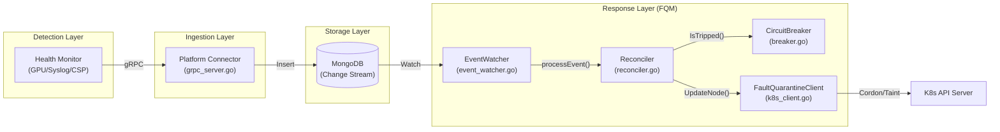
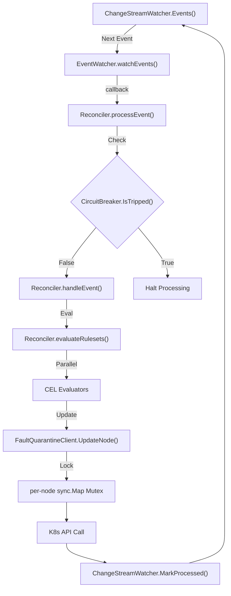

<!-- source: DeepWiki mcp.deepwiki.com · repo NVIDIA/NVSentinel · page 12.3 Performance Tuning · fetched 2026-10-26 -->

# Performance Tuning

Relevant source files

The following files were used as context for generating this wiki page:

- [docs/METRICS.md](docs/METRICS.md)
- [fault-quarantine/main.go](fault-quarantine/main.go)
- [fault-quarantine/pkg/common/common.go](fault-quarantine/pkg/common/common.go)
- [fault-quarantine/pkg/informer/k8s_client.go](fault-quarantine/pkg/informer/k8s_client.go)
- [fault-quarantine/pkg/informer/node_informer.go](fault-quarantine/pkg/informer/node_informer.go)
- [fault-quarantine/pkg/metrics/metrics.go](fault-quarantine/pkg/metrics/metrics.go)
- [fault-quarantine/pkg/reconciler/reconciler.go](fault-quarantine/pkg/reconciler/reconciler.go)
- [fault-quarantine/pkg/reconciler/reconciler_e2e_test.go](fault-quarantine/pkg/reconciler/reconciler_e2e_test.go)
- [node-drainer/pkg/metrics/metrics.go](node-drainer/pkg/metrics/metrics.go)
- [store-client/pkg/client/postgresql_client.go](store-client/pkg/client/postgresql_client.go)
- [tests/fault_management_test.go](tests/fault_management_test.go)
- [tests/fault_quarantine_test.go](tests/fault_quarantine_test.go)
- [tests/scale-tests/.gitignore](tests/scale-tests/.gitignore)
- [tests/scale-tests/PROMETHEUS_QUERIES.md](tests/scale-tests/PROMETHEUS_QUERIES.md)
- [tests/scale-tests/README.md](tests/scale-tests/README.md)
- [tests/scale-tests/cmd/fqm-scale-test/main.go](tests/scale-tests/cmd/fqm-scale-test/main.go)
- [tests/scale-tests/configs/values-v0.4.0-with-mongodb-metrics.yaml](tests/scale-tests/configs/values-v0.4.0-with-mongodb-metrics.yaml)
- [tests/scale-tests/event-generator/main.go](tests/scale-tests/event-generator/main.go)
- [tests/scale-tests/manifests/event-generator-config-fqm-latency.yaml](tests/scale-tests/manifests/event-generator-config-fqm-latency.yaml)
- [tests/scale-tests/manifests/event-generator-daemonset.yaml](tests/scale-tests/manifests/event-generator-daemonset.yaml)
- [tests/scale-tests/manifests/inference-sim-deployment.yaml](tests/scale-tests/manifests/inference-sim-deployment.yaml)
- [tests/scale-tests/manifests/training-sim-deployment.yaml](tests/scale-tests/manifests/training-sim-deployment.yaml)
- [tests/scale-tests/results/API_and_MongoDB_Results.md](tests/scale-tests/results/API_and_MongoDB_Results.md)
- [tests/scale-tests/results/Concurrent_Drain_Results.md](tests/scale-tests/results/Concurrent_Drain_Results.md)
- [tests/scale-tests/results/FQM_Latency_and_Queue_Depth_Results.md](tests/scale-tests/results/FQM_Latency_and_Queue_Depth_Results.md)
- [tests/scale-tests/results/graphs/pods_vs_drain_time.png](tests/scale-tests/results/graphs/pods_vs_drain_time.png)

## Purpose and Scope

This page documents the performance characteristics and scalability considerations for NVSentinel, with a focus on the **Fault Quarantine Module (FQM)** and **Node Drainer**. It details the end-to-end latency from health event detection to node cordoning, throughput limits, circuit breaker overhead, and resource tuning for production environments. Performance data is derived from scale testing at 1500 nodes with cluster failure scenarios ranging from 10% to 50% [tests/scale-tests/README.md:1-17]().

---

## FQM Event Processing Pipeline

The FQM processes fatal health events through a multi-stage pipeline. Understanding the data flow is critical for identifying bottlenecks and tuning performance.

### Pipeline Stages and Code Entities

**Sources:** [fault-quarantine/pkg/reconciler/reconciler.go:176-223](), [fault-quarantine/pkg/eventwatcher/event_watcher.go:123-144](), [store-client/pkg/client/mongodb_client.go:226-232]()

### Sequential Processing Logic

FQM processes events **sequentially** from the database change stream to ensure consistency and prevent race conditions on Kubernetes Node objects. The `Reconciler.processEvent` function is the core execution unit [fault-quarantine/pkg/eventwatcher/event_watcher.go:146-160]().

**Implementation Details:**
- **Serialization:** `EventWatcher` iterates over the event channel sequentially [fault-quarantine/pkg/eventwatcher/event_watcher.go:124-131]().
- **Node Locking:** `UpdateNode` uses a `sync.Map` named `operationMutex` to provide per-node locking, preventing concurrent updates to the same node from different event triggers [fault-quarantine/pkg/informer/k8s_client.go:52-52](), [fault-quarantine/pkg/informer/k8s_client.go:138-142]().
- **Backoff:** Kubernetes API updates use a custom exponential backoff with 10 steps and a 2.0 factor to handle `Conflict` (409) errors, specifically designed to handle node update conflicts between modules [fault-quarantine/pkg/informer/k8s_client.go:143-151]().

**Sources:** [fault-quarantine/pkg/eventwatcher/event_watcher.go:123-144](), [fault-quarantine/pkg/informer/k8s_client.go:138-172]()

---

## Circuit Breaker Tuning

The circuit breaker protects the cluster from mass cordoning during correlated failures (e.g., top-of-rack switch failure). It operates on a sliding window of recent cordon events.

### Performance Overhead

The `IsTripped()` check occurs for every event before processing [fault-quarantine/pkg/reconciler/reconciler.go:407-448](). Its performance depends on the `NodeInformer` cache state.

| Operation | Implementation | Performance Impact |
|-----------|----------------|--------------------|
| **Node Count** | `NodeInformer.GetNodeCounts()` | O(1) from local cache [fault-quarantine/pkg/informer/k8s_client.go:122-131]() |
| **Summation** | Sliding window ring buffer | O(N) where N is number of 1s buckets [fault-quarantine/pkg/breaker/breaker.go:84-134]() |
| **Persistence** | `WriteCircuitBreakerState()` | O(1) K8s ConfigMap update on state change [fault-quarantine/pkg/informer/k8s_client.go:208-228]() |

### Handling Startup Latency

On pod restart, the `NodeInformer` cache must sync before `IsTripped()` can return a valid node count. The system uses `getTotalNodesWithRetry` with the following configuration:
- **Steps:** 10 attempts [fault-quarantine/pkg/informer/k8s_client.go:39-44]()
- **Initial Delay:** 10ms [fault-quarantine/pkg/informer/k8s_client.go:41]()
- **Factor:** 1.5 [fault-quarantine/pkg/informer/k8s_client.go:42]()

**Sources:** [fault-quarantine/pkg/informer/k8s_client.go:39-44](), [fault-quarantine/pkg/breaker/breaker.go:282-337]()

---

## Scale Testing Results (1500 Nodes)

Testing on a 1500-node cluster validates the processing throughput and system limits [tests/scale-tests/README.md:16-17]().

### End-to-End Cordon Throughput

Scale tests demonstrate consistent throughput across different failure magnitudes [tests/scale-tests/README.md:116-120]().

| Scale | Node Count | Total Time | Peak Queue Depth | Avg Throughput |
|-------|------------|------------|------------------|----------------|
| 10% | 150 | 62.2s | 142 | ~2.5 nodes/sec |
| 25% | 375 | 154.6s | 371 | ~2.5 nodes/sec |
| 50% | 750 | 303.7s | 688 | ~2.5 nodes/sec |

**Key Metric:** `fault_quarantine_event_handling_duration_seconds` shows a P50 of **~0.37s** per event [tests/scale-tests/README.md:119-119]().

**Sources:** [tests/scale-tests/README.md:107-122](), [docs/METRICS.md:30-30]()

### Node Drainer Scalability

Node Drainer performance is pod-density dependent. In inference scenarios (high pod count), the drainer is typically limited by the Kubernetes client rate limit [tests/scale-tests/README.md:138-140]().

| Workload Type | Pods/Node | Total Pods (750 nodes) | Drain Time | Limit Factor |
|---------------|-----------|------------------------|------------|--------------|
| Training-sim | 2 | 1,500 | ~2-10 min | Grace Period |
| Inference-sim | 15 | 11,250 | ~8-44 min | K8s QPS Limit |

**Sources:** [tests/scale-tests/README.md:124-142]()

---

## Resource Tuning Recommendations

### CPU and Memory Limits

Based on burst testing at 4,200 events/sec, the following resource allocations are recommended for core components [tests/scale-tests/README.md:96-105]():

| Component | CPU Request | Memory Request | Note |
|-----------|-------------|----------------|------|
| **FQM** | 500m | 512Mi | Sequential processing is CPU-efficient. |
| **Node Drainer** | 1000m | 1Gi | High memory needed for tracking concurrent drains. |
| **MongoDB** | 2000m | 6Gi | Required for large change stream resume tokens [tests/scale-tests/README.md:49-50](). |

### Database Performance Tuning

For MongoDB, performance is improved by using the `BuildInsertOnlyPipeline` to filter events at the database level before they reach the FQM [store-client/pkg/client/mongodb_client.go:226-232]().

**Optimization Checklist:**
1. **Resume Tokens:** Ensure `DeleteResumeToken` is called on circuit breaker reset or cursor mode changes to avoid re-processing old bursts [store-client/pkg/client/postgresql_client.go:124-133](), [fault-quarantine/pkg/reconciler/reconciler.go:169-171]().
2. **Indexing:** Ensure `_id` and `nodename` are indexed for fast lookups during `UpdateDocumentStatus` [store-client/pkg/client/postgresql_client.go:212-230]().
3. **Dry Run Mode:** Enable `DryRun` during initial rollout to validate CEL expressions and annotations without impacting node availability [fault-quarantine/main.go:153-154](), [tests/fault_management_test.go:69-92]().

**Sources:** [fault-quarantine/main.go:136-164](), [store-client/pkg/client/mongodb_client.go:226-232](), [tests/scale-tests/configs/values-v0.4.0-with-mongodb-metrics.yaml:92-119]()

---

## Observability and Performance Monitoring

Monitor these specific Prometheus metrics to detect performance degradation [docs/METRICS.md:22-107]():

| Metric | Threshold | Action |
|--------|-----------|--------|
| `fault_quarantine_event_backlog_count` | > 100 | Check for processing bottlenecks [docs/METRICS.md:29]() |
| `node_drainer_queue_depth` | > 50 | Increase K8s client QPS limits [docs/METRICS.md:83]() |
| `fault_quarantine_breaker_utilization` | > 0.8 | Investigate correlated cluster failures [docs/METRICS.md:64]() |
| `fault_quarantine_processing_errors_total` | > 0 | Check `error_type` for API conflicts [docs/METRICS.md:28]() |

**Sources:** [docs/METRICS.md:22-85](), [fault-quarantine/pkg/metrics/metrics.go:28-205]()

---

