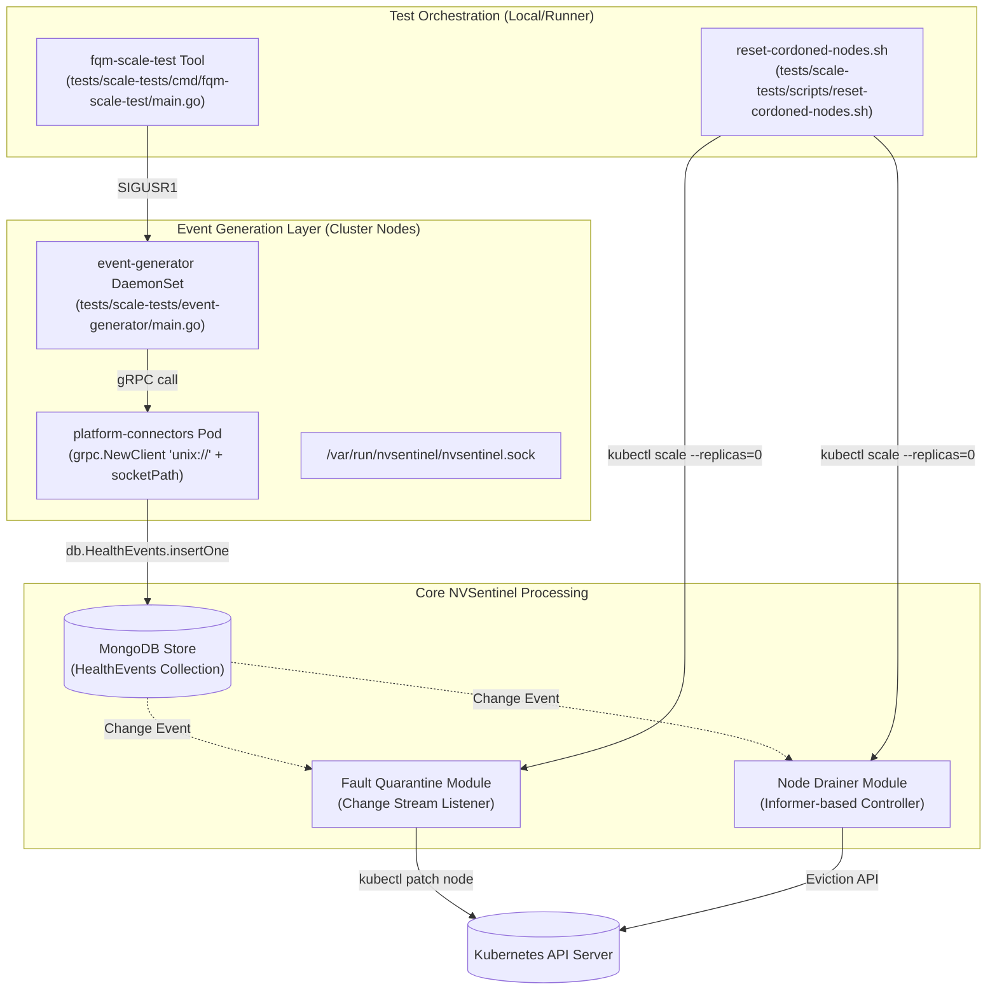
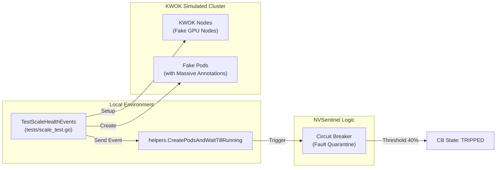

<!-- source: DeepWiki mcp.deepwiki.com · repo NVIDIA/NVSentinel · page 12.4 Scale Testing · fetched 2026-10-26 -->

# Scale Testing

<details>
<summary>Relevant source files</summary>

The following files were used as context for generating this wiki page:

- [.coderabbit.yaml](.coderabbit.yaml)
- [health-monitors/syslog-health-monitor/pkg/syslog-monitor/syslogmonitor.go](health-monitors/syslog-health-monitor/pkg/syslog-monitor/syslogmonitor.go)
- [tests/scale-tests/.gitignore](tests/scale-tests/.gitignore)
- [tests/scale-tests/PROMETHEUS_QUERIES.md](tests/scale-tests/PROMETHEUS_QUERIES.md)
- [tests/scale-tests/README.md](tests/scale-tests/README.md)
- [tests/scale-tests/cmd/fqm-scale-test/main.go](tests/scale-tests/cmd/fqm-scale-test/main.go)
- [tests/scale-tests/configs/node-drainer-mixed-eviction.toml](tests/scale-tests/configs/node-drainer-mixed-eviction.toml)
- [tests/scale-tests/configs/values-v0.4.0-with-mongodb-metrics.yaml](tests/scale-tests/configs/values-v0.4.0-with-mongodb-metrics.yaml)
- [tests/scale-tests/configs/values-v0.8.0-with-mongodb-metrics.yaml](tests/scale-tests/configs/values-v0.8.0-with-mongodb-metrics.yaml)
- [tests/scale-tests/event-generator/main.go](tests/scale-tests/event-generator/main.go)
- [tests/scale-tests/manifests/event-generator-config-fqm-latency.yaml](tests/scale-tests/manifests/event-generator-config-fqm-latency.yaml)
- [tests/scale-tests/manifests/event-generator-daemonset.yaml](tests/scale-tests/manifests/event-generator-daemonset.yaml)
- [tests/scale-tests/manifests/inference-sim-deployment.yaml](tests/scale-tests/manifests/inference-sim-deployment.yaml)
- [tests/scale-tests/manifests/mixed-eviction-allow-completion.yaml](tests/scale-tests/manifests/mixed-eviction-allow-completion.yaml)
- [tests/scale-tests/manifests/mixed-eviction-delete-timeout.yaml](tests/scale-tests/manifests/mixed-eviction-delete-timeout.yaml)
- [tests/scale-tests/manifests/mixed-eviction-immediate.yaml](tests/scale-tests/manifests/mixed-eviction-immediate.yaml)
- [tests/scale-tests/manifests/training-sim-deployment.yaml](tests/scale-tests/manifests/training-sim-deployment.yaml)
- [tests/scale-tests/results/API_and_MongoDB_Results.md](tests/scale-tests/results/API_and_MongoDB_Results.md)
- [tests/scale-tests/results/Concurrent_Drain_Results.md](tests/scale-tests/results/Concurrent_Drain_Results.md)
- [tests/scale-tests/results/FQM_Latency_and_Queue_Depth_Results.md](tests/scale-tests/results/FQM_Latency_and_Queue_Depth_Results.md)
- [tests/scale-tests/results/Mixed_Eviction_Results.md](tests/scale-tests/results/Mixed_Eviction_Results.md)
- [tests/scale-tests/results/graphs/pods_vs_drain_time.png](tests/scale-tests/results/graphs/pods_vs_drain_time.png)
- [tests/scale-tests/scripts/reset-cordoned-nodes.sh](tests/scale-tests/scripts/reset-cordoned-nodes.sh)
- [tests/scale_test.go](tests/scale_test.go)
- [tests/uat/tests.sh](tests/uat/tests.sh)

</details>


## Purpose and Scope

This document describes the scale testing framework used to validate NVSentinel's performance and scalability at production scale (1500+ nodes). The testing framework provides tools, methodologies, and workload simulators to answer critical operational questions about system behavior under load, including API server impact, MongoDB performance, and end-to-end latency during mass failure events.

**Covered in this page:**
- Test environment specifications and cluster scaling rationale.
- Testing framework architecture and tools (Event Generator, FQM Scale Test Tool).
- Workload simulation for Inference and Training patterns.
- Metrics collection via Prometheus and key PromQL queries.
- KWOK-based testing for simulated node environments.

**Sources:** [tests/scale-tests/README.md:1-23](), [tests/scale-tests/results/API_and_MongoDB_Results.md:1-12]()

---

## Test Objectives

The scale testing framework validates NVSentinel's behavior at production scale by addressing the following key performance indicators:

| Objective | Test Category | Component Focus |
|-----------|---------------|-----------------|
| API Server Impact | Sustained/Burst Load | `Platform Connector`, `K8s API` |
| MongoDB Performance | Write Throughput | `MongoDB Store`, `ReplicaSet` |
| FQM Latency | Mass Failure Simulation | `Fault Quarantine`, `Change Streams` |
| Concurrent Drains | Mixed Eviction Modes | `Node Drainer`, `K8s Eviction API` |

All tests are performed on a **1500-node cluster** using **NVSentinel v0.4.0** (or v0.8.0 for mixed eviction mode testing).

**Sources:** [tests/scale-tests/README.md:8-17](), [tests/scale-tests/results/API_and_MongoDB_Results.md:30-54]()

---

## Test Framework Architecture

### Component Interaction Space

This diagram bridges the high-level test orchestration with the specific code entities and Kubernetes resources involved in scale testing.



**Sources:** [tests/scale-tests/results/FQM_Latency_and_Queue_Depth_Results.md:21-32](), [tests/scale-tests/event-generator/main.go:91-102](), [tests/scale-tests/scripts/reset-cordoned-nodes.sh:20-24]()

---

## Event Generator

### Implementation Details

The `event-generator` is a Go application designed to simulate production-level event traffic. It supports two primary modes: **Continuous Generation** (for sustained load tests) and **On-Demand** (via `SIGUSR1` for latency benchmarks).

| Mode | Trigger | Logic |
|------|---------|-------|
| **Continuous** | `EVENT_RATE` env | `continuousEventLoop` calculates intervals and sends weighted random events. |
| **On-Demand** | `syscall.SIGUSR1` | `signal.Notify` triggers an immediate fatal GPU XID event for FQM testing. |

**Code Reference:** The generator uses `pb.NewPlatformConnectorClient(conn)` to communicate with the local `platform-connector` over a Unix Domain Socket (UDS) [tests/scale-tests/event-generator/main.go:102-138]().

### Event Distribution (Weighted Random)
In `continuousEventLoop`, the generator produces a realistic mix of events using weighted random selection [tests/scale-tests/event-generator/main.go:141-163]():
- **64%**: Healthy GPU events (`generateHealthyGpuEvent`)
- **24%**: System info events (`generateSystemInfoEvent`)
- **8%**: Fatal GPU errors (triggers `Fault Quarantine`)
- **4%**: NVSwitch warnings

**Sources:** [tests/scale-tests/event-generator/main.go:164-186](), [tests/scale-tests/results/API_and_MongoDB_Results.md:17-21]()

---

## Workload Simulation

### Inference vs. Training Patterns

To test the `Node Drainer` at scale, the framework uses deployments that mimic real-world pod densities and resource requirements.

| Characteristic | Inference Sim (`inference-sim-deployment.yaml`) | Training Sim (`training-sim-deployment.yaml`) |
|----------------|------------------------------------------------|-----------------------------------------------|
| **Pod Density** | 15 pods/node (22,500 total) | 2 pods/node (3,000 total) |
| **Termination Grace** | 30 seconds | 60 seconds |
| **Resource Request** | 10m CPU / 32Mi Memory | 1500m CPU / 3Gi Memory |
| **Scale Bottleneck** | Hits K8s client 5/sec rate limit | Limited by termination grace period |

**Sources:** [tests/scale-tests/README.md:128-133](), [tests/scale-tests/results/Concurrent_Drain_Results.md:135-140]()

---

## Scale Testing with KWOK

For local or low-resource scale testing, NVSentinel integrates with **KWOK** (Kubernetes WithOut Kubelet) to simulate massive node counts without the overhead of real VMs.

### KWOK Test Execution Flow



**Implementation:** The `TestScaleHealthEvents` function uses `helpers.GetAllNodesNames` to identify KWOK nodes and `helpers.SetupQuarantineTestWithOptions` to configure a 40% circuit breaker threshold [tests/scale_test.go:50-86](). It also tests the impact of "massive annotations" (30KB strings) on API server performance during pod creation [tests/scale_test.go:108-115](). The test verifies that the circuit breaker trips once the threshold of cordoned nodes is exceeded [tests/scale_test.go:130-174]().

**Sources:** [tests/scale_test.go:50-176](), [tests/scale-tests/README.md:107-122]()

---

## Metrics and Capacity Planning

### Key Performance Findings (1500 Nodes)

| Metric | Result | Context |
|--------|--------|---------|
| **Cordon Rate** | ~2.5 nodes/sec | Sequential processing in FQM |
| **API Latency (P75)** | ~20ms | Stable up to 500 events/sec |
| **MongoDB Memory** | 2.6 GB | During heavy sustained load (500 events/sec) |
| **Drain Rate (Inference)** | ~8-44 min | Rate limited by K8s API client (5/sec) |

### Essential Prometheus Queries

For monitoring scale tests, the following PromQL queries are utilized [tests/scale-tests/PROMETHEUS_QUERIES.md:1-106]():

**FQM Event Backlog:**
```promql
# Current pending events in FQM queue
fault_quarantine_event_backlog_count
```
**MongoDB Write Latency:**
```promql
# Average time for Platform Connector to write to DB
sum(rate(platform_connector_workqueue_work_duration_seconds_databaseStore_sum[5m])) 
/ sum(rate(platform_connector_workqueue_work_duration_seconds_databaseStore_count[5m]))
```
**Node Drainer Error Tracking:**
```promql
# Processing errors by type (e.g., context_deadline_exceeded)
sum(node_drainer_processing_errors_total) by (error_type)
```

**Sources:** [tests/scale-tests/results/FQM_Latency_and_Queue_Depth_Results.md:92-110](), [tests/scale-tests/PROMETHEUS_QUERIES.md:52-106]()

---

## Operational Procedures

### Cluster Reset and Cleanup

Large scale tests require a clean state to ensure change stream resume tokens do not process stale events. The `reset-cordoned-nodes.sh` script automates this:

1.  **Scale Down**: Scales `fault-quarantine`, `node-drainer`, and `fault-remediation` to 0 [tests/scale-tests/scripts/reset-cordoned-nodes.sh:22-24]().
2.  **Bulk Uncordon**: Uses `xargs -P 20` to uncordon nodes in parallel [tests/scale-tests/scripts/reset-cordoned-nodes.sh:28]().
3.  **Label Cleanup**: Removes `k8saas.nvidia.com/cordon-by` and other NVSentinel-specific metadata [tests/scale-tests/scripts/reset-cordoned-nodes.sh:32-36]().
4.  **Database Wipe**: Requires manual execution of `db.HealthEvents.deleteMany({})` and `db.ResumeTokens.deleteMany({})` to clear the persistent state [tests/scale-tests/scripts/reset-cordoned-nodes.sh:56-57]().

**Sources:** [tests/scale-tests/scripts/reset-cordoned-nodes.sh:1-58](), [tests/scale-tests/results/FQM_Latency_and_Queue_Depth_Results.md:44-57]()

---

