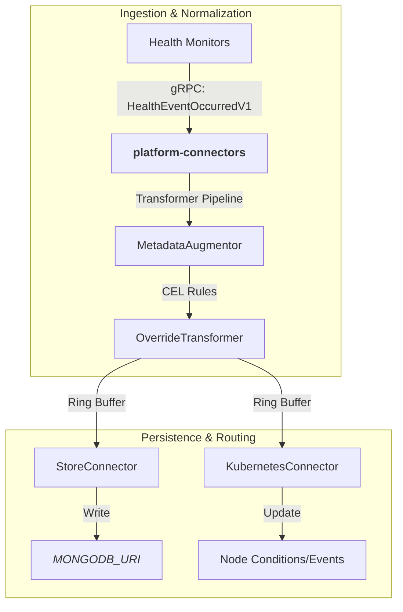
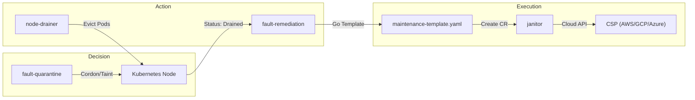

<!-- source: DeepWiki mcp.deepwiki.com · repo NVIDIA/NVSentinel · page 13 Module Reference · fetched 2026-10-26 -->

# Module Reference

Relevant source files

The following files were used as context for generating this wiki page:

- [commons/go.sum](commons/go.sum)
- [docs/configuration/event-exporter.md](docs/configuration/event-exporter.md)
- [docs/configuration/fault-quarantine.md](docs/configuration/fault-quarantine.md)
- [docs/configuration/fault-remediation.md](docs/configuration/fault-remediation.md)
- [docs/configuration/gpu-health-monitor.md](docs/configuration/gpu-health-monitor.md)
- [docs/configuration/kubernetes-object-monitor.md](docs/configuration/kubernetes-object-monitor.md)
- [docs/configuration/labeler.md](docs/configuration/labeler.md)
- [docs/configuration/mongodb-store.md](docs/configuration/mongodb-store.md)
- [docs/configuration/node-drainer.md](docs/configuration/node-drainer.md)
- [docs/configuration/platform-connectors.md](docs/configuration/platform-connectors.md)
- [docs/configuration/syslog-health-monitor.md](docs/configuration/syslog-health-monitor.md)
- [docs/platform-connectors.md](docs/platform-connectors.md)
- [event-exporter/go.mod](event-exporter/go.mod)
- [event-exporter/go.sum](event-exporter/go.sum)
- [fault-quarantine/go.mod](fault-quarantine/go.mod)
- [fault-quarantine/go.sum](fault-quarantine/go.sum)
- [fault-remediation/go.mod](fault-remediation/go.mod)
- [fault-remediation/go.sum](fault-remediation/go.sum)
- [health-events-analyzer/go.mod](health-events-analyzer/go.mod)
- [health-events-analyzer/go.sum](health-events-analyzer/go.sum)
- [health-monitors/syslog-health-monitor/go.mod](health-monitors/syslog-health-monitor/go.mod)
- [node-drainer/go.mod](node-drainer/go.mod)
- [node-drainer/go.sum](node-drainer/go.sum)
- [platform-connectors/go.mod](platform-connectors/go.mod)
- [platform-connectors/go.sum](platform-connectors/go.sum)
- [store-client/go.mod](store-client/go.mod)

This page provides detailed reference documentation for all NVSentinel modules, including their entry points, configuration options, dependencies, and deployment characteristics. This is a high-level parent page; for specific details, please refer to the child pages linked in each section.

## Module Overview

NVSentinel consists of multiple Go and Python modules organized into functional categories. Each module is independently versioned and can be deployed separately based on operational requirements.

**Core Processing Modules**
- `platform-connectors`: gRPC server for health event ingestion, normalization, and persistence [platform-connectors/go.mod:1-24]().
- `health-events-analyzer`: Pattern detection, aggregation, and recommendation engine [health-events-analyzer/go.mod:1-20]().

**Fault Management Modules**
- `fault-quarantine`: Node cordoning with CEL-based rules and circuit breaker [fault-quarantine/go.mod:1-24]().
- `node-drainer`: Pod eviction with namespace-specific strategies [node-drainer/go.mod:1-27]().
- `fault-remediation`: Maintenance CR creation via Go templates [fault-remediation/go.mod:1-26]().
- `janitor`: Multi-cloud maintenance execution (reboots, terminations) [distros/kubernetes/nvsentinel/values-full.yaml:171-175]().

**Health Monitor Modules**
- `gpu-health-monitor`: DCGM-based hardware monitoring [distros/kubernetes/nvsentinel/values.yaml:144-145]().
- `syslog-health-monitor`: Journald log parsing for XIDs and GPU resets [health-monitors/syslog-health-monitor/go.mod:1-19]().
- `csp-health-monitor`: Cloud provider maintenance event monitoring [distros/kubernetes/nvsentinel/values.yaml:158-159]().
- `kubernetes-object-monitor`: Resource-based health checks [distros/kubernetes/nvsentinel/values.yaml:172-173]().

**Support Service Modules**
- `metadata-collector`: GPU topology and inventory discovery [distros/kubernetes/nvsentinel/values.yaml:164-165]().
- `labeler`: Automatic node labeling for GPU drivers and DCGM [distros/kubernetes/nvsentinel/values.yaml:162-163]().
- `log-collector`: Diagnostic log gathering before remediation [docs/configuration/fault-remediation.md:210-213]().
- `event-exporter`: External event streaming via CloudEvents [event-exporter/go.mod:1-19]().

Sources: [platform-connectors/go.mod:1-24](), [health-events-analyzer/go.mod:1-20](), [fault-quarantine/go.mod:1-24](), [node-drainer/go.mod:1-27](), [fault-remediation/go.mod:1-26](), [health-monitors/syslog-health-monitor/go.mod:1-19](), [event-exporter/go.mod:1-19]()

## Module Architecture

Each module follows a standardized structure with consistent patterns for configuration, initialization, and execution. Most modules utilize the internal `commons`, `data-models`, and `store-client` libraries.

### Natural Language to Code Entity Mapping: Processing Pipeline
This diagram maps the logical stages of event processing to the specific code entities and configurations that implement them.

Sources: [docs/platform-connectors.md:21-37](), [docs/configuration/platform-connectors.md:33-56](), [docs/configuration/platform-connectors.md:114-128]()

### Natural Language to Code Entity Mapping: Remediation Workflow
This diagram associates the fault response lifecycle with the controllers and templates used in the codebase.

Sources: [docs/configuration/fault-remediation.md:45-77](), [docs/configuration/fault-remediation.md:130-152](), [distros/kubernetes/nvsentinel/values-tilt.yaml:265-285]()

## Core Processing Modules
The core processing layer is responsible for event ingestion and analysis. The `platform-connectors` module serves as the central gRPC hub [platform-connectors/go.mod:18](), while the `health-events-analyzer` provides high-level pattern recognition [health-events-analyzer/go.mod:1-20]().

For details, see [Core Processing Modules](#13.1).

| Feature | Code Reference | Configuration |
|---------|----------------|---------------|
| gRPC API | `pb.PlatformConnectorClient` | `global.metricsPort` |
| Persistence | `store-client` | `global.datastore.provider` |
| Enrichment | `MetadataAugmentor` | `platformConnector.transformers.MetadataAugmentor` |

Sources: [platform-connectors/go.mod:11-12](), [health-events-analyzer/go.mod:9-11](), [docs/platform-connectors.md:88-114]()

## Fault Management Modules
Fault management modules automate the response to detected failures. This includes quarantining nodes via `fault-quarantine` using CEL expressions [fault-quarantine/go.mod:8](), clearing workloads via `node-drainer` [node-drainer/go.mod:1-27](), and triggering repairs via `fault-remediation` [fault-remediation/go.mod:1-26]().

For details, see [Fault Management Modules](#13.2).

- **Fault Quarantine**: Uses `google/cel-go` to evaluate `isFatal` events and apply node taints [fault-quarantine/go.mod:8]().
- **Node Drainer**: Orchestrates pod evictions once a node is quarantined [node-drainer/go.mod:12]().
- **Fault Remediation**: Generates Custom Resources (CRs) based on `RecommendedAction` codes using Go templates and Kubernetes client-go [fault-remediation/go.mod:22]().

Sources: [fault-quarantine/go.mod:8](), [node-drainer/go.mod:12](), [fault-remediation/go.mod:20-22]()

## Health Monitor Modules
Health monitors are the primary sensors of the system. They detect faults at different layers (Hardware, OS, Cloud, Kubernetes) and report them to the platform connectors via gRPC [health-monitors/syslog-health-monitor/go.mod:16]().

For details, see [Health Monitor Modules](#13.3).

- **GPU Health Monitor**: Interfaces with DCGM for XID and hardware errors [distros/kubernetes/nvsentinel/values.yaml:110-118]().
- **Syslog Health Monitor**: Parses `journald` using `coreos/go-systemd` for critical GPU events like "fallen off the bus" [health-monitors/syslog-health-monitor/go.mod:8]().
- **CSP Health Monitor**: Polls cloud metadata services for scheduled maintenance [distros/kubernetes/nvsentinel/values.yaml:158-159]().

Sources: [health-monitors/syslog-health-monitor/go.mod:8-16](), [distros/kubernetes/nvsentinel/values.yaml:144-159]()

## Support Service Modules
Support services provide auxiliary functionality such as diagnostic log collection, node labeling, and exporting events to external systems.

For details, see [Support Service Modules](#13.4).

- **Event Exporter**: Uses `store-client` to watch for events and stream them via CloudEvents/Protobuf [event-exporter/go.mod:11-17]().
- **Log Collector**: Deployed as dynamic jobs to capture node state before reboots [docs/configuration/fault-remediation.md:210-213]().
- **Metadata Collector & Labeler**: Ensure nodes have consistent metadata for enrichment [distros/kubernetes/nvsentinel/values.yaml:162-165]().

Sources: [event-exporter/go.mod:11-17](), [distros/kubernetes/nvsentinel/values.yaml:162-165]()

---

