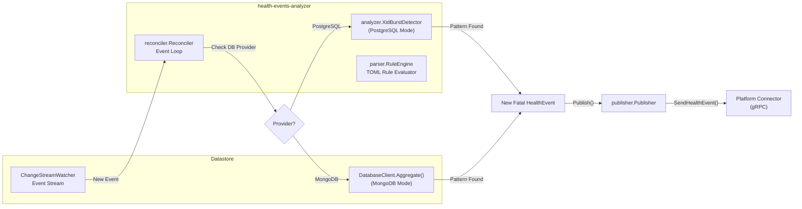
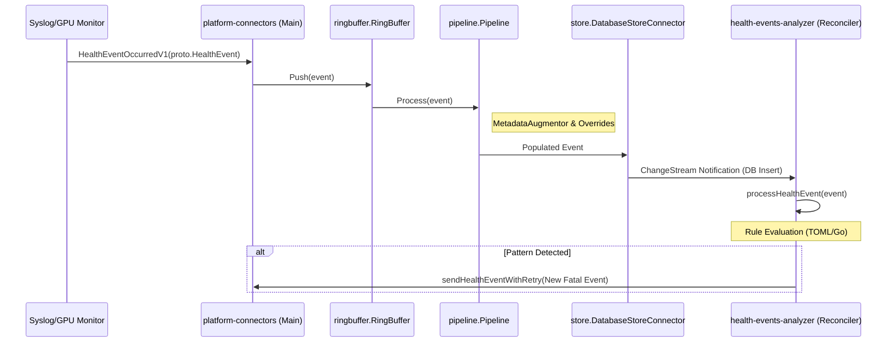

<!-- source: DeepWiki mcp.deepwiki.com · repo NVIDIA/NVSentinel · page 13.1 Core Processing Modules · fetched 2026-10-26 -->

# Core Processing Modules

<details>
<summary>Relevant source files</summary>

The following files were used as context for generating this wiki page:

- [distros/kubernetes/nvsentinel/charts/health-events-analyzer/values.yaml](distros/kubernetes/nvsentinel/charts/health-events-analyzer/values.yaml)
- [distros/kubernetes/nvsentinel/templates/configmap.yaml](distros/kubernetes/nvsentinel/templates/configmap.yaml)
- [docs/configuration/event-exporter.md](docs/configuration/event-exporter.md)
- [docs/configuration/fault-quarantine.md](docs/configuration/fault-quarantine.md)
- [docs/configuration/fault-remediation.md](docs/configuration/fault-remediation.md)
- [docs/configuration/gpu-health-monitor.md](docs/configuration/gpu-health-monitor.md)
- [docs/configuration/kubernetes-object-monitor.md](docs/configuration/kubernetes-object-monitor.md)
- [docs/configuration/labeler.md](docs/configuration/labeler.md)
- [docs/configuration/mongodb-store.md](docs/configuration/mongodb-store.md)
- [docs/configuration/node-drainer.md](docs/configuration/node-drainer.md)
- [docs/configuration/platform-connectors.md](docs/configuration/platform-connectors.md)
- [docs/configuration/syslog-health-monitor.md](docs/configuration/syslog-health-monitor.md)
- [docs/platform-connectors.md](docs/platform-connectors.md)
- [health-events-analyzer/main.go](health-events-analyzer/main.go)
- [health-events-analyzer/pkg/config/rules.go](health-events-analyzer/pkg/config/rules.go)
- [health-events-analyzer/pkg/publisher/publisher.go](health-events-analyzer/pkg/publisher/publisher.go)
- [health-events-analyzer/pkg/reconciler/reconciler.go](health-events-analyzer/pkg/reconciler/reconciler.go)
- [health-events-analyzer/pkg/reconciler/reconciler_test.go](health-events-analyzer/pkg/reconciler/reconciler_test.go)
- [platform-connectors/main.go](platform-connectors/main.go)
- [platform-connectors/pkg/connectors/kubernetes/k8s_connector.go](platform-connectors/pkg/connectors/kubernetes/k8s_connector.go)
- [platform-connectors/pkg/connectors/kubernetes/k8s_connector_envtest_test.go](platform-connectors/pkg/connectors/kubernetes/k8s_connector_envtest_test.go)
- [platform-connectors/pkg/connectors/kubernetes/k8s_platform_connector_test.go](platform-connectors/pkg/connectors/kubernetes/k8s_platform_connector_test.go)
- [platform-connectors/pkg/connectors/kubernetes/metrics.go](platform-connectors/pkg/connectors/kubernetes/metrics.go)
- [platform-connectors/pkg/connectors/kubernetes/process_node_events.go](platform-connectors/pkg/connectors/kubernetes/process_node_events.go)
- [platform-connectors/pkg/connectors/store/store_connector.go](platform-connectors/pkg/connectors/store/store_connector.go)
- [platform-connectors/pkg/connectors/store/store_connector_test.go](platform-connectors/pkg/connectors/store/store_connector_test.go)
- [platform-connectors/pkg/ringbuffer/metrics.go](platform-connectors/pkg/ringbuffer/metrics.go)
- [platform-connectors/pkg/ringbuffer/ring_buffer.go](platform-connectors/pkg/ringbuffer/ring_buffer.go)
- [platform-connectors/pkg/ringbuffer/ring_buffer_test.go](platform-connectors/pkg/ringbuffer/ring_buffer_test.go)
- [tests/health_events_analyzer_test.go](tests/health_events_analyzer_test.go)
- [tests/helpers/health_events_analyzer.go](tests/helpers/health_events_analyzer.go)
- [tests/helpers/kube.go](tests/helpers/kube.go)
- [tests/syslog_health_monitor_test.go](tests/syslog_health_monitor_test.go)

</details>


This page documents the core event processing infrastructure of NVSentinel, focusing on the **Platform Connectors** and the **Health Events Analyzer**. These modules handle the ingestion, transformation, persistence, and complex pattern analysis of health events.

---

## Platform Connectors

The Platform Connectors module acts as the central ingestion gateway for all health monitors (GPU, Syslog, CSP, and K8s Object monitors). It provides a gRPC interface for receiving events and manages a processing pipeline that enriches events before persisting them to the datastore.

### Architecture and Data Flow

The module is built around a ring-buffer architecture to decouple gRPC reception from synchronous processing and storage operations.

Title: Platform Connectors Internal Data Flow
```mermaid
graph TB
    subgraph "Ingestion Layer"
        GRPCServer["server.go<br/>gRPC Server"]
        HealthMonitors["Health Monitors<br/>(GPU, Syslog, etc.)"]
    end

    subgraph "Processing Pipeline"
        RingBuffer["ringbuffer.RingBuffer<br/>Internal Queue"]
        Pipeline["pipeline.Pipeline<br/>Transformer Chain"]
        MetadataAug["MetadataAugmentor<br/>K8s Labels/Metadata"]
        Overrides["OverrideTransformer<br/>Severity/Action Rules"]
    end

    subgraph "Output Connectors"
        K8sConnector["kubernetes.K8sConnector<br/>Node Conditions"]
        StoreConnector["store.DatabaseStoreConnector<br/>MongoDB/PostgreSQL"]
        GRPCSink["grpcsink.GRPCSinkConnector<br/>External Forwarding"]
    end

    HealthMonitors -->|"HealthEventOccurredV1()"| GRPCServer
    GRPCServer -->|"Push()"| RingBuffer
    RingBuffer -->|"Pop()"| Pipeline
    Pipeline --> MetadataAug
    MetadataAug --> Overrides
    Overrides -->|"Transformed Event"| K8sConnector
    Overrides -->|"Transformed Event"| StoreConnector
    Overrides -->|"Transformed Event"| GRPCSink
    
    K8sConnector -->|"UpdateStatus()"| K8sAPI[("Kubernetes API<br/>Node Status")]
    StoreConnector -->|"Insert()"| DB[( "HealthEvents Store" )]
```

**Sources:** [platform-connectors/main.go:60-178](), [platform-connectors/pkg/ringbuffer/ring_buffer.go:1-50](), [platform-connectors/pkg/pipeline/pipeline.go:1-40]()

### Key Components

#### 1. gRPC Ingestion Server
The server implements the `HealthEventsV1` service. It validates incoming `HealthEvents` and pushes them into the internal `RingBuffer`. It supports trace correlation by extracting or generating trace IDs for distributed observability using `tracing.TraceIDFromMetadata`.
**Sources:** [platform-connectors/main.go:60-87](), [platform-connectors/pkg/server/server.go:1-100]()

#### 2. Processing Pipeline
The pipeline consists of ordered transformers defined in the `pipeline` field of the configuration.
*   **Metadata Augmentor**: Queries the Kubernetes API to enrich events with node labels, PCI addresses, and GPU UUIDs.
*   **Override Transformer**: Applies rule-based overrides to modify `isFatal`, `isHealthy`, or `recommendedAction` based on custom logic defined in `overrides.toml`.
**Sources:** [platform-connectors/main.go:180-210](), [distros/kubernetes/nvsentinel/templates/configmap.yaml:40-75]()

#### 3. Kubernetes Connector
This connector maps `HealthEvents` to Kubernetes **Node Conditions**. It partitions events by `NodeName` and `CheckName`, aggregating messages to fit within the `MaxNodeConditionMessageLength` limit.
*   **Message Compaction**: If multiple events occur for the same check, `aggregateEventMessages` and `truncateNodeConditionMessage` ensure the most recent fault information is visible while staying under the `CompactedHealthEventMsgLen` limit.
*   **Status Management**: Sets condition status to `ConditionTrue` for faults and `ConditionFalse` for healthy events, updating `LastTransitionTime` only on status changes.
**Sources:** [platform-connectors/pkg/connectors/kubernetes/process_node_events.go:51-118](), [platform-connectors/pkg/connectors/kubernetes/process_node_events.go:160-209](), [platform-connectors/main.go:122-132]()

---

## Health Events Analyzer

The Health Events Analyzer is a complex event processing (CEP) engine. It watches the datastore for sequences of events that, when combined, indicate a more severe issue than a single event would suggest.

### Pattern Detection Logic

The analyzer supports two detection backends depending on the configured datastore:
1.  **MongoDB Backend**: Uses heavy-weight aggregation pipelines with `$setWindowFields` to detect patterns directly in the database.
2.  **PostgreSQL Backend**: Uses the `XidBurstDetector` (a Go-based implementation in `analyzer.XidBurstDetector`) to perform sliding window analysis on events fetched from Postgres.

Title: Health Events Analyzer Reconciliation Loop


**Sources:** [health-events-analyzer/pkg/reconciler/reconciler.go:64-137](), [health-events-analyzer/pkg/reconciler/reconciler.go:140-195]()

### Core Analysis Rules

The analyzer is configured via TOML rules defined in `config.HealthEventsAnalyzerRule`. Key patterns detected include:

| Rule Name | Logic | Recommended Action |
|-----------|-------|--------------------|
| `MultipleRemediations` | Detects if a node has undergone 5+ fatal remediations (`faultremediated.value: true`) within 7 days. | `CONTACT_SUPPORT` |
| `RepeatedXIDErrorOnSameGPU` | Detects 5+ fatal XIDs (excluding XID 31) on the same GPU UUID within 24 hours. | `CONTACT_SUPPORT` |
| `RepeatedXID31OnSameGPU` | Identifies bursts of XID 31 (Misaligned Address) on a single GPU. | `RESTART_VM` |

**Sources:** [distros/kubernetes/nvsentinel/charts/health-events-analyzer/values.yaml:70-205](), [health-events-analyzer/pkg/config/rules.go:23-32](), [tests/health_events_analyzer_test.go:44-86]()

### Implementation Details

*   **Reconciler**: Implements the `processHealthEvent` handler. It manages OpenTelemetry spans and links them to the original trace ID found in the event metadata to provide end-to-end visibility.
*   **XidBurstDetector**: When running against PostgreSQL, this component calculates sliding windows for XID errors using `NewXidBurstDetectorWithConfig`.
*   **Publisher**: Sends the newly generated events back to the Platform Connector via `sendHealthEventWithRetry`. It clones the original event and updates the `Agent` to `health-events-analyzer`.
**Sources:** [health-events-analyzer/pkg/reconciler/reconciler.go:140-180](), [health-events-analyzer/pkg/reconciler/reconciler.go:75-86](), [health-events-analyzer/pkg/publisher/publisher.go:118-168]()

---

## Internal Data Flow: Ingestion to Analysis

The following diagram and table bridge the "Natural Language" concepts of health monitoring to the specific "Code Entities" that handle the data.

| System Concept | Code Entity | File Path |
|----------------|-------------|-----------|
| Event Ingestion | `server.InitializeAndAttachRingBufferForConnectors` | [platform-connectors/pkg/server/server.go]() |
| Pattern Rule | `HealthEventsAnalyzerRule` | [health-events-analyzer/pkg/config/rules.go]() |
| Event Storage | `datastore.NewDataStore` | [store-client/pkg/datastore/datastore.go]() |
| Node Condition | `processNodeCondition` | [platform-connectors/pkg/connectors/kubernetes/process_node_events.go]() |
| Event Retry | `sendHealthEventWithRetry` | [health-events-analyzer/pkg/publisher/publisher.go]() |

Title: End-to-End Event Processing Sequence


**Sources:** [platform-connectors/main.go:107-153](), [health-events-analyzer/pkg/reconciler/reconciler.go:140-195](), [health-events-analyzer/pkg/publisher/publisher.go:58-103](), [tests/helpers/health_events_analyzer.go:49-94]()

---

