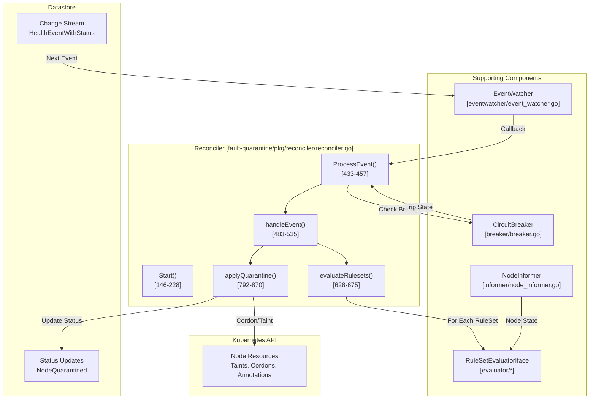
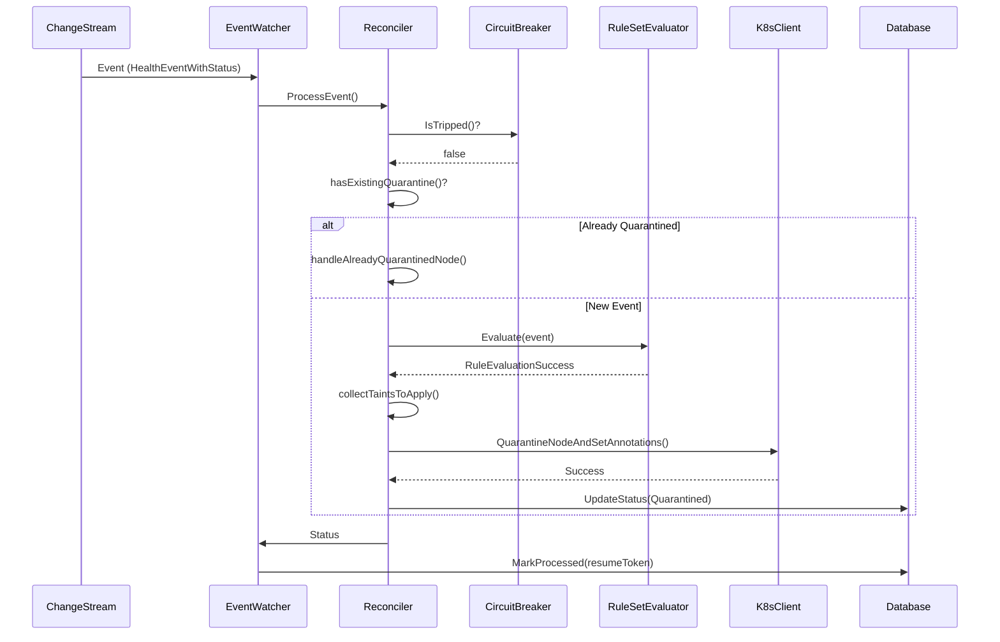
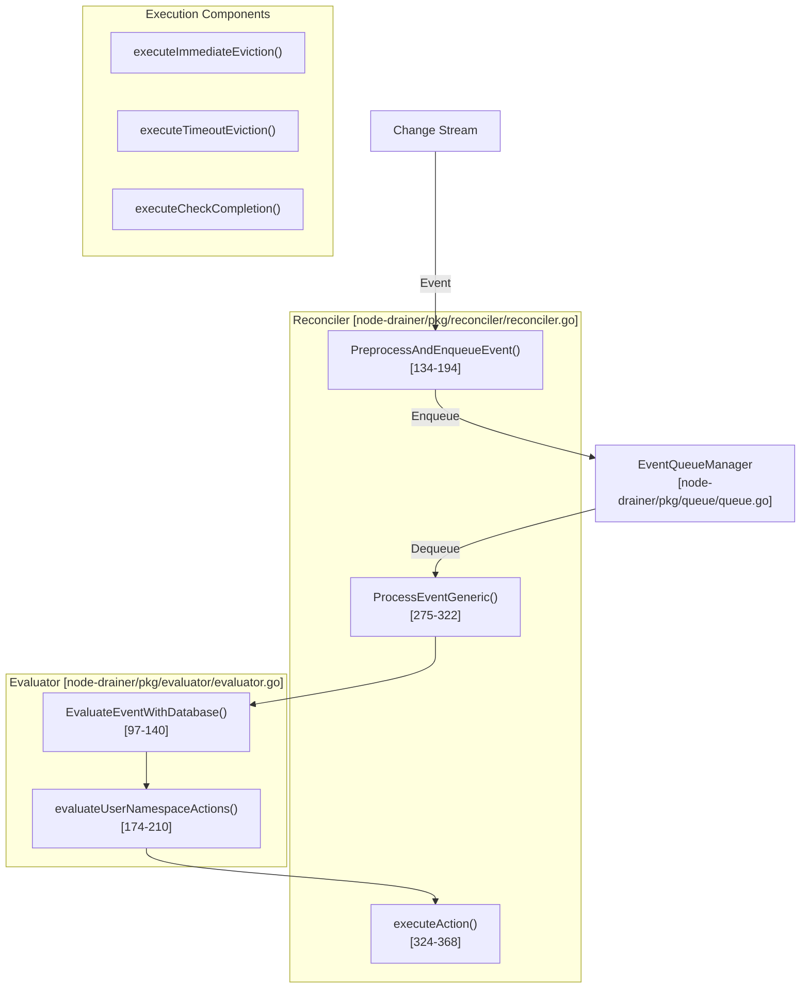
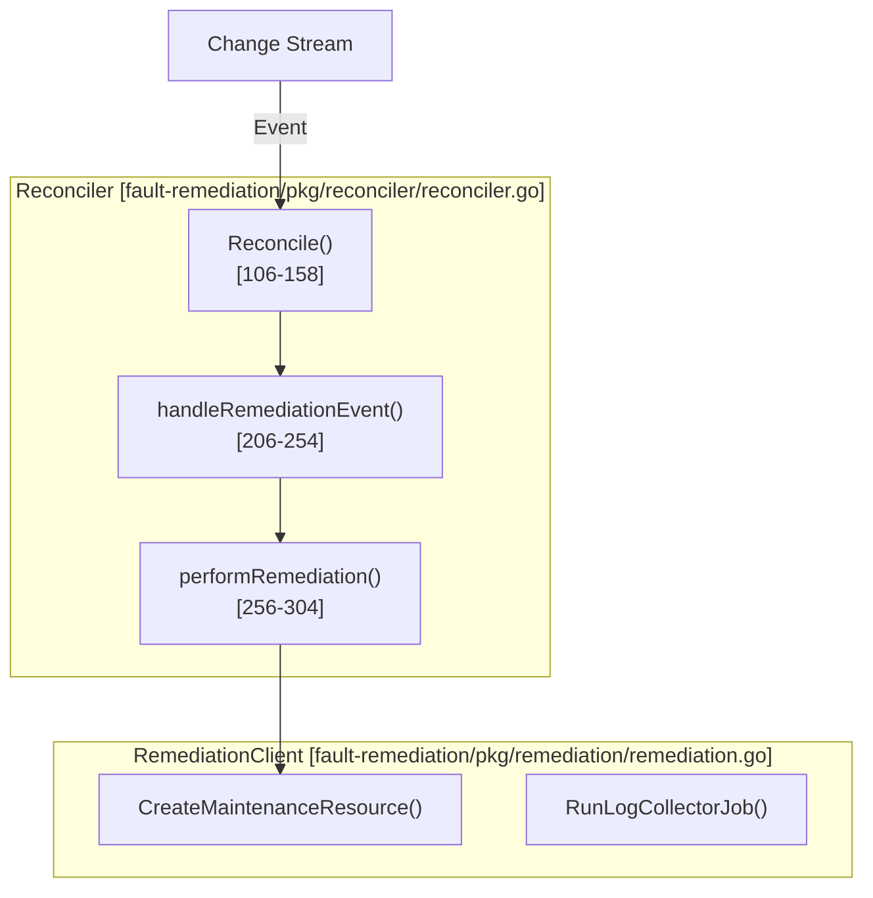
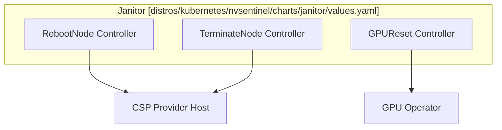
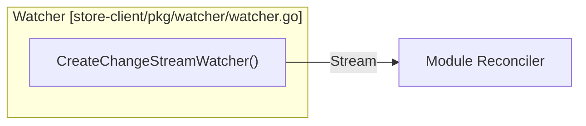

<!-- source: DeepWiki mcp.deepwiki.com · repo NVIDIA/NVSentinel · page 13.2 Fault Management Modules · fetched 2026-10-26 -->

# Fault Management Modules

<details>
<summary>Relevant source files</summary>

The following files were used as context for generating this wiki page:

- [distros/kubernetes/nvsentinel/charts/fault-remediation/values.yaml](distros/kubernetes/nvsentinel/charts/fault-remediation/values.yaml)
- [distros/kubernetes/nvsentinel/charts/janitor/crds/janitor.dgxc.nvidia.com_gpuresets.yaml](distros/kubernetes/nvsentinel/charts/janitor/crds/janitor.dgxc.nvidia.com_gpuresets.yaml)
- [distros/kubernetes/nvsentinel/charts/janitor/crds/janitor.dgxc.nvidia.com_rebootnodes.yaml](distros/kubernetes/nvsentinel/charts/janitor/crds/janitor.dgxc.nvidia.com_rebootnodes.yaml)
- [distros/kubernetes/nvsentinel/charts/janitor/crds/janitor.dgxc.nvidia.com_terminatenodes.yaml](distros/kubernetes/nvsentinel/charts/janitor/crds/janitor.dgxc.nvidia.com_terminatenodes.yaml)
- [distros/kubernetes/nvsentinel/charts/janitor/templates/configmap.yaml](distros/kubernetes/nvsentinel/charts/janitor/templates/configmap.yaml)
- [docs/METRICS.md](docs/METRICS.md)
- [fault-quarantine/main.go](fault-quarantine/main.go)
- [fault-quarantine/pkg/common/common.go](fault-quarantine/pkg/common/common.go)
- [fault-quarantine/pkg/informer/k8s_client.go](fault-quarantine/pkg/informer/k8s_client.go)
- [fault-quarantine/pkg/informer/node_informer.go](fault-quarantine/pkg/informer/node_informer.go)
- [fault-quarantine/pkg/metrics/metrics.go](fault-quarantine/pkg/metrics/metrics.go)
- [fault-quarantine/pkg/reconciler/reconciler.go](fault-quarantine/pkg/reconciler/reconciler.go)
- [fault-quarantine/pkg/reconciler/reconciler_e2e_test.go](fault-quarantine/pkg/reconciler/reconciler_e2e_test.go)
- [fault-remediation/main.go](fault-remediation/main.go)
- [fault-remediation/pkg/annotation/annotation.go](fault-remediation/pkg/annotation/annotation.go)
- [fault-remediation/pkg/crstatus/checker.go](fault-remediation/pkg/crstatus/checker.go)
- [fault-remediation/pkg/initializer/init.go](fault-remediation/pkg/initializer/init.go)
- [fault-remediation/pkg/reconciler/reconciler.go](fault-remediation/pkg/reconciler/reconciler.go)
- [fault-remediation/pkg/reconciler/reconciler_e2e_test.go](fault-remediation/pkg/reconciler/reconciler_e2e_test.go)
- [fault-remediation/pkg/reconciler/reconciler_test.go](fault-remediation/pkg/reconciler/reconciler_test.go)
- [fault-remediation/pkg/reconciler/templates/gpureset-template.yaml](fault-remediation/pkg/reconciler/templates/gpureset-template.yaml)
- [fault-remediation/pkg/remediation/fault_remediation_client_interface.go](fault-remediation/pkg/remediation/fault_remediation_client_interface.go)
- [fault-remediation/pkg/remediation/remediation.go](fault-remediation/pkg/remediation/remediation.go)
- [janitor/Makefile](janitor/Makefile)
- [janitor/api/v1alpha1/gpureset_types.go](janitor/api/v1alpha1/gpureset_types.go)
- [janitor/api/v1alpha1/rebootnode_types.go](janitor/api/v1alpha1/rebootnode_types.go)
- [janitor/api/v1alpha1/rebootnode_types_test.go](janitor/api/v1alpha1/rebootnode_types_test.go)
- [janitor/api/v1alpha1/terminatenode_types.go](janitor/api/v1alpha1/terminatenode_types.go)
- [janitor/pkg/config/config.go](janitor/pkg/config/config.go)
- [janitor/pkg/config/config_test.go](janitor/pkg/config/config_test.go)
- [janitor/pkg/config/default.go](janitor/pkg/config/default.go)
- [janitor/pkg/controller/utils.go](janitor/pkg/controller/utils.go)
- [node-drainer/main.go](node-drainer/main.go)
- [node-drainer/pkg/evaluator/evaluator.go](node-drainer/pkg/evaluator/evaluator.go)
- [node-drainer/pkg/informers/informers.go](node-drainer/pkg/informers/informers.go)
- [node-drainer/pkg/initializer/init.go](node-drainer/pkg/initializer/init.go)
- [node-drainer/pkg/metrics/metrics.go](node-drainer/pkg/metrics/metrics.go)
- [node-drainer/pkg/queue/queue.go](node-drainer/pkg/queue/queue.go)
- [node-drainer/pkg/queue/types.go](node-drainer/pkg/queue/types.go)
- [node-drainer/pkg/queue/worker.go](node-drainer/pkg/queue/worker.go)
- [node-drainer/pkg/reconciler/reconciler.go](node-drainer/pkg/reconciler/reconciler.go)
- [node-drainer/pkg/reconciler/reconciler_integration_test.go](node-drainer/pkg/reconciler/reconciler_integration_test.go)
- [store-client/pkg/client/postgresql_client.go](store-client/pkg/client/postgresql_client.go)
- [tests/fault_management_test.go](tests/fault_management_test.go)
- [tests/fault_quarantine_test.go](tests/fault_quarantine_test.go)

</details>


## Overview

This document provides detailed API and configuration reference for NVSentinel's fault management modules: **Fault Quarantine**, **Node Drainer**, **Fault Remediation**, and **Janitor**. These modules form the response automation layer that executes corrective actions when GPU nodes experience faults.

---

## Fault Quarantine Module

### Purpose

The Fault Quarantine module (`fault-quarantine`) watches for health events from Platform Connectors and evaluates them against configurable CEL-based rules. When rules match, it cordons nodes, applies taints, and updates node annotations to prevent new workload scheduling while allowing downstream modules to proceed with draining and remediation.

### Core Components

**Reconciler Architecture**



**Sources:** [fault-quarantine/pkg/reconciler/reconciler.go:146-228](), [fault-quarantine/pkg/reconciler/reconciler.go:433-535](), [fault-quarantine/pkg/eventwatcher/event_watcher.go:30-119]()

### Configuration API

**RuleSet Structure**

| Field | Type | Required | Description |
|-------|------|----------|-------------|
| `name` | string | Yes | Unique identifier for the ruleset |
| `version` | string | Yes | Version string for tracking changes |
| `priority` | int | No | Priority for taint effect resolution (higher wins) |
| `match.any` | []Rule | Yes | Array of CEL expressions (OR logic) |
| `match.all` | []Rule | No | Array of CEL expressions (AND logic) |
| `taint.key` | string | No | Kubernetes taint key to apply |
| `taint.value` | string | No | Kubernetes taint value |
| `taint.effect` | string | No | Taint effect: `NoSchedule`, `NoExecute`, `PreferNoSchedule` |
| `cordon.shouldCordon` | bool | No | Whether to set `node.spec.unschedulable=true` |

**Sources:** [fault-quarantine/pkg/reconciler/reconciler.go:64-68]()

### Internal Architecture

**Event Processing Pipeline**



**Sources:** [fault-quarantine/pkg/reconciler/reconciler.go:433-535](), [fault-quarantine/pkg/eventwatcher/event_watcher.go:121-200]()

**Key Data Structures**

- **`Reconciler`** [fault-quarantine/pkg/reconciler/reconciler.go:76-93](): Main processing engine
  - `config`: `ReconcilerConfig` with TOML rules, dry-run flag, circuit breaker settings
  - `k8sClient`: `*FaultQuarantineClient` for Kubernetes API operations
  - `cb`: `CircuitBreaker` for safety protection
  - `eventWatcher`: `EventWatcherInterface` for change stream processing
  - `taintInitKeys`: Pre-computed taint keys for efficient map initialization

**Taint Priority Resolution**

When multiple rulesets target the same taint key-value pair, the ruleset with highest priority determines the taint effect:

```go
// fault-quarantine/pkg/reconciler/reconciler.go:710-730
func (r *Reconciler) updateTaintMaps(
    evalName string,
    taintConfig *config.Taint,
    rulesetsConfig rulesetsConfig,
    taintAppliedMap map[keyValTaint]string,
    taintEffectPriorityMap map[keyValTaint]int,
) {
    keyVal := keyValTaint{Key: taintConfig.Key, Value: taintConfig.Value}
    newPriority := rulesetsConfig.RuleSetPriorityMap[evalName]
    
    r.taintUpdateMu.Lock()
    defer r.taintUpdateMu.Unlock()
    
    currentEffect := taintAppliedMap[keyVal]
    currentPriority := taintEffectPriorityMap[keyVal]
    
    if currentEffect == "" || newPriority > currentPriority {
        taintEffectPriorityMap[keyVal] = newPriority
        taintAppliedMap[keyVal] = taintConfig.Effect
    }
}
```

**Sources:** [fault-quarantine/pkg/reconciler/reconciler.go:710-730]()

### Node Annotation Schema

The `quarantineHealthEvent` annotation stores a map of health events that caused quarantine. Labels like `k8s.nvidia.com/cordon-by` track the module responsible for the action.

**Sources:** [fault-quarantine/pkg/reconciler/reconciler.go:117-125](), [fault-quarantine/pkg/reconciler/reconciler_e2e_test.go:64-67]()

---

## Node Drainer Module

### Purpose

The Node Drainer module (`node-drainer`) watches for quarantined nodes and evicts pods using configurable namespace-based strategies. It supports three eviction modes: `ImmediateEvict`, `AllowCompletion`, and `DeleteAfterTimeout`.

### Core Components

**Reconciler and Evaluator Architecture**



**Sources:** [node-drainer/pkg/reconciler/reconciler.go:53-107](), [node-drainer/pkg/reconciler/reconciler.go:134-194](), [node-drainer/pkg/evaluator/evaluator.go:97-210]()

### Configuration API

**User Namespace Configuration**

| Field | Type | Required | Description |
|-------|------|----------|-------------|
| `name` | string | Yes | Namespace name or glob pattern |
| `mode` | enum | Yes | `ImmediateEvict`, `AllowCompletion`, `DeleteAfterTimeout` |

**Sources:** [node-drainer/pkg/evaluator/evaluator.go:192-205]()

### Internal Architecture

**Partial Drain Support**

When a health event has `recommendedAction=COMPONENT_RESET`, the node-drainer can perform partial drain: only pods using specific entities (like a specific GPU UUID) are targeted.

```go
// node-drainer/pkg/evaluator/evaluator.go:151-152
isDrained, err := e.isNodeAlreadyDrained(ctx, healthEvent.HealthEvent.Id, partialDrainEntity,
    nodeName, healthEventStore)
```

**Sources:** [node-drainer/pkg/evaluator/evaluator.go:151-171]()

### Event Cancellation

The node-drainer supports cancelling in-progress drain operations when a node is manually uncordoned or health recovers. This is handled by `handleEventCancellation` which checks if the node status in the datastore has changed to `UnQuarantined` or `Cancelled`.

**Sources:** [node-drainer/pkg/reconciler/reconciler.go:198-211]()

---

## Fault Remediation Module

### Purpose

The Fault Remediation module (`fault-remediation`) watches for drained nodes and creates maintenance Custom Resources (e.g., `RebootNode`, `GPUReset`) using Go templates.

### Core Components

**Reconciler and Remediation Client Architecture**



**Sources:** [fault-remediation/pkg/reconciler/reconciler.go:69-158](), [fault-remediation/pkg/reconciler/reconciler.go:256-304]()

### Configuration API

**Equivalence Groups and Deduplication**

Equivalence groups prevent creating multiple CRs for the same logical operation. This allows powerful actions (e.g., full node reboot) to supersede weaker actions (e.g., GPU reset). Configuration is managed via the `maintenance.actions` section in the Helm chart values.

**Sources:** [distros/kubernetes/nvsentinel/charts/fault-remediation/values.yaml:48-90](), [fault-remediation/pkg/reconciler/reconciler_e2e_test.go:57-102]()

### Log Collection

When enabled, the remediation module triggers a `LogCollector` job to gather diagnostics (e.g., `nvidia-bug-report.sh`) before or during remediation.

**Sources:** [distros/kubernetes/nvsentinel/charts/fault-remediation/values.yaml:153-183](), [fault-remediation/pkg/reconciler/reconciler.go:61]()

---

## Janitor Module

### Purpose

The Janitor module executes maintenance Custom Resources created by Fault Remediation. It supports cloud-provider-specific operations (AWS, GCP, Azure, OCI) for node reboots, terminations, and component-level actions like GPU resets.

### Multi-Controller Architecture

Janitor is implemented as a set of controllers watching for specific CRDs: `RebootNode`, `TerminateNode`, and `GPUReset`.



**Sources:** [janitor/api/v1alpha1/rebootnode_types.go:1-30](), [janitor/api/v1alpha1/terminatenode_types.go:1-30](), [janitor/api/v1alpha1/gpureset_types.go:1-30]()

### Configuration API

**Cloud Provider Integration**

Janitor connects to a provider host to execute cloud-specific actions. It supports TTL-based cleanup of completed CRs to keep the cluster clean.

| Field | Description | Default |
|-------|-------------|---------|
| `nvsentinel.nvidia.com/ttl` | TTL-based auto-cleanup by janitor after completion | `336h` |
| `completeConditionType` | Condition to watch for marking remediation finished | `NodeReady` |

**Sources:** [distros/kubernetes/nvsentinel/charts/fault-remediation/values.yaml:100-129]()

---

## Data Store Watcher Integration

All fault management modules rely on the `ChangeStreamWatcher` to receive real-time updates from the datastore.



**Sources:** [fault-remediation/pkg/initializer/init.go:165-172](), [fault-quarantine/pkg/reconciler/reconciler.go:173-184]()

---

