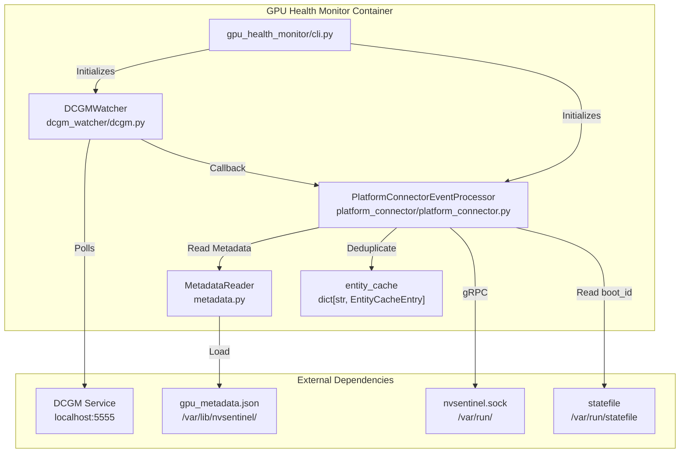
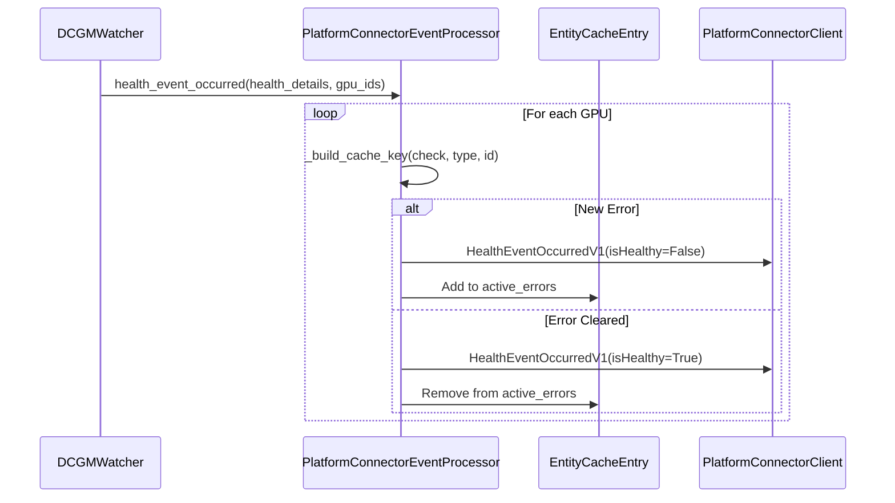
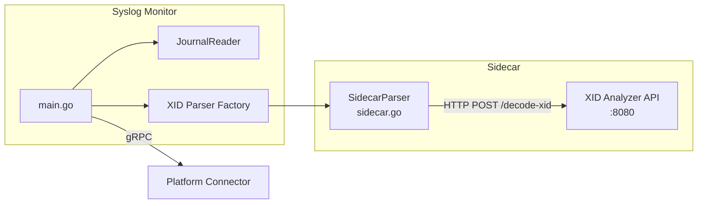
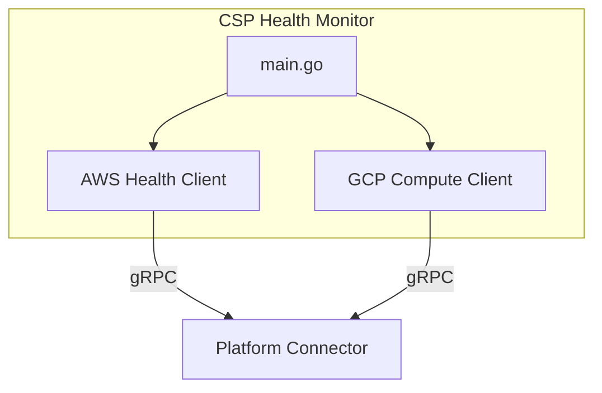
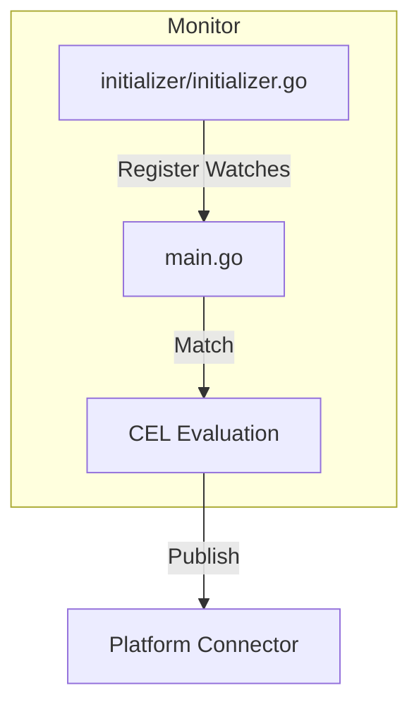

<!-- source: DeepWiki mcp.deepwiki.com · repo NVIDIA/NVSentinel · page 13.3 Health Monitor Modules · fetched 2026-10-26 -->

# Health Monitor Modules

Relevant source files

The following files were used as context for generating this wiki page:

- [commons/go.mod](commons/go.mod)
- [distros/kubernetes/nvsentinel/charts/gpu-health-monitor/templates/configmap.yaml](distros/kubernetes/nvsentinel/charts/gpu-health-monitor/templates/configmap.yaml)
- [distros/kubernetes/nvsentinel/charts/gpu-health-monitor/templates/daemonset-dcgm-3.x.yaml](distros/kubernetes/nvsentinel/charts/gpu-health-monitor/templates/daemonset-dcgm-3.x.yaml)
- [distros/kubernetes/nvsentinel/charts/gpu-health-monitor/templates/daemonset-dcgm-4.x.yaml](distros/kubernetes/nvsentinel/charts/gpu-health-monitor/templates/daemonset-dcgm-4.x.yaml)
- [distros/kubernetes/nvsentinel/charts/gpu-health-monitor/values.yaml](distros/kubernetes/nvsentinel/charts/gpu-health-monitor/values.yaml)
- [distros/kubernetes/nvsentinel/charts/kubernetes-object-monitor/templates/configmap.yaml](distros/kubernetes/nvsentinel/charts/kubernetes-object-monitor/templates/configmap.yaml)
- [distros/kubernetes/nvsentinel/charts/kubernetes-object-monitor/templates/deployment.yaml](distros/kubernetes/nvsentinel/charts/kubernetes-object-monitor/templates/deployment.yaml)
- [distros/kubernetes/nvsentinel/charts/kubernetes-object-monitor/values.yaml](distros/kubernetes/nvsentinel/charts/kubernetes-object-monitor/values.yaml)
- [distros/kubernetes/nvsentinel/charts/syslog-health-monitor/templates/_helpers.tpl](distros/kubernetes/nvsentinel/charts/syslog-health-monitor/templates/_helpers.tpl)
- [distros/kubernetes/nvsentinel/charts/syslog-health-monitor/values.yaml](distros/kubernetes/nvsentinel/charts/syslog-health-monitor/values.yaml)
- [docs/nic-health-monitor/Overview.md](docs/nic-health-monitor/Overview.md)
- [docs/nic-health-monitor/link-counter-detection.md](docs/nic-health-monitor/link-counter-detection.md)
- [docs/nic-health-monitor/link-state-detection.md](docs/nic-health-monitor/link-state-detection.md)
- [docs/nic-health-monitor/syslog-detection-correlation.md](docs/nic-health-monitor/syslog-detection-correlation.md)
- [health-monitors/csp-health-monitor/go.mod](health-monitors/csp-health-monitor/go.mod)
- [health-monitors/csp-health-monitor/go.sum](health-monitors/csp-health-monitor/go.sum)
- [health-monitors/gpu-health-monitor/gpu_health_monitor/cli.py](health-monitors/gpu-health-monitor/gpu_health_monitor/cli.py)
- [health-monitors/gpu-health-monitor/gpu_health_monitor/logger.py](health-monitors/gpu-health-monitor/gpu_health_monitor/logger.py)
- [health-monitors/gpu-health-monitor/gpu_health_monitor/platform_connector/metrics.py](health-monitors/gpu-health-monitor/gpu_health_monitor/platform_connector/metrics.py)
- [health-monitors/gpu-health-monitor/gpu_health_monitor/platform_connector/platform_connector.py](health-monitors/gpu-health-monitor/gpu_health_monitor/platform_connector/platform_connector.py)
- [health-monitors/gpu-health-monitor/gpu_health_monitor/tests/test_logger.py](health-monitors/gpu-health-monitor/gpu_health_monitor/tests/test_logger.py)
- [health-monitors/gpu-health-monitor/gpu_health_monitor/tests/test_platform_connector/test_platform_connector.py](health-monitors/gpu-health-monitor/gpu_health_monitor/tests/test_platform_connector/test_platform_connector.py)
- [health-monitors/kubernetes-object-monitor/Makefile](health-monitors/kubernetes-object-monitor/Makefile)
- [health-monitors/kubernetes-object-monitor/Tiltfile](health-monitors/kubernetes-object-monitor/Tiltfile)
- [health-monitors/kubernetes-object-monitor/main.go](health-monitors/kubernetes-object-monitor/main.go)
- [health-monitors/kubernetes-object-monitor/pkg/initializer/initializer.go](health-monitors/kubernetes-object-monitor/pkg/initializer/initializer.go)
- [health-monitors/syslog-health-monitor/main.go](health-monitors/syslog-health-monitor/main.go)
- [health-monitors/syslog-health-monitor/pkg/common/common.go](health-monitors/syslog-health-monitor/pkg/common/common.go)
- [health-monitors/syslog-health-monitor/pkg/common/common_test.go](health-monitors/syslog-health-monitor/pkg/common/common_test.go)
- [health-monitors/syslog-health-monitor/pkg/gpufallen/metrics.go](health-monitors/syslog-health-monitor/pkg/gpufallen/metrics.go)
- [health-monitors/syslog-health-monitor/pkg/sxid/metrics.go](health-monitors/syslog-health-monitor/pkg/sxid/metrics.go)
- [health-monitors/syslog-health-monitor/pkg/xid/metrics/metrics.go](health-monitors/syslog-health-monitor/pkg/xid/metrics/metrics.go)
- [health-monitors/syslog-health-monitor/pkg/xid/parser/factory.go](health-monitors/syslog-health-monitor/pkg/xid/parser/factory.go)
- [health-monitors/syslog-health-monitor/pkg/xid/parser/sidecar.go](health-monitors/syslog-health-monitor/pkg/xid/parser/sidecar.go)
- [health-monitors/syslog-health-monitor/pkg/xid/parser/sidecar_test.go](health-monitors/syslog-health-monitor/pkg/xid/parser/sidecar_test.go)
- [janitor/go.mod](janitor/go.mod)
- [janitor/go.sum](janitor/go.sum)
- [store-client/go.sum](store-client/go.sum)
- [tests/data/k8s-rule-override.yaml](tests/data/k8s-rule-override.yaml)
- [tests/gpu_health_monitor_test.go](tests/gpu_health_monitor_test.go)

This document provides detailed API and configuration reference for NVSentinel's health detection modules. These modules run continuously on nodes or as cluster-wide services to detect hardware faults, system log errors, cloud provider maintenance events, and Kubernetes resource anomalies.

For information about how health events are processed after detection, see [Core Processing Modules](#13.1). For event data structures and storage, see [Data Models and Storage](#3.4).

---

## Overview

Health monitors form the **detection layer** of NVSentinel's event-driven architecture. Each monitor specializes in a specific fault domain:

| Monitor | Language | Deployment | Scope | Detection Method |
|---------|----------|------------|-------|------------------|
| GPU Health Monitor | Python | DaemonSet | Per-node | DCGM integration |
| Syslog Health Monitor | Go | DaemonSet | Per-node | journalctl parsing |
| CSP Health Monitor | Go | Deployment | Cluster-wide | Cloud provider APIs |
| Kubernetes Object Monitor | Go | Deployment | Cluster-wide | CEL policy evaluation |

All monitors communicate with Platform Connectors via gRPC, sending `HealthEvent` messages defined in the shared protobuf models.

**Sources:** [health-monitors/syslog-health-monitor/main.go:61-63](), [health-monitors/syslog-health-monitor/main.go:118-129](), [health-monitors/gpu-health-monitor/gpu_health_monitor/platform_connector/platform_connector.py:21-26]()

---

## GPU Health Monitor

### Architecture and Components

The GPU Health Monitor is a Python-based service that integrates with NVIDIA DCGM (Data Center GPU Manager) to detect GPU hardware faults. It runs as a DaemonSet with variants to support different DCGM versions.

#### GPU Monitor Component Diagram

**Sources:** [health-monitors/gpu-health-monitor/gpu_health_monitor/platform_connector/platform_connector.py:44-67](), [health-monitors/gpu-health-monitor/gpu_health_monitor/platform_connector/platform_connector.py:133-140](), [health-monitors/gpu-health-monitor/gpu_health_monitor/tests/test_platform_connector/test_platform_connector.py:85-90]()

### Configuration and Deployment

The monitor is configured via CLI arguments and a `config.ini` file.

**Configuration Reference:**

| Parameter | Flag | Default | Description |
|-----------|------|---------|-------------|
| DCGM Address | `--dcgm-addr` | `localhost:5555` | Host:Port for DCGM service |
| State File | `--state-file` | - | Path to persist node boot ID |
| Strategy | `--processing-strategy` | `EXECUTE_REMEDIATION` | `EXECUTE_REMEDIATION` or `STORE_ONLY` |
| Metadata | `--metadata-path` | `/var/lib/nvsentinel/gpu_metadata.json` | Path to GPU metadata |

**Sources:** [health-monitors/gpu-health-monitor/gpu_health_monitor/platform_connector/platform_connector.py:50-53](), [health-monitors/gpu-health-monitor/gpu_health_monitor/tests/test_platform_connector/test_platform_connector.py:116-124](), [distros/kubernetes/nvsentinel/charts/gpu-health-monitor/values.yaml:1-20]()

### Event Generation and Deduplication

The `PlatformConnectorEventProcessor` uses an `entity_cache` of `EntityCacheEntry` objects to prevent redundant event submission by tracking `active_errors`.

#### GPU Event Flow

**Sources:** [health-monitors/gpu-health-monitor/gpu_health_monitor/platform_connector/platform_connector.py:35-42](), [health-monitors/gpu-health-monitor/gpu_health_monitor/platform_connector/platform_connector.py:133-166](), [health-monitors/gpu-health-monitor/gpu_health_monitor/tests/test_platform_connector/test_platform_connector.py:160-170]()

---

## Syslog Health Monitor

### Overview
The Syslog Health Monitor parses the systemd journal to detect XID errors, SXID errors, and GPU "fallen off" events. It includes a specialized XID analyzer sidecar for detailed error decoding.

#### Syslog Monitor Architecture

**Sources:** [health-monitors/syslog-health-monitor/main.go:69-72](), [health-monitors/syslog-health-monitor/pkg/xid/parser/sidecar.go:34-52](), [health-monitors/syslog-health-monitor/pkg/xid/parser/sidecar.go:95-116]()

### XID Sidecar Integration
For Kubernetes < 1.29, the monitor implements `WaitUntilReady` to block until the sidecar is accepting connections, ensuring startup ordering.

**Sources:** [health-monitors/syslog-health-monitor/pkg/xid/parser/sidecar.go:57-92](), [distros/kubernetes/nvsentinel/charts/syslog-health-monitor/templates/_helpers.tpl:80-106]()

---

## CSP Health Monitor

### Overview
A cluster-wide service that monitors Cloud Service Provider (CSP) APIs for maintenance events.

#### CSP Monitor Components

**Sources:** [health-monitors/csp-health-monitor/go.mod:7-13](), [health-monitors/csp-health-monitor/go.mod:21-26]()

---

## Kubernetes Object Monitor

### Overview
This monitor evaluates Kubernetes resources against CEL (Common Expression Language) policies. It is implemented using the `controller-runtime` manager.

#### K8s Object Monitor Logic

**Sources:** [health-monitors/kubernetes-object-monitor/main.go:102-116](), [health-monitors/kubernetes-object-monitor/pkg/initializer/initializer.go:1-10]()

### Configuration
- `--checks`: Comma-separated list of checks to enable.
- `--processing-strategy`: Determines if events trigger remediation or are just stored.

**Sources:** [health-monitors/syslog-health-monitor/main.go:58-60](), [health-monitors/syslog-health-monitor/main.go:75-77]()

---

## Summary: Health Monitor Comparison

| Feature | GPU Monitor | Syslog Monitor | CSP Monitor | K8s Object Monitor |
|---------|-------------|----------------|-------------|-------------------|
| **Language** | Python | Go | Go | Go |
| **Deployment** | DaemonSet | DaemonSet | Deployment | Deployment |
| **Detection Source** | DCGM API | journalctl | Cloud APIs | K8s API (CEL) |
| **Action Mapping** | `dcgm_errors_info_dict` | `parser.Response` | API Event Type | CEL Expression |

**Sources:** [health-monitors/gpu-health-monitor/gpu_health_monitor/platform_connector/platform_connector.py:50-53](), [health-monitors/syslog-health-monitor/main.go:45-50](), [health-monitors/syslog-health-monitor/pkg/xid/parser/sidecar.go:152-160]()

---

