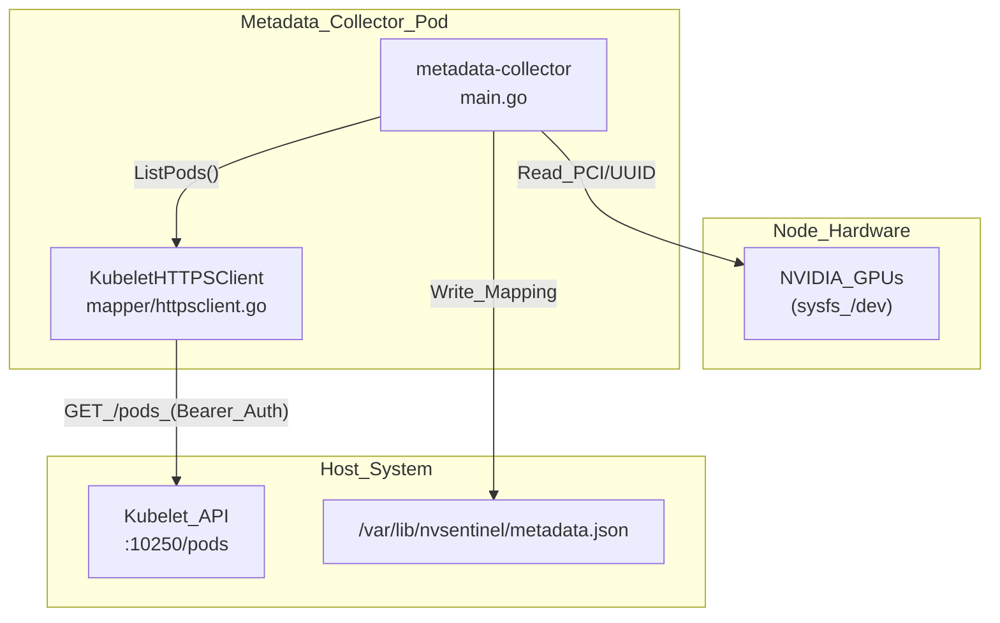
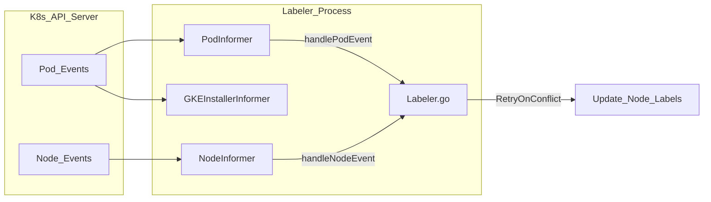
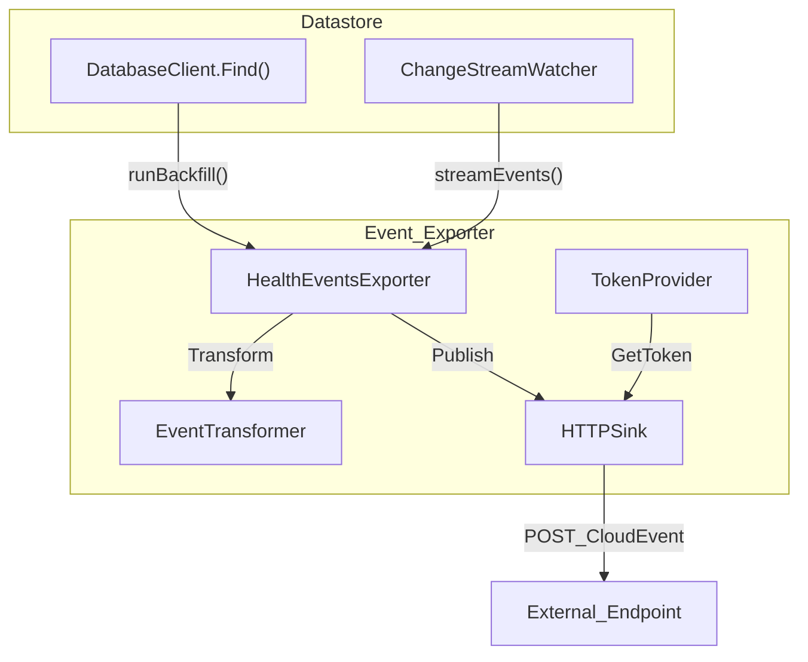

<!-- source: DeepWiki mcp.deepwiki.com · repo NVIDIA/NVSentinel · page 13.4 Support Service Modules · fetched 2026-10-26 -->

# Support Service Modules

Relevant source files

The following files were used as context for generating this wiki page:

- [data-models/pkg/model/pod_device_annotation.go](data-models/pkg/model/pod_device_annotation.go)
- [distros/kubernetes/nvsentinel/charts/fault-remediation/files/log-collector-job.yaml](distros/kubernetes/nvsentinel/charts/fault-remediation/files/log-collector-job.yaml)
- [distros/kubernetes/nvsentinel/charts/janitor/templates/networkpolicy.yaml](distros/kubernetes/nvsentinel/charts/janitor/templates/networkpolicy.yaml)
- [distros/kubernetes/nvsentinel/charts/labeler/templates/deployment.yaml](distros/kubernetes/nvsentinel/charts/labeler/templates/deployment.yaml)
- [distros/kubernetes/nvsentinel/charts/labeler/values.yaml](distros/kubernetes/nvsentinel/charts/labeler/values.yaml)
- [distros/kubernetes/nvsentinel/charts/metadata-collector/templates/clusterrole.yaml](distros/kubernetes/nvsentinel/charts/metadata-collector/templates/clusterrole.yaml)
- [distros/kubernetes/nvsentinel/charts/metadata-collector/templates/clusterrolebinding.yaml](distros/kubernetes/nvsentinel/charts/metadata-collector/templates/clusterrolebinding.yaml)
- [distros/kubernetes/nvsentinel/charts/metadata-collector/templates/daemonset.yaml](distros/kubernetes/nvsentinel/charts/metadata-collector/templates/daemonset.yaml)
- [distros/kubernetes/nvsentinel/charts/metadata-collector/templates/serviceaccount.yaml](distros/kubernetes/nvsentinel/charts/metadata-collector/templates/serviceaccount.yaml)
- [distros/kubernetes/nvsentinel/charts/metadata-collector/values.yaml](distros/kubernetes/nvsentinel/charts/metadata-collector/values.yaml)
- [distros/kubernetes/nvsentinel/templates/networkpolicy.yaml](distros/kubernetes/nvsentinel/templates/networkpolicy.yaml)
- [docs/configuration/metadata-collector.md](docs/configuration/metadata-collector.md)
- [docs/labeler.md](docs/labeler.md)
- [docs/log-collection.md](docs/log-collection.md)
- [docs/metadata-collector.md](docs/metadata-collector.md)
- [event-exporter/main.go](event-exporter/main.go)
- [event-exporter/pkg/auth/oidc.go](event-exporter/pkg/auth/oidc.go)
- [event-exporter/pkg/auth/oidc_test.go](event-exporter/pkg/auth/oidc_test.go)
- [event-exporter/pkg/config/config.go](event-exporter/pkg/config/config.go)
- [event-exporter/pkg/exporter/exporter.go](event-exporter/pkg/exporter/exporter.go)
- [event-exporter/pkg/exporter/worker_pool.go](event-exporter/pkg/exporter/worker_pool.go)
- [event-exporter/pkg/initializer/initializer.go](event-exporter/pkg/initializer/initializer.go)
- [event-exporter/pkg/sink/http.go](event-exporter/pkg/sink/http.go)
- [event-exporter/pkg/sink/http_test.go](event-exporter/pkg/sink/http_test.go)
- [event-exporter/pkg/transformer/types.go](event-exporter/pkg/transformer/types.go)
- [labeler/main.go](labeler/main.go)
- [labeler/pkg/initializer/init.go](labeler/pkg/initializer/init.go)
- [labeler/pkg/labeler/labeler.go](labeler/pkg/labeler/labeler.go)
- [labeler/pkg/labeler/labeler_test.go](labeler/pkg/labeler/labeler_test.go)
- [log-collector/entrypoint.sh](log-collector/entrypoint.sh)
- [metadata-collector/pkg/mapper/httpsclient.go](metadata-collector/pkg/mapper/httpsclient.go)
- [metadata-collector/pkg/mapper/httpsclient_test.go](metadata-collector/pkg/mapper/httpsclient_test.go)

## Purpose and Scope

Support Service Modules provide the auxiliary infrastructure required for metadata enrichment, node configuration discovery, diagnostic data collection, and external event streaming. These modules operate alongside the core detection and remediation pipelines to ensure that health events are contextualized with precise hardware information and that diagnostic logs are available for post-mortem analysis.

Key capabilities include:
1.  **Metadata Collector**: Discovers GPU topology, PCI addresses, and UUIDs by mapping Kubernetes pod resources to physical hardware.
2.  **Labeler**: Automatically manages Kubernetes node labels for DCGM versions, driver installation status, and runtime configurations (e.g., Kata Containers).
3.  **Log Collector**: Automates the collection of GPU-specific diagnostic logs (e.g., `nvidia-bug-report.sh`) and system logs during fault events.
4.  **Event Exporter**: Streams health events from the internal datastore to external sinks (e.g., HTTP endpoints) with support for historical backfill and OIDC authentication.

---

## Metadata Collector

The Metadata Collector is a DaemonSet that runs on every GPU node to provide a mapping between Kubernetes pods and physical GPU devices. It discovers hardware metadata (UUIDs, PCI Bus IDs) and writes them to a local state file used for event enrichment.

### Implementation and Data Flow

The collector interacts with the local Kubelet via an HTTPS client to retrieve pod specifications and maps them to device resources.

### Kubelet Communication
The collector uses `kubeletHTTPSClient` to communicate with the local Kubelet. It bypasses certificate validation (as the Kubelet cert often lacks a `localhost` SAN) but uses the pod's ServiceAccount token for authentication [metadata-collector/pkg/mapper/httpsclient.go:82-108]().

- **Target**: Defaults to `localhost:10250` but can be overridden via `KUBELET_HOST` [metadata-collector/pkg/mapper/httpsclient.go:69-72]().
- **Permissions**: Requires `GET` permissions on `nodes/proxy` [metadata-collector/pkg/mapper/httpsclient.go:99-101]().
- **Deployment**: Configured with `hostNetwork: true` and `hostPID: true` to access hardware and networking context [distros/kubernetes/nvsentinel/charts/metadata-collector/templates/daemonset.yaml:43-44]().

**Sources:**
- [metadata-collector/pkg/mapper/httpsclient.go:33-80]()
- [distros/kubernetes/nvsentinel/charts/metadata-collector/templates/daemonset.yaml:43-75]()
- [distros/kubernetes/nvsentinel/charts/metadata-collector/values.yaml:33-47]()

---

## Labeler

The Labeler is a controller that monitors Pod and Node events to automatically apply operational labels to Kubernetes Nodes. This ensures that NVSentinel components (like the Metadata Collector) only run on nodes where prerequisites (like drivers) are met.

### Logic and Labeling Rules
The `Labeler` struct uses indexed informers to track specific GPU-related pods [labeler/pkg/labeler/labeler.go:58-67]().

| Label Key | Discovery Logic |
|-----------|----------------|
| `nvsentinel.dgxc.nvidia.com/dcgm.version` | Parsed from `nvidia-dcgm` container image tags (e.g., `4.x`, `3.x`) via `dcgm4Regex` and `dcgm3Regex` [labeler/pkg/labeler/labeler.go:38, 52-55](). |
| `nvsentinel.dgxc.nvidia.com/driver.installed` | Set to `true` when a driver installer pod (GKE or standard) reaches `Ready` status [labeler/pkg/labeler/labeler.go:39, 131-162](). |
| `nvsentinel.dgxc.nvidia.com/kata.enabled` | Detected by checking `RuntimeClass` or specific annotations on the Node object [labeler/pkg/labeler/labeler.go:40-41](). |

### Event Handling Flow

**Sources:**
- [labeler/pkg/labeler/labeler.go:37-55]()
- [labeler/pkg/labeler/labeler.go:80-124]()
- [labeler/pkg/labeler/labeler_test.go:40-162]()

---

## Log Collector

The Log Collector is a shell-based utility, typically triggered as a Kubernetes Job by the `Fault Remediation Module`. It specializes in cross-platform GPU diagnostics collection.

### Collection Workflow
1.  **Environment Detection**: Checks for CSP-specific metadata (AWS IMDSv2 or GCP Metadata Server) to enable cloud-native diagnostic tools [log-collector/entrypoint.sh:56-90]().
2.  **NVIDIA Bug Report**: 
    - On **GCP COS**: Executes `nvidia-bug-report.sh` directly from the host filesystem via a privileged container [log-collector/entrypoint.sh:108-118]().
    - On **Standard/GPU Operator**: Locates the `nvidia-driver-daemonset` pod and executes the report inside the driver container [log-collector/entrypoint.sh:122-147]().
3.  **Cloud SOS Reports**: If enabled, runs `sos report` (GCP) or equivalent cloud diagnostics via `chroot /host` [log-collector/entrypoint.sh:150-163]().
4.  **Must-Gather**: Optionally runs the NVIDIA GPU Operator `must-gather.sh` script [log-collector/entrypoint.sh:29]().

**Sources:**
- [log-collector/entrypoint.sh:18-50]()
- [log-collector/entrypoint.sh:92-147]()
- [distros/kubernetes/nvsentinel/charts/fault-remediation/files/log-collector-job.yaml:1-20]()

---

## Event Exporter

The Event Exporter is a service that watches the NVSentinel datastore (MongoDB/PostgreSQL) and pushes health events to external HTTP sinks using the CloudEvents specification.

### Architecture: Backfill and Streaming
The exporter manages two phases: historical backfill and real-time streaming [event-exporter/pkg/exporter/exporter.go:67-91]().

### Key Components
- **Backfill**: Processes historical events based on `MaxAge` and `MaxEvents` configuration. It includes a `RateLimit` to prevent overwhelming the sink [event-exporter/pkg/exporter/exporter.go:93-138, 191-206]().
- **HTTPSink**: Implements the `EventSink` interface. It wraps the HTTP transport with OpenTelemetry tracing and manages OIDC `Bearer` tokens [event-exporter/pkg/sink/http.go:62-96]().
- **OIDC Token Provider**: Fetches and caches OIDC tokens using the `client_credentials` grant. It features an exponential backoff strategy for resilient token acquisition [event-exporter/pkg/auth/oidc.go:36-125]().

### Configuration
| Parameter | Flag / Config Key | Description |
|-----------|-------------------|-------------|
| Sink Endpoint | `cfg.Exporter.Sink.Endpoint` | Destination URL for CloudEvents [event-exporter/pkg/sink/http.go:34](). |
| Workers | `--workers` | Concurrent publish workers [event-exporter/main.go:73](). |
| Backfill Max Age | `Backfill.MaxAge` | Duration of historical data to export [event-exporter/pkg/exporter/exporter.go:98](). |
| OIDC Secret | `--oidc-secret-path` | Path to the client secret for authentication [event-exporter/main.go:72](). |

**Sources:**
- [event-exporter/pkg/exporter/exporter.go:67-138]()
- [event-exporter/pkg/sink/http.go:33-110]()
- [event-exporter/pkg/auth/oidc.go:74-115]()
- [event-exporter/main.go:69-138]()

---

