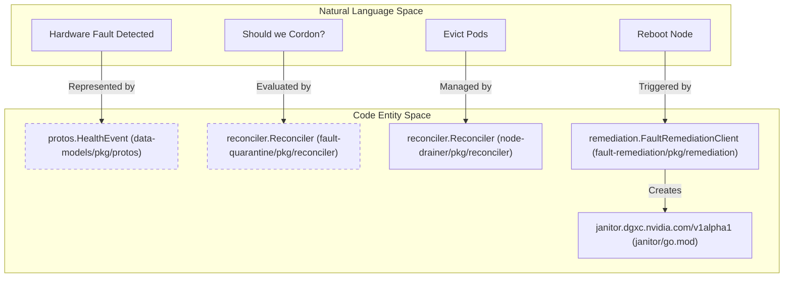
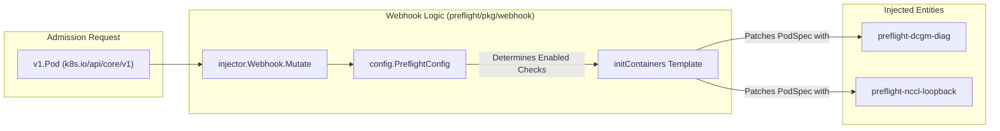

<!-- source: DeepWiki mcp.deepwiki.com · repo NVIDIA/NVSentinel · page 14 Glossary · fetched 2026-10-26 -->

# Glossary

Relevant source files

The following files were used as context for generating this wiki page:

- [commons/go.mod](commons/go.mod)
- [commons/go.sum](commons/go.sum)
- [commons/pkg/flags/database_flags_test.go](commons/pkg/flags/database_flags_test.go)
- [distros/kubernetes/nvsentinel/charts/fault-remediation/values.yaml](distros/kubernetes/nvsentinel/charts/fault-remediation/values.yaml)
- [distros/kubernetes/nvsentinel/charts/gpu-health-monitor/files/dcgmerrorsmapping.csv](distros/kubernetes/nvsentinel/charts/gpu-health-monitor/files/dcgmerrorsmapping.csv)
- [distros/kubernetes/nvsentinel/charts/health-events-analyzer/values.yaml](distros/kubernetes/nvsentinel/charts/health-events-analyzer/values.yaml)
- [distros/kubernetes/nvsentinel/charts/preflight/templates/_helpers.tpl](distros/kubernetes/nvsentinel/charts/preflight/templates/_helpers.tpl)
- [distros/kubernetes/nvsentinel/charts/preflight/templates/configmap.yaml](distros/kubernetes/nvsentinel/charts/preflight/templates/configmap.yaml)
- [distros/kubernetes/nvsentinel/charts/preflight/templates/deployment.yaml](distros/kubernetes/nvsentinel/charts/preflight/templates/deployment.yaml)
- [distros/kubernetes/nvsentinel/charts/preflight/values.yaml](distros/kubernetes/nvsentinel/charts/preflight/values.yaml)
- [distros/kubernetes/nvsentinel/values-full.yaml](distros/kubernetes/nvsentinel/values-full.yaml)
- [distros/kubernetes/nvsentinel/values-tilt.yaml](distros/kubernetes/nvsentinel/values-tilt.yaml)
- [distros/kubernetes/nvsentinel/values.yaml](distros/kubernetes/nvsentinel/values.yaml)
- [docs/INTEGRATIONS.md](docs/INTEGRATIONS.md)
- [docs/configuration/preflight.md](docs/configuration/preflight.md)
- [docs/designs/026-preflight-checks.md](docs/designs/026-preflight-checks.md)
- [docs/designs/035-preflight-inline-dcgm-config.md](docs/designs/035-preflight-inline-dcgm-config.md)
- [docs/preflight.md](docs/preflight.md)
- [event-exporter/go.mod](event-exporter/go.mod)
- [event-exporter/go.sum](event-exporter/go.sum)
- [fault-quarantine/go.mod](fault-quarantine/go.mod)
- [fault-quarantine/go.sum](fault-quarantine/go.sum)
- [fault-remediation/go.mod](fault-remediation/go.mod)
- [fault-remediation/go.sum](fault-remediation/go.sum)
- [fault-remediation/main.go](fault-remediation/main.go)
- [fault-remediation/pkg/annotation/annotation.go](fault-remediation/pkg/annotation/annotation.go)
- [fault-remediation/pkg/crstatus/checker.go](fault-remediation/pkg/crstatus/checker.go)
- [fault-remediation/pkg/initializer/init.go](fault-remediation/pkg/initializer/init.go)
- [fault-remediation/pkg/reconciler/reconciler.go](fault-remediation/pkg/reconciler/reconciler.go)
- [fault-remediation/pkg/reconciler/reconciler_e2e_test.go](fault-remediation/pkg/reconciler/reconciler_e2e_test.go)
- [fault-remediation/pkg/reconciler/reconciler_test.go](fault-remediation/pkg/reconciler/reconciler_test.go)
- [fault-remediation/pkg/reconciler/templates/gpureset-template.yaml](fault-remediation/pkg/reconciler/templates/gpureset-template.yaml)
- [fault-remediation/pkg/remediation/fault_remediation_client_interface.go](fault-remediation/pkg/remediation/fault_remediation_client_interface.go)
- [fault-remediation/pkg/remediation/remediation.go](fault-remediation/pkg/remediation/remediation.go)
- [health-events-analyzer/go.mod](health-events-analyzer/go.mod)
- [health-events-analyzer/go.sum](health-events-analyzer/go.sum)
- [health-events-analyzer/main.go](health-events-analyzer/main.go)
- [health-events-analyzer/pkg/config/rules.go](health-events-analyzer/pkg/config/rules.go)
- [health-events-analyzer/pkg/publisher/publisher.go](health-events-analyzer/pkg/publisher/publisher.go)
- [health-events-analyzer/pkg/reconciler/reconciler.go](health-events-analyzer/pkg/reconciler/reconciler.go)
- [health-events-analyzer/pkg/reconciler/reconciler_test.go](health-events-analyzer/pkg/reconciler/reconciler_test.go)
- [health-monitors/csp-health-monitor/go.mod](health-monitors/csp-health-monitor/go.mod)
- [health-monitors/csp-health-monitor/go.sum](health-monitors/csp-health-monitor/go.sum)
- [health-monitors/syslog-health-monitor/go.mod](health-monitors/syslog-health-monitor/go.mod)
- [janitor/go.mod](janitor/go.mod)
- [janitor/go.sum](janitor/go.sum)
- [node-drainer/go.mod](node-drainer/go.mod)
- [node-drainer/go.sum](node-drainer/go.sum)
- [node-drainer/main.go](node-drainer/main.go)
- [node-drainer/pkg/evaluator/evaluator.go](node-drainer/pkg/evaluator/evaluator.go)
- [node-drainer/pkg/informers/informers.go](node-drainer/pkg/informers/informers.go)
- [node-drainer/pkg/initializer/init.go](node-drainer/pkg/initializer/init.go)
- [node-drainer/pkg/queue/queue.go](node-drainer/pkg/queue/queue.go)
- [node-drainer/pkg/queue/types.go](node-drainer/pkg/queue/types.go)
- [node-drainer/pkg/queue/worker.go](node-drainer/pkg/queue/worker.go)
- [node-drainer/pkg/reconciler/reconciler.go](node-drainer/pkg/reconciler/reconciler.go)
- [node-drainer/pkg/reconciler/reconciler_integration_test.go](node-drainer/pkg/reconciler/reconciler_integration_test.go)
- [platform-connectors/go.mod](platform-connectors/go.mod)
- [platform-connectors/go.sum](platform-connectors/go.sum)
- [platform-connectors/pkg/transformers/metadata/transformer_test.go](platform-connectors/pkg/transformers/metadata/transformer_test.go)
- [preflight/pkg/config/config.go](preflight/pkg/config/config.go)
- [preflight/pkg/config/config_test.go](preflight/pkg/config/config_test.go)
- [preflight/pkg/controller/gang_controller.go](preflight/pkg/controller/gang_controller.go)
- [preflight/pkg/controller/gang_controller_test.go](preflight/pkg/controller/gang_controller_test.go)
- [preflight/pkg/webhook/handler_test.go](preflight/pkg/webhook/handler_test.go)
- [preflight/pkg/webhook/injector.go](preflight/pkg/webhook/injector.go)
- [preflight/pkg/webhook/injector_test.go](preflight/pkg/webhook/injector_test.go)
- [store-client/go.mod](store-client/go.mod)
- [store-client/go.sum](store-client/go.sum)
- [store-client/pkg/adapter/legacy_adapter.go](store-client/pkg/adapter/legacy_adapter.go)
- [store-client/pkg/config/env_loader.go](store-client/pkg/config/env_loader.go)
- [store-client/pkg/config/env_loader_test.go](store-client/pkg/config/env_loader_test.go)
- [store-client/pkg/datastore/providers/mongodb/register.go](store-client/pkg/datastore/providers/mongodb/register.go)
- [store-client/pkg/datastore/providers/mongodb/watcher/watch_store.go](store-client/pkg/datastore/providers/mongodb/watcher/watch_store.go)
- [store-client/pkg/datastore/providers/mongodb/watcher/watch_store_test.go](store-client/pkg/datastore/providers/mongodb/watcher/watch_store_test.go)
- [store-client/pkg/datastore/providers/postgresql/changestream.go](store-client/pkg/datastore/providers/postgresql/changestream.go)
- [store-client/pkg/datastore/providers/postgresql/datastore.go](store-client/pkg/datastore/providers/postgresql/datastore.go)
- [store-client/pkg/helper/datastore_helper.go](store-client/pkg/helper/datastore_helper.go)
- [store-client/pkg/query/builder.go](store-client/pkg/query/builder.go)
- [store-client/pkg/storewatcher/config.go](store-client/pkg/storewatcher/config.go)
- [store-client/pkg/storewatcher/watch_store.go](store-client/pkg/storewatcher/watch_store.go)
- [store-client/pkg/utils/pq.go](store-client/pkg/utils/pq.go)
- [store-client/pkg/utils/pq_test.go](store-client/pkg/utils/pq_test.go)
- [tests/health_events_analyzer_test.go](tests/health_events_analyzer_test.go)
- [tests/helpers/health_events_analyzer.go](tests/helpers/health_events_analyzer.go)
- [tests/helpers/kube.go](tests/helpers/kube.go)
- [tests/helpers/preflight.go](tests/helpers/preflight.go)
- [tilt/Tiltfile](tilt/Tiltfile)
- [tilt/helpers.star](tilt/helpers.star)

This page provides definitions for NVSentinel-specific terminology, architectural patterns, and abbreviations used throughout the codebase. It serves as a technical reference for engineers to understand the mapping between high-level concepts and their implementation in code.

## Core Architectural Terms

### Health Event
The fundamental data unit in NVSentinel representing a detected hardware or software fault. It is defined as a Protobuf message and persisted in the datastore (MongoDB or PostgreSQL).
*   **Implementation**: `HealthEvent` message and associated status models.
*   **Key Fields**: `nodeName`, `isHealthy`, `isFatal`, `entitiesImpacted`, and `recommendedAction`.
*   **Status Tracking**: Managed via `HealthEventStatus` and associated state constants.
*   **Sources**: [data-models/pkg/protos/health_event.pb.go:1-100](), [data-models/pkg/model/model.go:1-50](), [data-models/pkg/model/status.go:1-25]()

### Platform Connector
A gRPC entry point that receives `HealthEvent` reports from various monitors, validates them, and persists them to the datastore.
*   **Implementation**: Central ingestion point for all health data.
*   **Data Flow**: Monitors call the `ReportHealthEvent` RPC to send data.
*   **Sources**: [distros/kubernetes/nvsentinel/values-full.yaml:131-136](), [platform-connectors/go.mod:1-20]()

### Change Stream
A mechanism used by core modules (`Fault Quarantine`, `Node Drainer`, `Fault Remediation`) to react to datastore updates in real-time. This enables an event-driven architecture where components are decoupled.
*   **Implementation**: `ChangeStreamWatcher` interface and MongoDB/PostgreSQL providers.
*   **Usage**: The `Reconciler` in various modules uses these streams to trigger state transitions.
*   **Sources**: [fault-remediation/pkg/reconciler/reconciler.go:66-79](), [store-client/pkg/datastore/providers/mongodb/watcher/watch_store.go:1-40]()

### Recommended Action
A field within a `HealthEvent` that suggests a specific remediation path (e.g., `COMPONENT_RESET`, `RESTART_VM`, `REPLACE_VM`).
*   **Implementation**: `RecommendedAction` string mapping in Helm values and Protobuf enums.
*   **Sources**: [distros/kubernetes/nvsentinel/charts/fault-remediation/values.yaml:51-90](), [data-models/pkg/protos/health_event.pb.go:1-100]()

---

## Fault Management Terms

### Quarantine
The state where a node is marked as faulty to prevent new workloads from being scheduled. This is achieved by adding Kubernetes **Taints** and marking the node as **Unschedulable** (Cordon).
*   **Implementation**: Managed by the `Fault Quarantine` reconciler.
*   **Logic**: Uses CEL-based rules to evaluate whether an event warrants a quarantine action.
*   **Sources**: [fault-quarantine/pkg/reconciler/reconciler.go:76-115](), [distros/kubernetes/nvsentinel/values-full.yaml:150-155]()

### Drain
The process of gracefully evicting existing Pods from a quarantined node.
*   **Implementation**: Handled by the `Node Drainer` module using a specialized queue and reconciler.
*   **Strategies**: Supports different eviction behaviors such as `ForceDrain` or `AllowCompletion`.
*   **Sources**: [node-drainer/pkg/reconciler/reconciler.go:1-50](), [node-drainer/pkg/reconciler/reconciler_integration_test.go:217-230]()

### Remediation
The final step in the fault lifecycle where automated actions (like a node reboot or GPU reset) are taken to restore node health.
*   **Implementation**: `Fault Remediation` module which reconciles events and creates maintenance resources.
*   **Mechanism**: Uses Go templates to generate Custom Resources (CRs) for the `Janitor`.
*   **Sources**: [fault-remediation/pkg/reconciler/reconciler.go:106-158](), [distros/kubernetes/nvsentinel/charts/fault-remediation/values.yaml:97-129]()

### Equivalence Group
A grouping mechanism in Fault Remediation to prevent redundant or conflicting remediation actions on the same node.
*   **Implementation**: Defined in `maintenance.actions` configuration.
*   **Behavior**: A "restart" action might supersede a "reset" action.
*   **Sources**: [distros/kubernetes/nvsentinel/values-tilt.yaml:275-276](), [distros/kubernetes/nvsentinel/charts/fault-remediation/values.yaml:59-69]()

---

## Preflight Terms

### Preflight Check
A "point-in-time" validation that runs as a Kubernetes **Init Container** to verify GPU health before the main application container starts.
*   **Implementation**: Injected via a Mutating Admission Webhook.
*   **Available Checks**: `preflight-dcgm-diag`, `preflight-nccl-loopback`, and `preflight-nccl-allreduce`.
*   **Sources**: [preflight/pkg/webhook/injector.go:1-50](), [distros/kubernetes/nvsentinel/charts/preflight/values.yaml:115-183]()

### Gang Coordination
A mechanism for multi-node preflight checks (like NCCL all-reduce) to ensure all nodes in a distributed job are ready before starting the benchmark.
*   **Implementation**: Uses `gangDiscovery` configuration to identify pod groups via labels or annotations.
*   **Sources**: [distros/kubernetes/nvsentinel/values-tilt.yaml:108-117](), [preflight/pkg/config/config.go:95-166]()

---

## Conceptual Diagrams

### Natural Language to Code Entity Mapping: Event Lifecycle
This diagram bridges the conceptual "Fault Lifecycle" to the specific Go classes and Protobuf definitions that implement them.

**Sources**: [data-models/pkg/protos/health_event.pb.go:1-100](), [fault-quarantine/pkg/reconciler/reconciler.go:76-115](), [node-drainer/pkg/reconciler/reconciler.go:1-50](), [fault-remediation/pkg/reconciler/reconciler.go:55-64](), [janitor/go.mod:1-28]()

### Preflight Injection Logic
This diagram maps the Preflight conceptual "Gate" to the internal Webhook logic.

**Sources**: [preflight/pkg/webhook/injector.go:118-179](), [preflight/pkg/config/config.go:33-166](), [distros/kubernetes/nvsentinel/charts/preflight/values.yaml:115-160]()

---

## Technical Abbreviations

| Abbreviation | Full Term | Context | Code Pointer |
| :--- | :--- | :--- | :--- |
| **DCGM** | Data Center GPU Manager | GPU health monitoring and diagnostics via hostengine. | [distros/kubernetes/nvsentinel/values.yaml:110-117]() |
| **CEL** | Common Expression Language | Used for rule evaluation in Quarantine and Object Monitor. | [fault-quarantine/pkg/reconciler/reconciler.go:208-212]() |
| **XID** | NVIDIA GPU Error | Specific error codes reported by the NVIDIA driver. | [distros/kubernetes/nvsentinel/values-tilt.yaml:70-74]() |
| **CSP** | Cloud Service Provider | Integration for AWS, GCP, Azure, and OCI. | [health-monitors/csp-health-monitor/go.mod:7-25]() |
| **GVR** | Group Version Resource | Kubernetes API identification (e.g., `janitor.dgxc.nvidia.com/v1alpha1/RebootNode`). | [tests/helpers/kube.go:70-80]() |
| **SOS** | SOS Report | System diagnostic report used in AWS/GCP log collection. | [distros/kubernetes/nvsentinel/charts/fault-remediation/values.yaml:170-173]() |

**Sources**: [distros/kubernetes/nvsentinel/values.yaml](), [distros/kubernetes/nvsentinel/values-tilt.yaml](), [health-monitors/csp-health-monitor/go.mod](), [tests/helpers/kube.go](), [distros/kubernetes/nvsentinel/charts/fault-remediation/values.yaml]()