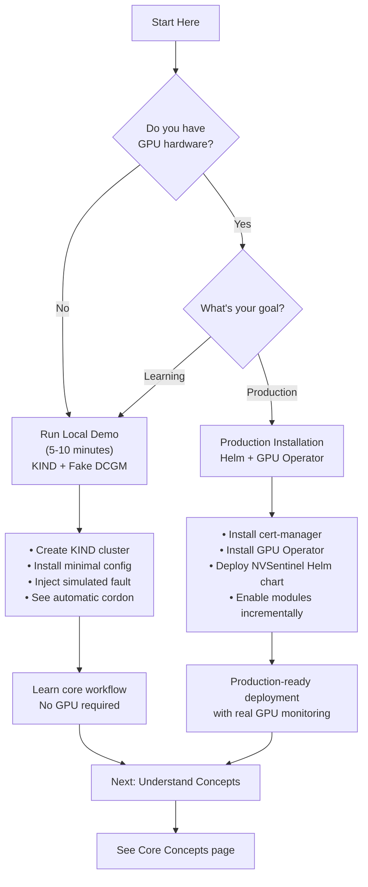
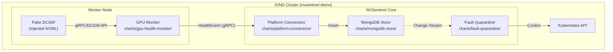
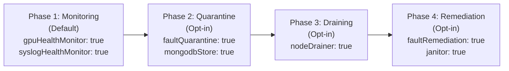

<!-- source: DeepWiki mcp.deepwiki.com · repo NVIDIA/NVSentinel · page 2 Getting Started · fetched 2026-10-26 -->

# Getting Started

<details>
<summary>Relevant source files</summary>

The following files were used as context for generating this wiki page:

- [README.md](README.md)
- [demos/local-fault-injection-demo/Makefile](demos/local-fault-injection-demo/Makefile)
- [demos/local-fault-injection-demo/README.md](demos/local-fault-injection-demo/README.md)
- [demos/local-fault-injection-demo/scripts/00-setup.sh](demos/local-fault-injection-demo/scripts/00-setup.sh)
- [demos/local-fault-injection-demo/scripts/01-show-cluster.sh](demos/local-fault-injection-demo/scripts/01-show-cluster.sh)
- [demos/local-fault-injection-demo/scripts/02-inject-error.sh](demos/local-fault-injection-demo/scripts/02-inject-error.sh)
- [demos/local-fault-injection-demo/scripts/03-verify-cordon.sh](demos/local-fault-injection-demo/scripts/03-verify-cordon.sh)
- [demos/local-fault-injection-demo/scripts/99-cleanup.sh](demos/local-fault-injection-demo/scripts/99-cleanup.sh)
- [demos/local-slinky-drain-demo/scripts/00-setup.sh](demos/local-slinky-drain-demo/scripts/00-setup.sh)
- [distros/kubernetes/README.md](distros/kubernetes/README.md)
- [distros/kubernetes/nvsentinel/charts/gpu-health-monitor/files/dcgmerrorsmapping.csv](distros/kubernetes/nvsentinel/charts/gpu-health-monitor/files/dcgmerrorsmapping.csv)
- [distros/kubernetes/nvsentinel/charts/preflight/templates/deployment.yaml](distros/kubernetes/nvsentinel/charts/preflight/templates/deployment.yaml)
- [distros/kubernetes/nvsentinel/values-full.yaml](distros/kubernetes/nvsentinel/values-full.yaml)
- [distros/kubernetes/nvsentinel/values-tilt.yaml](distros/kubernetes/nvsentinel/values-tilt.yaml)
- [distros/kubernetes/nvsentinel/values.yaml](distros/kubernetes/nvsentinel/values.yaml)
- [docs/INTEGRATIONS.md](docs/INTEGRATIONS.md)
- [docs/OVERVIEW.md](docs/OVERVIEW.md)
- [platform-connectors/pkg/transformers/metadata/transformer_test.go](platform-connectors/pkg/transformers/metadata/transformer_test.go)
- [tests/helpers/preflight.go](tests/helpers/preflight.go)
- [tilt/Tiltfile](tilt/Tiltfile)
- [tilt/helpers.star](tilt/helpers.star)

</details>


## Purpose and Scope

This section provides an introduction to deploying and using NVSentinel for the first time. It covers prerequisite requirements, installation options, and initial verification steps. NVSentinel is a GPU fault detection and remediation system for Kubernetes that monitors GPU health, system logs, and cloud provider maintenance events to automate node recovery [docs/OVERVIEW.md:3-5]().

For detailed installation procedures, see [Installation and Quick Start](#2.1). For hands-on learning through an interactive demo, see [Fault Injection Demo](#2.2). For understanding fundamental concepts, see [Core Concepts](#2.3).

## Prerequisites

NVSentinel requires the following infrastructure to be in place before installation [README.md:17-21]():

| Component | Version | Purpose | Required |
|-----------|---------|---------|----------|
| **Kubernetes** | 1.25+ | Container orchestration platform | Yes |
| **Helm** | 3.0+ | Kubernetes package manager | Yes |
| **cert-manager** | v1.19.0+ | TLS certificate management for webhooks and internal DB | Yes [distros/kubernetes/README.md:15]() |
| **NVIDIA GPU Operator** | Latest | Includes DCGM for GPU monitoring | For GPU monitoring [README.md:21]() |
| **Persistent Storage** | 10GB+ | For MongoDB/PostgreSQL event store | Yes [distros/kubernetes/README.md:16]() |

### Storage Requirements

NVSentinel supports MongoDB and PostgreSQL as database backends [docs/OVERVIEW.md:43-45](). Both provide change streams (MongoDB) or LISTEN/NOTIFY (PostgreSQL) for real-time event processing. The default MongoDB deployment via the Bitnami chart typically requires:

- **Replica Count**: 3 nodes recommended for production change stream support [distros/kubernetes/nvsentinel/values-tilt.yaml:148]().
- **Persistence**: Enabled by default with 10Gi per replica [distros/kubernetes/README.md:16]().

**Sources:** [README.md:17-21](), [distros/kubernetes/README.md:10-17](), [docs/OVERVIEW.md:43-45](), [distros/kubernetes/nvsentinel/values.yaml:25-56]()

## Installation Decision Flow

The following diagram shows how to choose your installation path based on your hardware availability and goals:

"Installation Decision Flow"


**Sources:** [README.md:15-103](), [demos/local-fault-injection-demo/README.md:33-47]()

## Quick Demo Path (No GPU Required)

The local fault injection demo provides a complete NVSentinel workflow without requiring GPU hardware [demos/local-fault-injection-demo/README.md:5-6](). It simulates a fatal GPU hardware fault (corrupt InfoROM) using DCGM's error injection capability [demos/local-fault-injection-demo/README.md:79-81]().

### Demo Architecture: Natural Language to Code Entity Space

This diagram maps high-level demo components to the specific Helm charts and code entities used in the local setup.

"Demo Component Mapping"


### Demo Workflow

```bash
# Automated execution
cd demos/local-fault-injection-demo
make demo  # Runs setup, injects fault, and verifies [demos/local-fault-injection-demo/Makefile]

# Or Step-by-Step
./scripts/00-setup.sh        # Creates cluster & installs [demos/local-fault-injection-demo/scripts/00-setup.sh:135]
./scripts/01-show-cluster.sh  # Initial state check
./scripts/02-inject-error.sh  # Simulates hardware failure
./scripts/03-verify-cordon.sh # Verifies node protection
```

**Sources:** [demos/local-fault-injection-demo/README.md:33-72](), [demos/local-fault-injection-demo/scripts/00-setup.sh:135-270]()

## Production Installation Path

For real GPU clusters, follow these steps to deploy the stable release.

### Step 1: Install Dependencies

```bash
# Install cert-manager (Required for TLS) [README.md:52-60]
helm repo add jetstack https://charts.jetstack.io --force-update
helm upgrade --install cert-manager jetstack/cert-manager \
  --namespace cert-manager --create-namespace \
  --version v1.19.1 --set installCRDs=true --wait

# Install Prometheus (Optional, for metrics) [README.md:62-74]
helm repo add prometheus-community https://prometheus-community.github.io/helm-charts --force-update
helm upgrade --install prometheus prometheus-community/kube-prometheus-stack \
  --namespace monitoring --create-namespace --set alertmanager.enabled=false --wait
```

### Step 2: Install NVSentinel

```bash
NVSENTINEL_VERSION=v1.0.0

helm upgrade --install nvsentinel oci://ghcr.io/nvidia/nvsentinel \
  --namespace nvsentinel --create-namespace \
  --version "$NVSENTINEL_VERSION" \
  --timeout 15m --wait
```

**Sources:** [README.md:50-86](), [distros/kubernetes/README.md:18-41]()

## Default Configuration (Safe Mode)

By default, NVSentinel only enables **Health Monitoring** modules, specifically `gpuHealthMonitor`, `syslogHealthMonitor`, `labeler`, and `metadataCollector` [distros/kubernetes/nvsentinel/values.yaml:143-164](). This is "safe" as it only observes and reports node conditions without taking disruptive actions like cordoning or draining [docs/OVERVIEW.md:56]().

"Progressive Enablement Strategy"


### Module Enable Flags

Configure these in your `values.yaml` to activate specific automation layers [distros/kubernetes/nvsentinel/values.yaml:143-180]():

| Module | Flag | Purpose |
|--------|------|---------|
| **Quarantine** | `global.faultQuarantine.enabled` | Cordons nodes based on CEL rules [distros/kubernetes/nvsentinel/values-full.yaml:150-155] |
| **Drainer** | `global.nodeDrainer.enabled` | Evicts pods using per-namespace strategies [distros/kubernetes/nvsentinel/values-full.yaml:157-162] |
| **Remediation** | `global.faultRemediation.enabled` | Creates break-fix CRDs (e.g., RebootNode) [distros/kubernetes/nvsentinel/values-full.yaml:164-169] |
| **Janitor** | `global.janitor.enabled` | Executes maintenance via Cloud APIs [distros/kubernetes/nvsentinel/values-full.yaml:171-175] |

**Sources:** [README.md:100-101](), [docs/OVERVIEW.md:55-58](), [distros/kubernetes/nvsentinel/values.yaml:143-180]()

## Dry-Run Mode

NVSentinel includes a global `dryRun` flag [distros/kubernetes/nvsentinel/values.yaml:16](). When set to `true`, modules will log the actions they *would* have taken (e.g., "Would cordon node X") without actually modifying the Kubernetes cluster or calling Cloud APIs [distros/kubernetes/nvsentinel/values-full.yaml:59-69]().

```yaml
global:
  dryRun: true # Test mode: log actions without executing [distros/kubernetes/nvsentinel/values.yaml:16]
```

**Sources:** [distros/kubernetes/nvsentinel/values.yaml:16](), [distros/kubernetes/nvsentinel/values-full.yaml:59-69]()

## Next Steps

After successful installation:

1. **Verify Installation**: Run the validation script: `./scripts/validate-nvsentinel.sh --version v1.0.0 --verbose` [README.md:95]().
2. **Check Logs**: Ensure monitors are detecting GPUs: `kubectl logs -n nvsentinel -l app.kubernetes.io/name=gpu-health-monitor`.
3. **Explore Integrations**: Learn how to use NVSentinel taints for scheduling [docs/INTEGRATIONS.md:103]().
4. **Understand Core Concepts**: Review [Core Concepts](#2.3) for details on the event lifecycle.

**Sources:** [README.md:88-96](), [docs/INTEGRATIONS.md:3-33]()

---

