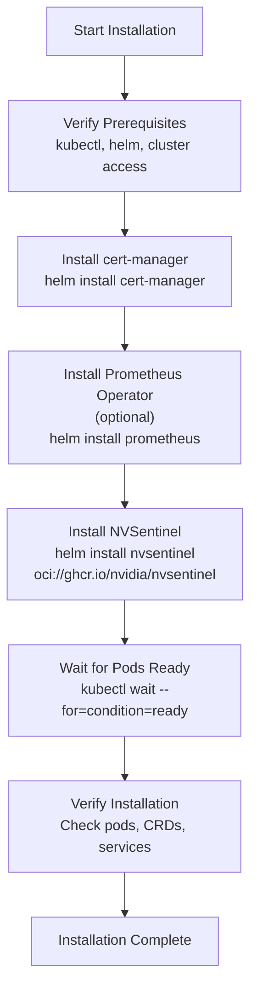
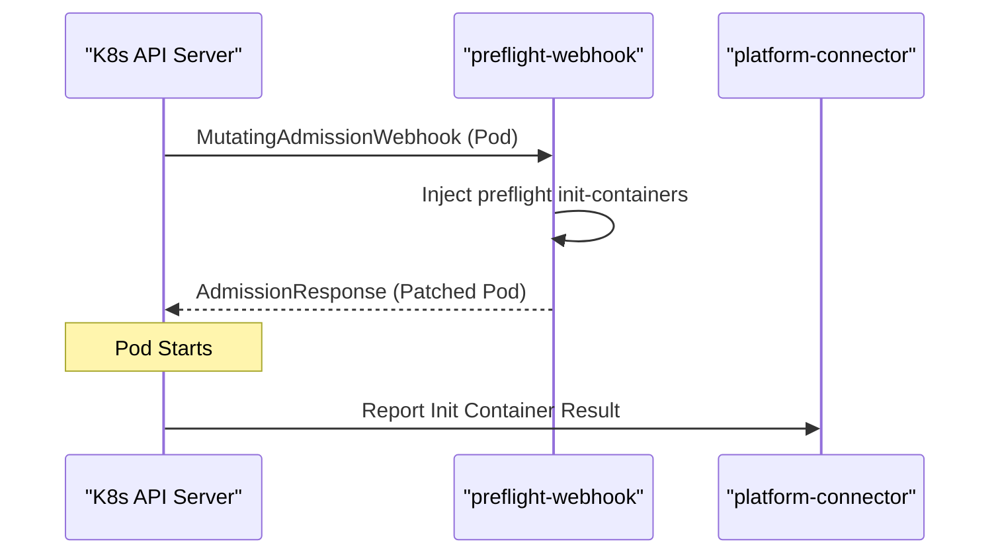

<!-- source: DeepWiki mcp.deepwiki.com · repo NVIDIA/NVSentinel · page 2.1 Installation and Quick Start · fetched 2026-10-26 -->

# Installation and Quick Start

<details>
<summary>Relevant source files</summary>

The following files were used as context for generating this wiki page:

- [distros/kubernetes/nvsentinel/charts/csp-health-monitor/templates/deployment.yaml](distros/kubernetes/nvsentinel/charts/csp-health-monitor/templates/deployment.yaml)
- [distros/kubernetes/nvsentinel/charts/event-exporter/templates/deployment.yaml](distros/kubernetes/nvsentinel/charts/event-exporter/templates/deployment.yaml)
- [distros/kubernetes/nvsentinel/charts/fault-quarantine/templates/deployment.yaml](distros/kubernetes/nvsentinel/charts/fault-quarantine/templates/deployment.yaml)
- [distros/kubernetes/nvsentinel/charts/fault-remediation/templates/deployment.yaml](distros/kubernetes/nvsentinel/charts/fault-remediation/templates/deployment.yaml)
- [distros/kubernetes/nvsentinel/charts/gpu-health-monitor/files/dcgmerrorsmapping.csv](distros/kubernetes/nvsentinel/charts/gpu-health-monitor/files/dcgmerrorsmapping.csv)
- [distros/kubernetes/nvsentinel/charts/health-events-analyzer/templates/deployment.yaml](distros/kubernetes/nvsentinel/charts/health-events-analyzer/templates/deployment.yaml)
- [distros/kubernetes/nvsentinel/charts/node-drainer/templates/deployment.yaml](distros/kubernetes/nvsentinel/charts/node-drainer/templates/deployment.yaml)
- [distros/kubernetes/nvsentinel/charts/preflight/templates/deployment.yaml](distros/kubernetes/nvsentinel/charts/preflight/templates/deployment.yaml)
- [distros/kubernetes/nvsentinel/templates/_helpers.tpl](distros/kubernetes/nvsentinel/templates/_helpers.tpl)
- [distros/kubernetes/nvsentinel/templates/configmap-datastore.yaml](distros/kubernetes/nvsentinel/templates/configmap-datastore.yaml)
- [distros/kubernetes/nvsentinel/templates/daemonset.yaml](distros/kubernetes/nvsentinel/templates/daemonset.yaml)
- [distros/kubernetes/nvsentinel/templates/job-external-mongodb-setup.yaml](distros/kubernetes/nvsentinel/templates/job-external-mongodb-setup.yaml)
- [distros/kubernetes/nvsentinel/values-atlas-gcp.yaml](distros/kubernetes/nvsentinel/values-atlas-gcp.yaml)
- [distros/kubernetes/nvsentinel/values-full.yaml](distros/kubernetes/nvsentinel/values-full.yaml)
- [distros/kubernetes/nvsentinel/values-tilt.yaml](distros/kubernetes/nvsentinel/values-tilt.yaml)
- [distros/kubernetes/nvsentinel/values.yaml](distros/kubernetes/nvsentinel/values.yaml)
- [docs/INTEGRATIONS.md](docs/INTEGRATIONS.md)
- [platform-connectors/pkg/transformers/metadata/transformer_test.go](platform-connectors/pkg/transformers/metadata/transformer_test.go)
- [scripts/validate-nvsentinel.sh](scripts/validate-nvsentinel.sh)
- [tests/helpers/preflight.go](tests/helpers/preflight.go)
- [tests/uat/kind/README.md](tests/uat/kind/README.md)
- [tests/uat/kind/cert-manager-values.yaml](tests/uat/kind/cert-manager-values.yaml)
- [tests/uat/kind/kwok-node-template.yaml](tests/uat/kind/kwok-node-template.yaml)
- [tests/uat/kind/nvidia-dcgm-daemonset.yaml](tests/uat/kind/nvidia-dcgm-daemonset.yaml)
- [tests/uat/kind/nvidia-driver-daemonset.yaml](tests/uat/kind/nvidia-driver-daemonset.yaml)
- [tests/uat/kind/prometheus-operator-values.yaml](tests/uat/kind/prometheus-operator-values.yaml)
- [tilt/Tiltfile](tilt/Tiltfile)
- [tilt/dcgm-fake/gpu-spec.yaml](tilt/dcgm-fake/gpu-spec.yaml)
- [tilt/helpers.star](tilt/helpers.star)
- [tilt/nvidia-dcgm-daemonset.yaml](tilt/nvidia-dcgm-daemonset.yaml)
- [tilt/nvidia-driver-daemonset.yaml](tilt/nvidia-driver-daemonset.yaml)

</details>


This page provides step-by-step instructions for installing NVSentinel in a Kubernetes cluster and verifying the deployment. It covers production installation via Helm, dependency setup, basic configuration, and verification procedures.

**Scope**: This guide focuses on getting NVSentinel running quickly with default settings. For detailed configuration options, see page [11.2](). For production deployment strategies and progressive enablement, see page [11.3](). For local development setup with Tilt, see page [10.2]().

---

## Prerequisites

NVSentinel requires a Kubernetes cluster with specific versions and supporting infrastructure:

| Component | Version | Purpose | Required |
|-----------|---------|---------|----------|
| **Kubernetes** | 1.25+ | Container orchestration platform | Yes |
| **Helm** | 3.0+ | Package manager for Kubernetes | Yes |
| **cert-manager** | v1.19.0+ | TLS certificate management | Yes |
| **Prometheus Operator** | Latest | Metrics collection (PodMonitor CRDs) | No (recommended) |
| **NVIDIA GPU Operator** | Latest | GPU monitoring via DCGM | Yes (for GPU monitoring) |
| **Persistent Storage** | - | MongoDB/PostgreSQL storage | Yes (10GB+ recommended) |

**Architecture Support**: NVSentinel supports both `amd64` and `arm64` architectures [distros/kubernetes/nvsentinel/values-tilt.yaml:95-102](). Container images are built for both platforms.

Sources: [distros/kubernetes/nvsentinel/values-tilt.yaml:17-102](), [distros/kubernetes/nvsentinel/values.yaml:17-23]()

---

## Installation Flow

### Deployment Lifecycle
The following diagram illustrates the deployment sequence and component readiness checks.

Title: NVSentinel Installation Workflow


Sources: [tilt/Tiltfile:43-89](), [scripts/validate-nvsentinel.sh:78-106]()

---

## Production Installation via Helm OCI Registry

### Step 1: Install cert-manager

cert-manager manages TLS certificates for secure communication between NVSentinel components and for MongoDB/PostgreSQL client authentication [distros/kubernetes/nvsentinel/values.yaml:99-103]().

```bash
# Add Jetstack Helm repository
helm repo add jetstack https://charts.jetstack.io --force-update

# Install cert-manager with CRDs
helm upgrade --install cert-manager jetstack/cert-manager \
  --namespace cert-manager \
  --create-namespace \
  --version v1.19.1 \
  --set installCRDs=true \
  --wait
```

Sources: [tilt/Tiltfile:43-52](), [tests/uat/kind/cert-manager-values.yaml:15-55]()

### Step 2: Install Prometheus Operator (Optional)

Prometheus Operator provides `PodMonitor` CRDs used by NVSentinel for metrics collection. While optional, it's recommended for production observability [distros/kubernetes/nvsentinel/values.yaml:23]().

```bash
# Add Prometheus community Helm repository
helm repo add prometheus-community https://prometheus-community.github.io/helm-charts --force-update

# Install Prometheus Operator (minimal configuration)
helm upgrade --install prometheus prometheus-community/kube-prometheus-stack \
  --namespace monitoring \
  --create-namespace \
  --set prometheus.enabled=true \
  --set alertmanager.enabled=false \
  --set grafana.enabled=false \
  --set kubeStateMetrics.enabled=false \
  --set nodeExporter.enabled=false \
  --wait
```

Sources: [tilt/Tiltfile:54-68](), [distros/kubernetes/nvsentinel/values.yaml:23-24]()

### Step 3: Install NVSentinel

Install NVSentinel from the GitHub Container Registry (GHCR) OCI registry:

```bash
# Set version (check releases for latest)
NVSENTINEL_VERSION=v1.0.0

# Install NVSentinel with default configuration
helm upgrade --install nvsentinel oci://ghcr.io/nvidia/nvsentinel \
  --namespace nvsentinel \
  --create-namespace \
  --version "$NVSENTINEL_VERSION" \
  --timeout 15m \
  --wait
```

**Default Behavior**: The default configuration ([distros/kubernetes/nvsentinel/values.yaml:144-181]()) enables only **monitoring components**:
- `gpuHealthMonitor.enabled: true` [distros/kubernetes/nvsentinel/values.yaml:144]()
- `syslogHealthMonitor.enabled: true` [distros/kubernetes/nvsentinel/values.yaml:160]()
- `metadataCollector.enabled: true` [distros/kubernetes/nvsentinel/values.yaml:164]()
- `labeler.enabled: true` [distros/kubernetes/nvsentinel/values.yaml:162]()

**Action-taking modules are disabled by default** for safety:
- `faultQuarantine.enabled: false` [distros/kubernetes/nvsentinel/values.yaml:148]()
- `nodeDrainer.enabled: false` [distros/kubernetes/nvsentinel/values.yaml:150]()
- `faultRemediation.enabled: false` [distros/kubernetes/nvsentinel/values.yaml:152]()
- `janitor.enabled: false` [distros/kubernetes/nvsentinel/values.yaml:154]()
- `mongodbStore.enabled: false` [distros/kubernetes/nvsentinel/values.yaml:170]()

Sources: [distros/kubernetes/nvsentinel/values.yaml:144-181](), [distros/kubernetes/nvsentinel/values.yaml:16-170]()

---

## Helm Chart Structure

The NVSentinel Helm chart follows a modular architecture with independent subcharts for each component.

Title: NVSentinel Subchart Dependencies

```mermaid
graph TB
    subgraph "Main Chart [nvsentinel]"
        MainChart["Chart.yaml"]
        ValuesYaml["values.yaml"]
    end
    
    subgraph "Health Monitor Subcharts"
        GPUMon["gpu-health-monitor"]
        SyslogMon["syslog-health-monitor"]
        CSPMon["csp-health-monitor"]
        K8sMon["kubernetes-object-monitor"]
        SlurmMon["slurm-drain-monitor"]
    end
    
    subgraph "Core Processing Subcharts"
        FQ["fault-quarantine"]
        ND["node-drainer"]
        FR["fault-remediation"]
        HEA["health-events-analyzer"]
    end
    
    subgraph "Infrastructure & Support"
        MongoDB["mongodb-store"]
        Postgres["postgresql"]
        Janitor["janitor"]
        Labeler["labeler"]
        Preflight["preflight"]
    end
    
    MainChart -.->|condition: global.gpuHealthMonitor.enabled| GPUMon
    MainChart -.->|condition: global.syslogHealthMonitor.enabled| SyslogMon
    MainChart -.->|condition: global.cspHealthMonitor.enabled| CSPMon
    MainChart -.->|condition: global.kubernetesObjectMonitor.enabled| K8sMon
    MainChart -.->|condition: global.slurmDrainMonitor.enabled| SlurmMon
    
    MainChart -.->|condition: global.faultQuarantine.enabled| FQ
    MainChart -.->|condition: global.nodeDrainer.enabled| ND
    MainChart -.->|condition: global.faultRemediation.enabled| FR
    MainChart -.->|condition: global.healthEventsAnalyzer.enabled| HEA
    
    MainChart -.->|condition: global.mongodbStore.enabled| MongoDB
    MainChart -.->|condition: postgresql.enabled| Postgres
    MainChart -.->|condition: global.janitor.enabled| Janitor
    MainChart -.->|condition: global.labeler.enabled| Labeler
    MainChart -.->|condition: global.preflight.enabled| Preflight
```


Sources: [distros/kubernetes/nvsentinel/values.yaml:144-181](), [distros/kubernetes/nvsentinel/values-full.yaml:138-181]()

---

## Basic Configuration

### Enabling Modules

To enable action-taking modules, override the `global` flags in a custom values file:

```yaml
# custom-values.yaml
global:
  mongodbStore:
    enabled: true
  faultQuarantine:
    enabled: true
  nodeDrainer:
    enabled: true
  faultRemediation:
    enabled: true
```

Sources: [distros/kubernetes/nvsentinel/values.yaml:144-171](), [distros/kubernetes/nvsentinel/values-tilt.yaml:52-85]()

### Dry-Run Mode

Enable dry-run to log actions without executing them (e.g., logging cordons without actually cordoning nodes) [distros/kubernetes/nvsentinel/values.yaml:16](). This is supported across modules via CLI flags like `--dry-run` [distros/kubernetes/nvsentinel/charts/fault-remediation/templates/deployment.yaml:92]().

```yaml
global:
  dryRun: true
```

Sources: [distros/kubernetes/nvsentinel/values.yaml:16](), [distros/kubernetes/nvsentinel/values-full.yaml:59-69](), [distros/kubernetes/nvsentinel/charts/fault-remediation/templates/deployment.yaml:92]()

### Datastore Configuration

NVSentinel supports MongoDB (default) or PostgreSQL. Configuration is centralized under `global.datastore` [distros/kubernetes/nvsentinel/values.yaml:33-56](). Components like `platform-connector` mount client certificates based on the provider [distros/kubernetes/nvsentinel/templates/daemonset.yaml:118-125]().

```yaml
global:
  datastore:
    provider: "mongodb" # or "postgresql"
    connection:
      host: "nvsentinel-mongodb"
      port: 27017
      database: "HealthEventsDatabase"
```

Sources: [distros/kubernetes/nvsentinel/values.yaml:33-56](), [distros/kubernetes/nvsentinel/templates/daemonset.yaml:118-125](), [tilt/Tiltfile:153-160]()

---

## Installation Verification

### Verify Pod Status

Check that all expected pods are running in the target namespace (default: `nvsentinel`) [scripts/validate-nvsentinel.sh:51]().

```bash
kubectl get pods -n nvsentinel
```

### Validation Script

Use the provided validation script to perform automated health checks on the deployment [scripts/validate-nvsentinel.sh:1-47]().

```bash
# Run validation script
./scripts/validate-nvsentinel.sh --version v1.0.0 --namespace nvsentinel
```

The script verifies:
1. **Namespace existence** [scripts/validate-nvsentinel.sh:83-88]()
2. **Datastore connectivity** [scripts/validate-nvsentinel.sh:90-92]()
3. **Image versions** across all NVSentinel pods [scripts/validate-nvsentinel.sh:108-114]()
4. **Image pull secrets** [scripts/validate-nvsentinel.sh:159-163]()

Sources: [scripts/validate-nvsentinel.sh:1-163]()

---

## Preflight Verification

If `global.preflight.enabled` is `true`, NVSentinel performs GPU health checks before pod admission [distros/kubernetes/nvsentinel/values-tilt.yaml:100](). In development environments like Tilt, this can be configured to use fake DCGM diagnostics for faster E2E passes [distros/kubernetes/nvsentinel/values-tilt.yaml:104-124]().

### Preflight Components
- **Webhook Server**: Validates incoming pod requests.
- **Init Containers**: Injected into pods to run diagnostics like `preflight-dcgm-diag` [distros/kubernetes/nvsentinel/values-tilt.yaml:119]().

Title: Preflight Admission Data Flow


Sources: [distros/kubernetes/nvsentinel/values-tilt.yaml:100-124](), [docs/INTEGRATIONS.md:29-32]()

---

## Troubleshooting

### Common Issues

| Issue | Verification Command | Potential Fix |
|-------|----------------------|---------------|
| **Datastore Connection** | `kubectl logs -l app.kubernetes.io/name=nvsentinel` | Verify `global.datastore.connection` values [distros/kubernetes/nvsentinel/values.yaml:49-56]() |
| **Missing GPU Metadata** | `cat /var/lib/nvsentinel/gpu_metadata.json` | Ensure `metadata-collector` is running [distros/kubernetes/nvsentinel/values.yaml:106]() |
| **DCGM Connection** | `kubectl describe pod -l app.kubernetes.io/name=gpu-health-monitor` | Check `global.dcgm.service.endpoint` [distros/kubernetes/nvsentinel/values.yaml:110-117]() |

Sources: [distros/kubernetes/nvsentinel/values.yaml:106-117](), [scripts/validate-nvsentinel.sh:54-60]()

---

