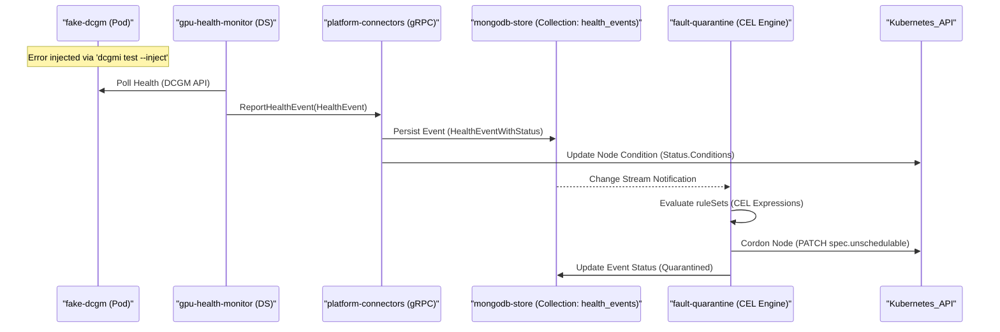
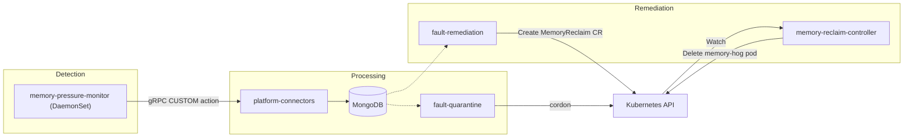

<!-- source: DeepWiki mcp.deepwiki.com · repo NVIDIA/NVSentinel · page 2.2 Fault Injection Demo · fetched 2026-10-26 -->

# Fault Injection Demo

<details>
<summary>Relevant source files</summary>

The following files were used as context for generating this wiki page:

- [README.md](README.md)
- [demos/README.md](demos/README.md)
- [demos/local-custom-remediation-demo/Makefile](demos/local-custom-remediation-demo/Makefile)
- [demos/local-custom-remediation-demo/README.md](demos/local-custom-remediation-demo/README.md)
- [demos/local-custom-remediation-demo/config/memoryreclaim-crd.yaml](demos/local-custom-remediation-demo/config/memoryreclaim-crd.yaml)
- [demos/local-custom-remediation-demo/config/nvsentinel-values.yaml](demos/local-custom-remediation-demo/config/nvsentinel-values.yaml)
- [demos/local-custom-remediation-demo/memory-pressure-monitor/go.sum](demos/local-custom-remediation-demo/memory-pressure-monitor/go.sum)
- [demos/local-custom-remediation-demo/memory-pressure-monitor/main.go](demos/local-custom-remediation-demo/memory-pressure-monitor/main.go)
- [demos/local-custom-remediation-demo/memory-reclaim-controller/go.mod](demos/local-custom-remediation-demo/memory-reclaim-controller/go.mod)
- [demos/local-custom-remediation-demo/memory-reclaim-controller/go.sum](demos/local-custom-remediation-demo/memory-reclaim-controller/go.sum)
- [demos/local-fault-injection-demo/Makefile](demos/local-fault-injection-demo/Makefile)
- [demos/local-fault-injection-demo/README.md](demos/local-fault-injection-demo/README.md)
- [demos/local-fault-injection-demo/scripts/00-setup.sh](demos/local-fault-injection-demo/scripts/00-setup.sh)
- [demos/local-fault-injection-demo/scripts/01-show-cluster.sh](demos/local-fault-injection-demo/scripts/01-show-cluster.sh)
- [demos/local-fault-injection-demo/scripts/02-inject-error.sh](demos/local-fault-injection-demo/scripts/02-inject-error.sh)
- [demos/local-fault-injection-demo/scripts/03-verify-cordon.sh](demos/local-fault-injection-demo/scripts/03-verify-cordon.sh)
- [demos/local-fault-injection-demo/scripts/99-cleanup.sh](demos/local-fault-injection-demo/scripts/99-cleanup.sh)
- [demos/local-slinky-drain-demo/scripts/00-setup.sh](demos/local-slinky-drain-demo/scripts/00-setup.sh)
- [distros/kubernetes/README.md](distros/kubernetes/README.md)
- [docs/OVERVIEW.md](docs/OVERVIEW.md)

</details>


## Purpose and Scope

This page provides a detailed walkthrough of the **Local Fault Injection Demo**, an interactive demonstration that runs entirely on a local machine without requiring GPU hardware. The demo illustrates NVSentinel's core fault detection and quarantine workflow, from GPU error detection through automated node cordoning.

**What this demo covers:**
- Simulating GPU hardware failures using a simulated DCGM environment [demos/local-fault-injection-demo/README.md:102]().
- Observing health event flow from detection to the persistent data store [demos/local-fault-injection-demo/README.md:12-13]().
- Verifying automated node quarantine (cordon) behavior triggered by fatal errors [demos/local-fault-injection-demo/README.md:11]().
- Understanding the event-driven architecture in practice using MongoDB change streams [demos/local-fault-injection-demo/README.md:106]().

**What this demo does NOT cover:**
- Production installation and configuration (see [Installation and Quick Start](2.1)).
- Pod eviction (Node Drainer) or remediation workflows (Fault Remediation), which are disabled to simplify the demo [demos/local-fault-injection-demo/scripts/00-setup.sh:175-178]().
- Real GPU hardware monitoring (DCGM integration is simulated) [demos/local-fault-injection-demo/README.md:5-6]().

The demo focuses on the **detection-to-quarantine** pipeline. Node Drainer, Fault Remediation, Health Events Analyzer, and Janitor modules are disabled to minimize resource usage and simplify the learning experience [demos/local-fault-injection-demo/scripts/00-setup.sh:175-182]().

**Location:** `demos/local-fault-injection-demo/` [demos/local-fault-injection-demo/README.md:1]()

---

## Prerequisites and System Requirements

### Required Tools

| Tool | Minimum Version | Purpose |
|------|----------------|---------|
| `docker` | 20.10+ | Container runtime for KIND [demos/local-fault-injection-demo/README.md:24]() |
| `kind` | 0.20+ | Kubernetes IN Docker cluster [demos/local-fault-injection-demo/README.md:26]() |
| `kubectl` | 1.25+ | Kubernetes CLI [demos/local-fault-injection-demo/README.md:25]() |
| `helm` | 3.0+ | Kubernetes package manager [demos/local-fault-injection-demo/README.md:27]() |
| `jq` | 1.6+ | JSON parsing in scripts [demos/local-fault-injection-demo/README.md:28]() |

### System Resources
- **Disk Space:** ~10GB free (Docker images + KIND cluster) [demos/local-fault-injection-demo/README.md:19]().
- **Memory:** 4GB minimum, 8GB recommended [demos/local-fault-injection-demo/README.md:20]().
- **CPU:** 2 cores minimum [demos/local-fault-injection-demo/README.md:21]().
- **GPU:** **Not required** (simulation mode) [demos/local-fault-injection-demo/README.md:16]().

**Sources:** [demos/local-fault-injection-demo/README.md:14-32](), [demos/local-fault-injection-demo/scripts/00-setup.sh:45-75]()

---

## Demo Architecture

The demo deploys a **minimal NVSentinel configuration** in a single-node KIND cluster. This configuration includes only the components necessary to demonstrate fault detection and quarantine.

### Deployment Topology

```mermaid
graph TB
    subgraph "KIND_Cluster_[nvsentinel-demo]"
        subgraph "Control_Plane_Node"
            "kube-apiserver"["kube-apiserver"]
            "mongodb-store"["mongodb-store (Pod)"]
        end
        
        subgraph "Worker_Node"
            "fake-dcgm"["fake-dcgm (DaemonSet)"]
            "gpu-health-monitor"["gpu-health-monitor (DaemonSet)"]
        end
        
        subgraph "Core_Components"
            "platform-connectors"["platform-connectors (Deployment)"]
            "fault-quarantine"["fault-quarantine (Deployment)"]
            "simple-health-client"["simple-health-client (Deployment)"]
        end
    end
    
    "fake-dcgm" -->|"DCGM_API"| "gpu-health-monitor"
    "gpu-health-monitor" -->|"gRPC_HealthEvent"| "platform-connectors"
    "platform-connectors" -->|"Insert_Event"| "mongodb-store"
    "mongodb-store" -.->|"Change_Stream"| "fault-quarantine"
    "fault-quarantine" -->|"Cordon_Node"| "kube-apiserver"
```

**Architecture Notes:**
- **Fake DCGM:** Simulates NVIDIA GPU monitoring with NVML injection [demos/local-fault-injection-demo/README.md:102]().
- **Single MongoDB Instance:** Uses a 1-node replica set to enable change streams without high resource overhead [demos/local-fault-injection-demo/scripts/00-setup.sh:209]().
- **Disabled Modules:** To keep the demo focused, `nodeDrainer`, `faultRemediation`, and `janitor` are explicitly disabled [demos/local-fault-injection-demo/scripts/00-setup.sh:175-182]().

**Sources:** [demos/local-fault-injection-demo/README.md:97-142](), [demos/local-fault-injection-demo/scripts/00-setup.sh:135-300]()

---

## Demo Workflow

The demo consists of four primary phases. Users can run the automated workflow (`make demo`) or execute scripts individually for learning.

### Phase 0: Setup (`00-setup.sh`)
**Purpose:** Create KIND cluster and install minimal NVSentinel deployment.
- **Cluster Creation:** Creates a cluster named `nvsentinel-demo` with one worker node [demos/local-fault-injection-demo/scripts/00-setup.sh:87-93]().
- **Cert-Manager:** Installs `cert-manager` for internal TLS requirements [demos/local-fault-injection-demo/scripts/00-setup.sh:107-121]().
- **NVSentinel Install:** Deploys NVSentinel via Helm with a minimal `values.yaml` [demos/local-fault-injection-demo/scripts/00-setup.sh:150-281]().

### Phase 1: Initial State Inspection (`01-show-cluster.sh`)
**Purpose:** Verify cluster health before fault injection.
- Checks if the worker node is `Ready` and `SchedulingEnabled` [demos/local-fault-injection-demo/scripts/01-show-cluster.sh:55-71]().
- Verifies all NVSentinel pods are `Running` [demos/local-fault-injection-demo/scripts/01-show-cluster.sh:73-95]().
- Confirms no health-related node conditions exist [demos/local-fault-injection-demo/scripts/01-show-cluster.sh:128]().

### Phase 2: Fault Injection (`02-inject-error.sh`)
**Purpose:** Simulate a GPU hardware failure.
- **DCGM Injection:** Executes `dcgmi test --inject` inside the `fake-dcgm` pod to simulate a fatal InfoROM corruption (Field 84) on GPU 0 [demos/local-fault-injection-demo/README.md:81]().
- **Detection:** The `gpu-health-monitor` detects this change during its next poll cycle and reports it to `platform-connectors` [demos/local-fault-injection-demo/README.md:87-88]().

### Phase 3: Automated Response Verification (`03-verify-cordon.sh`)
**Purpose:** Confirm that the node was automatically quarantined.
- **Cordon Check:** Polls the Kubernetes API to see if the node `spec.unschedulable` has been set to `true` [demos/local-fault-injection-demo/README.md:91]().
- **Condition Check:** Verifies the presence of health-related node conditions (e.g., `GPUXidError`) [demos/local-fault-injection-demo/scripts/01-show-cluster.sh:98-122]().

**Sources:** [demos/local-fault-injection-demo/README.md:34-73](), [demos/local-fault-injection-demo/scripts/00-setup.sh:1-150]()

---

## Detailed Implementation: Code Entity Space

This diagram maps the demo actions to specific code entities and data structures within the NVSentinel repository.



### Key Components in Code

| Code Entity | File Path | Role |
|-------------|-----------|------|
| `gpu-health-monitor` | `charts/gpu-health-monitor/` | Polls DCGM and sends gRPC events [distros/kubernetes/README.md:63]() |
| `platform-connectors` | `charts/platform-connectors/` | gRPC server for event ingestion and persistence [distros/kubernetes/README.md:62]() |
| `fault-quarantine` | `charts/fault-quarantine/` | Watches MongoDB and executes cordon/taint logic [distros/kubernetes/README.md:66]() |
| `mongodb-store` | `charts/mongodb-store/` | Event database providing change streams [distros/kubernetes/README.md:72]() |
| `ruleSets` | `values.yaml` (fault-quarantine) | CEL expressions used to match fatal events [distros/kubernetes/README.md:152-169]() |

**Sources:** [distros/kubernetes/README.md:52-76](), [demos/local-fault-injection-demo/README.md:108-142](), [README.md:117-166]()

---

## Extended Scenario: Custom Remediation Demo

While the basic fault injection demo focuses on quarantine, the **Custom Remediation Demo** shows how NVSentinel can be extended to handle non-GPU faults and trigger custom repair workflows.



### Implementation Details
- **Custom Monitor:** A Go DaemonSet that reads `/proc/meminfo` and sends a `CUSTOM` health event with `customRecommendedAction: "RECLAIM_MEMORY"` [demos/local-custom-remediation-demo/README.md:113-126]().
- **Custom Action Mapping:** Configured in Helm to map the "RECLAIM_MEMORY" action to a specific CRD (`MemoryReclaim`) [demos/local-custom-remediation-demo/README.md:162-171]().
- **Third-Party Controller:** The `memory-reclaim-controller` watches for these CRs and executes the repair by deleting specific pods [demos/local-custom-remediation-demo/README.md:150-153]().

**Sources:** [demos/local-custom-remediation-demo/README.md:1-171]()

---

## Cleanup

To destroy the demo environment and reclaim system resources, use the provided cleanup script:

```bash
# Deletes the KIND cluster and local temporary files
./scripts/99-cleanup.sh
```

This command deletes the `nvsentinel-demo` cluster [demos/local-fault-injection-demo/scripts/00-setup.sh:83](). Note that persistent data in MongoDB is lost as persistence is disabled for this demo [demos/local-fault-injection-demo/scripts/00-setup.sh:248]().

**Sources:** [demos/local-fault-injection-demo/README.md:46](), [demos/local-fault-injection-demo/scripts/00-setup.sh:77-85]()

---

