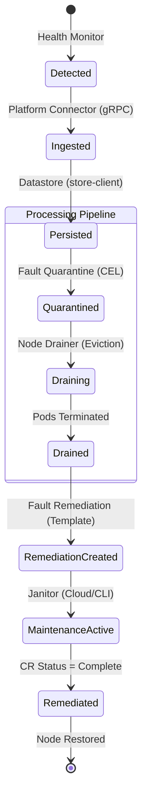

<!-- source: DeepWiki mcp.deepwiki.com · repo NVIDIA/NVSentinel · page 2.3 Core Concepts · fetched 2026-10-26 -->

# Core Concepts

<details>
<summary>Relevant source files</summary>

The following files were used as context for generating this wiki page:

- [commons/go.sum](commons/go.sum)
- [data-models/pkg/protos/health_event.pb.go](data-models/pkg/protos/health_event.pb.go)
- [data-models/protobufs/health_event.proto](data-models/protobufs/health_event.proto)
- [distros/kubernetes/nvsentinel/charts/gpu-health-monitor/files/dcgmerrorsmapping.csv](distros/kubernetes/nvsentinel/charts/gpu-health-monitor/files/dcgmerrorsmapping.csv)
- [distros/kubernetes/nvsentinel/charts/preflight/templates/deployment.yaml](distros/kubernetes/nvsentinel/charts/preflight/templates/deployment.yaml)
- [distros/kubernetes/nvsentinel/values-full.yaml](distros/kubernetes/nvsentinel/values-full.yaml)
- [distros/kubernetes/nvsentinel/values-tilt.yaml](distros/kubernetes/nvsentinel/values-tilt.yaml)
- [distros/kubernetes/nvsentinel/values.yaml](distros/kubernetes/nvsentinel/values.yaml)
- [docs/INTEGRATIONS.md](docs/INTEGRATIONS.md)
- [event-exporter/go.mod](event-exporter/go.mod)
- [event-exporter/go.sum](event-exporter/go.sum)
- [fault-quarantine/go.mod](fault-quarantine/go.mod)
- [fault-quarantine/go.sum](fault-quarantine/go.sum)
- [fault-remediation/go.mod](fault-remediation/go.mod)
- [fault-remediation/go.sum](fault-remediation/go.sum)
- [health-events-analyzer/go.mod](health-events-analyzer/go.mod)
- [health-events-analyzer/go.sum](health-events-analyzer/go.sum)
- [health-monitors/gpu-health-monitor/gpu_health_monitor/protos/health_event_pb2.py](health-monitors/gpu-health-monitor/gpu_health_monitor/protos/health_event_pb2.py)
- [health-monitors/gpu-health-monitor/gpu_health_monitor/protos/health_event_pb2.pyi](health-monitors/gpu-health-monitor/gpu_health_monitor/protos/health_event_pb2.pyi)
- [health-monitors/syslog-health-monitor/go.mod](health-monitors/syslog-health-monitor/go.mod)
- [node-drainer/go.mod](node-drainer/go.mod)
- [node-drainer/go.sum](node-drainer/go.sum)
- [platform-connectors/go.mod](platform-connectors/go.mod)
- [platform-connectors/go.sum](platform-connectors/go.sum)
- [platform-connectors/pkg/transformers/metadata/transformer_test.go](platform-connectors/pkg/transformers/metadata/transformer_test.go)
- [store-client/go.mod](store-client/go.mod)
- [tests/helpers/healthevent.go](tests/helpers/healthevent.go)
- [tests/helpers/preflight.go](tests/helpers/preflight.go)
- [tilt/Tiltfile](tilt/Tiltfile)
- [tilt/helpers.star](tilt/helpers.star)

</details>


## Purpose and Scope

This page defines the fundamental concepts of NVSentinel: **Health Events**, **Monitoring**, **Quarantine**, **Drain**, and **Remediation**. It explains the technical implementation of the event lifecycle, data flow between components, and the transition from high-level operational states to specific code entities.

NVSentinel is designed as a modular, event-driven system where coordination occurs through a shared datastore (MongoDB or PostgreSQL) and the Kubernetes API, rather than direct RPC calls between core logic modules [distros/kubernetes/nvsentinel/values.yaml:25-35]().

---

## Health Events

A **Health Event** is the primary data structure in NVSentinel, representing a detected hardware or software fault.

### Data Structure and Code Entities
In the codebase, these are defined as Protobuf messages which are then used to generate Python and Go bindings [data-models/protobufs/health_event.proto:1-50]().

| Field | Code Identifier | Description |
|-------|-----------------|-------------|
| **Agent** | `agent` | The monitor that reported the event (e.g., `gpu-health-monitor`) [data-models/protobufs/health_event.proto:27]() |
| **Check Name** | `check_name` | Specific fault type (e.g., `GPUXidError`) [data-models/protobufs/health_event.proto:29]() |
| **Severity** | `is_fatal` | Boolean indicating if the node must be isolated immediately [data-models/protobufs/health_event.proto:30]() |
| **Impact** | `entities_impacted` | List of specific GPUs (by UUID) or other components affected [data-models/protobufs/health_event.proto:35]() |
| **Strategy** | `processing_strategy` | Dictates if the event should trigger remediation or just be logged (`STORE_ONLY` vs `EXECUTE_REMEDIATION`) [data-models/protobufs/health_event.proto:41]() |

**Sources:** [data-models/protobufs/health_event.proto:1-50](), [health-monitors/gpu-health-monitor/gpu_health_monitor/protos/health_event_pb2.py:1-100]()

---

## Health Monitoring

Monitors are the "sensors" of the system. They operate at different levels of the stack to provide comprehensive coverage.

### Monitor Taxonomy

| Component | Implementation | Detection Source | Scope |
|-----------|----------------|------------------|-------|
| **GPU Health Monitor** | Python [distros/kubernetes/nvsentinel/values.yaml:143-144]() | DCGM (XIDs, ECC, Thermal) [distros/kubernetes/nvsentinel/values.yaml:110-112]() | Per-Node (DaemonSet) |
| **Syslog Health Monitor** | Go [distros/kubernetes/nvsentinel/values.yaml:159-160]() | Journalctl (Kernel Panics, Driver Crashes) [distros/kubernetes/nvsentinel/values.yaml:105-106]() | Per-Node (DaemonSet) |
| **CSP Health Monitor** | Go [distros/kubernetes/nvsentinel/values.yaml:157-158]() | AWS/GCP/Azure/OCI APIs (Maintenance events) [distros/kubernetes/nvsentinel/values-full.yaml:172-174]() | Cluster-wide |
| **K8s Object Monitor** | Go [distros/kubernetes/nvsentinel/values.yaml:171-172]() | K8s API (CEL expressions on resources) [distros/kubernetes/nvsentinel/values-full.yaml:205-207]() | Cluster-wide |

### Natural Language to Code Entity Space: Monitoring
The following diagram bridges the concept of "Monitoring" to the actual gRPC service and message definitions.

```mermaid
graph TD
    subgraph "Natural Language: Detection"
        A["Hardware Fault"]
        B["Cloud Maintenance"]
    end

    subgraph "Code Entity: Health Monitors"
        GPU["gpu-health-monitor (Python)"]
        CSP["csp-health-monitor (Go)"]
    end

    subgraph "Code Entity: Platform Connectors"
        PC["platform-connectors (Go)"]
        PC_RPC["HealthEventOccurredV1"]
    end

    subgraph "Data Model"
        HE["HealthEvent (Protobuf)"]
    end

    A --> GPU
    B --> CSP
    GPU -->| "calls gRPC" | PC_RPC
    CSP -->| "calls gRPC" | PC_RPC
    PC_RPC -->| "unmarshals" | HE
```
**Sources:** [platform-connectors/go.mod:1-24](), [data-models/protobufs/health_event.proto:1-50](), [distros/kubernetes/nvsentinel/values.yaml:143-173]()

---

## Event Processing Pipeline

The `platform-connectors` module acts as the gateway. It receives events via gRPC, typically over a Unix domain socket for node-local monitors.

### Data Flow Logic
1. **Ingestion**: The `PlatformConnector` service receives a `HealthEvents` stream [platform-connectors/go.mod:7-24]().
2. **Persistence**: Events are stored in the configured datastore via the `store-client` abstraction [store-client/go.mod:1-24]().
3. **Conditioning**: The connector updates the Kubernetes `Node` object status, adding or updating conditions based on the fault [platform-connectors/go.mod:20-22]().

**Sources:** [platform-connectors/go.mod:1-24](), [store-client/go.mod:1-24](), [distros/kubernetes/nvsentinel/values.yaml:25-56]()

---

## Fault Quarantine and Circuit Breaking

**Quarantine** is the logic that isolates a node from the scheduler.

### CEL-Based Rules
Quarantine decisions are driven by **Common Expression Language (CEL)**. This allows administrators to define complex logic like "only cordon if the event is fatal AND the node is not explicitly excluded from management" [fault-quarantine/go.mod:8-8]().

### Circuit Breaker Implementation
To prevent a "storm" of quarantines (e.g., a top-of-rack switch failure causing all GPUs to report errors), a circuit breaker is used. It is configured via a percentage of the cluster and a cooldown duration.

| Parameter | Default Key | Description |
|-----------|-------------|-------------|
| **Max Percentage** | `maxQuarantinePercent` | Maximum % of nodes allowed to be quarantined simultaneously |
| **Cooldown** | `cooldownDuration` | Period to wait before allowing more quarantines after a trip |

**Sources:** [fault-quarantine/go.mod:1-24](), [distros/kubernetes/nvsentinel/values-full.yaml:150-155]()

---

## Node Drain and Remediation

Once a node is quarantined (cordoned), the **Node Drainer** and **Fault Remediation** modules take over.

### Drain Strategies
Draining is the graceful eviction of pods. Strategies are applied per-namespace [node-drainer/go.mod:1-27]():
- `Immediate`: Forceful deletion.
- `AllowCompletion`: Wait for the pod to finish (common for batch jobs).
- `DeleteAfterTimeout`: Wait for a grace period, then delete.

### Remediation Templates
Remediation is triggered by the creation of a Custom Resource (CR). These CRs are generated using **Go Templates**, allowing for dynamic field injection like `NodeName` or `HealthEventID` [fault-remediation/go.mod:1-26]().

### Natural Language to Code Entity Space: Remediation
This diagram maps the maintenance lifecycle to specific CRDs and the `janitor` module.

```mermaid
graph LR
    subgraph "Natural Language: Action"
        R1["Reset GPU"]
        R2["Reboot Node"]
    end

    subgraph "Code Entity: Custom Resources (CRDs)"
        GR["GPUReset (v1alpha1)"]
        RN["RebootNode (v1alpha1)"]
    end

    subgraph "Code Entity: Modules"
        FR["fault-remediation"]
        JAN["janitor"]
    end

    subgraph "Infrastructure"
        CSP_API["Cloud Provider API"]
        NV_SMI["nvidia-smi"]
    end

    R1 --> GR
    R2 --> RN
    FR -->| "applies template" | GR
    FR -->| "applies template" | RN
    JAN -->| "reconciles" | GR
    JAN -->| "reconciles" | RN
    GR -->| "executes" | NV_SMI
    RN -->| "triggers" | CSP_API
```
**Sources:** [distros/kubernetes/nvsentinel/values-tilt.yaml:266-283](), [fault-remediation/go.mod:1-26](), [node-drainer/go.mod:1-27]()

---

## The Event Lifecycle

The following state machine describes the end-to-end flow of a fault through the system components.



### State Definitions

1. **Detected**: A monitor identifies a failure condition (e.g., XID error) [distros/kubernetes/nvsentinel/values-full.yaml:138-140]().
2. **Ingested**: The event is validated and stored in the database [platform-connectors/go.mod:1-24]().
3. **Quarantined**: The node is cordoned and tainted based on CEL rules [fault-quarantine/go.mod:8-12]().
4. **Drained**: All user pods are evicted based on the configured strategy [node-drainer/go.mod:1-27]().
5. **Remediated**: The repair action (e.g., `GPUReset`) is confirmed successful by the `janitor` [distros/kubernetes/nvsentinel/values-tilt.yaml:266-277]().

**Sources:** [distros/kubernetes/nvsentinel/values-full.yaml:131-176](), [fault-remediation/go.mod:1-26](), [platform-connectors/go.mod:1-24]()

---

