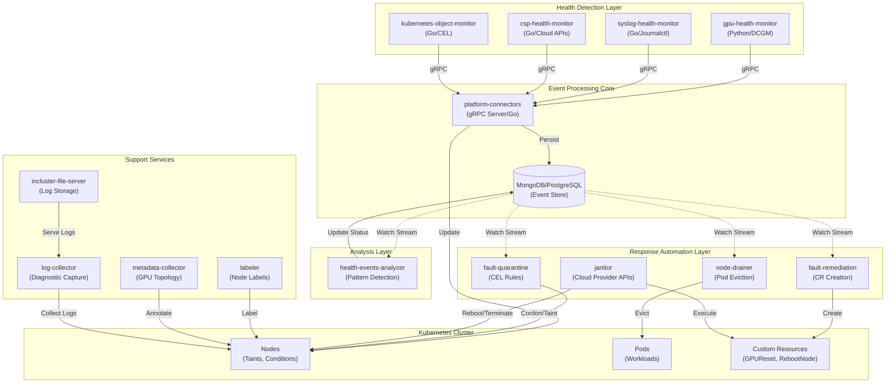
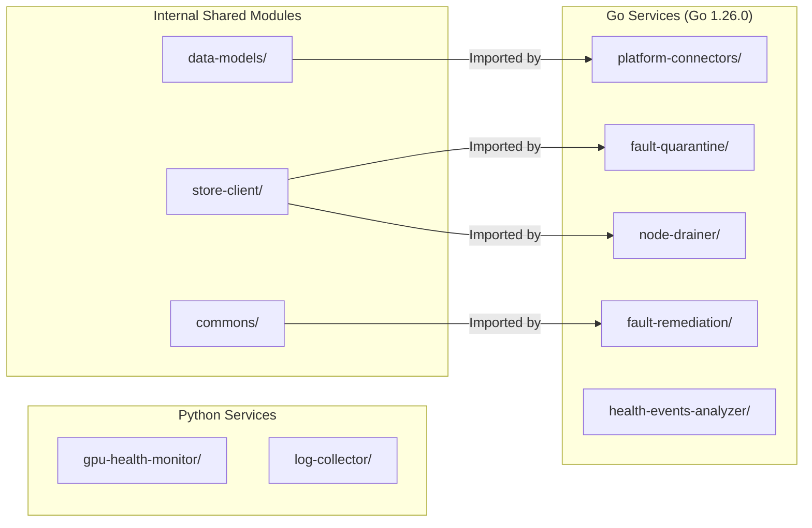

<!-- source: DeepWiki mcp.deepwiki.com · repo NVIDIA/NVSentinel · page 3 Architecture · fetched 2026-10-26 -->

# Architecture

Relevant source files

The following files were used as context for generating this wiki page:

- [commons/go.sum](commons/go.sum)
- [distros/kubernetes/nvsentinel/charts/gpu-health-monitor/files/dcgmerrorsmapping.csv](distros/kubernetes/nvsentinel/charts/gpu-health-monitor/files/dcgmerrorsmapping.csv)
- [distros/kubernetes/nvsentinel/charts/preflight/templates/deployment.yaml](distros/kubernetes/nvsentinel/charts/preflight/templates/deployment.yaml)
- [distros/kubernetes/nvsentinel/values-full.yaml](distros/kubernetes/nvsentinel/values-full.yaml)
- [distros/kubernetes/nvsentinel/values-tilt.yaml](distros/kubernetes/nvsentinel/values-tilt.yaml)
- [distros/kubernetes/nvsentinel/values.yaml](distros/kubernetes/nvsentinel/values.yaml)
- [docs/INTEGRATIONS.md](docs/INTEGRATIONS.md)
- [event-exporter/go.mod](event-exporter/go.mod)
- [event-exporter/go.sum](event-exporter/go.sum)
- [fault-quarantine/go.mod](fault-quarantine/go.mod)
- [fault-quarantine/go.sum](fault-quarantine/go.sum)
- [fault-remediation/go.mod](fault-remediation/go.mod)
- [fault-remediation/go.sum](fault-remediation/go.sum)
- [health-events-analyzer/go.mod](health-events-analyzer/go.mod)
- [health-events-analyzer/go.sum](health-events-analyzer/go.sum)
- [health-monitors/syslog-health-monitor/go.mod](health-monitors/syslog-health-monitor/go.mod)
- [node-drainer/go.mod](node-drainer/go.mod)
- [node-drainer/go.sum](node-drainer/go.sum)
- [platform-connectors/go.mod](platform-connectors/go.mod)
- [platform-connectors/go.sum](platform-connectors/go.sum)
- [platform-connectors/pkg/transformers/metadata/transformer_test.go](platform-connectors/pkg/transformers/metadata/transformer_test.go)
- [store-client/go.mod](store-client/go.mod)
- [tests/helpers/preflight.go](tests/helpers/preflight.go)
- [tilt/Tiltfile](tilt/Tiltfile)
- [tilt/helpers.star](tilt/helpers.star)

## Purpose and Scope

This document provides a high-level overview of NVSentinel's architecture, covering its layered design, core principles, and key technologies. NVSentinel is a Kubernetes-native GPU node resilience system that automatically detects, quarantines, and remediates hardware and software faults in GPU clusters.

For detailed information about specific architectural aspects, see:
- **[System Overview](#3.1)**: High-level architecture showing layers (detection, processing, response) and component relationships.
- **[Event-Driven Architecture](#3.2)**: MongoDB change streams, asynchronous communication patterns, and decoupled component design.
- **[Data Flow and Processing Pipeline](#3.3)**: Complete event flow from detection through analysis to remediation with sequence diagrams.
- **[Data Models and Storage](#3.4)**: HealthEvent data structures, MongoDB/PostgreSQL schemas, and store-client abstraction.
- **[Multi-Language Architecture](#3.5)**: Python and Go service integration, gRPC communication, and shared internal modules.

## Overview

NVSentinel implements a **microservices-based, event-driven architecture** where independent components communicate asynchronously via database change streams and synchronously via gRPC. The system follows a clear separation of concerns across functional layers that process health events from detection through automated remediation.

**Core Architecture Characteristics:**

| Characteristic | Implementation | Benefit |
|----------------|----------------|---------|
| **Decoupled Components** | MongoDB/PostgreSQL change streams for async communication | Independent scaling, failure isolation |
| **Event-Driven Processing** | Change stream watchers with aggregation pipelines | Temporal decoupling, crash recovery via resume tokens |
| **Progressive Pipeline** | Status fields trigger downstream processing | Observable, auditable remediation flow |
| **Stateless Services** | External state in MongoDB and Kubernetes API | Horizontal scalability, simple restarts |
| **Kubernetes-Native** | CRDs, DaemonSets, Deployments, CEL expressions | Natural integration with cluster lifecycle |

The architecture prioritizes **reliability** (ring buffers, circuit breakers, resume tokens), **observability** (Prometheus metrics, audit trails), and **extensibility** (plugin system, CEL rules, Go templates).

**Sources**: [distros/kubernetes/nvsentinel/values-full.yaml:21-32](), [distros/kubernetes/nvsentinel/values.yaml:144-181]()

## Layered Architecture

NVSentinel is organized into functional layers that process health events from detection through automated remediation.

### System Architecture Diagram

This diagram maps the natural language components to their corresponding code entities and services.

**Sources**: [distros/kubernetes/nvsentinel/values.yaml:143-180](), [tilt/Tiltfile:126-145]()

## Design Principles

### 1. Event-Driven Communication
All components communicate asynchronously via database change streams (MongoDB native change streams or PostgreSQL LISTEN/NOTIFY), eliminating direct dependencies. Health monitors send events to `platform-connectors` via gRPC, which persists them to the datastore. Downstream components watch these streams to react to new events.

**Sources**: [distros/kubernetes/nvsentinel/values.yaml:25-56](), [platform-connectors/go.mod:18-19]()

### 2. Progressive Remediation Pipeline
Fault remediation flows through a staged pipeline where each component updates status fields to trigger downstream processing:
**Detection** → **Quarantine** → **Drain** → **Remediation** → **Execution**.
This ensures that nodes are safely cordoned and workloads are gracefully evicted before any hardware maintenance (like a GPU reset or node reboot) is performed.

**Sources**: [distros/kubernetes/nvsentinel/values-full.yaml:150-175](), [distros/kubernetes/nvsentinel/values-tilt.yaml:266-285]()

### 3. Stateless Components with External State
NVSentinel components are stateless, storing all persistent state in MongoDB/PostgreSQL or the Kubernetes API. This enables horizontal scaling and simple restarts without data loss. The system uses resume tokens for change streams to ensure processing resumes exactly where it left off.

**Sources**: [distros/kubernetes/nvsentinel/values.yaml:99-103](), [store-client/go.mod:18-20]()

### 4. Circuit Breaker Protection
The `fault-quarantine` module implements a circuit breaker to prevent mass node quarantines during cluster-wide events or false positives. If the percentage of quarantined nodes exceeds a threshold, the circuit trips and stops further automated cordoning.

**Sources**: [distros/kubernetes/nvsentinel/values-full.yaml:69-70](), [fault-quarantine/go.mod:8-12]()

### 5. Kubernetes-Native Design
NVSentinel leverages standard Kubernetes primitives:
- **DaemonSets** for node-local monitoring (`gpu-health-monitor`, `syslog-health-monitor`).
- **Deployments** for central controllers.
- **CRDs** for maintenance actions (`GPUReset`, `RebootNode`).
- **CEL (Common Expression Language)** for flexible quarantine rules and object monitoring.

**Sources**: [distros/kubernetes/nvsentinel/values.yaml:171-172](), [fault-quarantine/go.mod:8-9](), [platform-connectors/go.mod:9-10]()

## Key Technologies

NVSentinel uses a polyglot architecture combining Go and Python services.

### Code Entity Mapping Diagram

This diagram bridges the functional names to the specific code modules and files.

**Sources**: [platform-connectors/go.mod:1-5](), [fault-quarantine/go.mod:112-120](), [node-drainer/go.mod:112-120](), [store-client/go.mod:1-5]()

## Component Organization

### Deployment Model
NVSentinel is deployed via Helm and supports various cloud providers (AWS, GCP, Azure, OCI).

| Resource Type | Components | Purpose |
|---------------|------------|---------|
| **DaemonSet** | Health Monitors, Labeler, Metadata Collector | Node-local detection and labeling |
| **Deployment** | Platform Connectors, Fault Management Modules | Centralized event processing and orchestration |
| **StatefulSet** | MongoDB (optional) | High-availability event storage |
| **Job** | Database Setup, Maintenance Execution | One-time or triggered maintenance tasks |

**Sources**: [distros/kubernetes/nvsentinel/values.yaml:89-98](), [distros/kubernetes/nvsentinel/values-full.yaml:40-130](), [tilt/Tiltfile:146-161]()

### Development vs. Production
In production, NVSentinel interacts with real hardware and cloud APIs. For development, the project provides a comprehensive local setup using **KIND** and **KWOK** (Kubernetes Without Kubelet) to simulate nodes and GPUs.

**Sources**: [tilt/Tiltfile:75-125](), [distros/kubernetes/nvsentinel/values-tilt.yaml:104-125]()

---
For detailed information on component relationships, see **[System Overview](#3.1)**.
For implementation details of the event-driven patterns, see **[Event-Driven Architecture](#3.2)**.
To trace a fault from detection to fix, see **[Data Flow and Processing Pipeline](#3.3)**.

---

