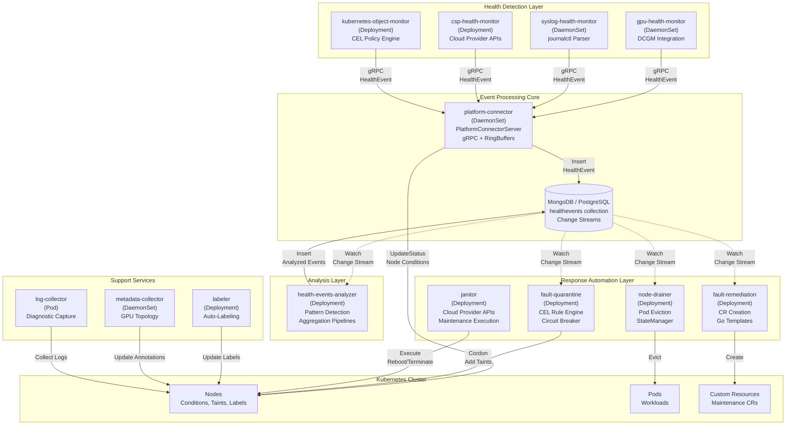
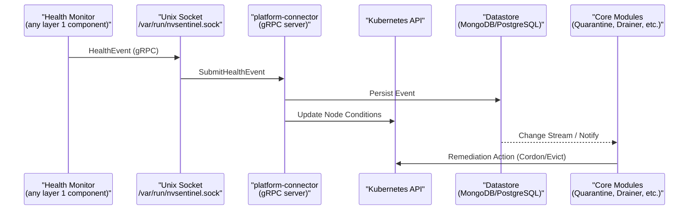
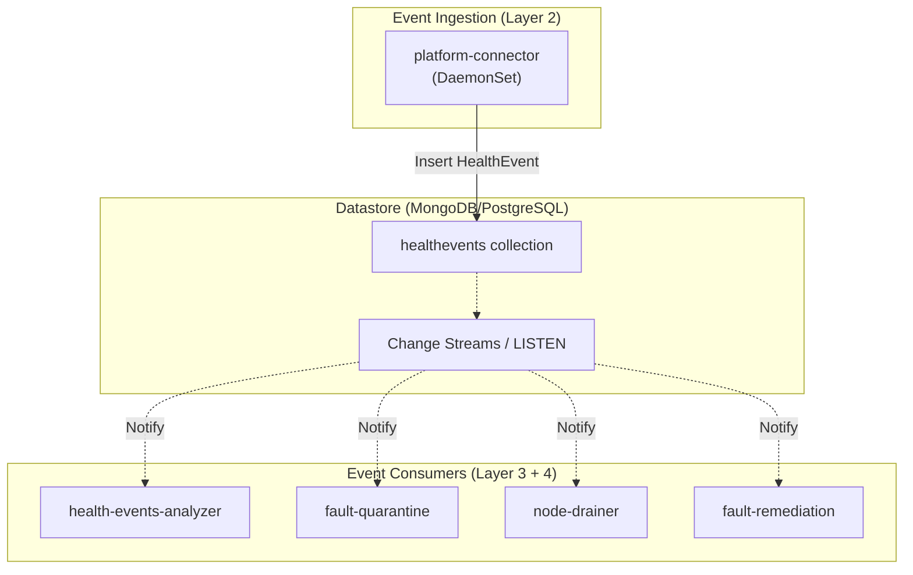
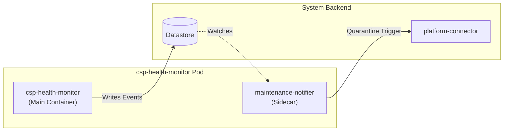

<!-- source: DeepWiki mcp.deepwiki.com · repo NVIDIA/NVSentinel · page 3.1 System Overview · fetched 2026-10-26 -->

# System Overview

<details>
<summary>Relevant source files</summary>

The following files were used as context for generating this wiki page:

- [README.md](README.md)
- [demos/local-fault-injection-demo/Makefile](demos/local-fault-injection-demo/Makefile)
- [demos/local-fault-injection-demo/README.md](demos/local-fault-injection-demo/README.md)
- [demos/local-fault-injection-demo/scripts/00-setup.sh](demos/local-fault-injection-demo/scripts/00-setup.sh)
- [demos/local-fault-injection-demo/scripts/01-show-cluster.sh](demos/local-fault-injection-demo/scripts/01-show-cluster.sh)
- [demos/local-fault-injection-demo/scripts/02-inject-error.sh](demos/local-fault-injection-demo/scripts/02-inject-error.sh)
- [demos/local-fault-injection-demo/scripts/03-verify-cordon.sh](demos/local-fault-injection-demo/scripts/03-verify-cordon.sh)
- [demos/local-fault-injection-demo/scripts/99-cleanup.sh](demos/local-fault-injection-demo/scripts/99-cleanup.sh)
- [demos/local-slinky-drain-demo/scripts/00-setup.sh](demos/local-slinky-drain-demo/scripts/00-setup.sh)
- [distros/kubernetes/README.md](distros/kubernetes/README.md)
- [distros/kubernetes/nvsentinel/charts/csp-health-monitor/templates/deployment.yaml](distros/kubernetes/nvsentinel/charts/csp-health-monitor/templates/deployment.yaml)
- [distros/kubernetes/nvsentinel/charts/event-exporter/templates/deployment.yaml](distros/kubernetes/nvsentinel/charts/event-exporter/templates/deployment.yaml)
- [distros/kubernetes/nvsentinel/charts/fault-quarantine/templates/deployment.yaml](distros/kubernetes/nvsentinel/charts/fault-quarantine/templates/deployment.yaml)
- [distros/kubernetes/nvsentinel/charts/fault-remediation/templates/deployment.yaml](distros/kubernetes/nvsentinel/charts/fault-remediation/templates/deployment.yaml)
- [distros/kubernetes/nvsentinel/charts/gpu-health-monitor/files/dcgmerrorsmapping.csv](distros/kubernetes/nvsentinel/charts/gpu-health-monitor/files/dcgmerrorsmapping.csv)
- [distros/kubernetes/nvsentinel/charts/health-events-analyzer/templates/deployment.yaml](distros/kubernetes/nvsentinel/charts/health-events-analyzer/templates/deployment.yaml)
- [distros/kubernetes/nvsentinel/charts/node-drainer/templates/deployment.yaml](distros/kubernetes/nvsentinel/charts/node-drainer/templates/deployment.yaml)
- [distros/kubernetes/nvsentinel/charts/preflight/templates/deployment.yaml](distros/kubernetes/nvsentinel/charts/preflight/templates/deployment.yaml)
- [distros/kubernetes/nvsentinel/templates/_helpers.tpl](distros/kubernetes/nvsentinel/templates/_helpers.tpl)
- [distros/kubernetes/nvsentinel/templates/configmap-datastore.yaml](distros/kubernetes/nvsentinel/templates/configmap-datastore.yaml)
- [distros/kubernetes/nvsentinel/templates/daemonset.yaml](distros/kubernetes/nvsentinel/templates/daemonset.yaml)
- [distros/kubernetes/nvsentinel/templates/job-external-mongodb-setup.yaml](distros/kubernetes/nvsentinel/templates/job-external-mongodb-setup.yaml)
- [distros/kubernetes/nvsentinel/values-atlas-gcp.yaml](distros/kubernetes/nvsentinel/values-atlas-gcp.yaml)
- [distros/kubernetes/nvsentinel/values-full.yaml](distros/kubernetes/nvsentinel/values-full.yaml)
- [distros/kubernetes/nvsentinel/values-tilt.yaml](distros/kubernetes/nvsentinel/values-tilt.yaml)
- [distros/kubernetes/nvsentinel/values.yaml](distros/kubernetes/nvsentinel/values.yaml)
- [docs/INTEGRATIONS.md](docs/INTEGRATIONS.md)
- [docs/OVERVIEW.md](docs/OVERVIEW.md)
- [platform-connectors/pkg/transformers/metadata/transformer_test.go](platform-connectors/pkg/transformers/metadata/transformer_test.go)
- [tests/helpers/preflight.go](tests/helpers/preflight.go)
- [tilt/Tiltfile](tilt/Tiltfile)
- [tilt/helpers.star](tilt/helpers.star)

</details>


This page describes NVSentinel's high-level architecture, showing how components are organized into functional layers and how they interact to provide automated GPU fault detection and remediation.

For detailed event flow sequences, see [Data Flow and Processing Pipeline](#3.3). For information about the event-driven communication model, see [Event-Driven Architecture](#3.2).

## Overview

NVSentinel implements a **layered microservices architecture** where components are organized by function into five distinct layers. This design enables:

- **Independent scaling**: Each layer can scale independently based on load.
- **Failure isolation**: Problems in one layer don't cascade to others.
- **Progressive enablement**: Operators can enable layers incrementally as confidence grows.
- **Clear separation of concerns**: Each component has a single, well-defined responsibility.

The system uses an **event-driven architecture** where all coordination happens through a shared datastore (MongoDB or PostgreSQL), eliminating direct inter-component dependencies and simplifying operational complexity [README.md:41-45]().

Sources: [README.md:163-184](), [docs/OVERVIEW.md:15-18]()

## Architectural Layers

**Five-Layer Architecture Diagram**



### Layer 1: Health Detection

**Purpose:** Monitor hardware and software health across the cluster [docs/OVERVIEW.md:19-25]().

Components in this layer detect faults through different mechanisms:

| Component | Type | Detection Method | Data Source |
|-----------|------|-----------------|-------------|
| `gpu-health-monitor` | DaemonSet | DCGM field values | GPU telemetry via DCGM hostengine [docs/OVERVIEW.md:21]() |
| `syslog-health-monitor` | DaemonSet | Pattern matching | `journalctl` system logs [docs/OVERVIEW.md:22]() |
| `csp-health-monitor` | Deployment | API polling | CSP APIs (AWS, GCP, Azure, OCI) [docs/OVERVIEW.md:23]() |
| `kubernetes-object-monitor` | Deployment | CEL expressions | Kubernetes resource state [docs/OVERVIEW.md:24]() |

All monitors generate health events and send them to `platform-connectors` via gRPC [README.md:186-193]().

Sources: [README.md:163-184](), [docs/OVERVIEW.md:19-25]()

### Layer 2: Event Processing Core

**Purpose:** Normalize, validate, persist, and distribute health events.

The processing core consists of two components that work together:

**`platform-connector` (DaemonSet):**
- Runs gRPC server listening on Unix Domain Socket [distros/kubernetes/nvsentinel/templates/daemonset.yaml:126]().
- Routes events to both Kubernetes API (node conditions) and datastore [README.md:195-196]().
- Persists events to the database and updates node status [docs/OVERVIEW.md:26]().

**Datastore (MongoDB or PostgreSQL):**
- Stores health events in a central database [README.md:44]().
- Provides change streams (MongoDB) or LISTEN/NOTIFY (PostgreSQL) for real-time event propagation [docs/OVERVIEW.md:43-46]().
- Enables asynchronous, decoupled communication between layers [docs/OVERVIEW.md:17-18]().

Sources: [distros/kubernetes/nvsentinel/templates/daemonset.yaml:82-160](), [docs/OVERVIEW.md:43-46](), [README.md:41-47]()

### Layer 3: Analysis

**Purpose:** Detect patterns and aggregate related events.

**`health-events-analyzer` (Deployment):**
- Watches change stream for health events to identify patterns [docs/OVERVIEW.md:36]().
- Generates recommended actions based on historical data [docs/OVERVIEW.md:36]().
- Runs as a Deployment with configurable replica counts [distros/kubernetes/nvsentinel/charts/health-events-analyzer/templates/deployment.yaml:24]().

Sources: [docs/OVERVIEW.md:36](), [distros/kubernetes/nvsentinel/charts/health-events-analyzer/templates/deployment.yaml:15-112]()

### Layer 4: Response Automation

**Purpose:** Take automated corrective actions based on health events [docs/OVERVIEW.md:30-35]().

Each component watches for specific event patterns and takes targeted actions:

| Component | Trigger Condition | Action | Deployment Config |
|-----------|------------------|--------|-------------------|
| `fault-quarantine` | Fatal health events | Cordon/Taint nodes via CEL rules [docs/OVERVIEW.md:32]() | [distros/kubernetes/nvsentinel/values-full.yaml:150-155]() |
| `node-drainer` | Quarantined nodes | Gracefully evict workloads [docs/OVERVIEW.md:33]() | [distros/kubernetes/nvsentinel/charts/node-drainer/templates/deployment.yaml:14-120]() |
| `fault-remediation` | Drained nodes | Create maintenance CRDs (reboot/reset) [docs/OVERVIEW.md:34]() | [distros/kubernetes/nvsentinel/charts/fault-remediation/templates/deployment.yaml:14-115]() |
| `janitor` | Maintenance CRDs | Execute maintenance via Cloud APIs [docs/OVERVIEW.md:35]() | [distros/kubernetes/nvsentinel/values-full.yaml:171-175]() |

Sources: [docs/OVERVIEW.md:30-35](), [distros/kubernetes/nvsentinel/values-full.yaml:138-175]()

### Layer 5: Support Services

**Purpose:** Provide metadata enrichment, labeling, and diagnostics.

| Component | Type | Function |
|-----------|------|----------|
| `labeler` | Deployment | Tags nodes with DCGM and driver versions [docs/OVERVIEW.md:37]() |
| `metadata-collector` | DaemonSet | Collects GPU topology, PCI addresses, and UUIDs [distros/kubernetes/nvsentinel/values.yaml:163-164]() |
| `log-collector` | Sidecar/Job | Diagnostic log collection triggered by remediation [distros/kubernetes/nvsentinel/charts/fault-remediation/templates/deployment.yaml:147-154]() |

Sources: [docs/OVERVIEW.md:37](), [distros/kubernetes/nvsentinel/charts/fault-remediation/templates/deployment.yaml:147-154]()

## Communication Patterns

**Event Flow Diagram**



**Key Communication Mechanisms:**

1. **gRPC over Unix Domain Socket**: Health monitors communicate with the local `platform-connector` via `/var/run/nvsentinel` socket [distros/kubernetes/nvsentinel/templates/daemonset.yaml:126]().
2. **Datastore Change Streams**: Response automation components watch for relevant event patterns without polling [docs/OVERVIEW.md:43-46]().
3. **Kubernetes API**: Direct updates for node conditions, pod eviction, and CRD creation [docs/OVERVIEW.md:17-35]().

Sources: [distros/kubernetes/nvsentinel/templates/daemonset.yaml:126](), [docs/OVERVIEW.md:43-46](), [README.md:195-206]()

## Deployment Model

NVSentinel deploys entirely within Kubernetes using standard workload types [distros/kubernetes/nvsentinel/values-full.yaml:40-175]():

| Workload Type | Components |
|---------------|-----------|
| **DaemonSet** | `platform-connector`, `gpu-health-monitor`, `syslog-health-monitor`, `metadata-collector` [distros/kubernetes/nvsentinel/templates/daemonset.yaml:17]() |
| **Deployment** | `fault-quarantine`, `node-drainer`, `fault-remediation`, `health-events-analyzer`, `csp-health-monitor`, `labeler` |
| **StatefulSet** | `mongodb-store` (when enabled as internal DB) [distros/kubernetes/nvsentinel/values-tilt.yaml:126-170]() |

Sources: [distros/kubernetes/nvsentinel/templates/daemonset.yaml:17](), [distros/kubernetes/nvsentinel/values-full.yaml:138-175]()

## Progressive Enablement Model

NVSentinel uses a **monitoring-first safety model** where only read-only components are enabled by default [README.md:100]():

**Default Configuration (Safe):**
```yaml
global:
  dryRun: false
  
  # Health Monitors (enabled by default)
  gpuHealthMonitor:
    enabled: true
  syslogHealthMonitor:
    enabled: true

  # Core Modules (disabled by default)
  faultQuarantine:
    enabled: false
  nodeDrainer:
    enabled: false
  faultRemediation:
    enabled: false
```

**Recommended Enablement Sequence:**

1. **Phase 1 (Monitoring)**: Deploy with defaults, validate event detection accuracy [docs/OVERVIEW.md:56]().
2. **Phase 2 (Quarantine)**: Enable `faultQuarantine`, observe cordoning behavior [docs/OVERVIEW.md:32]().
3. **Phase 3 (Draining)**: Enable `nodeDrainer`, validate graceful workload migration [docs/OVERVIEW.md:33]().
4. **Phase 4 (Remediation)**: Enable `faultRemediation` + `janitor`, test automated repairs [docs/OVERVIEW.md:34-35]().

Sources: [README.md:100](), [docs/OVERVIEW.md:56](), [distros/kubernetes/nvsentinel/values.yaml:143-154]()

## Data Store as System Backbone

The MongoDB or PostgreSQL datastore serves as NVSentinel's **central nervous system**, enabling asynchronous, decoupled communication between all components [docs/OVERVIEW.md:17-18]().

**Datastore Architecture Diagram**



**Key Benefits:**
1. **No Direct Dependencies**: Components never communicate directly [docs/OVERVIEW.md:17]().
2. **Audit Trail**: All health events are persisted with full audit trails [docs/OVERVIEW.md:46]().
3. **Failure Isolation**: If one consumer fails, others continue processing.

Sources: [docs/OVERVIEW.md:17-18, 43-46](), [README.md:41-47]()

## CSP Health Monitor Architecture

The CSP health monitor provides cloud-native fault detection and proactive quarantine [docs/OVERVIEW.md:23]().

**Component Relationships:**



- **Main Container**: Polls CSP APIs (AWS, GCP, Azure, OCI) for scheduled maintenance and hardware events [docs/OVERVIEW.md:23]().
- **Sidecar (maintenance-notifier)**: Watches the datastore for maintenance events and triggers quarantine via the platform connector [distros/kubernetes/nvsentinel/charts/csp-health-monitor/templates/deployment.yaml:159-161]().

Sources: [docs/OVERVIEW.md:23](), [distros/kubernetes/nvsentinel/charts/csp-health-monitor/templates/deployment.yaml:93-161]()

---

