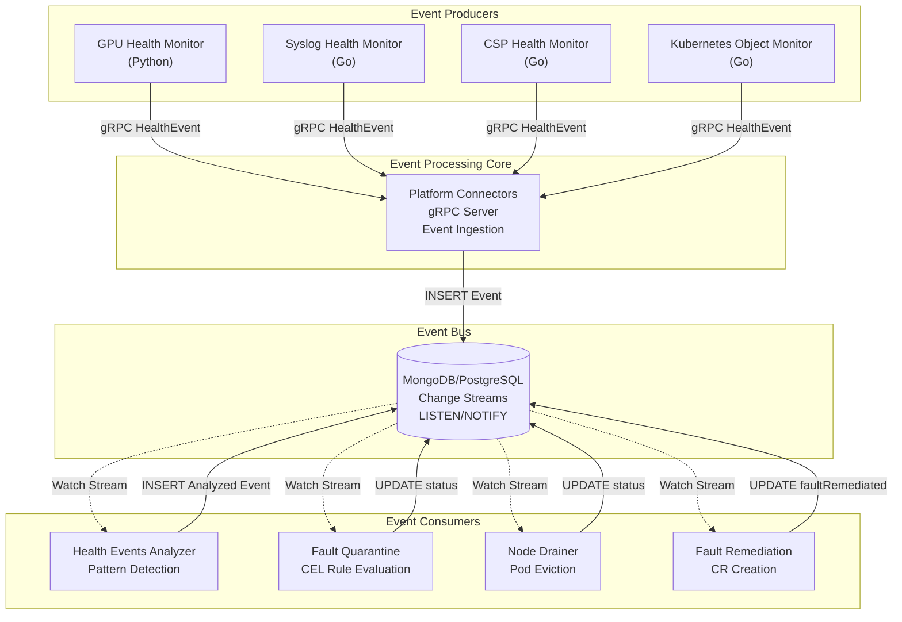
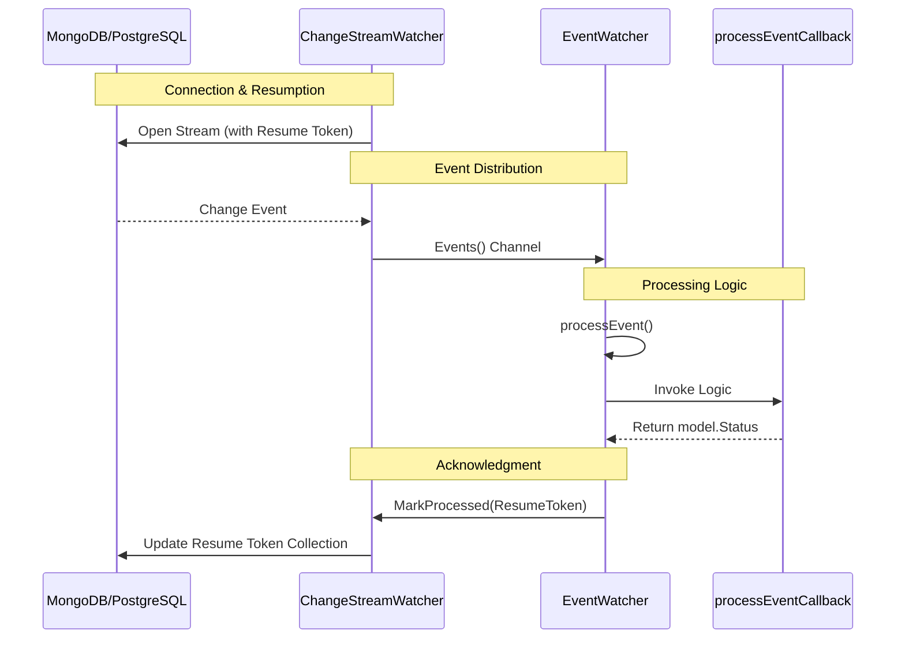

<!-- source: DeepWiki mcp.deepwiki.com · repo NVIDIA/NVSentinel · page 3.2 Event-Driven Architecture · fetched 2026-10-26 -->

# Event-Driven Architecture

Relevant source files

The following files were used as context for generating this wiki page:

- [commons/pkg/flags/database_flags_test.go](commons/pkg/flags/database_flags_test.go)
- [fault-quarantine/pkg/eventwatcher/event_watcher.go](fault-quarantine/pkg/eventwatcher/event_watcher.go)
- [node-drainer/pkg/evaluator/evaluator_integration_test.go](node-drainer/pkg/evaluator/evaluator_integration_test.go)
- [node-drainer/pkg/queue/queue_test.go](node-drainer/pkg/queue/queue_test.go)
- [store-client/pkg/adapter/legacy_adapter.go](store-client/pkg/adapter/legacy_adapter.go)
- [store-client/pkg/config/env_loader.go](store-client/pkg/config/env_loader.go)
- [store-client/pkg/config/env_loader_test.go](store-client/pkg/config/env_loader_test.go)
- [store-client/pkg/datastore/behavioral_contract_test.go](store-client/pkg/datastore/behavioral_contract_test.go)
- [store-client/pkg/datastore/interface_compliance_test.go](store-client/pkg/datastore/interface_compliance_test.go)
- [store-client/pkg/datastore/interfaces.go](store-client/pkg/datastore/interfaces.go)
- [store-client/pkg/datastore/providers/mongodb/health_store.go](store-client/pkg/datastore/providers/mongodb/health_store.go)
- [store-client/pkg/datastore/providers/mongodb/health_store_test.go](store-client/pkg/datastore/providers/mongodb/health_store_test.go)
- [store-client/pkg/datastore/providers/mongodb/register.go](store-client/pkg/datastore/providers/mongodb/register.go)
- [store-client/pkg/datastore/providers/mongodb/watcher/unmarshaller.go](store-client/pkg/datastore/providers/mongodb/watcher/unmarshaller.go)
- [store-client/pkg/datastore/providers/mongodb/watcher/watch_store.go](store-client/pkg/datastore/providers/mongodb/watcher/watch_store.go)
- [store-client/pkg/datastore/providers/mongodb/watcher/watch_store_test.go](store-client/pkg/datastore/providers/mongodb/watcher/watch_store_test.go)
- [store-client/pkg/datastore/providers/mongodb/watcher_factory.go](store-client/pkg/datastore/providers/mongodb/watcher_factory.go)
- [store-client/pkg/datastore/providers/postgresql/changestream.go](store-client/pkg/datastore/providers/postgresql/changestream.go)
- [store-client/pkg/datastore/providers/postgresql/database_client_test.go](store-client/pkg/datastore/providers/postgresql/database_client_test.go)
- [store-client/pkg/datastore/providers/postgresql/datastore.go](store-client/pkg/datastore/providers/postgresql/datastore.go)
- [store-client/pkg/datastore/providers/postgresql/health_events.go](store-client/pkg/datastore/providers/postgresql/health_events.go)
- [store-client/pkg/datastore/providers/postgresql/pipeline_filter.go](store-client/pkg/datastore/providers/postgresql/pipeline_filter.go)
- [store-client/pkg/datastore/providers/postgresql/sql_filter_builder.go](store-client/pkg/datastore/providers/postgresql/sql_filter_builder.go)
- [store-client/pkg/datastore/providers/postgresql/watcher_factory.go](store-client/pkg/datastore/providers/postgresql/watcher_factory.go)
- [store-client/pkg/helper/datastore_helper.go](store-client/pkg/helper/datastore_helper.go)
- [store-client/pkg/query/builder.go](store-client/pkg/query/builder.go)
- [store-client/pkg/storewatcher/config.go](store-client/pkg/storewatcher/config.go)
- [store-client/pkg/storewatcher/watch_store.go](store-client/pkg/storewatcher/watch_store.go)
- [store-client/pkg/utils/pq.go](store-client/pkg/utils/pq.go)
- [store-client/pkg/utils/pq_test.go](store-client/pkg/utils/pq_test.go)
- [store-client/pkg/watcher/factory.go](store-client/pkg/watcher/factory.go)

## Purpose and Scope

This document describes the event-driven architecture that forms the core communication mechanism in NVSentinel. It covers how components communicate asynchronously via the datastore, the implementation of MongoDB change streams and PostgreSQL alternatives, and the decoupled design that enables independent scaling and failure isolation.

The architecture centers on the `store-client` abstraction, which provides a unified `ChangeStreamWatcher` interface for consuming events regardless of the underlying database provider [store-client/pkg/datastore/interfaces.go:113-119]().

---

## Architecture Overview

NVSentinel employs a **publish-subscribe event-driven architecture** where the datastore (MongoDB or PostgreSQL) acts as the central event bus. Components communicate exclusively through persisted events—no component directly calls another component's API. This design eliminates tight coupling and enables each service to operate independently.

### Core Event-Driven Pattern

**Sources:** [fault-quarantine/pkg/eventwatcher/event_watcher.go:123-141](), [store-client/pkg/datastore/providers/postgresql/health_events.go:71-83]()

---

## Datastore Abstraction and Watchers

The `store-client` module provides a database-agnostic layer for watching events. Consumers interact with the `ChangeStreamWatcher` interface, which hides the complexity of the underlying database protocol [store-client/pkg/datastore/interfaces.go:113-119]().

### MongoDB Change Streams

MongoDB change streams provide real-time notification of changes. The `ChangeStreamWatcher` in `store-client/pkg/datastore/providers/mongodb/watcher/watch_store.go` manages the lifecycle of these streams:

1.  **Connection Management**: Validates connectivity and pings the database [store-client/pkg/datastore/providers/mongodb/watcher/watch_store.go:138-143]().
2.  **Resume Tokens**: Looks up existing tokens in a dedicated collection to resume processing from the last known state [store-client/pkg/datastore/providers/mongodb/watcher/watch_store.go:171-181]().
3.  **Consistency**: Uses `Majority` write and read concerns for resume tokens to ensure data integrity [store-client/pkg/datastore/providers/mongodb/watcher/watch_store.go:156-161]().
4.  **Full Document Lookup**: Configured with `UpdateLookup` to ensure the consumer receives the complete document even on partial updates [store-client/pkg/datastore/providers/mongodb/watcher/watch_store.go:165]().

### PostgreSQL LISTEN/NOTIFY

For PostgreSQL, the system uses a hybrid approach combining `LISTEN/NOTIFY` for real-time triggers and polling for reliability [store-client/pkg/datastore/providers/postgresql/datastore.go:158-160]().

-   **Server-side Filtering**: Uses SQL `WHERE` clauses to filter events before they reach the application [store-client/pkg/datastore/providers/postgresql/datastore.go:201-202]().
-   **Snake Case Mapping**: Automatically converts PascalCase collection names to snake_case table names for PostgreSQL compatibility [store-client/pkg/datastore/providers/postgresql/datastore.go:149-151]().

**Sources:** [store-client/pkg/datastore/providers/mongodb/watcher/watch_store.go:115-190](), [store-client/pkg/datastore/providers/postgresql/datastore.go:138-165]()

---

## Event Flow Lifecycle

### Event Processing with Change Streams

The `EventWatcher` in `fault-quarantine` demonstrates the typical consumer loop:

**Sources:** [fault-quarantine/pkg/eventwatcher/event_watcher.go:123-144](), [fault-quarantine/pkg/eventwatcher/event_watcher.go:35-38]()

---

## Component Implementation: Fault Quarantine

The `FaultQuarantine` module serves as a primary example of this architecture. It utilizes an `EventWatcher` to consume health events and trigger node isolation [fault-quarantine/pkg/eventwatcher/event_watcher.go:32-42]().

### Key Entities and Functions

| Entity | Role | Location |
|---|---|---|
| `EventWatcher` | Manages the datastore watch loop and metrics | [fault-quarantine/pkg/eventwatcher/event_watcher.go:32-42]() |
| `MarkProcessed` | Updates the resume token to ensure at-least-once delivery | [fault-quarantine/pkg/eventwatcher/event_watcher.go:135-140]() |
| `UnmarshalDocument` | Converts raw datastore events into Go `HealthEventWithStatus` models | [fault-quarantine/pkg/eventwatcher/event_watcher.go:149-154]() |
| `GetRecordUUID` | Retrieves the primary key (ObjectID or UUID) for DB lookups | [fault-quarantine/pkg/eventwatcher/event_watcher.go:166-169]() |

### Observability and Metrics

Event processing is heavily instrumented with Prometheus metrics:
-   `change_stream_resume_token_recoveries_total`: Tracks recovery from stale resume tokens [store-client/pkg/datastore/providers/mongodb/watcher/watch_store.go:44-51]().
-   `TotalEventsReceived`: Incremented every time the watcher yields an event [fault-quarantine/pkg/eventwatcher/event_watcher.go:125]().
-   `ProcessingErrors`: Tracked by error type (e.g., `unmarshal_error`, `mark_processed_error`) [fault-quarantine/pkg/eventwatcher/event_watcher.go:136]().

**Sources:** [fault-quarantine/pkg/eventwatcher/event_watcher.go:123-141](), [store-client/pkg/datastore/providers/mongodb/watcher/watch_store.go:44-51]()

---

## Resiliency and Fault Tolerance

### Resumability
Consumers persist a **Resume Token** after successfully processing an event. On restart, the `store-client` retrieves this token from the `ResumeTokens` collection [store-client/pkg/storewatcher/watch_store.go:152-165](). If no token is found, the stream starts from the current head of the log [store-client/pkg/storewatcher/watch_store.go:169]().

### Workqueue Deduplication
The `NodeDrainer` uses an `EventQueueManager` to prevent concurrent processing of the same event. If an event is re-enqueued while already in-flight, it is marked as "dirty" and only processed again after the current task completes [node-drainer/pkg/queue/queue_test.go:174-184]().

### At-Least-Once Delivery
Because the resume token is only updated *after* the event processing logic completes, NVSentinel guarantees that an event will be retried if the pod crashes during processing [fault-quarantine/pkg/eventwatcher/event_watcher.go:132-140]().

**Sources:** [store-client/pkg/storewatcher/watch_store.go:152-179](), [node-drainer/pkg/queue/queue_test.go:139-190](), [fault-quarantine/pkg/eventwatcher/event_watcher.go:123-144]()

---

## Configuration and Environment

The event-driven system is configured primarily via environment variables defined in the `store-client` module:

| Environment Variable | Description | Default |
|---|---|---|
| `MONGODB_URI` | Connection string for MongoDB | - |
| `DATASTORE_PROVIDER` | Choice of `mongodb` or `postgresql` | `mongodb` |
| `MONGODB_CHANGE_STREAM_RETRY_DEADLINE_SECONDS` | Timeout for stream reconnection | `60` |
| `MONGODB_TOKEN_COLLECTION_NAME` | Collection where resume tokens are stored | `ResumeTokens` |

**Sources:** [store-client/pkg/config/env_loader.go:56-74](), [store-client/pkg/config/env_loader.go:77-86](), [store-client/pkg/config/env_loader.go:170-185]()

---

