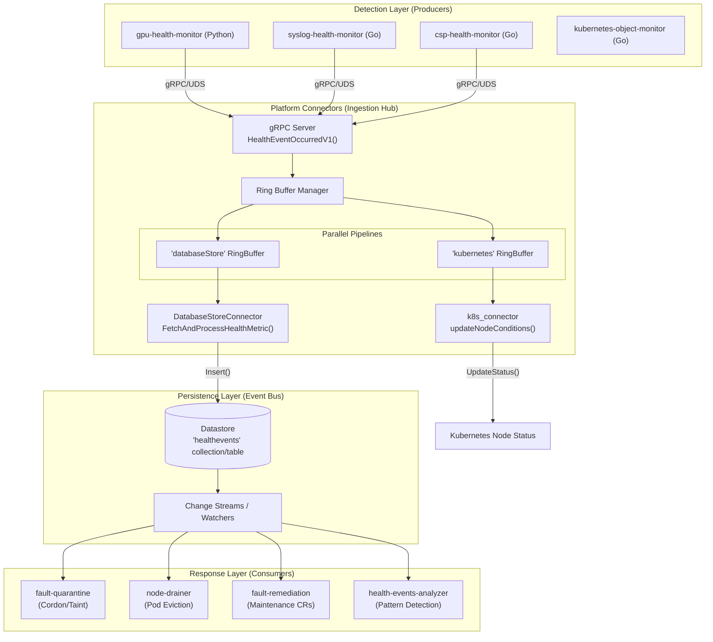
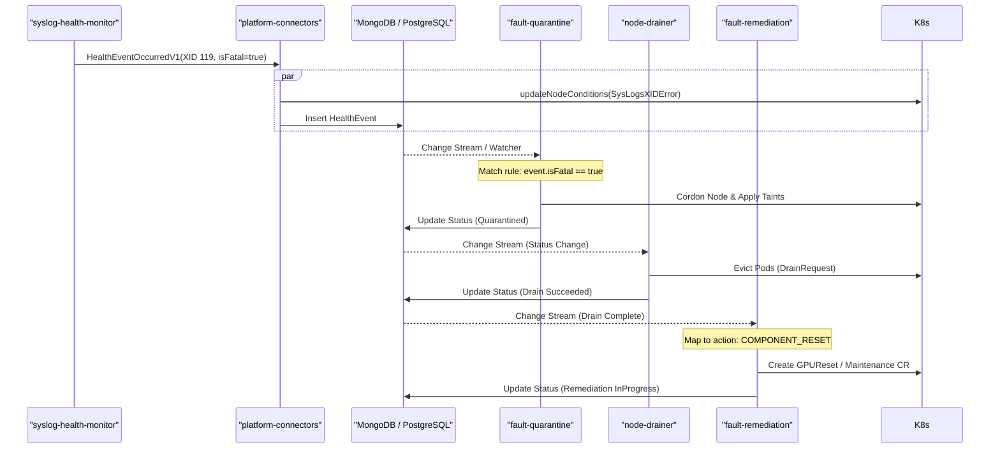

<!-- source: DeepWiki mcp.deepwiki.com · repo NVIDIA/NVSentinel · page 3.3 Data Flow and Processing Pipeline · fetched 2026-10-26 -->

# Data Flow and Processing Pipeline

Relevant source files

The following files were used as context for generating this wiki page:

- [distros/kubernetes/nvsentinel/charts/gpu-health-monitor/files/dcgmerrorsmapping.csv](distros/kubernetes/nvsentinel/charts/gpu-health-monitor/files/dcgmerrorsmapping.csv)
- [distros/kubernetes/nvsentinel/charts/preflight/templates/deployment.yaml](distros/kubernetes/nvsentinel/charts/preflight/templates/deployment.yaml)
- [distros/kubernetes/nvsentinel/templates/configmap.yaml](distros/kubernetes/nvsentinel/templates/configmap.yaml)
- [distros/kubernetes/nvsentinel/values-full.yaml](distros/kubernetes/nvsentinel/values-full.yaml)
- [distros/kubernetes/nvsentinel/values-tilt.yaml](distros/kubernetes/nvsentinel/values-tilt.yaml)
- [distros/kubernetes/nvsentinel/values.yaml](distros/kubernetes/nvsentinel/values.yaml)
- [docs/DATA_FLOW.md](docs/DATA_FLOW.md)
- [docs/INTEGRATIONS.md](docs/INTEGRATIONS.md)
- [docs/README.md](docs/README.md)
- [docs/audit-logging.md](docs/audit-logging.md)
- [docs/configuration/README.md](docs/configuration/README.md)
- [docs/index.yml](docs/index.yml)
- [docs/tracing.md](docs/tracing.md)
- [platform-connectors/main.go](platform-connectors/main.go)
- [platform-connectors/pkg/connectors/kubernetes/k8s_connector.go](platform-connectors/pkg/connectors/kubernetes/k8s_connector.go)
- [platform-connectors/pkg/connectors/kubernetes/k8s_connector_envtest_test.go](platform-connectors/pkg/connectors/kubernetes/k8s_connector_envtest_test.go)
- [platform-connectors/pkg/connectors/kubernetes/k8s_platform_connector_test.go](platform-connectors/pkg/connectors/kubernetes/k8s_platform_connector_test.go)
- [platform-connectors/pkg/connectors/kubernetes/process_node_events.go](platform-connectors/pkg/connectors/kubernetes/process_node_events.go)
- [platform-connectors/pkg/transformers/metadata/transformer_test.go](platform-connectors/pkg/transformers/metadata/transformer_test.go)
- [tests/helpers/preflight.go](tests/helpers/preflight.go)
- [tests/syslog_health_monitor_test.go](tests/syslog_health_monitor_test.go)
- [tilt/Tiltfile](tilt/Tiltfile)
- [tilt/helpers.star](tilt/helpers.star)

## Purpose

This document describes the end-to-end flow of health data within NVSentinel, from initial detection by distributed monitors to final remediation actions. It details the gRPC ingestion path, the parallel processing architecture of Platform Connectors, and the asynchronous event-driven lifecycle managed via Datastore change streams (MongoDB) or polling (PostgreSQL).

---

## System Overview

NVSentinel employs a decoupled architecture where **Health Monitors** act as event producers and **Platform Connectors** serves as the central ingestion hub. Data is distributed via high-performance ring buffers to both the Kubernetes API (for immediate visibility) and a persistent Datastore (MongoDB or PostgreSQL) which acts as the system's event bus.

**Sources:**
- [platform-connectors/main.go:60-178]()
- [platform-connectors/pkg/connectors/kubernetes/process_node_events.go:51-118]()
- [docs/INTEGRATIONS.md:67-101]()

---

## Event Ingestion and Distribution

### gRPC Ingestion
Monitors communicate with `platform-connectors` using the `HealthEventOccurredV1` gRPC method. The server is initialized in `platform-connectors/main.go` and handles incoming `protos.HealthEvent` objects [platform-connectors/main.go:38-44]().

### Parallel Ring Buffers
To ensure high throughput and prevent slow downstream consumers (like the Kubernetes API) from blocking database persistence, `platform-connectors` uses internal ring buffers [platform-connectors/main.go:112-113]().

| Buffer Name | Consumer Class | Responsibility |
| :--- | :--- | :--- |
| `kubernetes` | `K8sConnector` | Updates `NodeStatus` conditions and manages message truncation [platform-connectors/pkg/connectors/kubernetes/process_node_events.go:49-58]() |
| `databaseStore` | `DatabaseStoreConnector` | Persists the full event to the configured provider (MongoDB/PostgreSQL) [platform-connectors/main.go:155-178]() |

### Metadata Enrichment and Overrides
The pipeline supports transformation stages defined in the `ConfigMap` [distros/kubernetes/nvsentinel/templates/configmap.yaml:22-39]().
- **MetadataAugmentor**: Enriches events with node labels such as GPU driver versions or instance types [distros/kubernetes/nvsentinel/templates/configmap.yaml:40-47]().
- **OverrideTransformer**: Allows modifying event fields (e.g., `isFatal`, `recommendedAction`) based on CEL-like `when` expressions [distros/kubernetes/nvsentinel/templates/configmap.yaml:48-75]().

**Sources:**
- [platform-connectors/main.go:180-210]()
- [platform-connectors/pkg/connectors/kubernetes/process_node_events.go:160-209]()

---

## Event Processing Pipeline

Once persisted, events trigger a chain of reactions managed by specialized modules.

### Sequence: Detection to Remediation
The following diagram traces a fatal GPU error (e.g., XID 119) through the system as seen in E2E testing scenarios [tests/syslog_health_monitor_test.go:67-88]().

**Sources:**
- [tests/syslog_health_monitor_test.go:72-88]()
- [platform-connectors/pkg/connectors/kubernetes/process_node_events.go:83-96]()
- [distros/kubernetes/nvsentinel/values-tilt.yaml:268-277]()

---

## Health Events Analyzer (Pattern Detection)

The `health-events-analyzer` performs secondary analysis on the event stream to detect complex patterns like "XID Bursts" [distros/kubernetes/nvsentinel/values.yaml:145-146]().

### Processing Logic
1. **Event Reception**: Listens for non-fatal events via the datastore stream.
2. **Rule Evaluation**: Evaluates historical events over a time window.
3. **Aggregation**: If a pattern matches (e.g., multiple ECC errors), it generates a new "Synthetic" HealthEvent with `isFatal=true` and submits it back to the pipeline.

### Code Entity Bridge: Pipeline Components
| System Concept | Code Entity | File Reference |
| :--- | :--- | :--- |
| Condition Update | `K8sConnector.processNodeCondition` | [platform-connectors/pkg/connectors/kubernetes/process_node_events.go:160-163]() |
| Event Storage | `DatabaseStoreConnector` | [platform-connectors/main.go:155-159]() |
| Message Truncation | `truncateNodeConditionMessage` | [platform-connectors/pkg/connectors/kubernetes/process_node_events.go:185-186]() |
| Remediation Mapping | `maintenance.actions` | [distros/kubernetes/nvsentinel/values-tilt.yaml:267-270]() |

**Sources:**
- [platform-connectors/pkg/connectors/kubernetes/process_node_events.go:145-158]()
- [distros/kubernetes/nvsentinel/values.yaml:143-154]()

---

## Reliability and Observability

### Trace Correlation
To debug the pipeline, NVSentinel uses OpenTelemetry tracing. `platform-connectors` initializes the tracer to correlate monitor events with downstream actions [platform-connectors/main.go:70-72]().

### Audit Logging
HTTP write operations to Kubernetes and CSP APIs are captured by the `auditlogger` to provide a forensic trail of remediation actions [platform-connectors/main.go:66-68]().

### Dry Run Mode
The system supports a global `dryRun` flag. When enabled, modules like `fault-quarantine` and `node-drainer` log intended actions (cordoning, evictions) without executing them against the cluster [distros/kubernetes/nvsentinel/values-full.yaml:59-69]().

**Sources:**
- [docs/configuration/README.md:19-26]()
- [docs/configuration/README.md:76-91]()
- [platform-connectors/main.go:60-87]()

---

