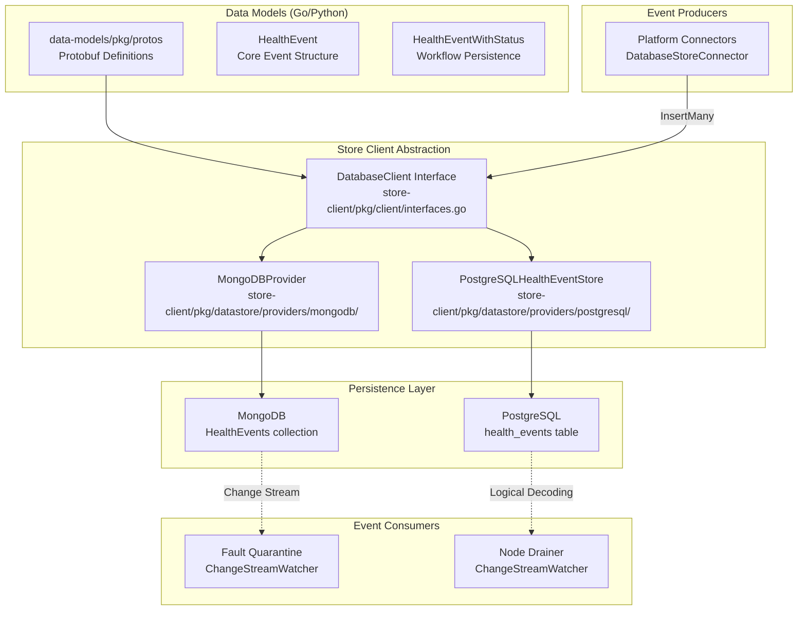
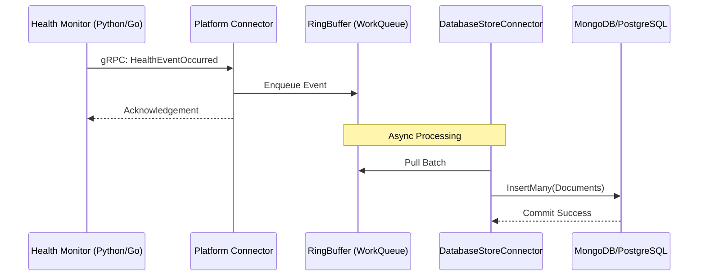

<!-- source: DeepWiki mcp.deepwiki.com · repo NVIDIA/NVSentinel · page 3.4 Data Models and Storage · fetched 2026-10-26 -->

# Data Models and Storage

<details>
<summary>Relevant source files</summary>

The following files were used as context for generating this wiki page:

- [api/go.mod](api/go.mod)
- [api/go.sum](api/go.sum)
- [commons/pkg/statemanager/statemanager.go](commons/pkg/statemanager/statemanager.go)
- [commons/pkg/statemanager/statemanager_test.go](commons/pkg/statemanager/statemanager_test.go)
- [data-models/go.mod](data-models/go.mod)
- [data-models/go.sum](data-models/go.sum)
- [data-models/pkg/model/health_event_extentions.go](data-models/pkg/model/health_event_extentions.go)
- [data-models/pkg/protos/health_event.pb.go](data-models/pkg/protos/health_event.pb.go)
- [data-models/protobufs/health_event.proto](data-models/protobufs/health_event.proto)
- [demos/local-custom-remediation-demo/memory-pressure-monitor/go.mod](demos/local-custom-remediation-demo/memory-pressure-monitor/go.mod)
- [docs/state-manager.md](docs/state-manager.md)
- [health-monitors/gpu-health-monitor/gpu_health_monitor/protos/health_event_pb2.py](health-monitors/gpu-health-monitor/gpu_health_monitor/protos/health_event_pb2.py)
- [health-monitors/gpu-health-monitor/gpu_health_monitor/protos/health_event_pb2.pyi](health-monitors/gpu-health-monitor/gpu_health_monitor/protos/health_event_pb2.pyi)
- [store-client/pkg/client/mongodb_client.go](store-client/pkg/client/mongodb_client.go)
- [store-client/pkg/client/mongodb_pipeline_builder.go](store-client/pkg/client/mongodb_pipeline_builder.go)
- [store-client/pkg/client/mongodb_pipeline_test.go](store-client/pkg/client/mongodb_pipeline_test.go)
- [store-client/pkg/client/pipeline_builder.go](store-client/pkg/client/pipeline_builder.go)
- [store-client/pkg/client/pipeline_builder_test.go](store-client/pkg/client/pipeline_builder_test.go)
- [store-client/pkg/client/postgresql_pipeline_builder.go](store-client/pkg/client/postgresql_pipeline_builder.go)
- [tests/helpers/healthevent.go](tests/helpers/healthevent.go)
- [tests/scale-tests/event-generator/go.mod](tests/scale-tests/event-generator/go.mod)
- [tests/scale-tests/event-generator/go.sum](tests/scale-tests/event-generator/go.sum)
- [tilt/csp-api-mock/go.mod](tilt/csp-api-mock/go.mod)
- [tilt/csp-api-mock/go.sum](tilt/csp-api-mock/go.sum)
- [tilt/simple-health-client/go.mod](tilt/simple-health-client/go.mod)
- [tilt/simple-health-client/go.sum](tilt/simple-health-client/go.sum)

</details>


This page documents the data models and storage layer of NVSentinel, including the Protobuf-based data structures, the store-client abstraction that provides a unified interface for MongoDB and PostgreSQL, and the database schemas used for event persistence and change stream propagation.

---

## Overview of Data Architecture

NVSentinel uses a centralized datastore as its nervous system. All health detection flows into it via the `PlatformConnector` gRPC service, and all response components watch it for relevant events. The system supports both MongoDB and PostgreSQL as backend storage engines, abstracted through the `store-client` library.

### Data Architecture Components


**Sources:** `store-client/pkg/client/mongodb_client.go:32-35` (), `data-models/go.mod:1-10` ()

---

## Data Models Module

The `data-models` module contains the source-of-truth Protobuf definitions. These are compiled into Go and Python bindings to ensure consistency across the multi-language architecture.

### HealthEvent Protobuf
The `HealthEvent` message is the fundamental structure for fault reports.

| Field | Type | Description |
|-------|------|-------------|
| `nodeName` | `string` | The Kubernetes node where the fault occurred. |
| `checkName` | `string` | Identifier for the monitor (e.g., `GpuXidError`). |
| `componentClass` | `string` | Category (e.g., `GPU`, `Software`). |
| `isFatal` | `bool` | Whether the fault requires node evacuation. |
| `recommendedAction` | `enum` | Action suggested by the monitor (e.g., `RESTART_VM`). |
| `metadata` | `map<string, string>` | Arbitrary key-value pairs for diagnostic context. |

**Sources:** `health-monitors/gpu-health-monitor/gpu_health_monitor/protos/health_event_pb2.pyi:107-133` (), `data-models/pkg/protos/health_event.pb.go:1-10` ()

### HealthEventWithStatus
This structure wraps a `HealthEvent` with operational metadata used by NVSentinel to track the lifecycle of a fault.

**Key Status Fields:**
- `nodeQuarantined`: String status tracking the quarantine state. [health-monitors/gpu-health-monitor/gpu_health_monitor/protos/health_event_pb2.pyi:72]()
- `userPodsEvictionStatus`: An `OperationStatus` tracking drain progress. [health-monitors/gpu-health-monitor/gpu_health_monitor/protos/health_event_pb2.pyi:74]()
- `faultRemediated`: Boolean indicating if the fix was applied. [health-monitors/gpu-health-monitor/gpu_health_monitor/protos/health_event_pb2.pyi:76]()
- `spanIds`: Trace identifiers for cross-component observability. [health-monitors/gpu-health-monitor/gpu_health_monitor/protos/health_event_pb2.pyi:78]()

**Sources:** `health-monitors/gpu-health-monitor/gpu_health_monitor/protos/health_event_pb2.pyi:56-79` (), `health-monitors/gpu-health-monitor/gpu_health_monitor/protos/health_event_pb2.pyi:81-89` ()

---

## Store Client Abstraction

The `store-client` provides a unified client implementation for interacting with the backend datastores. It handles database-specific logic such as MongoDB BSON marshaling and change stream token management.

### Store Client Interface (Code Entity Space)
The `mongoEvent` struct implements the `Event` interface, providing a database-agnostic way to access record metadata.

```mermaid
classDiagram
    class Event {
        <<interface>>
        +GetDocumentID() string
        +GetRecordUUID() string
        +GetNodeName() string
        +GetResumeToken() []byte
        +UnmarshalDocument(v interface{}) error
    }
    class mongoEvent {
        -rawEvent mongoWatcher.Event
        +GetDocumentID() string
        +GetRecordUUID() string
        +GetNodeName() string
        +UnmarshalDocument(v interface{}) error
    }
    Event <|-- mongoEvent
```
**Sources:** `store-client/pkg/client/mongodb_client.go:39-41` (), `store-client/pkg/client/mongodb_client.go:43-85` ()

### Key Implementation Details
- **Document Identification**: In MongoDB, the `_id` field is extracted and converted to a hex string to serve as the document ID. [store-client/pkg/client/mongodb_client.go:69-78]()
- **Node Name Extraction**: The client deep-parses the raw BSON document to extract `healthevent.nodename` for routing and filtering. [store-client/pkg/client/mongodb_client.go:113-131]()
- **Type Normalization**: Since `bson.Unmarshal` into `map[string]interface{}` preserves MongoDB-specific types (like `primitive.DateTime`), the client includes a `normalizeMongoTypes` step to convert them to standard Go types. [store-client/pkg/client/mongodb_client.go:211-216]()

---

## Pipeline Builders

NVSentinel uses database-specific pipeline builders to filter events from the change streams (MongoDB Change Streams or PostgreSQL Logical Replication).

### Agnostic Pipeline Construction
While specific builders exist for MongoDB and PostgreSQL, the system promotes the use of `BuildInsertOnlyPipelineAgnostic()` to maintain provider independence.

- **MongoDB Insert Pipeline**: Matches documents where `operationType` is `insert`. [store-client/pkg/client/mongodb_client.go:226-232]()
- **Quarantine Update Pipeline**: Matches updates to the `healtheventstatus.nodequarantined` field. [store-client/pkg/client/mongodb_client.go:234-240]()

**Sources:** `store-client/pkg/client/mongodb_client.go:220-232` ()

---

## Ring Buffer and Ingestion Flow

To handle high-frequency event bursts (e.g., GPU XID storms), the system utilizes a batching and queuing mechanism before persistence.



### Ingestion Logic
The `PlatformConnector` receives events via gRPC and places them into a `RingBuffer`. The `DatabaseStoreConnector` then pulls these events in batches to perform bulk inserts into the configured datastore.

**Sources:** `api/go.mod:1-10` (), `store-client/pkg/client/mongodb_client.go:166-218` ()

---

