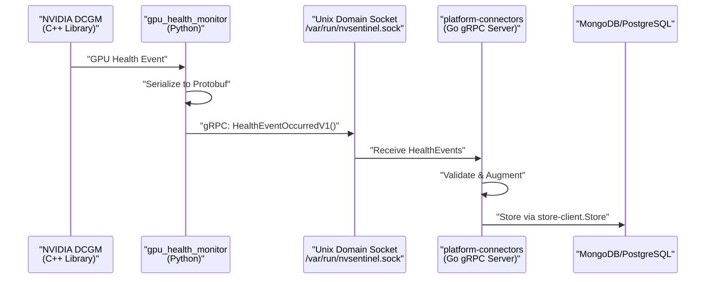
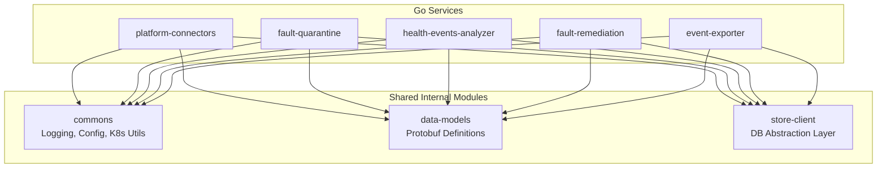
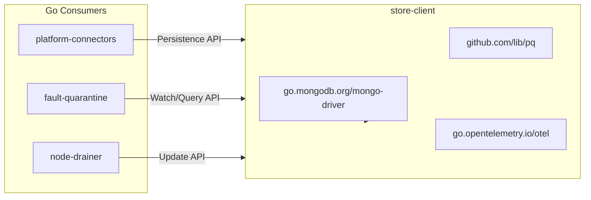

<!-- source: DeepWiki mcp.deepwiki.com · repo NVIDIA/NVSentinel · page 3.5 Multi-Language Architecture · fetched 2026-10-26 -->

# Multi-Language Architecture

<details>
<summary>Relevant source files</summary>

The following files were used as context for generating this wiki page:

- [api/go.mod](api/go.mod)
- [api/go.sum](api/go.sum)
- [commons/go.sum](commons/go.sum)
- [data-models/go.mod](data-models/go.mod)
- [data-models/go.sum](data-models/go.sum)
- [demos/local-custom-remediation-demo/memory-pressure-monitor/go.mod](demos/local-custom-remediation-demo/memory-pressure-monitor/go.mod)
- [docs/designs/030-grpc-tls-authentication.md](docs/designs/030-grpc-tls-authentication.md)
- [docs/designs/031-OTEL-traces.md](docs/designs/031-OTEL-traces.md)
- [docs/designs/032-feature-flag-tracking.md](docs/designs/032-feature-flag-tracking.md)
- [event-exporter/go.mod](event-exporter/go.mod)
- [event-exporter/go.sum](event-exporter/go.sum)
- [fault-quarantine/go.mod](fault-quarantine/go.mod)
- [fault-quarantine/go.sum](fault-quarantine/go.sum)
- [fault-remediation/go.mod](fault-remediation/go.mod)
- [fault-remediation/go.sum](fault-remediation/go.sum)
- [health-events-analyzer/go.mod](health-events-analyzer/go.mod)
- [health-events-analyzer/go.sum](health-events-analyzer/go.sum)
- [health-monitors/gpu-health-monitor/poetry.lock](health-monitors/gpu-health-monitor/poetry.lock)
- [health-monitors/gpu-health-monitor/pyproject.toml](health-monitors/gpu-health-monitor/pyproject.toml)
- [health-monitors/syslog-health-monitor/go.mod](health-monitors/syslog-health-monitor/go.mod)
- [log-collector/poetry.lock](log-collector/poetry.lock)
- [log-collector/pyproject.toml](log-collector/pyproject.toml)
- [node-drainer/go.mod](node-drainer/go.mod)
- [node-drainer/go.sum](node-drainer/go.sum)
- [platform-connectors/go.mod](platform-connectors/go.mod)
- [platform-connectors/go.sum](platform-connectors/go.sum)
- [store-client/go.mod](store-client/go.mod)
- [tests/scale-tests/event-generator/go.mod](tests/scale-tests/event-generator/go.mod)
- [tests/scale-tests/event-generator/go.sum](tests/scale-tests/event-generator/go.sum)
- [tilt/csp-api-mock/go.mod](tilt/csp-api-mock/go.mod)
- [tilt/csp-api-mock/go.sum](tilt/csp-api-mock/go.sum)
- [tilt/simple-health-client/go.mod](tilt/simple-health-client/go.mod)
- [tilt/simple-health-client/go.sum](tilt/simple-health-client/go.sum)

</details>


This document describes NVSentinel's polyglot architecture, which combines Python services for GPU hardware monitoring with Go services for Kubernetes-native operations. For information about how these services communicate via gRPC, see the protobuf definitions in the `data-models` module.

## Overview

NVSentinel employs a strategic multi-language architecture that leverages Python's hardware integration ecosystem and Go's Kubernetes-native capabilities. Python services handle low-level GPU monitoring via NVIDIA DCGM bindings, while Go services implement all Kubernetes operations, event processing, and automation logic. The two ecosystems communicate exclusively through gRPC with protobuf-defined interfaces, ensuring type safety and language independence.

## Language Division

The codebase is divided into two primary language ecosystems, each selected for specific technical requirements:

| Component | Language | Rationale | Location |
|-----------|----------|-----------|----------|
| GPU Health Monitor | Python 3.10 | NVIDIA DCGM Python bindings, hardware abstraction | [health-monitors/gpu-health-monitor/pyproject.toml:8-16]() |
| Log Collector | Python 3.10 | System log parsing, CLI tooling | [log-collector/pyproject.toml:8-10]() |
| Platform Connectors | Go 1.26.x | gRPC server, high-throughput event processing | [platform-connectors/go.mod:1-5]() |
| Health Events Analyzer | Go 1.26.x | Stream processing, aggregation pipelines | [health-events-analyzer/go.mod:1-5]() |
| Fault Quarantine | Go 1.26.x | Kubernetes API integration, CEL evaluation | [fault-quarantine/go.mod:1-5]() |
| Node Drainer | Go 1.26.x | Pod eviction, Kubernetes lifecycle management | [node-drainer/go.mod:1-5]() |
| Fault Remediation | Go 1.26.x | Custom resource creation, Go template rendering | [fault-remediation/go.mod:1-5]() |
| Event Exporter | Go 1.26.x | External event streaming and integration | [event-exporter/go.mod:1-5]() |

**Python Selection**: Python is used for services requiring direct hardware integration or specialized log parsing. The GPU Health Monitor depends on `nvidia-dcgm` and `grpcio` for reporting hardware faults. The Log Collector service uses Python for its `file_server_cleanup` logic, leveraging `click` and `prometheus-client` [log-collector/pyproject.toml:9-10]().

**Go Selection**: All Kubernetes-native operations are implemented in Go 1.26, leveraging `k8s.io/client-go` and `controller-runtime` [platform-connectors/go.mod:22-23](). Go's static typing and performance are prioritized for the core event processing pipeline and fault management modules like `fault-quarantine`, which utilizes `google/cel-go` for rule evaluation [fault-quarantine/go.mod:8]().

Sources: [platform-connectors/go.mod:1-24](), [log-collector/pyproject.toml:1-10](), [fault-quarantine/go.mod:1-24](), [node-drainer/go.mod:1-27]()

## gRPC Communication Layer

Python and Go services communicate via gRPC, with interfaces defined using Protocol Buffers. This allows the Python-based `gpu-health-monitor` to stream events to the Go-based `platform-connectors`.

### Python to Go Event Flow

The following diagram illustrates the flow from hardware detection in Python to persistence in Go.



Sources: [platform-connectors/go.mod:18-19](), [data-models/go.mod:8](), [store-client/go.mod:1-24]()

### Cross-Language Type Mapping

The system ensures consistency between Python and Go types through shared Protobuf definitions provided by the `data-models` module.

| Protobuf Entity | Python Mapping | Go Mapping |
|-----------------|----------------|------------|
| `HealthEvent` | `health_event_pb2.HealthEvent` | `pb.HealthEvent` |
| `ProcessingStrategy` | `health_event_pb2.ProcessingStrategy` | `pb.ProcessingStrategy` |
| `RecommendedAction` | `health_event_pb2.RecommendedAction` | `pb.RecommendedAction` |

Sources: [data-models/go.mod:1-17](), [platform-connectors/go.mod:19]()

## Shared Internal Modules (Go)

Go services share common functionality through internal modules, managed within the monorepo using Go `replace` directives. This ensures that core logic for data persistence and Kubernetes interaction is reused across all Go components.



Sources: [platform-connectors/go.mod:120-124](), [fault-quarantine/go.mod:115-119](), [health-events-analyzer/go.mod:110-114](), [fault-remediation/go.mod:113-117](), [event-exporter/go.mod:104-108]()

### Module Roles

*   **`commons`**: Provides shared utilities for logging and Prometheus metrics registration [commons/go.sum]().
*   **`data-models`**: Central repository for all Go structs and Protobuf-generated code representing health events and system state [data-models/go.mod:1-10]().
*   **`store-client`**: An abstraction layer for database operations, supporting both MongoDB and PostgreSQL. It uses `go.mongodb.org/mongo-driver` and `github.com/lib/pq` [store-client/go.mod:13-18]().

Sources: [store-client/go.mod:1-24](), [data-models/go.mod:1-10]()

### Monorepo Development with Replace Directives

To maintain consistency and allow atomic changes across modules, NVSentinel uses `replace` directives in `go.mod` files:

```go
// Example from node-drainer/go.mod
replace github.com/nvidia/nvsentinel/store-client => ../store-client
replace github.com/nvidia/nvsentinel/data-models => ../data-models
replace github.com/nvidia/nvsentinel/commons => ../commons
```

This configuration ensures that services always build against the local versions of internal modules rather than remote tags [node-drainer/go.mod:113-117]().

Sources: [node-drainer/go.mod:112-120](), [platform-connectors/go.mod:119-125]()

## Python Package Structure

Python services use Poetry for dependency management and follow a structured layout for CLI and core logic.

| Component | File/Directory | Role |
|-----------|----------------|------|
| Entry Point | `file_server_cleanup.cli:cli` | Click-based CLI entry point for log collector [log-collector/pyproject.toml:22]() |
| Dependencies | `pyproject.toml` | Poetry configuration and requirements [log-collector/pyproject.toml:1-20]() |
| Formatting | `black` | Uncompromising code formatter [health-monitors/gpu-health-monitor/poetry.lock:4-5]() |

### Poetry Dependency Management

The Python environment is strictly versioned via `poetry.lock` to ensure reproducible builds. Key dependencies include `prometheus-client` for observability [log-collector/pyproject.toml:10]() and `black` for development [log-collector/pyproject.toml:13]().

Sources: [log-collector/pyproject.toml:1-23](), [health-monitors/gpu-health-monitor/poetry.lock:1-50]()

## Shared Data Access (store-client)

The `store-client` module is the primary integration point for all Go services requiring data persistence. It abstracts the underlying database and provides tracing via OpenTelemetry [store-client/go.mod:20]().



Sources: [store-client/go.mod:13-20](), [platform-connectors/go.mod:85](), [node-drainer/go.mod:13]()

---

