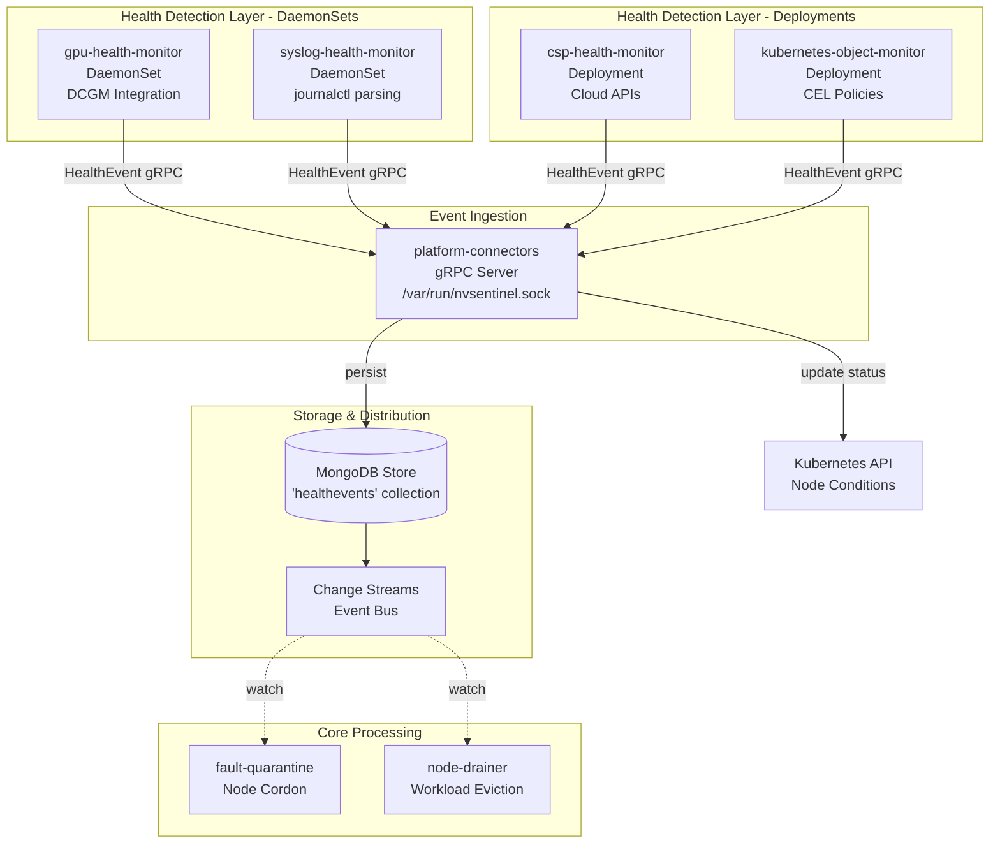
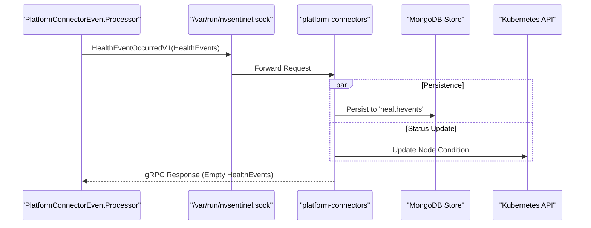

<!-- source: DeepWiki mcp.deepwiki.com · repo NVIDIA/NVSentinel · page 4 Health Monitoring · fetched 2026-10-26 -->

# Health Monitoring

Relevant source files

The following files were used as context for generating this wiki page:

- [distros/kubernetes/nvsentinel/charts/gpu-health-monitor/files/dcgmerrorsmapping.csv](distros/kubernetes/nvsentinel/charts/gpu-health-monitor/files/dcgmerrorsmapping.csv)
- [distros/kubernetes/nvsentinel/charts/gpu-health-monitor/templates/configmap.yaml](distros/kubernetes/nvsentinel/charts/gpu-health-monitor/templates/configmap.yaml)
- [distros/kubernetes/nvsentinel/charts/gpu-health-monitor/templates/daemonset-dcgm-3.x.yaml](distros/kubernetes/nvsentinel/charts/gpu-health-monitor/templates/daemonset-dcgm-3.x.yaml)
- [distros/kubernetes/nvsentinel/charts/gpu-health-monitor/templates/daemonset-dcgm-4.x.yaml](distros/kubernetes/nvsentinel/charts/gpu-health-monitor/templates/daemonset-dcgm-4.x.yaml)
- [distros/kubernetes/nvsentinel/charts/gpu-health-monitor/values.yaml](distros/kubernetes/nvsentinel/charts/gpu-health-monitor/values.yaml)
- [distros/kubernetes/nvsentinel/charts/preflight/templates/deployment.yaml](distros/kubernetes/nvsentinel/charts/preflight/templates/deployment.yaml)
- [distros/kubernetes/nvsentinel/values-full.yaml](distros/kubernetes/nvsentinel/values-full.yaml)
- [distros/kubernetes/nvsentinel/values-tilt.yaml](distros/kubernetes/nvsentinel/values-tilt.yaml)
- [distros/kubernetes/nvsentinel/values.yaml](distros/kubernetes/nvsentinel/values.yaml)
- [docs/INTEGRATIONS.md](docs/INTEGRATIONS.md)
- [health-monitors/gpu-health-monitor/gpu_health_monitor/cli.py](health-monitors/gpu-health-monitor/gpu_health_monitor/cli.py)
- [health-monitors/gpu-health-monitor/gpu_health_monitor/logger.py](health-monitors/gpu-health-monitor/gpu_health_monitor/logger.py)
- [health-monitors/gpu-health-monitor/gpu_health_monitor/platform_connector/metrics.py](health-monitors/gpu-health-monitor/gpu_health_monitor/platform_connector/metrics.py)
- [health-monitors/gpu-health-monitor/gpu_health_monitor/platform_connector/platform_connector.py](health-monitors/gpu-health-monitor/gpu_health_monitor/platform_connector/platform_connector.py)
- [health-monitors/gpu-health-monitor/gpu_health_monitor/tests/test_logger.py](health-monitors/gpu-health-monitor/gpu_health_monitor/tests/test_logger.py)
- [health-monitors/gpu-health-monitor/gpu_health_monitor/tests/test_platform_connector/test_platform_connector.py](health-monitors/gpu-health-monitor/gpu_health_monitor/tests/test_platform_connector/test_platform_connector.py)
- [platform-connectors/pkg/transformers/metadata/transformer_test.go](platform-connectors/pkg/transformers/metadata/transformer_test.go)
- [tests/gpu_health_monitor_test.go](tests/gpu_health_monitor_test.go)
- [tests/helpers/preflight.go](tests/helpers/preflight.go)
- [tilt/Tiltfile](tilt/Tiltfile)
- [tilt/helpers.star](tilt/helpers.star)

## Purpose and Scope

The Health Monitoring subsystem is responsible for detecting and reporting hardware and infrastructure issues in GPU-enabled Kubernetes clusters. It serves as the detection layer of NVSentinel, providing structured data to the core processing modules. This document covers the overall architecture, event flow patterns, and integration points of the health monitoring system. 

For detailed information about individual monitor implementations, see:
- GPU Health Monitor: [GPU Health Monitor](#4.1)
- Syslog Health Monitor: [Syslog Health Monitor](#4.2)
- CSP Health Monitor: [CSP Health Monitor](#4.3)
- Kubernetes Object Monitor: [Kubernetes Object Monitor](#4.4)

For information about how health events trigger fault management actions, see [Event Processing](#5).

Sources: [distros/kubernetes/nvsentinel/values-full.yaml:21-32](), [docs/INTEGRATIONS.md:67-76]()

## System Architecture

Health monitors operate as independent DaemonSets or Deployments that detect faults and report them to the `platform-connectors` via gRPC over Unix domain sockets. This decoupled design allows monitors to be added, removed, or upgraded independently without affecting the core system.

### High-Level Architecture

**Health Monitoring Data Flow**

Sources: [docs/INTEGRATIONS.md:77-101](), [distros/kubernetes/nvsentinel/values.yaml:141-175](), [distros/kubernetes/nvsentinel/values-full.yaml:131-180]()

### Monitor Deployment Patterns

Health monitors use two deployment patterns based on their data sources and resource requirements:

| Monitor | Deployment Type | Reason | Default Configuration |
|---------|----------------|--------|---------------|
| `gpu-health-monitor` | DaemonSet | Requires local DCGM access per node | `enabled: true` |
| `syslog-health-monitor` | DaemonSet | Requires local journald access per node | `enabled: true` |
| `csp-health-monitor` | Deployment | Queries cluster-wide cloud provider APIs | `enabled: false` |
| `kubernetes-object-monitor` | Deployment | Watches cluster-wide Kubernetes resources | `enabled: false` |

Sources: [distros/kubernetes/nvsentinel/values.yaml:141-175](), [distros/kubernetes/nvsentinel/charts/gpu-health-monitor/templates/daemonset-dcgm-4.x.yaml:15-17](), [distros/kubernetes/nvsentinel/charts/preflight/templates/deployment.yaml:15-18]()

## Core Health Monitors

The system provides four primary health monitors, each specialized for different fault detection mechanisms.

### GPU Health Monitor
Monitors GPU hardware health via the NVIDIA Data Center GPU Manager (DCGM). It detects critical issues such as XID errors, thermal problems, ECC errors, and NVLink failures. It utilizes a `DCGMWatcher` class to poll the DCGM hostengine.
*   **For details, see [GPU Health Monitor](#4.1)**

### Syslog Health Monitor
Parses system logs via `journalctl` to identify kernel panics, driver crashes, and hardware faults that may not be captured by DCGM. It is particularly effective at detecting "GPU has fallen off the bus" events and other low-level driver issues.
*   **For details, see [Syslog Health Monitor](#4.2)**

### CSP Health Monitor
Integrates with Cloud Service Provider APIs (AWS, GCP, Azure, OCI) to monitor for scheduled maintenance events, spot instance interruptions, and underlying hardware degradation reported by the cloud platform.
*   **For details, see [CSP Health Monitor](#4.3)**

### Kubernetes Object Monitor
A policy-based monitor that evaluates CEL (Common Expression Language) expressions against any Kubernetes resource. This allows operators to generate health events from custom signals, such as specific pod conditions or node labels.
*   **For details, see [Kubernetes Object Monitor](#4.4)**

Sources: [distros/kubernetes/nvsentinel/values-full.yaml:137-180](), [health-monitors/gpu-health-monitor/gpu_health_monitor/dcgm_watcher/dcgm.py:85-90](), [docs/INTEGRATIONS.md:71-75]()

## Health Event Communication

Health monitors communicate with the `platform-connectors` using gRPC over Unix domain sockets. The `PlatformConnectorEventProcessor` in the GPU monitor handles the transformation of DCGM events into gRPC messages.

### gRPC Event Flow

**Health Event Submission Sequence**

Sources: [health-monitors/gpu-health-monitor/gpu_health_monitor/platform_connector/platform_connector.py:44-54](), [health-monitors/gpu-health-monitor/gpu_health_monitor/tests/test_platform_connector/test_platform_connector.py:71-74](), [distros/kubernetes/nvsentinel/charts/gpu-health-monitor/templates/daemonset-dcgm-4.x.yaml:95-96]()

### HealthEvent Data Structure

The `HealthEvent` is the standardized data structure used across all monitors (defined in `health_event.proto`). It contains:
*   **Check Name**: The specific test that failed (e.g., `GpuXidError`).
*   **Impacted Entities**: List of affected hardware components (GPU UUIDs, PCI addresses).
*   **Severity**: Whether the event is fatal (`isFatal`) and requires immediate quarantine.
*   **Recommended Action**: Suggested remediation (e.g., `COMPONENT_RESET`, `RESTART_VM`).
*   **Metadata**: Node name, agent ID, and generation timestamp.

Sources: [health-monitors/gpu-health-monitor/gpu_health_monitor/platform_connector/platform_connector.py:105-120](), [health-monitors/gpu-health-monitor/gpu_health_monitor/tests/test_platform_connector/test_platform_connector.py:139-147]()

## Node Condition Updates

The `platform-connectors` automatically translates health events into Kubernetes Node Conditions. This makes the health status visible to standard Kubernetes tools and other controllers.

*   **Condition Type**: Typically matches the `checkName` (e.g., `GpuInforomWatch`).
*   **Status**: Set to `True` when a fault is detected and `False` when it is resolved.
*   **Message**: Contains details about the specific error and impacted entities (PCI addresses and UUIDs).

Sources: [docs/INTEGRATIONS.md:14-18](), [tests/gpu_health_monitor_test.go:127-128](), [tests/gpu_health_monitor_test.go:143-160]()

## Summary of Available Monitors

| Monitor | Key Code Entities / Files | Primary Role |
|---------|---------------------------|--------------|
| **GPU** | `DCGMWatcher`, `PlatformConnectorEventProcessor` | Hardware-level DCGM metrics and XID detection |
| **Syslog** | `syslog-health-monitor` | Kernel and driver log pattern matching |
| **CSP** | `csp-health-monitor` | Cloud maintenance and lifecycle events |
| **K8s Object** | `kubernetes-object-monitor` | Policy-driven monitoring of K8s resources |

Sources: [health-monitors/gpu-health-monitor/gpu_health_monitor/cli.py:162-168](), [distros/kubernetes/nvsentinel/values-tilt.yaml:48-97]()

---

