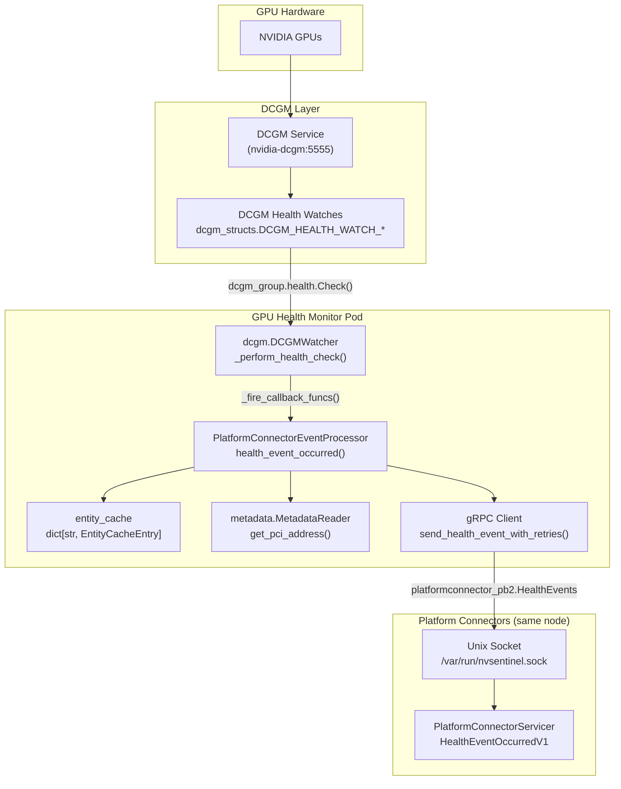
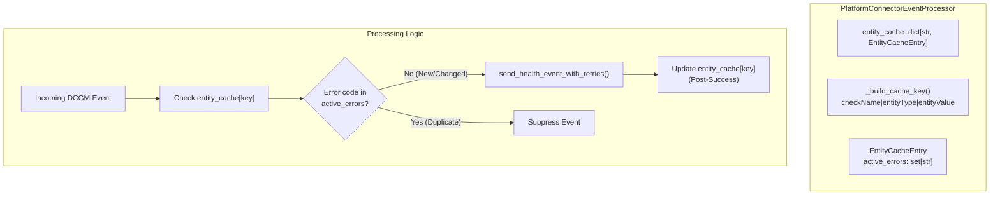

<!-- source: DeepWiki mcp.deepwiki.com · repo NVIDIA/NVSentinel · page 4.1 GPU Health Monitor · fetched 2026-10-26 -->

# GPU Health Monitor

Relevant source files

The following files were used as context for generating this wiki page:

- [distros/kubernetes/nvsentinel/charts/gpu-health-monitor/templates/configmap.yaml](distros/kubernetes/nvsentinel/charts/gpu-health-monitor/templates/configmap.yaml)
- [distros/kubernetes/nvsentinel/charts/gpu-health-monitor/templates/daemonset-dcgm-3.x.yaml](distros/kubernetes/nvsentinel/charts/gpu-health-monitor/templates/daemonset-dcgm-3.x.yaml)
- [distros/kubernetes/nvsentinel/charts/gpu-health-monitor/templates/daemonset-dcgm-4.x.yaml](distros/kubernetes/nvsentinel/charts/gpu-health-monitor/templates/daemonset-dcgm-4.x.yaml)
- [distros/kubernetes/nvsentinel/charts/gpu-health-monitor/values.yaml](distros/kubernetes/nvsentinel/charts/gpu-health-monitor/values.yaml)
- [health-monitors/gpu-health-monitor/Makefile](health-monitors/gpu-health-monitor/Makefile)
- [health-monitors/gpu-health-monitor/gpu_health_monitor/cli.py](health-monitors/gpu-health-monitor/gpu_health_monitor/cli.py)
- [health-monitors/gpu-health-monitor/gpu_health_monitor/dcgm_watcher/dcgm.py](health-monitors/gpu-health-monitor/gpu_health_monitor/dcgm_watcher/dcgm.py)
- [health-monitors/gpu-health-monitor/gpu_health_monitor/dcgm_watcher/metrics.py](health-monitors/gpu-health-monitor/gpu_health_monitor/dcgm_watcher/metrics.py)
- [health-monitors/gpu-health-monitor/gpu_health_monitor/logger.py](health-monitors/gpu-health-monitor/gpu_health_monitor/logger.py)
- [health-monitors/gpu-health-monitor/gpu_health_monitor/platform_connector/metrics.py](health-monitors/gpu-health-monitor/gpu_health_monitor/platform_connector/metrics.py)
- [health-monitors/gpu-health-monitor/gpu_health_monitor/platform_connector/platform_connector.py](health-monitors/gpu-health-monitor/gpu_health_monitor/platform_connector/platform_connector.py)
- [health-monitors/gpu-health-monitor/gpu_health_monitor/tests/conftest.py](health-monitors/gpu-health-monitor/gpu_health_monitor/tests/conftest.py)
- [health-monitors/gpu-health-monitor/gpu_health_monitor/tests/test_dcgm_watcher/test_dcgm.py](health-monitors/gpu-health-monitor/gpu_health_monitor/tests/test_dcgm_watcher/test_dcgm.py)
- [health-monitors/gpu-health-monitor/gpu_health_monitor/tests/test_logger.py](health-monitors/gpu-health-monitor/gpu_health_monitor/tests/test_logger.py)
- [health-monitors/gpu-health-monitor/gpu_health_monitor/tests/test_platform_connector/test_platform_connector.py](health-monitors/gpu-health-monitor/gpu_health_monitor/tests/test_platform_connector/test_platform_connector.py)
- [health-monitors/gpu-health-monitor/poetry.lock](health-monitors/gpu-health-monitor/poetry.lock)
- [health-monitors/gpu-health-monitor/pyproject.toml](health-monitors/gpu-health-monitor/pyproject.toml)
- [log-collector/poetry.lock](log-collector/poetry.lock)
- [log-collector/pyproject.toml](log-collector/pyproject.toml)
- [tests/gpu_health_monitor_test.go](tests/gpu_health_monitor_test.go)
- [tilt/dcgm-fake/Dockerfile](tilt/dcgm-fake/Dockerfile)

## Overview

The GPU Health Monitor is a Python-based DaemonSet that monitors GPU health by integrating with NVIDIA DCGM (Data Center GPU Manager). It detects hardware faults (XID errors, NvLink failures, thermal violations, etc.), deduplicates events using an in-memory cache, and forwards them via gRPC to Platform Connectors for persistence and analysis.

**Key Capabilities:**
- **DCGM Integration**: Polls DCGM health checks and parses error codes from watch failures [health-monitors/gpu-health-monitor/gpu_health_monitor/dcgm_watcher/dcgm.py:30-40]().
- **XID Error Detection**: Detects GPU errors (memory, thermal, NvLink) and categorizes them by severity [health-monitors/gpu-health-monitor/gpu_health_monitor/platform_connector/platform_connector.py:149-167]().
- **Event Deduplication**: Maintains per-entity cache (`entity_cache`) to suppress duplicate events [health-monitors/gpu-health-monitor/gpu_health_monitor/platform_connector/platform_connector.py:35-42]().
- **gRPC Communication**: Sends `HealthEvent` protobuf messages to Platform Connectors via Unix domain socket [health-monitors/gpu-health-monitor/gpu_health_monitor/platform_connector/platform_connector.py:311-335]().

This page covers DCGM integration, event processing logic, deduplication mechanisms, and gRPC communication. For downstream event handling, see [Platform Connectors](#5.1). For the broader health monitoring ecosystem, see [Health Monitoring](#4).

**Sources:** [health-monitors/gpu-health-monitor/gpu_health_monitor/platform_connector/platform_connector.py:44-67](), [health-monitors/gpu-health-monitor/gpu_health_monitor/cli.py:55-78]()

## Architecture and Data Flow

The GPU Health Monitor runs as a DaemonSet pod on each GPU node, polling DCGM health checks and forwarding events to Platform Connectors via gRPC over a Unix domain socket.

### Natural Language to Code Entity Space: Data Flow
Title: GPU Health Monitor Data Flow Architecture

**Sources:** [health-monitors/gpu-health-monitor/gpu_health_monitor/dcgm_watcher/dcgm.py:109-122](), [health-monitors/gpu-health-monitor/gpu_health_monitor/platform_connector/platform_connector.py:133-148](), [health-monitors/gpu-health-monitor/gpu_health_monitor/platform_connector/platform_connector.py:311-335]()

**Event Processing Flow:**

| Step | Component | Action | Code Reference |
|------|-----------|--------|----------------|
| 1 | `DCGMWatcher` | Poll DCGM based on `PollIntervalSeconds` | [cli.py:164-168](), [health-monitors/gpu-health-monitor/gpu_health_monitor/dcgm_watcher/dcgm.py:39]() |
| 2 | `DCGMWatcher` | Execute `_perform_health_check` via `pydcgm` | [dcgm.py:183-207]() |
| 3 | `PlatformConnectorEventProcessor` | Invoke `health_event_occurred(health_details, gpu_ids)` | [platform_connector.py:133-148]() |
| 4 | Deduplication | Check `entity_cache` for duplicate errors | [platform_connector.py:187-191]() |
| 5 | Metadata Enrichment | Add GPU UUID, PCI address, chassis serial | [platform_connector.py:168-178]() |
| 6 | gRPC Send | Send `HealthEvents` via Unix socket with retries | [platform_connector.py:311-335]() |

**Sources:** [health-monitors/gpu-health-monitor/gpu_health_monitor/platform_connector/platform_connector.py:44-385](), [health-monitors/gpu-health-monitor/gpu_health_monitor/cli.py:158-164]()

## DCGM Integration

### Health Check Polling

The GPU Health Monitor uses the `dcgm.DCGMWatcher` class to poll DCGM health checks at a configurable interval. It initializes by discovering all available entities (GPUs and Switches) to create a monitoring group [health-monitors/gpu-health-monitor/gpu_health_monitor/dcgm_watcher/dcgm.py:124-143]().

**DCGMWatcher Configuration:**

| Parameter | Source | Purpose |
|-----------|-------|---------|
| `addr` | `--dcgm-addr` CLI arg | DCGM gRPC endpoint [cli.py:57]() |
| `poll_interval_seconds` | `PollIntervalSeconds` config | Health check frequency [cli.py:164]() |
| `callbacks` | `enabled_event_processors` | Event processors to invoke [cli.py:165]() |

**Sources:** [health-monitors/gpu-health-monitor/gpu_health_monitor/dcgm_watcher/dcgm.py:30-50](), [health-monitors/gpu-health-monitor/gpu_health_monitor/cli.py:162-168]()

### DCGM Health Watches

DCGM reports health status for multiple hardware subsystems. Each watch maps to a `checkName` in the health event:

| DCGM Watch Name | Check Name | Detects |
|-----------------|------------|---------|
| `DCGM_HEALTH_WATCH_NVLINK` | `GpuNvlinkWatch` | NvLink failures |
| `DCGM_HEALTH_WATCH_MEM` | `GpuMemWatch` | Memory errors (XID) |
| `DCGM_HEALTH_WATCH_THERMAL` | `GpuThermalWatch` | Temperature violations |
| `DCGM_HEALTH_WATCH_PCIE` | `GpuPcieWatch` | PCIe replay rate |
| `DCGM_HEALTH_WATCH_INFOROM` | `GpuInforomWatch` | Corrupt InfoROM |

The monitor converts DCGM watch names to check names using `_convert_dcgm_watch_name_to_check_name()` [platform_connector.py:85-87]().

**Sources:** [health-monitors/gpu-health-monitor/gpu_health_monitor/platform_connector/platform_connector.py:78-87](), [health-monitors/gpu-health-monitor/gpu_health_monitor/dcgm_watcher/dcgm.py:52-63]()

### DCGM Error Code Mapping

The monitor maps DCGM error codes to `RecommendedAction` enum values using a CSV configuration file (`dcgmerrorsmapping.csv`) passed via `--dcgm-error-mapping-config-file` [cli.py:58-60]().

**Fatality Logic:**
- Events are fatal (`isFatal=true`) if `recommendedAction != NONE` [platform_connector.py:303-309]().
- Fatal events trigger quarantine in the Fault Quarantine module.

**Sources:** [health-monitors/gpu-health-monitor/gpu_health_monitor/platform_connector/platform_connector.py:303-309](), [health-monitors/gpu-health-monitor/gpu_health_monitor/cli.py:115-122]()

### DCGM Connectivity Failure Detection

The monitor sends a special `GpuDcgmConnectivityFailure` event if DCGM becomes unreachable. When connectivity is restored, `clear_dcgm_connectivity_failure()` is called to send a healthy event [platform_connector.py:92-131]().

**Sources:** [health-monitors/gpu-health-monitor/gpu_health_monitor/platform_connector/platform_connector.py:337-384](), [health-monitors/gpu-health-monitor/gpu_health_monitor/tests/test_platform_connector/test_platform_connector.py:626-728]()

## Event Deduplication

The GPU Health Monitor maintains an in-memory cache (`entity_cache`) to suppress duplicate events and track entity health state.

### Entity Cache Architecture

Title: GPU Health Monitor Deduplication Logic

**Sources:** [health-monitors/gpu-health-monitor/gpu_health_monitor/platform_connector/platform_connector.py:35-42](), [health-monitors/gpu-health-monitor/gpu_health_monitor/platform_connector/platform_connector.py:89-90](), [health-monitors/gpu-health-monitor/gpu_health_monitor/platform_connector/platform_connector.py:291-300]()

### Deduplication Logic

The deduplication algorithm in `health_event_occurred()` ensures that redundant events are not flooded to the Platform Connectors.

**For Unhealthy Events:**
1. Build cache key: `key = _build_cache_key(check_name, "GPU", gpu_id)` [platform_connector.py:187]().
2. Retrieve entry: `entry = self.entity_cache.get(key)` [platform_connector.py:188]().
3. If the error code is not in `entry.active_errors`, the event is considered new and added to `pending_cache_updates` [platform_connector.py:189-195]().

**For Healthy Events:**
1. If an entity previously had errors and now passes, a healthy event is sent to clear the state [platform_connector.py:241-267]().

**Sources:** [health-monitors/gpu-health-monitor/gpu_health_monitor/platform_connector/platform_connector.py:133-302](), [health-monitors/gpu-health-monitor/gpu_health_monitor/tests/test_platform_connector/test_platform_connector.py:420-493]()

## gRPC Communication

The GPU Health Monitor sends events to Platform Connectors via gRPC over a Unix domain socket.

### Unix Socket Configuration

**Socket Path:** Defaults to path provided in `eventprocessors.platformconnector` configuration [cli.py:39-43]().

The socket is shared via a host path volume mount between the monitor and the connector [distros/kubernetes/nvsentinel/charts/gpu-health-monitor/templates/daemonset-dcgm-4.x.yaml:111-114]().

### Retry Mechanism

The `send_health_event_with_retries()` method implements exponential backoff to handle transient communication failures.

**Retry Configuration:**

| Parameter | Value | Purpose |
|-----------|-------|---------|
| `MAX_RETRIES` | `10` | Maximum retry attempts [platform_connector.py:31]() |
| `INITIAL_DELAY` | `5` seconds | First retry delay [platform_connector.py:32]() |

**Sources:** [health-monitors/gpu-health-monitor/gpu_health_monitor/platform_connector/platform_connector.py:311-335]()

### Metadata Enrichment

Before sending events, the monitor enriches them with GPU-specific metadata using `MetadataReader`.

| Metadata Type | Field | Source |
|---------------|-------|--------|
| GPU UUID | `entitiesImpacted` | Metadata file [platform_connector.py:173-178]() |
| PCI Address | `entitiesImpacted` | Metadata file [platform_connector.py:168-172]() |
| Chassis Serial | `metadata` | Metadata file [platform_connector.py:228-230]() |

If critical metadata (PCI/UUID) is missing for a remediation event, the monitor downgrades the `recommendedAction` to `RESTART_VM` to ensure safety [platform_connector.py:202-213]().

**Sources:** [health-monitors/gpu-health-monitor/gpu_health_monitor/platform_connector/platform_connector.py:168-213](), [health-monitors/gpu-health-monitor/gpu_health_monitor/tests/test_platform_connector/test_platform_connector.py:495-624]()

## Dual DCGM Version Support

The GPU Health Monitor supports both DCGM 3.x and 4.x versions through separate container images and DaemonSets.

### Version Selection

| DCGM Version | Image Suffix | Node Selector Label |
|--------------|--------------|---------------------|
| 3.x | `-dcgm-3.x` | `nvsentinel.dgxc.nvidia.com/dcgm.version: "3.x"` [distros/kubernetes/nvsentinel/charts/gpu-health-monitor/templates/daemonset-dcgm-3.x.yaml:127]() |
| 4.x | `-dcgm-4.x` | `nvsentinel.dgxc.nvidia.com/dcgm.version: "4.x"` [distros/kubernetes/nvsentinel/charts/gpu-health-monitor/templates/daemonset-dcgm-4.x.yaml:127]() |

**Sources:** [health-monitors/gpu-health-monitor/Makefile:115-179](), [distros/kubernetes/nvsentinel/charts/gpu-health-monitor/templates/daemonset-dcgm-4.x.yaml:127]()

## Development and Testing

### Unit Tests

The test suite validates core logic using mock DCGM responses and a local gRPC server.

| Test File | Focus |
|-----------|-------|
| `test_dcgm.py` | DCGM group creation, polling, and health response parsing [test_dcgm.py:39-207]() |
| `test_platform_connector.py` | gRPC message formation, deduplication, and metadata enrichment [test_platform_connector.py:77-839]() |

**Sources:** [health-monitors/gpu-health-monitor/gpu_health_monitor/tests/test_dcgm_watcher/test_dcgm.py:1-207](), [health-monitors/gpu-health-monitor/gpu_health_monitor/tests/test_platform_connector/test_platform_connector.py:1-839]()

---

