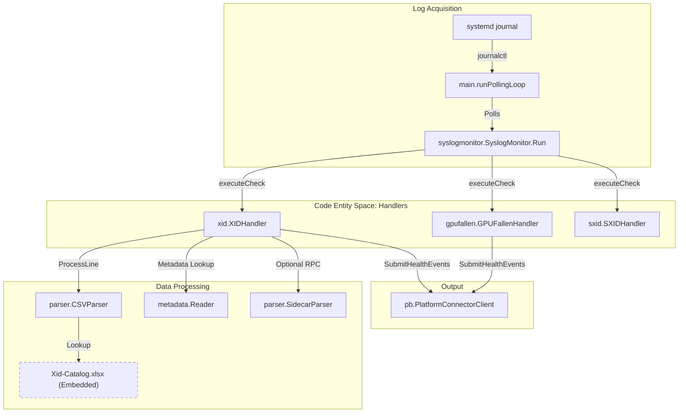
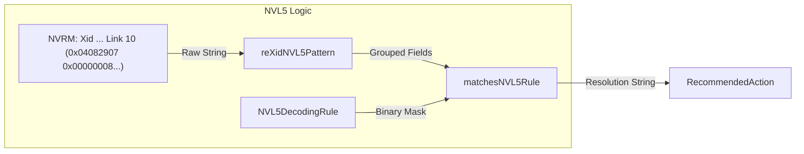

<!-- source: DeepWiki mcp.deepwiki.com · repo NVIDIA/NVSentinel · page 4.2 Syslog Health Monitor · fetched 2026-10-26 -->

# Syslog Health Monitor

Relevant source files

The following files were used as context for generating this wiki page:

- [.coderabbit.yaml](.coderabbit.yaml)
- [distros/kubernetes/nvsentinel/charts/syslog-health-monitor/templates/_helpers.tpl](distros/kubernetes/nvsentinel/charts/syslog-health-monitor/templates/_helpers.tpl)
- [distros/kubernetes/nvsentinel/charts/syslog-health-monitor/values.yaml](distros/kubernetes/nvsentinel/charts/syslog-health-monitor/values.yaml)
- [health-monitors/syslog-health-monitor/main.go](health-monitors/syslog-health-monitor/main.go)
- [health-monitors/syslog-health-monitor/pkg/common/common.go](health-monitors/syslog-health-monitor/pkg/common/common.go)
- [health-monitors/syslog-health-monitor/pkg/common/common_test.go](health-monitors/syslog-health-monitor/pkg/common/common_test.go)
- [health-monitors/syslog-health-monitor/pkg/gpufallen/gpufallen_handler.go](health-monitors/syslog-health-monitor/pkg/gpufallen/gpufallen_handler.go)
- [health-monitors/syslog-health-monitor/pkg/gpufallen/gpufallen_handler_test.go](health-monitors/syslog-health-monitor/pkg/gpufallen/gpufallen_handler_test.go)
- [health-monitors/syslog-health-monitor/pkg/gpufallen/metrics.go](health-monitors/syslog-health-monitor/pkg/gpufallen/metrics.go)
- [health-monitors/syslog-health-monitor/pkg/gpufallen/types.go](health-monitors/syslog-health-monitor/pkg/gpufallen/types.go)
- [health-monitors/syslog-health-monitor/pkg/patterns/xid.go](health-monitors/syslog-health-monitor/pkg/patterns/xid.go)
- [health-monitors/syslog-health-monitor/pkg/sxid/metrics.go](health-monitors/syslog-health-monitor/pkg/sxid/metrics.go)
- [health-monitors/syslog-health-monitor/pkg/sxid/sxid_handler.go](health-monitors/syslog-health-monitor/pkg/sxid/sxid_handler.go)
- [health-monitors/syslog-health-monitor/pkg/sxid/sxid_handler_test.go](health-monitors/syslog-health-monitor/pkg/sxid/sxid_handler_test.go)
- [health-monitors/syslog-health-monitor/pkg/sxid/types.go](health-monitors/syslog-health-monitor/pkg/sxid/types.go)
- [health-monitors/syslog-health-monitor/pkg/syslog-monitor/syslogmonitor.go](health-monitors/syslog-health-monitor/pkg/syslog-monitor/syslogmonitor.go)
- [health-monitors/syslog-health-monitor/pkg/syslog-monitor/syslogmonitor_test.go](health-monitors/syslog-health-monitor/pkg/syslog-monitor/syslogmonitor_test.go)
- [health-monitors/syslog-health-monitor/pkg/syslog-monitor/types.go](health-monitors/syslog-health-monitor/pkg/syslog-monitor/types.go)
- [health-monitors/syslog-health-monitor/pkg/xid/metrics/metrics.go](health-monitors/syslog-health-monitor/pkg/xid/metrics/metrics.go)
- [health-monitors/syslog-health-monitor/pkg/xid/parser/csv.go](health-monitors/syslog-health-monitor/pkg/xid/parser/csv.go)
- [health-monitors/syslog-health-monitor/pkg/xid/parser/csv_test.go](health-monitors/syslog-health-monitor/pkg/xid/parser/csv_test.go)
- [health-monitors/syslog-health-monitor/pkg/xid/parser/factory.go](health-monitors/syslog-health-monitor/pkg/xid/parser/factory.go)
- [health-monitors/syslog-health-monitor/pkg/xid/parser/parser.go](health-monitors/syslog-health-monitor/pkg/xid/parser/parser.go)
- [health-monitors/syslog-health-monitor/pkg/xid/parser/sidecar.go](health-monitors/syslog-health-monitor/pkg/xid/parser/sidecar.go)
- [health-monitors/syslog-health-monitor/pkg/xid/parser/sidecar_test.go](health-monitors/syslog-health-monitor/pkg/xid/parser/sidecar_test.go)
- [health-monitors/syslog-health-monitor/pkg/xid/xid_handler.go](health-monitors/syslog-health-monitor/pkg/xid/xid_handler.go)
- [tests/scale_test.go](tests/scale_test.go)
- [tests/uat/tests.sh](tests/uat/tests.sh)

## Purpose and Scope

The Syslog Health Monitor is a specialized DaemonSet component responsible for monitoring system-level logs via the `systemd` journal (`journalctl`) on each Kubernetes node. Its primary function is to detect hardware and driver-level faults—specifically NVIDIA GPU XID errors, SXID (Switch XID) errors, and "GPU fallen off bus" events—that are reported to the kernel log but might be missed by higher-level API monitoring.

The monitor parses these logs via a polling loop, matches them against a known catalog of error codes (including an embedded NVIDIA XID Catalog), and publishes normalized `HealthEvents` to the Platform Connector via gRPC. It supports persistent state tracking using cursors to ensure no log lines are missed across restarts.

## System Architecture

The monitor is structured around a polling loop that invokes a series of specialized handlers. Each handler is responsible for a specific class of system log pattern.

### Logic Flow: Log to Health Event
The following diagram illustrates how a raw log line from `journalctl` is transformed into a structured `HealthEvent` through the internal handler ecosystem.

**Diagram 1: Code Entity Space Mapping**
Sources: [health-monitors/syslog-health-monitor/main.go:160-161](), [health-monitors/syslog-health-monitor/pkg/syslog-monitor/syslogmonitor.go:193-214](), [health-monitors/syslog-health-monitor/pkg/xid/xid_handler.go:68-106](), [health-monitors/syslog-health-monitor/pkg/common/common.go:64-65]()

### Component Relationships
The monitor bridges the gap between the host operating system's log facilities and the NVSentinel gRPC API.

| Component | Role | File Reference |
| :--- | :--- | :--- |
| `SyslogMonitor` | Orchestrates the polling of journal logs across multiple check definitions and manages cursor persistence. | [health-monitors/syslog-health-monitor/pkg/syslog-monitor/syslogmonitor.go:42-59]() |
| `XIDHandler` | Specifically handles `NVRM: Xid` patterns, mapping them to recommended actions and correlating PCI IDs to UUIDs. | [health-monitors/syslog-health-monitor/pkg/xid/xid_handler.go:37-66]() |
| `CSVParser` | Uses an embedded Excel catalog to resolve XID numbers to human-readable mnemonics and actions. | [health-monitors/syslog-health-monitor/pkg/xid/parser/csv.go:73-90]() |
| `SidecarParser` | An alternative parser that delegates XID decoding to an external REST service (e.g., `xid-analyzer-sidecar`). | [health-monitors/syslog-health-monitor/pkg/xid/parser/sidecar.go:34-52]() |
| `GPUFallenHandler` | Detects "fallen off the bus" strings and suppresses duplicate events if an XID was already seen. | [health-monitors/syslog-health-monitor/pkg/gpufallen/gpufallen_handler.go:32-52]() |

Sources: [health-monitors/syslog-health-monitor/pkg/syslog-monitor/syslogmonitor.go:150-190](), [health-monitors/syslog-health-monitor/pkg/xid/xid_handler.go:15-31]()

## Implementation Details

### XID Detection and Resolution
The monitor includes an embedded version of the official NVIDIA XID Error Catalog (`Xid-Catalog.xlsx`). When an XID error is detected (e.g., `NVRM: Xid (PCI:0000:03:00): 48`), the `CSVParser` performs the following:

1.  **Pattern Matching**: Uses `patterns.XIDPattern` to extract the PCI address and XID code. [health-monitors/syslog-health-monitor/pkg/xid/parser/csv.go:169-173]()
2.  **Catalog Lookup**: Matches the XID code against the embedded Excel sheet to find the `RecommendedAction`. [health-monitors/syslog-health-monitor/pkg/common/common.go:100-121]()
3.  **Action Mapping**: Converts string actions (e.g., "RESET_GPU") into protobuf enums (e.g., `pb.RecommendedAction_COMPONENT_RESET`). [health-monitors/syslog-health-monitor/pkg/common/common.go:68-88]()

### NVL5 (Next-Gen Link) Decoding
For newer architectures, the monitor supports complex NVL5 XID decoding (codes 144-150). These messages include `intrInfo` and `errorStatus` fields that require bit-pattern matching.

**Diagram 2: NVL5 Bit-Pattern Matching**
Sources: [health-monitors/syslog-health-monitor/pkg/xid/parser/csv.go:50-53](), [health-monitors/syslog-health-monitor/pkg/common/common.go:124-160]()

### GPU UUID Correlation
Logs often refer to PCI addresses (e.g., `0000:03:00`), while remediation modules require GPU UUIDs. The `XIDHandler` resolves this by:
1.  **Metadata Reader**: Querying `gpu_metadata.json` (from `metadata-collector`) to map PCI to UUID. [health-monitors/syslog-health-monitor/pkg/xid/xid_handler.go:140-148]()
2.  **Log Parsing**: Parsing `NVRM` mapping lines in the log to build a `pciToGPUUUID` map. [health-monitors/syslog-health-monitor/pkg/xid/xid_handler.go:75-84]()

## Data Flow

The monitor operates as a polling service driven by `main.runPollingLoop`.

1.  **Initialization**: The monitor parses flags and initializes the `SyslogMonitor` with persistent state. [health-monitors/syslog-health-monitor/main.go:133-136]()
2.  **Journal Reading**: For each check, the monitor calls `journalctl` with the appropriate filters (e.g., `_TRANSPORT=kernel`). [health-monitors/syslog-health-monitor/pkg/syslog-monitor/syslogmonitor.go:197]()
3.  **Processing**: Each line is passed to the corresponding handler's `ProcessLine` method. [health-monitors/syslog-health-monitor/pkg/xid/xid_handler.go:68]()
4.  **Submission**: If a fault is detected, a `pb.HealthEvents` message is sent via gRPC to the Platform Connector. [health-monitors/syslog-health-monitor/main.go:118]()

### Fault Detection Strategy
The monitor distinguishes between "Unhealthy" and "Healthy" events:
*   **Unhealthy**: Detected via XID, SXID, or GPU Fallen patterns.
*   **Healthy**: Detected via "GPU reset executed" log lines, which trigger a recovery event. [health-monitors/syslog-health-monitor/pkg/xid/xid_handler.go:86-89]()

Sources: [health-monitors/syslog-health-monitor/main.go:160-161](), [health-monitors/syslog-health-monitor/pkg/xid/xid_handler.go:108-115]()

## Configuration and Metrics

### Command-Line Flags
| Flag | Description | Default |
| :--- | :--- | :--- |
| `--checks` | List of checks to enable (e.g., `SysLogsXIDError`). | `SysLogsXIDError,SysLogsSXIDError,SysLogsGPUFallenOff` |
| `--xid-analyser-endpoint` | URL for an external XID decoding sidecar. | `""` |
| `--polling-interval` | Interval between journal polls. | `30m` |
| `--processing-strategy` | `EXECUTE_REMEDIATION` or `STORE_ONLY`. | `EXECUTE_REMEDIATION` |

Sources: [health-monitors/syslog-health-monitor/main.go:59-77]()

### Metrics
The monitor exposes Prometheus metrics on port `2112`:
*   `xid_processing_latency_seconds`: Latency of XID parsing. [health-monitors/syslog-health-monitor/pkg/xid/metrics/metrics.go:23]()
*   `syslog_health_monitor_gpu_fallen_errors`: Counter for GPU fallen events. [health-monitors/syslog-health-monitor/pkg/gpufallen/metrics.go:24-30]()
*   `xid_processing_errors_total`: Counter for parsing errors. [health-monitors/syslog-health-monitor/pkg/xid/metrics/metrics.go:32]()

Sources: [health-monitors/syslog-health-monitor/main.go:68](), [health-monitors/syslog-health-monitor/pkg/xid/xid_handler.go:72]()

---

