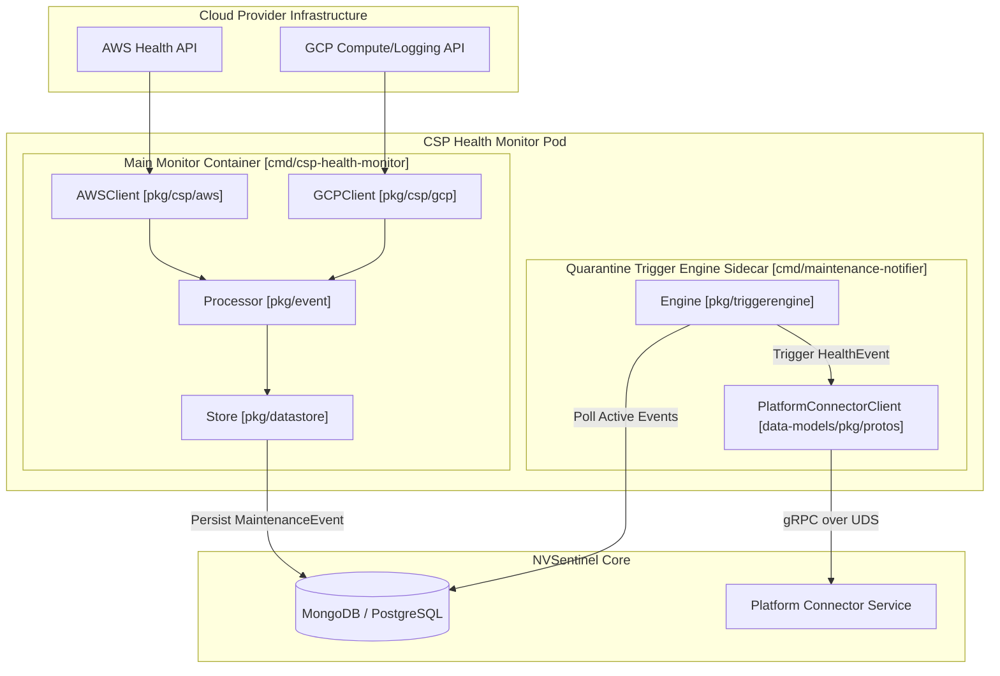
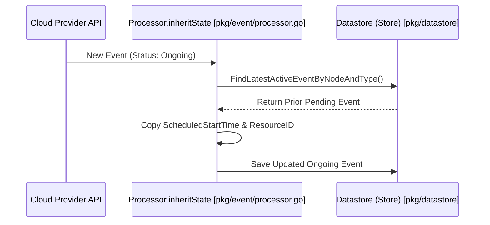

<!-- source: DeepWiki mcp.deepwiki.com · repo NVIDIA/NVSentinel · page 4.3 CSP Health Monitor · fetched 2026-10-26 -->

# CSP Health Monitor

Relevant source files

The following files were used as context for generating this wiki page:

- [.lychee.toml](.lychee.toml)
- [commons/go.mod](commons/go.mod)
- [distros/kubernetes/nvsentinel/charts/csp-health-monitor/templates/serviceaccount.yaml](distros/kubernetes/nvsentinel/charts/csp-health-monitor/templates/serviceaccount.yaml)
- [distros/kubernetes/nvsentinel/charts/csp-health-monitor/values.yaml](distros/kubernetes/nvsentinel/charts/csp-health-monitor/values.yaml)
- [docs/configuration/csp-health-monitor.md](docs/configuration/csp-health-monitor.md)
- [docs/csp-health-monitor-iam.md](docs/csp-health-monitor-iam.md)
- [docs/runbooks/README.md](docs/runbooks/README.md)
- [docs/runbooks/csp-health-monitor-iam.md](docs/runbooks/csp-health-monitor-iam.md)
- [health-monitors/csp-health-monitor/Makefile](health-monitors/csp-health-monitor/Makefile)
- [health-monitors/csp-health-monitor/cmd/csp-health-monitor/main.go](health-monitors/csp-health-monitor/cmd/csp-health-monitor/main.go)
- [health-monitors/csp-health-monitor/cmd/maintenance-notifier/main.go](health-monitors/csp-health-monitor/cmd/maintenance-notifier/main.go)
- [health-monitors/csp-health-monitor/go.mod](health-monitors/csp-health-monitor/go.mod)
- [health-monitors/csp-health-monitor/go.sum](health-monitors/csp-health-monitor/go.sum)
- [health-monitors/csp-health-monitor/pkg/config/config.go](health-monitors/csp-health-monitor/pkg/config/config.go)
- [health-monitors/csp-health-monitor/pkg/csp/aws/aws.go](health-monitors/csp-health-monitor/pkg/csp/aws/aws.go)
- [health-monitors/csp-health-monitor/pkg/csp/aws/aws_test.go](health-monitors/csp-health-monitor/pkg/csp/aws/aws_test.go)
- [health-monitors/csp-health-monitor/pkg/csp/aws/informer.go](health-monitors/csp-health-monitor/pkg/csp/aws/informer.go)
- [health-monitors/csp-health-monitor/pkg/csp/gcp/gcp.go](health-monitors/csp-health-monitor/pkg/csp/gcp/gcp.go)
- [health-monitors/csp-health-monitor/pkg/event/gcp_normalizer.go](health-monitors/csp-health-monitor/pkg/event/gcp_normalizer.go)
- [health-monitors/csp-health-monitor/pkg/event/processor.go](health-monitors/csp-health-monitor/pkg/event/processor.go)
- [health-monitors/csp-health-monitor/pkg/triggerengine/trigger.go](health-monitors/csp-health-monitor/pkg/triggerengine/trigger.go)
- [health-monitors/csp-health-monitor/pkg/triggerengine/trigger_test.go](health-monitors/csp-health-monitor/pkg/triggerengine/trigger_test.go)
- [health-monitors/syslog-health-monitor/pkg/syslog-monitor/fake_journal.go](health-monitors/syslog-health-monitor/pkg/syslog-monitor/fake_journal.go)
- [health-monitors/syslog-health-monitor/pkg/syslog-monitor/journal_stub.go](health-monitors/syslog-health-monitor/pkg/syslog-monitor/journal_stub.go)
- [janitor/go.mod](janitor/go.mod)
- [janitor/go.sum](janitor/go.sum)
- [store-client/go.sum](store-client/go.sum)

## Purpose and Scope

The **CSP Health Monitor** is a centralized monitoring service (typically running as a single-replica deployment) that integrates with Cloud Service Provider (CSP) APIs—specifically **AWS** and **GCP**—to detect scheduled maintenance events, capacity constraints, and infrastructure-level health issues. Unlike the GPU or Syslog monitors which run as DaemonSets on every node, the CSP monitor performs cluster-wide API polling to identify events affecting any node within the managed cluster.

This monitor provides the "Early Warning" system for cloud-provider-initiated events, such as instance retirements or hardware maintenance, allowing NVSentinel to proactively quarantine and drain nodes before the provider forces a reboot or termination.

**Sources:** [health-monitors/csp-health-monitor/go.mod:1-31](), [distros/kubernetes/nvsentinel/charts/csp-health-monitor/values.yaml:66-96](), [docs/csp-health-monitor-iam.md:1-6]()

## Architecture and Data Flow

The CSP Health Monitor consists of two primary logical components often deployed in the same pod: the **Main Monitor** (Polling Engine) and the **Quarantine Trigger Engine** (Sidecar).

### Component Relationship Diagram

**Sources:** [health-monitors/csp-health-monitor/pkg/triggerengine/trigger.go:58-86](), [health-monitors/csp-health-monitor/cmd/maintenance-notifier/main.go:105-126](), [distros/kubernetes/nvsentinel/charts/csp-health-monitor/values.yaml:31-43]()

## Cloud Provider Integrations

### AWS Integration
The `AWSClient` uses the AWS Health SDK to query the `DescribeEvents`, `DescribeAffectedEntities`, and `DescribeEventDetails` APIs. It maps AWS-specific event codes to internal maintenance types.

| AWS Event Type Code | Internal Mapping |
|---------------------|------------------|
| `AWS_EC2_INSTANCE_REBOOT_MAINTENANCE_SCHEDULED` | Reboot Maintenance |
| `AWS_EC2_INSTANCE_POWER_MAINTENANCE_SCHEDULED` | Power Maintenance |
| `AWS_EC2_ULTRASERVER_MAINTENANCE_INITIATED` | UltraServer Maintenance |

The monitor uses a `NodeInformer` to map AWS Instance IDs (found in the Health API) to Kubernetes Node names by checking the `spec.providerID` field of Node objects. It requires specific IAM permissions such as `health:DescribeEvents` and `health:DescribeAffectedEntities`.

**Sources:** [health-monitors/csp-health-monitor/pkg/csp/aws/aws.go:42-79](), [health-monitors/csp-health-monitor/pkg/csp/aws/aws.go:104-113](), [health-monitors/csp-health-monitor/pkg/csp/aws/aws.go:174-181](), [docs/csp-health-monitor-iam.md:62-67]()

### GCP Integration
GCP integration leverages the Compute Engine API to detect `upcomingMaintenance` events and the Cloud Logging API to ingest `compute.instances.upcomingMaintenance` logs. This dual approach ensures both polling-based discovery and event-driven updates are captured. It requires the `logging.logEntries.list` IAM permission.

**Sources:** [health-monitors/csp-health-monitor/go.mod:8-9](), [distros/kubernetes/nvsentinel/charts/csp-health-monitor/values.yaml:80-84](), [docs/csp-health-monitor-iam.md:7-12]()

## Event Processing Pipeline

The `Processor` in `pkg/event/processor.go` is responsible for the lifecycle of a `MaintenanceEvent`. It performs state inheritance to ensure continuity as cloud events progress from "Scheduled" to "Ongoing" to "Completed".

### State Inheritance Logic
1.  **Pending to Ongoing**: When an event status moves to `StatusMaintenanceOngoing`, the processor looks up the prior `StatusDetected` event for that node to inherit the `ScheduledStartTime` and `ResourceID`.
2.  **Ongoing to Completed**: When a `StatusMaintenanceComplete` signal is received, it retrieves the latest `Ongoing` event to preserve the original `MaintenanceType` and `ActualStartTime`.

**Sources:** [health-monitors/csp-health-monitor/pkg/event/processor.go:75-111](), [health-monitors/csp-health-monitor/pkg/event/processor.go:116-147](), [health-monitors/csp-health-monitor/pkg/event/processor.go:152-213]()

## Quarantine Trigger Engine

The `Engine` in `pkg/triggerengine/trigger.go` acts as the bridge between the CSP-specific `MaintenanceEvent` (stored in the DB) and the standard NVSentinel `HealthEvent` (sent to Platform Connector).

### Key Functions
-   **checkAndTriggerEvents**: Periodically queries the datastore for events that have reached the "trigger window" (defined by `triggerQuarantineWorkflowTimeLimitMinutes`).
-   **triggerQuarantine**: Converts a `MaintenanceEvent` into a `pb.HealthEvent` with `ComponentClass_CSP_INFRASTRUCTURE` and sends it to the `PlatformConnector` via gRPC over UDS.
-   **isNodeReady**: After maintenance is marked complete, the engine monitors the Kubernetes Node status via the `k8sClient`. It only triggers a "Healthy" event once the node is back in `Ready` state and the `PostMaintenanceHealthyDelayMinutes` has passed.

**Sources:** [health-monitors/csp-health-monitor/pkg/triggerengine/trigger.go:118-150](), [health-monitors/csp-health-monitor/pkg/triggerengine/trigger.go:153-188](), [health-monitors/csp-health-monitor/cmd/maintenance-notifier/main.go:105-126](), [distros/kubernetes/nvsentinel/charts/csp-health-monitor/values.yaml:71-76]()

## Configuration Reference

The monitor is configured via a `config.toml` file generated by the Helm chart.

| Parameter | Default | Description |
|-----------|---------|-------------|
| `maintenanceEventPollIntervalSeconds` | 60 | How often the Trigger Engine checks the DB for events. |
| `triggerQuarantineWorkflowTimeLimitMinutes` | 30 | Lead time before maintenance to start the quarantine/drain. |
| `postMaintenanceHealthyDelayMinutes` | 15 | Wait time after maintenance before marking node healthy. |
| `processingStrategy` | `EXECUTE_REMEDIATION` | Can be `STORE_ONLY` for observability-only mode. |
| `nodeReadinessTimeoutMinutes` | 60 | Timeout for monitoring node readiness post-maintenance. |

**Sources:** [distros/kubernetes/nvsentinel/charts/csp-health-monitor/values.yaml:52-57](), [distros/kubernetes/nvsentinel/charts/csp-health-monitor/values.yaml:71-79](), [health-monitors/csp-health-monitor/pkg/config/config.go:1-30]()

## Metrics

The CSP Health Monitor and its sidecar export Prometheus metrics for operational visibility:

-   `csp_monitor_errors`: Counter of SDK or K8s client errors, labeled by CSP (`aws`, `gcp`).
-   `trigger_poll_cycles`: Counter of how many times the Trigger Engine has polled the DB.
-   `trigger_events_found`: Number of maintenance events identified for action, labeled by trigger type (`quarantine`, `healthy`).
-   `trigger_datastore_query_duration_seconds`: Histogram of DB query latency.
-   `trigger_uds_send_errors`: Counter of gRPC communication failures between the sidecar and Platform Connector.

**Sources:** [health-monitors/csp-health-monitor/pkg/csp/aws/aws.go:124-128](), [health-monitors/csp-health-monitor/pkg/triggerengine/trigger.go:102-108](), [health-monitors/csp-health-monitor/pkg/triggerengine/trigger.go:126-138](), [health-monitors/csp-health-monitor/cmd/maintenance-notifier/main.go:115-116]()

---

