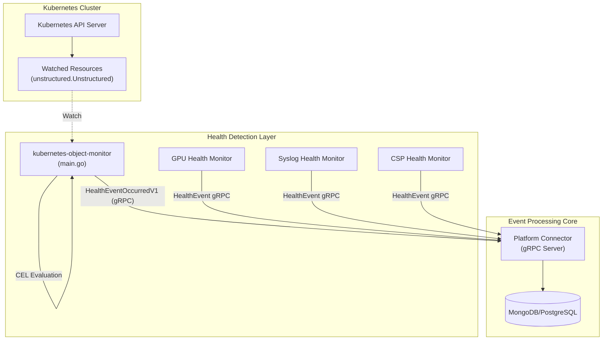
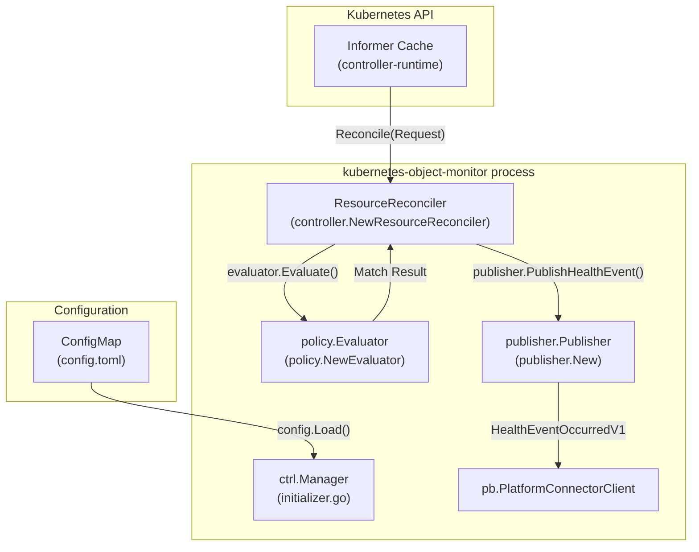

<!-- source: DeepWiki mcp.deepwiki.com · repo NVIDIA/NVSentinel · page 4.4 Kubernetes Object Monitor · fetched 2026-10-26 -->

# Kubernetes Object Monitor

<details>
<summary>Relevant source files</summary>

The following files were used as context for generating this wiki page:

- [distros/kubernetes/nvsentinel/charts/kubernetes-object-monitor/templates/clusterrole.yaml](distros/kubernetes/nvsentinel/charts/kubernetes-object-monitor/templates/clusterrole.yaml)
- [distros/kubernetes/nvsentinel/charts/kubernetes-object-monitor/templates/configmap.yaml](distros/kubernetes/nvsentinel/charts/kubernetes-object-monitor/templates/configmap.yaml)
- [distros/kubernetes/nvsentinel/charts/kubernetes-object-monitor/templates/deployment.yaml](distros/kubernetes/nvsentinel/charts/kubernetes-object-monitor/templates/deployment.yaml)
- [distros/kubernetes/nvsentinel/charts/kubernetes-object-monitor/values.yaml](distros/kubernetes/nvsentinel/charts/kubernetes-object-monitor/values.yaml)
- [docs/monitoring-critical-operators.md](docs/monitoring-critical-operators.md)
- [health-monitors/kubernetes-object-monitor/Makefile](health-monitors/kubernetes-object-monitor/Makefile)
- [health-monitors/kubernetes-object-monitor/Tiltfile](health-monitors/kubernetes-object-monitor/Tiltfile)
- [health-monitors/kubernetes-object-monitor/go.mod](health-monitors/kubernetes-object-monitor/go.mod)
- [health-monitors/kubernetes-object-monitor/go.sum](health-monitors/kubernetes-object-monitor/go.sum)
- [health-monitors/kubernetes-object-monitor/main.go](health-monitors/kubernetes-object-monitor/main.go)
- [health-monitors/kubernetes-object-monitor/pkg/config/types.go](health-monitors/kubernetes-object-monitor/pkg/config/types.go)
- [health-monitors/kubernetes-object-monitor/pkg/controller/reconciler.go](health-monitors/kubernetes-object-monitor/pkg/controller/reconciler.go)
- [health-monitors/kubernetes-object-monitor/pkg/controller/reconciler_test.go](health-monitors/kubernetes-object-monitor/pkg/controller/reconciler_test.go)
- [health-monitors/kubernetes-object-monitor/pkg/initializer/initializer.go](health-monitors/kubernetes-object-monitor/pkg/initializer/initializer.go)
- [health-monitors/kubernetes-object-monitor/pkg/publisher/publisher.go](health-monitors/kubernetes-object-monitor/pkg/publisher/publisher.go)
- [tests/data/k8s-rule-override.yaml](tests/data/k8s-rule-override.yaml)
- [tests/helpers/kubernetes_object_monitor.go](tests/helpers/kubernetes_object_monitor.go)
- [tests/kubernetes_object_monitor_test.go](tests/kubernetes_object_monitor_test.go)

</details>


## Purpose and Scope

The Kubernetes Object Monitor is a policy-based health detection component that watches Kubernetes resources and generates health events based on Common Expression Language (CEL) rules. It enables operators to define custom health checks by observing the state of any Kubernetes object (Pods, Nodes, Events, custom resources) and emitting structured health events when policy conditions are met. [health-monitors/kubernetes-object-monitor/pkg/config/types.go:20-27]()

This monitor is distinct from other health detection components: for GPU hardware monitoring, see [GPU Health Monitor](#4.1); for system log analysis, see [Syslog Health Monitor](#4.2); for cloud provider maintenance events, see [CSP Health Monitor](#4.3).

**Sources:** [health-monitors/kubernetes-object-monitor/pkg/config/types.go:20-27]()

---

## System Overview

The Kubernetes Object Monitor operates as a cluster-wide Deployment that continuously watches specified Kubernetes resources using the Kubernetes API. When resource states match configured CEL expressions, it generates health events and sends them to Platform Connectors via gRPC. [health-monitors/kubernetes-object-monitor/main.go:35-78]()

### Position in Architecture



**Sources:** [health-monitors/kubernetes-object-monitor/main.go:69-78](), [health-monitors/kubernetes-object-monitor/pkg/publisher/publisher.go:117-117]()

---

## Architecture and Design

### CEL Policy-Based Detection

The Kubernetes Object Monitor uses the Common Expression Language (CEL) for policy evaluation. CEL expressions allow operators to define arbitrary conditions based on Kubernetes resource state. The `Evaluator` class handles the lifecycle of these expressions. [health-monitors/kubernetes-object-monitor/pkg/initializer/initializer.go:111-115]()

- **Resource Specs**: Defines the GVK (Group, Version, Kind) to watch. [health-monitors/kubernetes-object-monitor/pkg/config/types.go:29-33]()
- **Predicate Expressions**: CEL string evaluated against the resource. [health-monitors/kubernetes-object-monitor/pkg/config/types.go:35-37]()
- **Node Association**: Optional CEL expression to map a non-node resource (like a Pod) to a specific Node. [health-monitors/kubernetes-object-monitor/pkg/config/types.go:39-41]()

### Component Structure

The `InitializeAll` function in `initializer.go` sets up the controller-runtime manager and registers reconcilers for each unique GVK defined in the policies. [health-monitors/kubernetes-object-monitor/pkg/initializer/initializer.go:65-130]()



**Sources:** [health-monitors/kubernetes-object-monitor/pkg/initializer/initializer.go:92-129](), [health-monitors/kubernetes-object-monitor/pkg/publisher/publisher.go:51-106](), [health-monitors/kubernetes-object-monitor/pkg/initializer/initializer.go:172-195]()

---

## Configuration

### Policy Definition

Policies are defined in a TOML configuration file, typically mounted via a ConfigMap. [distros/kubernetes/nvsentinel/charts/kubernetes-object-monitor/templates/configmap.yaml:24-57]()

| Field | Type | Description |
|-------|------|-------------|
| `name` | string | Unique identifier for the policy. [health-monitors/kubernetes-object-monitor/pkg/config/types.go:21]() |
| `resource` | ResourceSpec | GVK of the object to monitor. [health-monitors/kubernetes-object-monitor/pkg/config/types.go:23]() |
| `predicate.expression` | string | CEL expression that returns `true` if the object is unhealthy. [health-monitors/kubernetes-object-monitor/pkg/config/types.go:36]() |
| `healthEvent.isFatal` | bool | If true, triggers immediate remediation (e.g., Cordon/Drain). [health-monitors/kubernetes-object-monitor/pkg/config/types.go:45]() |
| `healthEvent.processingStrategy` | string | Overrides the global strategy (`EXECUTE_REMEDIATION` or `STORE_ONLY`). [health-monitors/kubernetes-object-monitor/pkg/config/types.go:50]() |

### Deployment Arguments

The monitor is configured via CLI flags in the Deployment template. [distros/kubernetes/nvsentinel/charts/kubernetes-object-monitor/templates/deployment.yaml:52-59]()

- `--policy-config-path`: Path to the TOML policy file. [health-monitors/kubernetes-object-monitor/main.go:44-48]()
- `--platform-connector-socket`: gRPC endpoint for event submission. [health-monitors/kubernetes-object-monitor/main.go:69-73]()
- `--resync-period`: Interval for periodic reconciliation (default 5m). [health-monitors/kubernetes-object-monitor/main.go:59-63]()

**Sources:** [health-monitors/kubernetes-object-monitor/pkg/config/types.go:21-51](), [health-monitors/kubernetes-object-monitor/main.go:44-73](), [distros/kubernetes/nvsentinel/charts/kubernetes-object-monitor/templates/configmap.yaml:24-57]()

---

## Health Event Generation

### Entity Impact Tracking

The monitor populates the `EntitiesImpacted` field in the health event, allowing the system to track specific resources (e.g., a failing Pod) even if the event is associated with a Node. [health-monitors/kubernetes-object-monitor/pkg/publisher/publisher.go:68-80]()

```go
// From publisher.go
if resourceInfo != nil {
    entityValue = fmt.Sprintf("%s/%s", resourceInfo.Namespace, resourceInfo.Name)
    entitiesImpacted = []*pb.Entity{
        {
            EntityType:  resourceInfo.GVK(),
            EntityValue: entityValue,
        },
    }
}
```

**Sources:** [health-monitors/kubernetes-object-monitor/pkg/publisher/publisher.go:68-80]()

### State Management and Annotations

The monitor uses the `AnnotationManager` to record policy matches directly on the Kubernetes objects. This provides immediate visibility via `kubectl describe`. [health-monitors/kubernetes-object-monitor/pkg/initializer/initializer.go:172-176]()

- **Annotation Key**: `nvsentinel.nvidia.com/k8s-object-monitor-policy-matches`. [tests/helpers/kubernetes_object_monitor.go:35-35]()
- **Behavior**: The annotation is added when a policy matches and cleared when the resource returns to a healthy state. [tests/kubernetes_object_monitor_test.go:69-119]()

**Sources:** [health-monitors/kubernetes-object-monitor/pkg/initializer/initializer.go:172-176](), [tests/helpers/kubernetes_object_monitor.go:35-35](), [tests/kubernetes_object_monitor_test.go:69-119]()

---

## Processing Strategy

The monitor respects a `processingStrategy` which determines the downstream impact of events. [health-monitors/kubernetes-object-monitor/pkg/publisher/publisher.go:53-62]()

| Strategy | Behavior |
|----------|----------|
| `EXECUTE_REMEDIATION` | Events trigger active remediation like node draining. [health-monitors/kubernetes-object-monitor/main.go:74-78]() |
| `STORE_ONLY` | Events are persisted to the database for observability but do not trigger automated actions. [tests/kubernetes_object_monitor_test.go:125-189]() |

**Sources:** [health-monitors/kubernetes-object-monitor/main.go:74-78](), [health-monitors/kubernetes-object-monitor/pkg/publisher/publisher.go:53-62](), [tests/kubernetes_object_monitor_test.go:125-189]()

---

## RBAC and Security

The monitor uses dynamic RBAC generation. The Helm chart iterates through the configured policies and generates a `ClusterRole` with the necessary `get`, `list`, and `watch` permissions for every resource type being monitored. [distros/kubernetes/nvsentinel/charts/kubernetes-object-monitor/templates/clusterrole.yaml:15-65]()

```yaml
rules:
  - apiGroups: [""]
    resources: ["nodes"]
    verbs: ["get", "list", "watch", "patch", "update"]
  # Automatically generated for other resources:
  - apiGroups: ["apps"]
    resources: ["daemonsets"]
    verbs: ["get", "list", "watch"]
```

**Sources:** [distros/kubernetes/nvsentinel/charts/kubernetes-object-monitor/templates/clusterrole.yaml:15-65]()

---

## Metrics and Observability

The monitor integrates with the standard NVSentinel metrics registry and exports controller-runtime metrics. [health-monitors/kubernetes-object-monitor/main.go:94-96]()

- **Port**: Default `2112`. [distros/kubernetes/nvsentinel/charts/kubernetes-object-monitor/templates/deployment.yaml:55-55]()
- **Key Metrics**:
    - `nvsentinel_policy_matches_total`: Counter for CEL policy matches, labeled by policy name and resource. [health-monitors/kubernetes-object-monitor/pkg/controller/reconciler_test.go:67-76]()
    - `nvsentinel_agent_status`: Gauge indicating if the monitor is in `STORE_ONLY` mode. [health-monitors/kubernetes-object-monitor/main.go:97-97]()

**Sources:** [health-monitors/kubernetes-object-monitor/main.go:49-53](), [health-monitors/kubernetes-object-monitor/main.go:94-97](), [distros/kubernetes/nvsentinel/charts/kubernetes-object-monitor/templates/deployment.yaml:55-55]()

---

