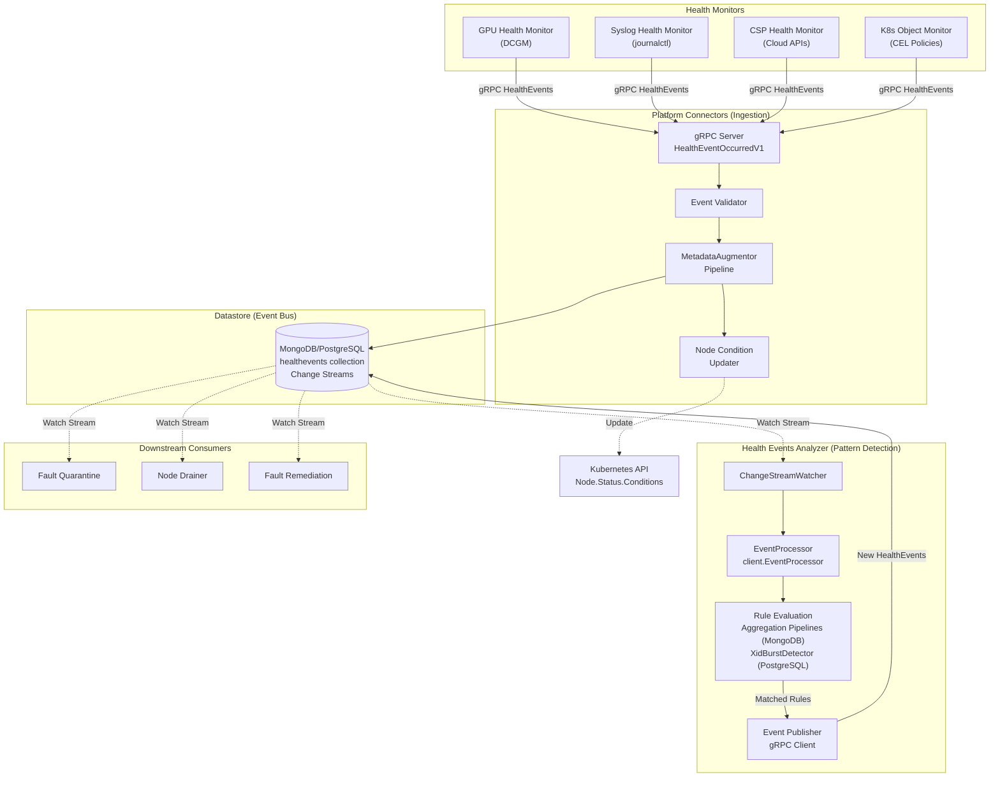
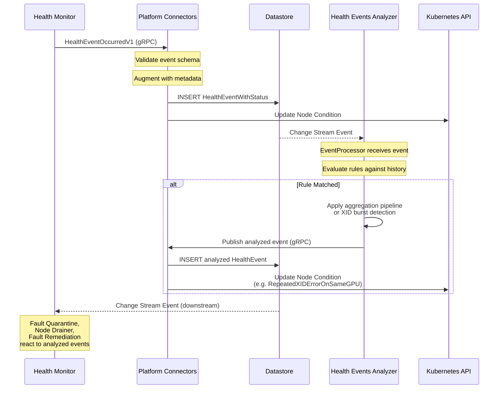
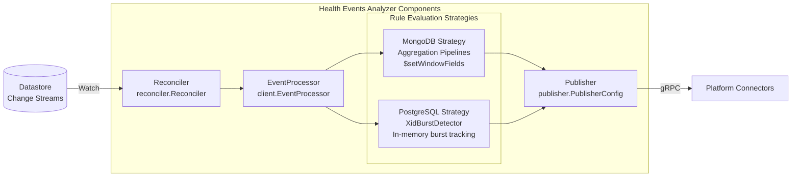

<!-- source: DeepWiki mcp.deepwiki.com · repo NVIDIA/NVSentinel · page 5 Event Processing · fetched 2026-10-26 -->

# Event Processing

Relevant source files

The following files were used as context for generating this wiki page:

- [commons/go.sum](commons/go.sum)
- [distros/kubernetes/nvsentinel/templates/configmap.yaml](distros/kubernetes/nvsentinel/templates/configmap.yaml)
- [event-exporter/go.mod](event-exporter/go.mod)
- [event-exporter/go.sum](event-exporter/go.sum)
- [fault-quarantine/go.mod](fault-quarantine/go.mod)
- [fault-quarantine/go.sum](fault-quarantine/go.sum)
- [fault-remediation/go.mod](fault-remediation/go.mod)
- [fault-remediation/go.sum](fault-remediation/go.sum)
- [health-events-analyzer/go.mod](health-events-analyzer/go.mod)
- [health-events-analyzer/go.sum](health-events-analyzer/go.sum)
- [health-monitors/syslog-health-monitor/go.mod](health-monitors/syslog-health-monitor/go.mod)
- [node-drainer/go.mod](node-drainer/go.mod)
- [node-drainer/go.sum](node-drainer/go.sum)
- [platform-connectors/go.mod](platform-connectors/go.mod)
- [platform-connectors/go.sum](platform-connectors/go.sum)
- [platform-connectors/main.go](platform-connectors/main.go)
- [platform-connectors/pkg/connectors/kubernetes/k8s_connector.go](platform-connectors/pkg/connectors/kubernetes/k8s_connector.go)
- [platform-connectors/pkg/connectors/kubernetes/k8s_connector_envtest_test.go](platform-connectors/pkg/connectors/kubernetes/k8s_connector_envtest_test.go)
- [platform-connectors/pkg/connectors/kubernetes/k8s_platform_connector_test.go](platform-connectors/pkg/connectors/kubernetes/k8s_platform_connector_test.go)
- [platform-connectors/pkg/connectors/kubernetes/process_node_events.go](platform-connectors/pkg/connectors/kubernetes/process_node_events.go)
- [store-client/go.mod](store-client/go.mod)
- [tests/syslog_health_monitor_test.go](tests/syslog_health_monitor_test.go)

## Purpose and Scope

Event Processing is the central coordination layer in NVSentinel that receives health events from monitors, normalizes and persists them to the datastore, and performs pattern detection to identify complex fault scenarios. This page provides an overview of the event processing architecture and the interaction between its two primary components: Platform Connectors and Health Events Analyzer.

For details on Platform Connectors (event ingestion and gRPC server), see [Platform Connectors](#5.1). For Health Events Analyzer (pattern detection and rule evaluation), see [Health Events Analyzer](#5.2). For common event processing patterns and implementation details, see [Event Processing Patterns](#5.3).

---

## Architecture Overview

The Event Processing layer consists of two primary components that communicate asynchronously through the datastore:

**Event Processing Data Flow**

Sources: [platform-connectors/main.go:60-87](), [platform-connectors/pkg/connectors/kubernetes/k8s_connector.go:1-100]()

---

## Event Lifecycle

Health events flow through the system in a multi-stage pipeline:

**Health Event Lifecycle Sequence**

Sources: [platform-connectors/pkg/connectors/kubernetes/process_node_events.go:51-118](), [health-events-analyzer/go.mod:7-20]()

---

## Platform Connectors: Event Ingestion

Platform Connectors serves as the gRPC server endpoint that receives health events from all monitors and persists them to the datastore.

### Key Responsibilities

| Function | Description | Implementation |
|----------|-------------|----------------|
| **gRPC Server** | Receives `HealthEventOccurredV1` calls from monitors | `platform-connectors` binary |
| **Event Validation** | Validates event schema and required fields | `platform-connectors/pkg/pipeline` |
| **Metadata Augmentation** | Enriches events with node metadata, timestamps | `MetadataAugmentor` pipeline |
| **Persistence** | Stores `HealthEventWithStatus` documents in datastore | `DatabaseStoreConnector` |
| **Node Condition Updates** | Sets Kubernetes node conditions based on check name | `K8sConnector.updateNodeConditions` |

### Event Structure

Events ingested by Platform Connectors follow the `HealthEventWithStatus` schema defined in the data models module.

Sources: [platform-connectors/pkg/connectors/kubernetes/process_node_events.go:51-58](), [platform-connectors/go.mod:12-12]()

---

## Health Events Analyzer: Pattern Detection

Health Events Analyzer watches the datastore for new health events and evaluates complex rules to detect patterns that indicate deeper hardware or software issues.

### Core Components

**Health Events Analyzer Component Architecture**

### Rule Evaluation System

Health Events Analyzer supports multiple database strategies for pattern detection:

| Datastore | Strategy | Implementation |
|-----------|----------|----------------|
| **MongoDB** | Aggregation pipelines with `$setWindowFields` | Pipelines execute directly in MongoDB via change streams |
| **PostgreSQL** | Go-based `XidBurstDetector` | In-memory burst tracking with sliding windows |

Sources: [health-events-analyzer/go.mod:7-20](), [store-client/go.mod:1-24]()

---

## EventProcessor Framework

The `EventProcessor` is a unified abstraction in `store-client` that handles change stream event processing with standardized metrics and error handling.

### Key Design Decision: At-Least-Once Delivery

The EventProcessor ensures resilience by managing the database resume token:

1.  **Success**: Resume token advances, event is marked as "consumed".
2.  **Failure**: Resume token does NOT advance if `MarkProcessedOnError` is false.
3.  **Pod Restart**: Change stream resumes from the last successful event, ensuring no events are missed.

Sources: [store-client/go.mod:1-24](), [health-events-analyzer/go.mod:11-11]()

---

## XID Burst Detection

XID (GPU error code) burst detection identifies patterns of GPU errors that indicate hardware degradation. The system tracks "bursts" of errors and triggers rules when errors repeat across multiple bursts.

### Burst Parameters

- **Burst Window**: Short window (e.g., 3 minutes) to group related errors.
- **Lookback Period**: Long window (e.g., 24 hours) to identify repeating patterns.
- **Sticky XIDs**: Specific critical XID codes (e.g., 74, 79, 119) that trigger high-priority remediation.

Sources: [health-events-analyzer/go.mod:7-20](), [health-monitors/syslog-health-monitor/go.mod:1-19]()

---

## Summary

Event Processing in NVSentinel consists of two asynchronously-coupled components:

| Component | Role | Key Technologies |
|-----------|------|------------------|
| **Platform Connectors** | Event ingestion, validation, persistence | gRPC server, Metadata augmentation, K8s API |
| **Health Events Analyzer** | Pattern detection, rule evaluation | Change streams, Aggregation pipelines, XID burst detection |

For implementation details, see [Platform Connectors](#5.1), [Health Events Analyzer](#5.2), and [Event Processing Patterns](#5.3).

---

