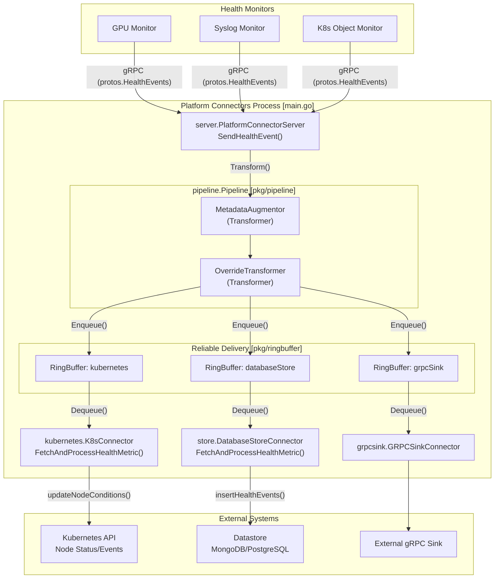
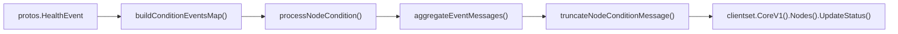

<!-- source: DeepWiki mcp.deepwiki.com · repo NVIDIA/NVSentinel · page 5.1 Platform Connectors · fetched 2026-10-26 -->

# Platform Connectors

Relevant source files

The following files were used as context for generating this wiki page:

- [distros/kubernetes/nvsentinel/templates/configmap.yaml](distros/kubernetes/nvsentinel/templates/configmap.yaml)
- [docs/configuration/event-exporter.md](docs/configuration/event-exporter.md)
- [docs/configuration/fault-quarantine.md](docs/configuration/fault-quarantine.md)
- [docs/configuration/fault-remediation.md](docs/configuration/fault-remediation.md)
- [docs/configuration/gpu-health-monitor.md](docs/configuration/gpu-health-monitor.md)
- [docs/configuration/kubernetes-object-monitor.md](docs/configuration/kubernetes-object-monitor.md)
- [docs/configuration/labeler.md](docs/configuration/labeler.md)
- [docs/configuration/mongodb-store.md](docs/configuration/mongodb-store.md)
- [docs/configuration/node-drainer.md](docs/configuration/node-drainer.md)
- [docs/configuration/platform-connectors.md](docs/configuration/platform-connectors.md)
- [docs/configuration/syslog-health-monitor.md](docs/configuration/syslog-health-monitor.md)
- [docs/designs/033-grpc-sink-connector.md](docs/designs/033-grpc-sink-connector.md)
- [docs/platform-connectors.md](docs/platform-connectors.md)
- [platform-connectors/main.go](platform-connectors/main.go)
- [platform-connectors/pkg/connectors/grpcsink/grpc_sink_connector.go](platform-connectors/pkg/connectors/grpcsink/grpc_sink_connector.go)
- [platform-connectors/pkg/connectors/grpcsink/grpc_sink_connector_test.go](platform-connectors/pkg/connectors/grpcsink/grpc_sink_connector_test.go)
- [platform-connectors/pkg/connectors/grpcsink/metrics.go](platform-connectors/pkg/connectors/grpcsink/metrics.go)
- [platform-connectors/pkg/connectors/kubernetes/k8s_connector.go](platform-connectors/pkg/connectors/kubernetes/k8s_connector.go)
- [platform-connectors/pkg/connectors/kubernetes/k8s_connector_envtest_test.go](platform-connectors/pkg/connectors/kubernetes/k8s_connector_envtest_test.go)
- [platform-connectors/pkg/connectors/kubernetes/k8s_platform_connector_test.go](platform-connectors/pkg/connectors/kubernetes/k8s_platform_connector_test.go)
- [platform-connectors/pkg/connectors/kubernetes/metrics.go](platform-connectors/pkg/connectors/kubernetes/metrics.go)
- [platform-connectors/pkg/connectors/kubernetes/process_node_events.go](platform-connectors/pkg/connectors/kubernetes/process_node_events.go)
- [platform-connectors/pkg/connectors/store/store_connector.go](platform-connectors/pkg/connectors/store/store_connector.go)
- [platform-connectors/pkg/connectors/store/store_connector_test.go](platform-connectors/pkg/connectors/store/store_connector_test.go)
- [platform-connectors/pkg/ringbuffer/metrics.go](platform-connectors/pkg/ringbuffer/metrics.go)
- [platform-connectors/pkg/ringbuffer/ring_buffer.go](platform-connectors/pkg/ringbuffer/ring_buffer.go)
- [platform-connectors/pkg/ringbuffer/ring_buffer_test.go](platform-connectors/pkg/ringbuffer/ring_buffer_test.go)
- [tests/syslog_health_monitor_test.go](tests/syslog_health_monitor_test.go)

## Overview

Platform Connectors is the central communication hub in NVSentinel that receives health events from all monitoring components and distributes them to three primary destinations: the Kubernetes API (for node conditions and events), the datastore (for persistence), and an optional gRPC Sink for external streaming. It operates as a gRPC server, providing a robust event validation and metadata augmentation pipeline with ring buffer-based delivery guarantees.

This module is part of the **Event Ingestion & Storage** layer. It normalizes disparate health signals into a standard `HealthEvent` protobuf format and ensures they are reliably persisted for analysis by the [Health Events Analyzer](5.2).

**Sources:** [platform-connectors/main.go:60-87](), [distros/kubernetes/nvsentinel/templates/configmap.yaml:22-39](), [docs/configuration/platform-connectors.md:3-5]()

## System Architecture

Platform Connectors consists of a gRPC server (`PlatformConnectorServer`), a sequential transformation pipeline, and dedicated ring buffers for the Kubernetes connector (`K8sConnector`), the database store connector (`DatabaseStoreConnector`), and the gRPC Sink connector.

### Data Flow and Code Entities

**Sources:** [platform-connectors/main.go:107-178](), [platform-connectors/pkg/ringbuffer/ring_buffer.go:47-51](), [platform-connectors/pkg/connectors/kubernetes/k8s_connector.go:45-51](), [platform-connectors/pkg/connectors/store/store_connector.go:37-44]()

## gRPC Server and Transformation Pipeline

The service exposes a gRPC endpoint `SendHealthEvent` defined in `protos.PlatformConnector`. Before events are queued for persistence, they pass through a configurable `pipeline.Pipeline`.

### Metadata Augmentation
The `MetadataAugmentor` transformer enriches events with node labels (e.g., GPU topology, instance types). It uses an LRU cache to minimize calls to the Kubernetes API.
- **Cache Size:** Configurable via `cacheSize` (default: 50).
- **TTL:** Configurable via `cacheTTLSeconds` (default: 3600s).
- **Allowed Labels:** A whitelist of labels to import into the event metadata.

### Override Transformer
The `OverrideTransformer` applies CEL (Common Expression Language) rules to modify event properties. This allows for centralized suppression or escalation of specific errors.
- **Rules:** Defined in `overrides.toml`.
- **Logic:** If a `when` expression matches, the `override` block updates fields like `isFatal`, `isHealthy`, or `recommendedAction`.

**Sources:** [platform-connectors/main.go:180-210](), [distros/kubernetes/nvsentinel/templates/configmap.yaml:40-75](), [docs/configuration/platform-connectors.md:33-56](), [docs/configuration/platform-connectors.md:114-128]()

## Reliable Delivery with Ring Buffers

To decouple gRPC ingestion from slow downstream I/O (like database writes or K8s API latency), Platform Connectors uses a `RingBuffer` implementation based on Kubernetes `workqueue`.

- **At-Least-Once Delivery:** Events are only removed from the queue after successful processing (`HealthMetricEleProcessingCompleted`).
- **Exponential Backoff:** If a connector fails (e.g., database is down), the `AddRateLimited` method ensures the event is retried with increasing delays.
- **Queue Separation:** Kubernetes and Database connectors have independent buffers to prevent one from blocking the other.

**Sources:** [platform-connectors/pkg/ringbuffer/ring_buffer.go:97-138](), [platform-connectors/pkg/ringbuffer/ring_buffer.go:30-34](), [platform-connectors/pkg/ringbuffer/ring_buffer.go:78-88]()

## Kubernetes Connector

The `K8sConnector` is responsible for translating `HealthEvent` objects into Kubernetes-native `NodeConditions` and `Events`.

### Node Condition Lifecycle

- **Aggregation:** Multiple errors on a single node (e.g., multiple XIDs) are concatenated into the `Message` field, delimited by semicolons.
- **Truncation:** Messages are truncated to `MaxNodeConditionMessageLength` (default 1024) to comply with etcd limits, while ensuring the `Recommended Action=` marker remains visible.
- **Resolution:** When an event with `isHealthy: true` arrives, the connector removes the corresponding error message from the condition. If no errors remain, the condition status transitions to `False` and the reason is updated to `...IsHealthy`.

**Sources:** [platform-connectors/pkg/connectors/kubernetes/process_node_events.go:51-118](), [platform-connectors/pkg/connectors/kubernetes/process_node_events.go:145-158](), [platform-connectors/pkg/connectors/kubernetes/process_node_events.go:232-260](), [platform-connectors/pkg/connectors/kubernetes/process_node_events.go:184-194]()

## Datastore Persistence

The `DatabaseStoreConnector` handles the persistence of health events. It utilizes the `store-client` library to remain database-agnostic.

### Persistence Logic
The connector pulls `QueuedHealthEvents` from its `RingBuffer`. It converts `protos.HealthEvent` into the database model `model.HealthEventWithStatus`. This structure includes metadata such as the trace ID and a state machine for tracking remediation progress.

- **Batch Insertion:** Events are processed in batches as they arrive in the ring buffer.
- **Retry Mechanism:** If the database is unreachable, the connector utilizes the ring buffer's `AddRateLimited` functionality to retry up to `StoreConnectorMaxRetries`.

**Sources:** [platform-connectors/pkg/connectors/store/store_connector.go:92-155](), [platform-connectors/pkg/connectors/store/store_connector.go:186-200](), [platform-connectors/pkg/connectors/store/store_connector.go:117-146]()

## Configuration

The module is configured via a central JSON file, typically mounted from a ConfigMap.

| Parameter | Helm Path | Description |
|-----------|-----------|-------------|
| `K8sConnectorQps` | `platformConnector.k8sConnector.qps` | Rate limit for K8s API calls. |
| `MaxNodeConditionMessageLength` | `platformConnector.k8sConnector.maxNodeConditionMessageLength` | Max bytes for node condition text. |
| `StoreConnectorMaxRetries` | `platformConnector.mongodbStore.maxRetries` | Retries for DB insertion. |
| `pipeline` | `platformConnector.pipeline` | Ordered list of transformers. |
| `enableGRPCSinkConnector` | `platformConnector.grpcSinkConnector.enabled` | Enable external gRPC event sink. |

**Sources:** [distros/kubernetes/nvsentinel/templates/configmap.yaml:22-39](), [platform-connectors/pkg/connectors/kubernetes/k8s_connector.go:39-43](), [docs/configuration/platform-connectors.md:180-212]()

---

