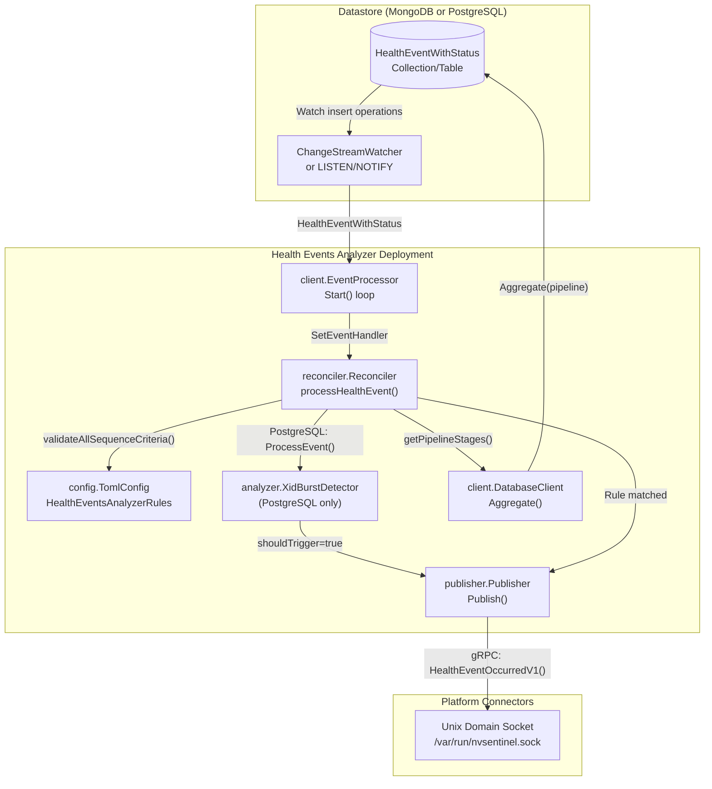
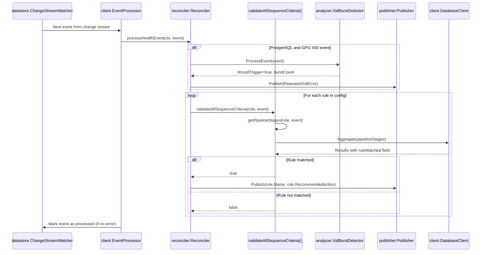
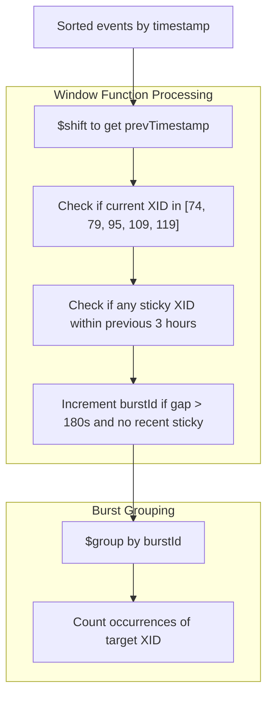

<!-- source: DeepWiki mcp.deepwiki.com · repo NVIDIA/NVSentinel · page 5.2 Health Events Analyzer · fetched 2026-10-26 -->

# Health Events Analyzer

Relevant source files

The following files were used as context for generating this wiki page:

- [distros/kubernetes/nvsentinel/charts/health-events-analyzer/values.yaml](distros/kubernetes/nvsentinel/charts/health-events-analyzer/values.yaml)
- [health-events-analyzer/main.go](health-events-analyzer/main.go)
- [health-events-analyzer/pkg/analyzer/xid_burst_detector.go](health-events-analyzer/pkg/analyzer/xid_burst_detector.go)
- [health-events-analyzer/pkg/analyzer/xid_burst_detector_test.go](health-events-analyzer/pkg/analyzer/xid_burst_detector_test.go)
- [health-events-analyzer/pkg/config/rules.go](health-events-analyzer/pkg/config/rules.go)
- [health-events-analyzer/pkg/publisher/publisher.go](health-events-analyzer/pkg/publisher/publisher.go)
- [health-events-analyzer/pkg/reconciler/reconciler.go](health-events-analyzer/pkg/reconciler/reconciler.go)
- [health-events-analyzer/pkg/reconciler/reconciler_test.go](health-events-analyzer/pkg/reconciler/reconciler_test.go)
- [tests/health_events_analyzer_test.go](tests/health_events_analyzer_test.go)
- [tests/helpers/health_events_analyzer.go](tests/helpers/health_events_analyzer.go)
- [tests/helpers/kube.go](tests/helpers/kube.go)

## Overview

The Health Events Analyzer is an event processing component that watches MongoDB/PostgreSQL for health events, detects temporal and spatial patterns using aggregation pipelines, and publishes analyzed events when patterns indicate deeper system issues. The analyzer identifies patterns such as repeated XID errors on the same GPU, XID errors across different processing clusters, and multiple remediation cycles that suggest hardware degradation.

Unlike simple event forwarding, the analyzer applies **stateful pattern detection** to distinguish transient issues from systemic problems. For example, a single XID 13 error may be an application error, but XID 13 appearing in multiple bursts on the same GPC/TPC combination within 24 hours indicates hardware failure requiring diagnostic testing.

The analyzer integrates with the fault management pipeline by publishing new health events with `agent="health-events-analyzer"` and `checkName` set to the matched rule name. These analyzed events can trigger downstream actions via the [Fault Quarantine Module](6.1) and [Fault Remediation Module](6.3).

**Key Capabilities:**
- **XID Burst Detection:** Groups XID errors into bursts separated by time gaps, tracks sticky vs non-sticky XIDs.
- **Multi-Database Support:** MongoDB aggregation pipelines for complex queries, Go-based detection for PostgreSQL.
- **Pattern Recognition:** Temporal patterns (repeated events over time) and spatial patterns (same GPU, different GPUs, same GPC/TPC).
- **Configurable Rules:** TOML-based rule definitions with enable/disable flags per rule.

**Sources:** [health-events-analyzer/pkg/reconciler/reconciler.go:15-54](), [tests/health_events_analyzer_test.go:44-86]()

## Component Architecture

The Health Events Analyzer operates as a single-replica Deployment that processes health events from MongoDB/PostgreSQL using the `Reconciler` and `EventProcessor` components. The reconciler applies aggregation pipelines (MongoDB) or stateful burst detection (PostgreSQL) to identify patterns, then publishes analyzed events via the `Publisher` to Platform Connectors.

### High-Level Architecture

### Reconciler Structure

The `Reconciler` struct in [health-events-analyzer/pkg/reconciler/reconciler.go:47-54]() contains the core processing components:

| Field | Type | Purpose |
|-------|------|---------|
| `config` | `HealthEventsAnalyzerReconcilerConfig` | TOML rules, publisher, datastore config. |
| `datastore` | `datastore.DataStore` | Abstraction over MongoDB/PostgreSQL. |
| `databaseClient` | `client.DatabaseClient` | MongoDB-specific client for aggregation. |
| `eventProcessor` | `client.EventProcessor` | Unified event stream processor. |
| `xidDetector` | `*analyzer.XidBurstDetector` | PostgreSQL-specific XID burst detection. |
| `useXidDetector` | `bool` | True if datastore is PostgreSQL. |

**Deployment Characteristics:**
- **Replica Count:** 1 (single deployment, not DaemonSet) [distros/kubernetes/nvsentinel/charts/health-events-analyzer/values.yaml:15]().
- **Scope:** Cluster-wide (processes events for all nodes).
- **Concurrency:** Sequential event processing (EventProcessor guarantees ordering).
- **Resume Capability:** Uses resume tokens to recover from pod restarts without losing events [health-events-analyzer/pkg/reconciler/reconciler.go:121-126]().

**Sources:** [health-events-analyzer/pkg/reconciler/reconciler.go:47-137](), [distros/kubernetes/nvsentinel/charts/health-events-analyzer/values.yaml:15]()

## Event Processing Flow

The analyzer processes health events using the `EventProcessor` from `store-client`, which handles change stream watching, resume token management, and event delivery. The reconciler's `processHealthEvent()` method is called for each event and applies pattern detection logic.

### Event Processing Sequence

### processHealthEvent Implementation

The `processHealthEvent()` method in [health-events-analyzer/pkg/reconciler/reconciler.go:140-192]() implements the event handler interface:

**Processing Steps:**
1. **Tracing:** Start an OpenTelemetry span linked to the ingestion trace [health-events-analyzer/pkg/reconciler/reconciler.go:143-148]().
2. **Metrics Tracking:** Record event reception with node label [health-events-analyzer/pkg/reconciler/reconciler.go:152-162]().
3. **XID Detection:** If PostgreSQL is used, call `handleXidDetector()` [health-events-analyzer/pkg/reconciler/reconciler.go:75-81]().
4. **Rule Evaluation:** Iterate through TOML rules and process matches [health-events-analyzer/pkg/reconciler/reconciler.go:204-219]().
5. **Error Handling:** If processing fails, return error; `EventProcessor` is configured with `MarkProcessedOnError: false` to ensure retries [health-events-analyzer/pkg/reconciler/reconciler.go:125-126]().

**Sources:** [health-events-analyzer/pkg/reconciler/reconciler.go:140-219](), [health-events-analyzer/pkg/reconciler/reconciler.go:121-128]()

## Pattern Detection Rules

The analyzer uses TOML-based rules to define pattern detection logic. Each rule specifies MongoDB aggregation pipeline stages that query historical events to identify patterns.

### Rule Configuration Structure

The `HealthEventsAnalyzerRule` struct in [health-events-analyzer/pkg/config/rules.go:23-32]() defines the rule schema:

| Field | Type | Purpose |
|-------|------|---------|
| `Name` | `string` | Unique rule identifier, used as `checkName` in published events. |
| `Description` | `string` | Human-readable explanation of pattern. |
| `Stage` | `[]string` | MongoDB aggregation pipeline stages as JSON strings. |
| `RecommendedAction` | `string` | Action to set in published event (e.g., `CONTACT_SUPPORT`). |
| `Message` | `string` | Custom message for published event. |
| `EvaluateRule` | `bool` | Enable/disable rule evaluation via Helm values. |

### Rule Categories

The Health Events Analyzer includes rules for several pattern categories:

#### Multiple Remediations Pattern
**Rule:** `MultipleRemediations`  
**Purpose:** Detect if 5+ remediations completed within 7 days on same node [distros/kubernetes/nvsentinel/charts/health-events-analyzer/values.yaml:71-109]().

#### XID Burst Detection Patterns
**Concept:** XID errors are grouped into "bursts" separated by time gaps. A burst continues if events arrive within 180 seconds. Sticky XIDs (74, 79, 95, 109, 119) extend burst boundaries for up to 3 hours [distros/kubernetes/nvsentinel/charts/health-events-analyzer/values.yaml:210-215]().

| Rule | Pattern | Time Window | Threshold |
|------|---------|-------------|-----------|
| `RepeatedXIDErrorOnSameGPU` | Fatal XIDs (non-31) on same GPU | 24 hours | 5 bursts |
| `RepeatedXID31OnSameGPU` | XID 31 on same GPU | 24 hours | 2 bursts |
| `RepeatedXID31OnDifferentGPU` | XID 31 on 2+ different GPUs | 24 hours | Spatial match |

#### GPC/TPC Spatial Patterns (XID 13)
**Concept:** XID 13 errors indicate SM issues. Errors on the same GPC and TPC suggest localized hardware failure [distros/kubernetes/nvsentinel/charts/health-events-analyzer/values.yaml:46-47]().

**Sources:** [distros/kubernetes/nvsentinel/charts/health-events-analyzer/values.yaml:42-109](), [health-events-analyzer/pkg/config/rules.go:23-32]()

## XID Burst Detection

The analyzer distinguishes between transient GPU errors and hardware failure patterns using burst logic.

### Burst Definition
A **burst** is a sequence of XID errors separated by time gaps ≤ 180 seconds. For **Sticky XIDs** (74, 79, 95, 109, 119), the burst continues if a sticky XID occurred within the previous 10800 seconds (3 hours) [distros/kubernetes/nvsentinel/charts/health-events-analyzer/values.yaml:210-230]().

### MongoDB Pipeline Approach
The pipeline uses `$setWindowFields` and `$shift` to compute burst IDs [distros/kubernetes/nvsentinel/charts/health-events-analyzer/values.yaml:194-206]():

### PostgreSQL Go-Based Detection
For PostgreSQL, the analyzer uses `XidBurstDetector` [health-events-analyzer/pkg/reconciler/reconciler.go:75-81](). The parameters are extracted from the `RepeatedXidError` rule's pipeline configuration to ensure consistency [health-events-analyzer/pkg/analyzer/xid_burst_detector.go:133-142]().

The `XidBurstDetector` implements the same logic as the MongoDB pipeline:
- `BurstWindow`: 180 seconds [health-events-analyzer/pkg/analyzer/xid_burst_detector.go:95]().
- `StickyWindow`: 3 hours [health-events-analyzer/pkg/analyzer/xid_burst_detector.go:96]().
- `BurstThreshold`: 5 [health-events-analyzer/pkg/analyzer/xid_burst_detector.go:98]().

**Sources:** [distros/kubernetes/nvsentinel/charts/health-events-analyzer/values.yaml:194-230](), [health-events-analyzer/pkg/reconciler/reconciler.go:75-81](), [health-events-analyzer/pkg/analyzer/xid_burst_detector.go:35-142]()

## Aggregation Pipeline Construction

The analyzer builds MongoDB aggregation pipelines dynamically by parsing TOML rule stages and resolving references to the incoming event.

### 'this.' Reference Resolution
Rule stages can reference the current event's fields using the `"this."` prefix. The parser resolves these references to actual values:

| Reference | Resolves To |
|-----------|-------------|
| `"this.healthevent.nodename"` | Current event's node name |
| `"this.healthevent.errorcode.0"` | First error code |
| `"this.healthevent.generatedtimestamp.seconds"` | Event timestamp in seconds |

### Agent Filter Stage
Every pipeline starts with a filter to exclude events from `"health-events-analyzer"` itself to prevent infinite loops.

**Sources:** [distros/kubernetes/nvsentinel/charts/health-events-analyzer/values.yaml:118-137](), [health-events-analyzer/pkg/reconciler/reconciler.go:131-137]()

## Event Publishing

When a rule matches, the analyzer publishes a new health event. The `publisher.Publisher` transforms the original event and sends it to Platform Connectors via gRPC.

### Event Transformation
The `Publisher.Publish()` method creates a new event [health-events-analyzer/pkg/publisher/publisher.go:118-135]():
- `Agent`: Set to `"health-events-analyzer"`.
- `CheckName`: Set to the rule name.
- `RecommendedAction`: Set from the rule configuration.
- `IsFatal`: Set to `true` if `RecommendedAction != NONE` [health-events-analyzer/pkg/publisher/publisher.go:156-160]().

### Retry Logic
The publisher implements exponential backoff retry for `codes.Unavailable` gRPC errors [health-events-analyzer/pkg/publisher/publisher.go:44-56](). It performs up to 5 retries with a base delay of 5 seconds [health-events-analyzer/pkg/publisher/publisher.go:34-37]().

**Sources:** [health-events-analyzer/pkg/publisher/publisher.go:34-168](), [health-events-analyzer/pkg/reconciler/reconciler.go:165-180]()

## Metrics and Observability

The analyzer tracks performance and detection results using Prometheus metrics.

| Metric Name | Type | Purpose |
|-------------|------|---------|
| `total_events_received` | Counter | Total events received from the datastore [health-events-analyzer/pkg/reconciler/reconciler.go:162](). |
| `total_events_successfully_processed` | Counter | Events processed without errors [health-events-analyzer/pkg/reconciler/reconciler.go:182](). |
| `total_event_processing_error` | Counter | Errors during processing [health-events-analyzer/pkg/reconciler/reconciler.go:169](). |
| `fatal_event_publishing_error` | Counter | Failures when sending events to Platform Connector [health-events-analyzer/pkg/publisher/publisher.go:79-91](). |

**Sources:** [health-events-analyzer/pkg/reconciler/reconciler.go:162-182](), [health-events-analyzer/pkg/publisher/publisher.go:79-91]()

---

