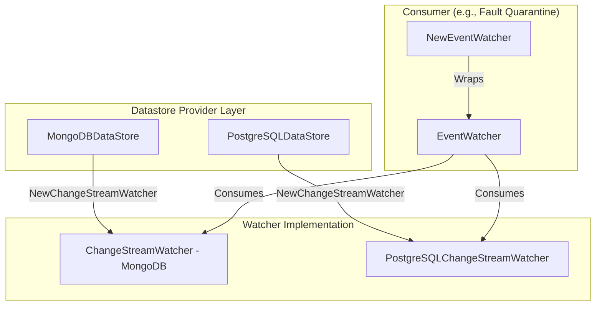
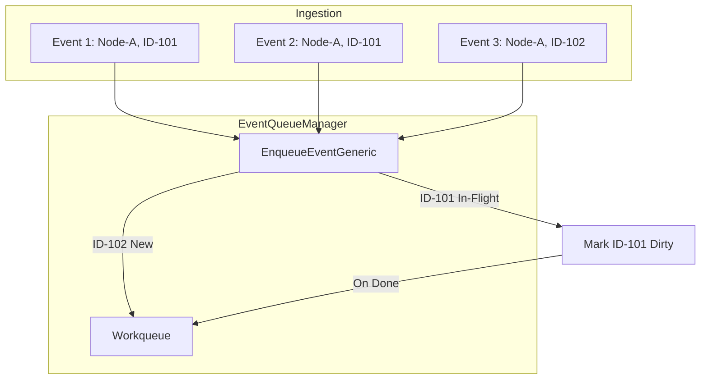
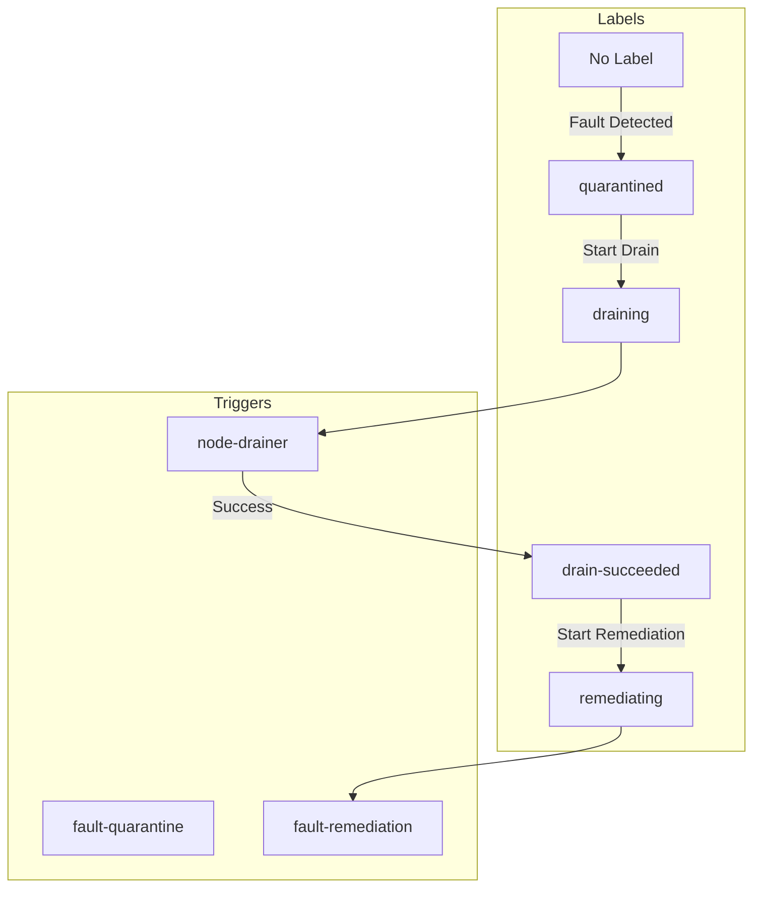

<!-- source: DeepWiki mcp.deepwiki.com · repo NVIDIA/NVSentinel · page 5.3 Event Processing Patterns · fetched 2026-10-26 -->

# Event Processing Patterns

Relevant source files

The following files were used as context for generating this wiki page:

- [commons/pkg/flags/database_flags_test.go](commons/pkg/flags/database_flags_test.go)
- [commons/pkg/statemanager/statemanager.go](commons/pkg/statemanager/statemanager.go)
- [commons/pkg/statemanager/statemanager_test.go](commons/pkg/statemanager/statemanager_test.go)
- [docs/state-manager.md](docs/state-manager.md)
- [fault-quarantine/pkg/eventwatcher/event_watcher.go](fault-quarantine/pkg/eventwatcher/event_watcher.go)
- [node-drainer/pkg/evaluator/evaluator_integration_test.go](node-drainer/pkg/evaluator/evaluator_integration_test.go)
- [node-drainer/pkg/queue/queue_test.go](node-drainer/pkg/queue/queue_test.go)
- [store-client/pkg/adapter/legacy_adapter.go](store-client/pkg/adapter/legacy_adapter.go)
- [store-client/pkg/client/mongodb_client.go](store-client/pkg/client/mongodb_client.go)
- [store-client/pkg/config/env_loader.go](store-client/pkg/config/env_loader.go)
- [store-client/pkg/config/env_loader_test.go](store-client/pkg/config/env_loader_test.go)
- [store-client/pkg/datastore/behavioral_contract_test.go](store-client/pkg/datastore/behavioral_contract_test.go)
- [store-client/pkg/datastore/interface_compliance_test.go](store-client/pkg/datastore/interface_compliance_test.go)
- [store-client/pkg/datastore/interfaces.go](store-client/pkg/datastore/interfaces.go)
- [store-client/pkg/datastore/providers/mongodb/health_store.go](store-client/pkg/datastore/providers/mongodb/health_store.go)
- [store-client/pkg/datastore/providers/mongodb/health_store_test.go](store-client/pkg/datastore/providers/mongodb/health_store_test.go)
- [store-client/pkg/datastore/providers/mongodb/register.go](store-client/pkg/datastore/providers/mongodb/register.go)
- [store-client/pkg/datastore/providers/mongodb/watcher/watch_store.go](store-client/pkg/datastore/providers/mongodb/watcher/watch_store.go)
- [store-client/pkg/datastore/providers/mongodb/watcher/watch_store_test.go](store-client/pkg/datastore/providers/mongodb/watcher/watch_store_test.go)
- [store-client/pkg/datastore/providers/postgresql/changestream.go](store-client/pkg/datastore/providers/postgresql/changestream.go)
- [store-client/pkg/datastore/providers/postgresql/datastore.go](store-client/pkg/datastore/providers/postgresql/datastore.go)
- [store-client/pkg/datastore/providers/postgresql/health_events.go](store-client/pkg/datastore/providers/postgresql/health_events.go)
- [store-client/pkg/helper/datastore_helper.go](store-client/pkg/helper/datastore_helper.go)
- [store-client/pkg/query/builder.go](store-client/pkg/query/builder.go)
- [store-client/pkg/storewatcher/config.go](store-client/pkg/storewatcher/config.go)
- [store-client/pkg/storewatcher/watch_store.go](store-client/pkg/storewatcher/watch_store.go)
- [store-client/pkg/utils/pq.go](store-client/pkg/utils/pq.go)
- [store-client/pkg/utils/pq_test.go](store-client/pkg/utils/pq_test.go)

This page documents the common event processing patterns used throughout NVSentinel's event-driven architecture. These patterns enable asynchronous, decoupled processing of health events from detection through remediation across multiple database providers (MongoDB and PostgreSQL).

---

## Overview

NVSentinel uses an event-driven architecture where all components communicate asynchronously through the datastore. Components watch for events via **change streams** (MongoDB) or **LISTEN/NOTIFY** (PostgreSQL), process them according to business logic, and publish new events back to the datastore.

- **Decoupling**: Components operate independently via the `DataStore` abstraction [store-client/pkg/datastore/providers/postgresql/datastore.go:35-41]().
- **Resumability**: Resume tokens allow processing to continue after restarts without data loss [store-client/pkg/datastore/providers/mongodb/watcher/watch_store.go:89-92]().
- **Provider Agnostic**: The system supports both MongoDB and PostgreSQL through a unified interface [store-client/pkg/datastore/providers/postgresql/datastore.go:127-130]().

---

## Core Event Processing Patterns

### 1. Unified Change Stream Watching Pattern

All processing components follow a unified pattern using the `ChangeStreamWatcher` abstraction. This allows the same business logic to run regardless of whether the backend is MongoDB or PostgreSQL.

**Change Stream Architecture (Code Entity Space)**

Sources: [store-client/pkg/datastore/providers/postgresql/datastore.go:139-165](), [store-client/pkg/datastore/providers/mongodb/watcher/watch_store.go:94-113](), [fault-quarantine/pkg/eventwatcher/event_watcher.go:56-68]()

**Key Components**:
- **`ChangeStreamWatcher`**: Interface providing an `Events()` channel for consumers [store-client/pkg/datastore/providers/mongodb/watcher/watch_store.go:94-113]().
- **`MarkProcessed`**: Method to commit the current position in the stream, preventing duplicate processing upon restart [fault-quarantine/pkg/eventwatcher/event_watcher.go:135-140]().
- **`UnmarshalDocument`**: Provider-agnostic method to convert raw database events into `HealthEventWithStatus` models [store-client/pkg/client/mongodb_client.go:166-175]().

---

### 2. Workqueue Deduplication Pattern

To ensure node-level consistency, components like the `Node Drainer` use a workqueue with deduplication logic based on `DocumentID`. This prevents the same event from being processed concurrently by multiple workers.

**Deduplication Logic (Code Entity Space)**

Sources: [node-drainer/pkg/queue/queue_test.go:139-160](), [node-drainer/pkg/queue/queue_test.go:174-180]()

**Implementation Details**:
- **`EnqueueEventGeneric`**: Extracts the unique `_id` and node name to manage queue state [node-drainer/pkg/queue/queue_test.go:103-104]().
- **Dirty Items**: If an event with the same `EventID` is re-enqueued while still in-flight, the workqueue marks it "dirty" and only queues it again after the current processing completes [node-drainer/pkg/queue/queue_test.go:174-183]().

---

### 3. State Machine and Node Labeling Pattern

NVSentinel coordinates cross-module operations (Quarantine -> Drain -> Remediation) using a centralized state machine reflected in Kubernetes node labels.

**State Transition Flow (Natural Language to Code)**

Sources: [docs/state-manager.md:22-66](), [commons/pkg/statemanager/statemanager.go:18-66]()

**State Label Values**:
| State | Applied By | Description |
| :--- | :--- | :--- |
| `quarantined` | `fault-quarantine` | Fault detected, node cordoned [docs/state-manager.md:73]() |
| `draining` | `node-drainer` | Workload evacuation in progress [docs/state-manager.md:74]() |
| `drain-succeeded`| `node-drainer` | All workloads evacuated [docs/state-manager.md:75]() |
| `remediating` | `fault-remediation` | Recovery action in progress [docs/state-manager.md:77]() |

---

### 4. Database-Agnostic Metadata Extraction

To support both document (MongoDB) and relational (PostgreSQL) backends, NVSentinel implements normalization logic to extract indexable fields.

- **MongoDB Extraction**: Uses `bson.M` and type assertions to pull `nodename` and `healthevent` details from change stream documents [store-client/pkg/client/mongodb_client.go:87-131]().
- **PostgreSQL Extraction**: Uses `extractIndexFields` to pull fields from the `HealthEvent` protobuf before serializing to a `JSONB` document column [store-client/pkg/datastore/providers/postgresql/health_events.go:103-128]().

**Sources**: [store-client/pkg/client/mongodb_client.go:87-131](), [store-client/pkg/datastore/providers/postgresql/health_events.go:103-128]()

---

### 5. Resume Token and Persistence Pattern

Components maintain continuity across restarts by persisting the last processed event ID.

1.  **Lookup**: On startup, `ChangeStreamWatcher` looks up the `ResumeToken` for its `clientName` [store-client/pkg/datastore/providers/mongodb/watcher/watch_store.go:171-176]().
2.  **Ingestion**: Events are streamed from the database starting after the token [store-client/pkg/storewatcher/watch_store.go:161-167]().
3.  **Checkpointing**: After successful processing, `MarkProcessed` updates the token store [fault-quarantine/pkg/eventwatcher/event_watcher.go:134-140]().

**Sources**: [store-client/pkg/datastore/providers/mongodb/watcher/watch_store.go:171-176](), [store-client/pkg/storewatcher/watch_store.go:161-167](), [fault-quarantine/pkg/eventwatcher/event_watcher.go:134-140]()

---

