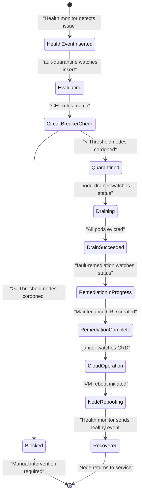
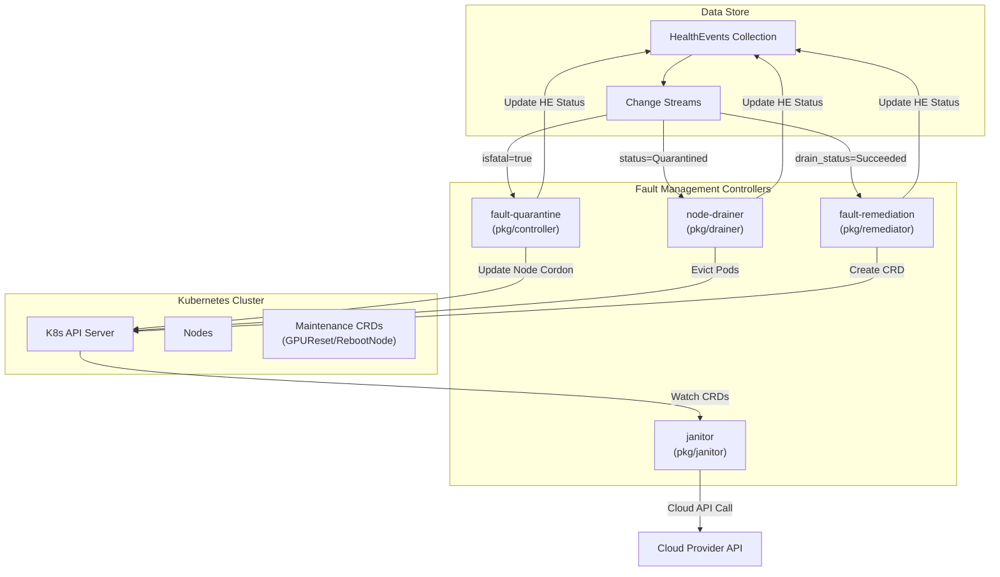

<!-- source: DeepWiki mcp.deepwiki.com · repo NVIDIA/NVSentinel · page 6 Fault Management · fetched 2026-10-26 -->

# Fault Management

Relevant source files

The following files were used as context for generating this wiki page:

- [commons/go.sum](commons/go.sum)
- [distros/kubernetes/nvsentinel/charts/gpu-health-monitor/files/dcgmerrorsmapping.csv](distros/kubernetes/nvsentinel/charts/gpu-health-monitor/files/dcgmerrorsmapping.csv)
- [distros/kubernetes/nvsentinel/charts/preflight/templates/deployment.yaml](distros/kubernetes/nvsentinel/charts/preflight/templates/deployment.yaml)
- [distros/kubernetes/nvsentinel/values-full.yaml](distros/kubernetes/nvsentinel/values-full.yaml)
- [distros/kubernetes/nvsentinel/values-tilt.yaml](distros/kubernetes/nvsentinel/values-tilt.yaml)
- [distros/kubernetes/nvsentinel/values.yaml](distros/kubernetes/nvsentinel/values.yaml)
- [docs/INTEGRATIONS.md](docs/INTEGRATIONS.md)
- [event-exporter/go.mod](event-exporter/go.mod)
- [event-exporter/go.sum](event-exporter/go.sum)
- [fault-quarantine/go.mod](fault-quarantine/go.mod)
- [fault-quarantine/go.sum](fault-quarantine/go.sum)
- [fault-remediation/go.mod](fault-remediation/go.mod)
- [fault-remediation/go.sum](fault-remediation/go.sum)
- [health-events-analyzer/go.mod](health-events-analyzer/go.mod)
- [health-events-analyzer/go.sum](health-events-analyzer/go.sum)
- [health-monitors/syslog-health-monitor/go.mod](health-monitors/syslog-health-monitor/go.mod)
- [node-drainer/go.mod](node-drainer/go.mod)
- [node-drainer/go.sum](node-drainer/go.sum)
- [platform-connectors/go.mod](platform-connectors/go.mod)
- [platform-connectors/go.sum](platform-connectors/go.sum)
- [platform-connectors/pkg/transformers/metadata/transformer_test.go](platform-connectors/pkg/transformers/metadata/transformer_test.go)
- [store-client/go.mod](store-client/go.mod)
- [tests/helpers/preflight.go](tests/helpers/preflight.go)
- [tilt/Tiltfile](tilt/Tiltfile)
- [tilt/helpers.star](tilt/helpers.star)

The Fault Management subsystem orchestrates automated responses to hardware and software failures in GPU nodes. It implements a multi-phase pipeline that progresses faulty nodes through quarantine, workload evacuation, and remediation while maintaining cluster stability through circuit breaker protection.

NVSentinel is designed as a set of independent modules that coordinate through a shared data store and the Kubernetes API [distros/kubernetes/nvsentinel/values-full.yaml:21-29](). No module communicates directly with another; instead, they watch for specific event patterns and update the health event document status, creating a state machine progression.

This page provides an architectural overview of the fault management pipeline. For detailed implementation information, see:
- [Fault Quarantine Module](#6.1) — CEL-based rules, node cordoning, tainting, circuit breaker, and manual intervention handling
- [Node Drainer Module](#6.2) — Pod eviction strategies, namespace modes, partial drain, and cancellation handling
- [Fault Remediation Module](#6.3) — CR creation via Go templates, equivalence groups, log collection, and deduplication
- [Janitor and Maintenance Execution](#6.4) — Multi-cloud maintenance operations, node reboots, terminations, and CR execution

## Architecture Overview

The fault management subsystem consists of controllers that typically use MongoDB change streams (or PostgreSQL LISTEN/NOTIFY) as an event bus [distros/kubernetes/nvsentinel/values.yaml:25-35](). This provides loose coupling and guaranteed event ordering.

### Fault Management State Machine

The following diagram illustrates the lifecycle of a fault from detection to recovery.

**Sources:**
- [distros/kubernetes/nvsentinel/values-full.yaml:150-175]()
- [distros/kubernetes/nvsentinel/values-tilt.yaml:55-82]()

### Component Relationship and Data Flow

All modules operate independently. Coordination happens through the data store and the Kubernetes API.

**Sources:**
- [fault-quarantine/go.mod:7-23]()
- [node-drainer/go.mod:7-26]()
- [fault-remediation/go.mod:7-25]()

## Core Pipeline Modules

### Fault Quarantine Module
The **Fault Quarantine** module is the first responder in the fault management pipeline. It evaluates incoming health events against Common Expression Language (CEL) rules [fault-quarantine/go.mod:8-9](). If a match is found, it cordons the node to prevent new workloads from being scheduled. To protect cluster availability, it includes a **Circuit Breaker** that halts automated cordoning if a configurable percentage of the cluster is affected [distros/kubernetes/nvsentinel/values-full.yaml:150-155]().

For details, see [Fault Quarantine Module](#6.1).

### Node Drainer Module
Once a node is quarantined, the **Node Drainer** handles the graceful eviction of existing workloads [node-drainer/go.mod:1-27](). It supports per-namespace eviction strategies and coordinates with external plugins like Slurm for HPC workloads [distros/kubernetes/nvsentinel/values-tilt.yaml:93-94](). This ensures that sensitive workloads are not abruptly terminated unless necessary.

For details, see [Node Drainer Module](#6.2).

### Fault Remediation Module
The **Fault Remediation** module triggers the actual recovery action after a node has been successfully drained. It renders Go templates to create Kubernetes Custom Resources (CRDs) like `GPUReset` or `RebootNode` [distros/kubernetes/nvsentinel/values-tilt.yaml:265-283](). It also facilitates diagnostic data gathering through the Log Collector before the node is reset [distros/kubernetes/nvsentinel/values.yaml:163-164]().

For details, see [Fault Remediation Module](#6.3).

### Janitor and Maintenance Execution
The **Janitor** is the cloud-aware execution engine. It watches for maintenance CRDs and performs actions such as reboots or terminations via cloud provider APIs [distros/kubernetes/nvsentinel/values-full.yaml:171-175](). It supports AWS, GCP, Azure, and OCI [distros/kubernetes/nvsentinel/values-full.yaml:173]().

For details, see [Janitor and Maintenance Execution](#6.4).

## Deployment and Safety

By default, NVSentinel installs in **monitoring-only mode** [distros/kubernetes/nvsentinel/values.yaml:143-175](). Fault management modules must be explicitly enabled via Helm values:

| Module | Helm Key | Default |
|--------|----------|---------|
| Fault Quarantine | `global.faultQuarantine.enabled` | `false` [distros/kubernetes/nvsentinel/values.yaml:148]() |
| Node Drainer | `global.nodeDrainer.enabled` | `false` [distros/kubernetes/nvsentinel/values.yaml:150]() |
| Fault Remediation | `global.faultRemediation.enabled` | `false` [distros/kubernetes/nvsentinel/values.yaml:152]() |
| Janitor | `global.janitor.enabled` | `false` [distros/kubernetes/nvsentinel/values.yaml:154]() |

**Dry-Run Mode:** All modules support a `global.dryRun` flag [distros/kubernetes/nvsentinel/values-full.yaml:59-69](). When enabled, the system logs the actions it *would* take (e.g., "Would cordon node X") without actually modifying the Kubernetes cluster or cloud resources.

**Sources:**
- [distros/kubernetes/nvsentinel/values.yaml:143-175]()
- [distros/kubernetes/nvsentinel/values-full.yaml:59-69]()

---

