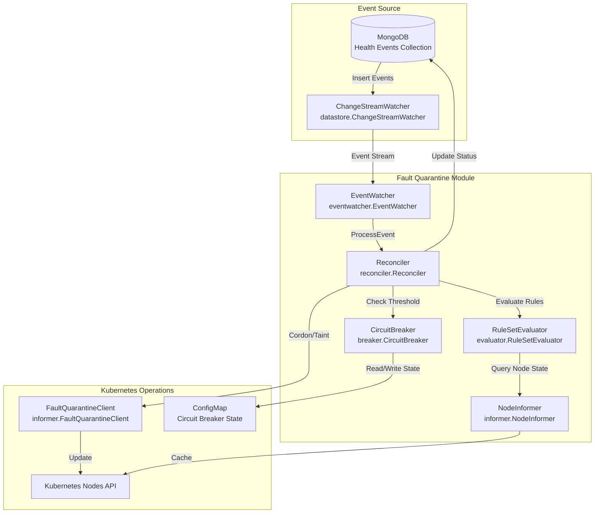
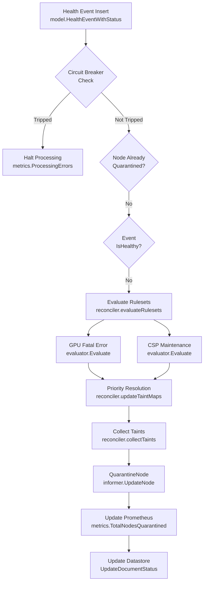

<!-- source: DeepWiki mcp.deepwiki.com · repo NVIDIA/NVSentinel · page 6.1 Fault Quarantine Module · fetched 2026-10-26 -->

# Fault Quarantine Module

Relevant source files

The following files were used as context for generating this wiki page:

- [docs/METRICS.md](docs/METRICS.md)
- [fault-quarantine/main.go](fault-quarantine/main.go)
- [fault-quarantine/pkg/breaker/breaker.go](fault-quarantine/pkg/breaker/breaker.go)
- [fault-quarantine/pkg/breaker/breaker_test.go](fault-quarantine/pkg/breaker/breaker_test.go)
- [fault-quarantine/pkg/breaker/types.go](fault-quarantine/pkg/breaker/types.go)
- [fault-quarantine/pkg/common/common.go](fault-quarantine/pkg/common/common.go)
- [fault-quarantine/pkg/informer/k8s_client.go](fault-quarantine/pkg/informer/k8s_client.go)
- [fault-quarantine/pkg/informer/k8s_client_interface.go](fault-quarantine/pkg/informer/k8s_client_interface.go)
- [fault-quarantine/pkg/informer/node_informer.go](fault-quarantine/pkg/informer/node_informer.go)
- [fault-quarantine/pkg/metrics/metrics.go](fault-quarantine/pkg/metrics/metrics.go)
- [fault-quarantine/pkg/reconciler/reconciler.go](fault-quarantine/pkg/reconciler/reconciler.go)
- [fault-quarantine/pkg/reconciler/reconciler_e2e_test.go](fault-quarantine/pkg/reconciler/reconciler_e2e_test.go)
- [node-drainer/pkg/metrics/metrics.go](node-drainer/pkg/metrics/metrics.go)
- [store-client/pkg/client/interfaces.go](store-client/pkg/client/interfaces.go)
- [store-client/pkg/client/postgresql_client.go](store-client/pkg/client/postgresql_client.go)
- [store-client/pkg/datastore/providers/postgresql/database_client.go](store-client/pkg/datastore/providers/postgresql/database_client.go)
- [tests/fault_management_test.go](tests/fault_management_test.go)
- [tests/fault_quarantine_test.go](tests/fault_quarantine_test.go)

## Purpose and Scope

The Fault Quarantine Module (FQM) is responsible for detecting unhealthy nodes based on health events and preventing workload scheduling on them through Kubernetes cordoning and tainting operations. FQM evaluates health events against configurable CEL-based rulesets, applies priority-based taint resolution, and provides circuit breaker protection to prevent mass node failures from destabilizing the cluster.

This document covers the fault quarantine decision logic, circuit breaker implementation, and Kubernetes node lifecycle operations.

**Sources:** [fault-quarantine/pkg/reconciler/reconciler.go:49-101](), [fault-quarantine/pkg/reconciler/reconciler.go:103-115]()

---

## Architecture Overview

**Diagram: Fault Quarantine Module Architecture**

The FQM consists of five key components:

| Component | Implementation | Responsibility |
|-----------|---------------|----------------|
| **Reconciler** | `reconciler.Reconciler` | Orchestrates event processing, rule evaluation, and quarantine decisions. [fault-quarantine/pkg/reconciler/reconciler.go:76-93]() |
| **EventWatcher** | `eventwatcher.EventWatcher` | Consumes datastore events, handles resume tokens, and tracks metrics. [fault-quarantine/pkg/reconciler/reconciler.go:40-40]() |
| **CircuitBreaker** | `breaker.CircuitBreaker` | Sliding window tracking of cordon events to prevent mass node failures. [fault-quarantine/pkg/reconciler/reconciler.go:80-80]() |
| **RuleSetEvaluator** | `evaluator.RuleSetEvaluator` | Evaluates CEL expressions against health events to determine quarantine actions. [fault-quarantine/pkg/reconciler/reconciler.go:39-39]() |
| **NodeInformer** | `informer.NodeInformer` | Maintains a cached view of Kubernetes nodes for efficient querying. [fault-quarantine/pkg/informer/k8s_client.go:71-74]() |

**Sources:** [fault-quarantine/pkg/reconciler/reconciler.go:76-115](), [fault-quarantine/pkg/informer/k8s_client.go:46-53](), [fault-quarantine/pkg/breaker/breaker.go:49-80]()

---

## Event Processing Pipeline

**Diagram: Event Processing Flow**

### Processing Stages

#### 1. Circuit Breaker Check
The first operation is checking if the circuit breaker is tripped via `IsTripped`. If tripped, processing for cordoning events is halted.

**Sources:** [fault-quarantine/pkg/breaker/breaker.go:186-221](), [fault-quarantine/pkg/reconciler/reconciler.go:80-80]()

#### 2. Node Quarantine State Detection
The reconciler checks node annotations to determine if a node is already in a quarantine state. This state is managed via specific annotation keys defined in `common`.

**Sources:** [fault-quarantine/pkg/reconciler/reconciler.go:41-41](), [fault-quarantine/pkg/common/common.go:21-23]()

#### 3. Rule Evaluation
Rulesets evaluate health events using CEL expressions. The `evaluator` package handles the mapping of health event fields to CEL variables.

**Sources:** [fault-quarantine/pkg/reconciler/reconciler.go:208-211](), [tests/fault_quarantine_test.go:35-64]()

#### 4. Priority-Based Taint Resolution
When multiple rulesets match, the reconciler resolves which taints to apply based on configured priorities.

**Sources:** [fault-quarantine/pkg/reconciler/reconciler.go:64-68]()

#### 5. Kubernetes API Operations
The `FaultQuarantineClient` performs node updates using a retry mechanism with exponential backoff to handle API server conflicts.

**Sources:** [fault-quarantine/pkg/informer/k8s_client.go:138-172](), [fault-quarantine/pkg/informer/k8s_client.go:174-188]()

---

## Circuit Breaker Protection

The circuit breaker prevents cascading failures when many nodes simultaneously develop faults. It tracks unique cordoned nodes in a sliding time window and trips when a threshold percentage is exceeded.

### Sliding Window Implementation
The circuit breaker uses a ring buffer with 1-second granularity (`bucketSize`). As time passes, `slideWindow` shifts the buffer and expires old cordon events.

**Sources:** [fault-quarantine/pkg/breaker/breaker.go:50-59](), [fault-quarantine/pkg/breaker/breaker.go:85-135]()

### Threshold Calculation
The threshold is calculated as `math.Ceil(float64(totalNodes) * TripPercentage / 100)`. Total nodes are retrieved from the `NodeInformer` cache.

**Sources:** [fault-quarantine/pkg/breaker/breaker.go:197-216](), [fault-quarantine/pkg/informer/k8s_client.go:122-131]()

### State Persistence
Circuit breaker state is persisted to a Kubernetes ConfigMap to survive pod restarts.
- `status`: Current state (`CLOSED` or `TRIPPED`).
- `cursor`: Controls stream resume behavior (`RESUME` or `CREATE`).

**Sources:** [fault-quarantine/pkg/informer/k8s_client.go:85-120](), [fault-quarantine/pkg/informer/k8s_client.go:190-206]()

---

## Node Quarantine Operations

### Manual Intervention Handling
The module monitors for manual uncordon or untaint actions. If a user manually clears a node, FQM detects this via the `NodeInformer` and can update its internal tracking or metrics.

**Sources:** [fault-quarantine/pkg/metrics/metrics.go:65-79](), [tests/fault_quarantine_test.go:96-169]()

### Dry-Run Mode
When `DryRun` is enabled, the module simulates the quarantine process. It evaluates rules and prepares updates but skips the final Kubernetes `Update` call that modifies node spec.

**Sources:** [fault-quarantine/main.go:153-153](), [tests/fault_management_test.go:37-95]()

### Metrics
The module exports Prometheus metrics for monitoring the quarantine lifecycle:

| Metric Name | Type | Description |
|-------------|------|-------------|
| `fault_quarantine_events_received_total` | Counter | Total events from the datastore. |
| `fault_quarantine_nodes_quarantined_total` | Counter | Nodes moved to unschedulable state. |
| `fault_quarantine_breaker_state` | Gauge | Current circuit breaker state (1 for active). |
| `fault_quarantine_node_remediation_duration_seconds` | Histogram | End-to-end time from fault to unquarantine. |

**Sources:** [fault-quarantine/pkg/metrics/metrics.go:30-205](), [docs/METRICS.md:20-68]()

---

**Sources:** [fault-quarantine/pkg/reconciler/reconciler.go:1-115](), [fault-quarantine/pkg/breaker/breaker.go:1-221](), [fault-quarantine/pkg/informer/k8s_client.go:1-210](), [fault-quarantine/pkg/metrics/metrics.go:1-205](), [fault-quarantine/main.go:1-164]()

---

