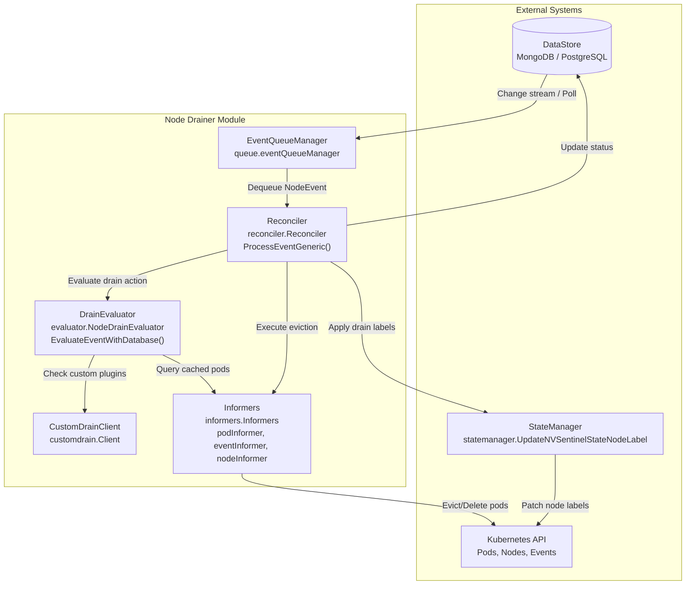
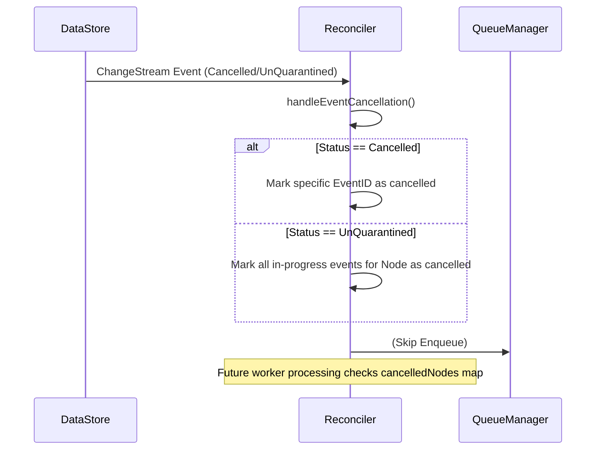
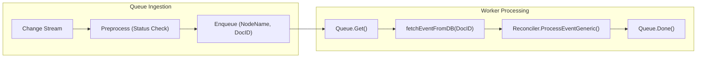
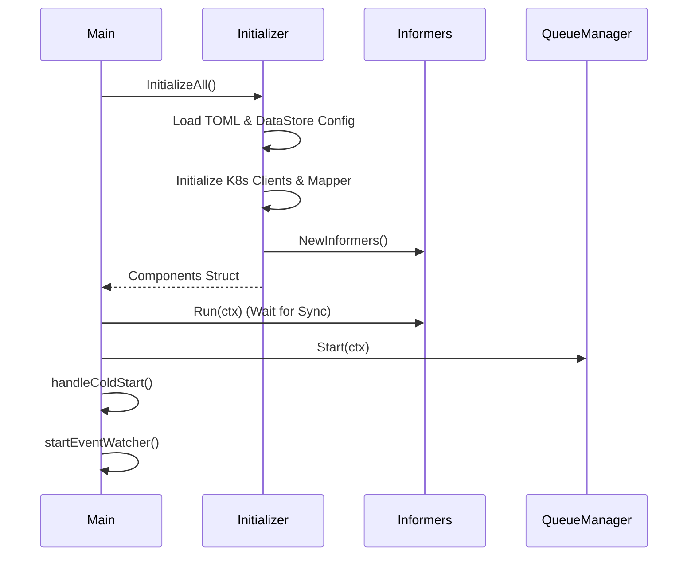

<!-- source: DeepWiki mcp.deepwiki.com · repo NVIDIA/NVSentinel · page 6.2 Node Drainer Module · fetched 2026-10-26 -->

# Node Drainer Module

Relevant source files

The following files were used as context for generating this wiki page:

- [distros/kubernetes/nvsentinel/charts/csp-health-monitor/templates/configmap.yaml](distros/kubernetes/nvsentinel/charts/csp-health-monitor/templates/configmap.yaml)
- [distros/kubernetes/nvsentinel/charts/fault-quarantine/templates/configmap.yaml](distros/kubernetes/nvsentinel/charts/fault-quarantine/templates/configmap.yaml)
- [distros/kubernetes/nvsentinel/charts/fault-remediation/templates/configmap.yaml](distros/kubernetes/nvsentinel/charts/fault-remediation/templates/configmap.yaml)
- [distros/kubernetes/nvsentinel/charts/health-events-analyzer/templates/configmap.yaml](distros/kubernetes/nvsentinel/charts/health-events-analyzer/templates/configmap.yaml)
- [distros/kubernetes/nvsentinel/charts/incluster-file-server/templates/deployment.yaml](distros/kubernetes/nvsentinel/charts/incluster-file-server/templates/deployment.yaml)
- [distros/kubernetes/nvsentinel/charts/node-drainer/templates/configmap.yaml](distros/kubernetes/nvsentinel/charts/node-drainer/templates/configmap.yaml)
- [distros/kubernetes/nvsentinel/charts/node-drainer/values.yaml](distros/kubernetes/nvsentinel/charts/node-drainer/values.yaml)
- [docs/syslog-health-monitor.md](docs/syslog-health-monitor.md)
- [health-monitors/syslog-health-monitor/pkg/metadata/reader.go](health-monitors/syslog-health-monitor/pkg/metadata/reader.go)
- [health-monitors/syslog-health-monitor/pkg/metadata/reader_test.go](health-monitors/syslog-health-monitor/pkg/metadata/reader_test.go)
- [health-monitors/syslog-health-monitor/pkg/xid/types.go](health-monitors/syslog-health-monitor/pkg/xid/types.go)
- [health-monitors/syslog-health-monitor/pkg/xid/xid_handler_test.go](health-monitors/syslog-health-monitor/pkg/xid/xid_handler_test.go)
- [node-drainer/main.go](node-drainer/main.go)
- [node-drainer/pkg/config/config.go](node-drainer/pkg/config/config.go)
- [node-drainer/pkg/customdrain/client.go](node-drainer/pkg/customdrain/client.go)
- [node-drainer/pkg/customdrain/client_integration_test.go](node-drainer/pkg/customdrain/client_integration_test.go)
- [node-drainer/pkg/customdrain/types.go](node-drainer/pkg/customdrain/types.go)
- [node-drainer/pkg/evaluator/evaluator.go](node-drainer/pkg/evaluator/evaluator.go)
- [node-drainer/pkg/evaluator/types.go](node-drainer/pkg/evaluator/types.go)
- [node-drainer/pkg/informers/informers.go](node-drainer/pkg/informers/informers.go)
- [node-drainer/pkg/initializer/init.go](node-drainer/pkg/initializer/init.go)
- [node-drainer/pkg/queue/queue.go](node-drainer/pkg/queue/queue.go)
- [node-drainer/pkg/queue/types.go](node-drainer/pkg/queue/types.go)
- [node-drainer/pkg/queue/worker.go](node-drainer/pkg/queue/worker.go)
- [node-drainer/pkg/reconciler/reconciler.go](node-drainer/pkg/reconciler/reconciler.go)
- [node-drainer/pkg/reconciler/reconciler_integration_test.go](node-drainer/pkg/reconciler/reconciler_integration_test.go)
- [tests/fault_remediation_test.go](tests/fault_remediation_test.go)
- [tests/helpers/metadata.go](tests/helpers/metadata.go)
- [tests/helpers/syslog-health-monitor.go](tests/helpers/syslog-health-monitor.go)
- [tests/node_drainer_test.go](tests/node_drainer_test.go)

## Purpose and Scope

The Node Drainer Module is responsible for evacuating pods from nodes that have been quarantined by the Fault Quarantine Module. It processes health events from the datastore, determines the appropriate eviction strategy based on namespace configuration, and orchestrates pod removal while respecting Kubernetes best practices such as PodDisruptionBudgets.

The module is database-agnostic, supporting both MongoDB and PostgreSQL via a unified `store-client` interface [node-drainer/pkg/reconciler/reconciler.go:44-46](). It handles complex scenarios including partial node drains (GPU-specific), custom drain plugins (e.g., Slurm integration), and event cancellation [node-drainer/pkg/reconciler/reconciler.go:198-210]().

**Sources:** [node-drainer/pkg/reconciler/reconciler.go:1-112](), [node-drainer/pkg/queue/types.go:1-64]()

## Architecture Overview

The Node Drainer Module consists of a core reconciler, a rate-limited workqueue, and a set of evaluators.

### Component Responsibilities

| Component | Class/Interface | Purpose |
|-----------|----------------|---------|
| **Event Queue Manager** | `queue.EventQueueManager` | Manages per-node rate-limited queues with exponential backoff [node-drainer/pkg/queue/types.go:50-64](). |
| **Reconciler** | `reconciler.Reconciler` | Orchestrates the drain lifecycle and updates datastore state [node-drainer/pkg/reconciler/reconciler.go:53-67](). |
| **Drain Evaluator** | `evaluator.DrainEvaluator` | Determines the specific action (Evict, Wait, Skip) based on node state and TOML config [node-drainer/pkg/evaluator/evaluator.go:97-140](). |
| **Custom Drain Client** | `customdrain.Client` | Interface for external drain plugins (e.g., `DrainRequest` CRDs) [node-drainer/pkg/reconciler/reconciler.go:81-90](). |

**Sources:** [node-drainer/pkg/reconciler/reconciler.go:53-112](), [node-drainer/pkg/queue/types.go:27-71](), [node-drainer/pkg/evaluator/evaluator.go:42-52]()

## Event Processing and Cancellation

The module utilizes a sophisticated event handling pipeline that supports "Cold Starts" and real-time cancellation.

### Cancellation Logic
When a node is unquarantined or an event is manually cancelled, the reconciler must halt active drain operations.

- **Cancelled Status**: Marks a specific `EventID` for a node to be ignored [node-drainer/pkg/reconciler/reconciler.go:198-201]().
- **UnQuarantined Status**: Marks all current events for that node as cancelled, effectively stopping the drain [node-drainer/pkg/reconciler/reconciler.go:203-210]().

**Sources:** [node-drainer/pkg/reconciler/reconciler.go:126-210]()

### Cold Start Handling
On startup, the module queries the datastore for any events that were `InProgress` but not yet terminal (`Succeeded`, `Failed`, `Cancelled`). These are re-enqueued to ensure no drain operation is lost during a pod restart [node-drainer/main.go:170-175]().

**Sources:** [node-drainer/main.go:170-175](), [node-drainer/pkg/reconciler/reconciler.go:212-230]()

## Drain Strategies and Modes

The `NodeDrainEvaluator` maps namespaces to specific drain modes based on the `UserNamespaces` configuration in the TOML file [node-drainer/pkg/evaluator/evaluator.go:174-210]().

### Support for Partial Drain
If `PartialDrainEnabled` is true, the evaluator checks if only specific entities (e.g., a single GPU) are impacted. If so, it only targets pods using those specific resources rather than the entire node [node-drainer/pkg/evaluator/evaluator.go:106-125](). The filtering logic uses pod annotations added by the `metadata-collector` (e.g., `dgxc.nvidia.com/devices`) [node-drainer/pkg/informers/informers.go:200-223]().

### Drain Modes

| Mode | Behavior |
|------|----------|
| **ImmediateEvict** | Uses the K8s Eviction API to remove pods immediately, respecting PDBs [node-drainer/pkg/evaluator/evaluator.go:180-181](). |
| **DeleteAfterTimeout** | Waits for a specified duration before force-deleting pods [node-drainer/pkg/evaluator/evaluator.go:182-183](). |
| **AllowCompletion** | Waits indefinitely for pods to reach a terminal phase naturally [node-drainer/pkg/evaluator/evaluator.go:181-182](). |

### Custom Drain Plugins
If `CustomDrain.Enabled` is set, the evaluator delegates the drain orchestration to an external plugin by creating a `DrainRequest` CRD [node-drainer/pkg/evaluator/evaluator.go:132-135]().

**Sources:** [node-drainer/pkg/evaluator/evaluator.go:174-210](), [node-drainer/pkg/informers/informers.go:200-223]()

## Queue and Worker Implementation

The `EventQueueManager` uses a `workqueue.TypedRateLimitingInterface` with exponential backoff [node-drainer/pkg/queue/queue.go:32-35]().

### Lazy Fetch Pattern
To minimize memory usage, only the native database `DocumentID` is stored in the queue. The full `HealthEvent` is fetched from the database only when the worker begins processing [node-drainer/pkg/queue/worker.go:31-53]().

### Trace Correlation
The worker manages `DrainSession` spans that persist across requeue cycles. It extracts `traceID` and `parentSpanID` from the event metadata to link the drain operation back to the original health event [node-drainer/pkg/queue/worker.go:97-130]().

**Sources:** [node-drainer/pkg/queue/queue.go:31-79](), [node-drainer/pkg/queue/worker.go:31-151](), [node-drainer/pkg/queue/types.go:27-33]()

## Initialization and Lifecycle

The `initializer` package bootstraps the module, ensuring Kubernetes informers are synced before processing starts.

**Key Steps:**
1. **Config Loading**: Loads TOML for drain modes and `store-client` config for DB connectivity [node-drainer/pkg/initializer/init.go:182-199]().
2. **Informer Sync**: The module blocks until K8s caches (Pods, Nodes, Events) are fully synced to prevent incorrect drain decisions [node-drainer/main.go:159-165]().
3. **Graceful Shutdown**: On `SIGTERM`, the queue is shut down first, followed by the datastore clients [node-drainer/main.go:185-203]().

**Sources:** [node-drainer/pkg/initializer/init.go:69-160](), [node-drainer/main.go:106-207]()

---

