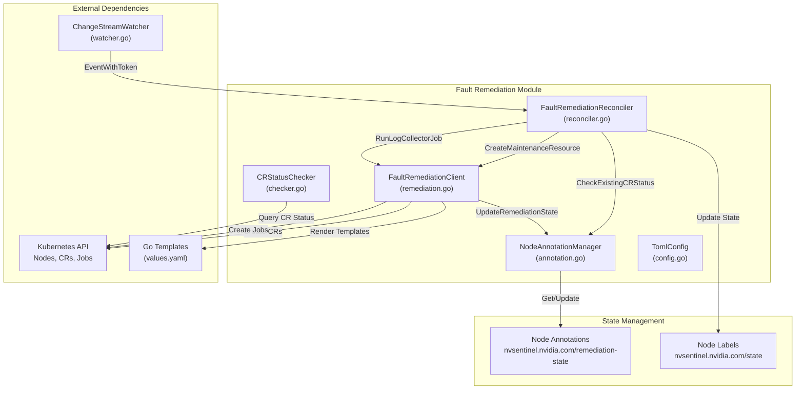
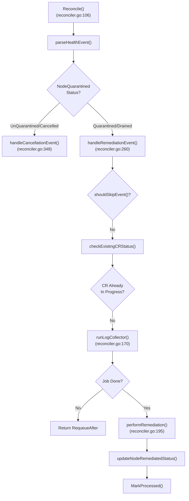
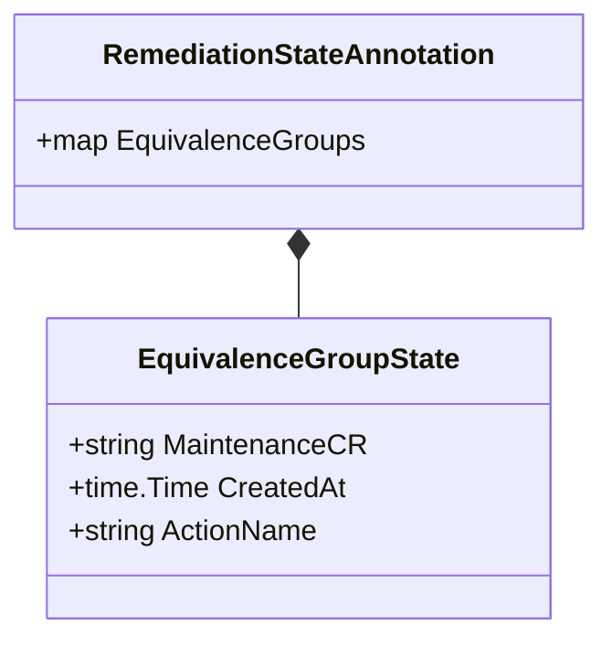
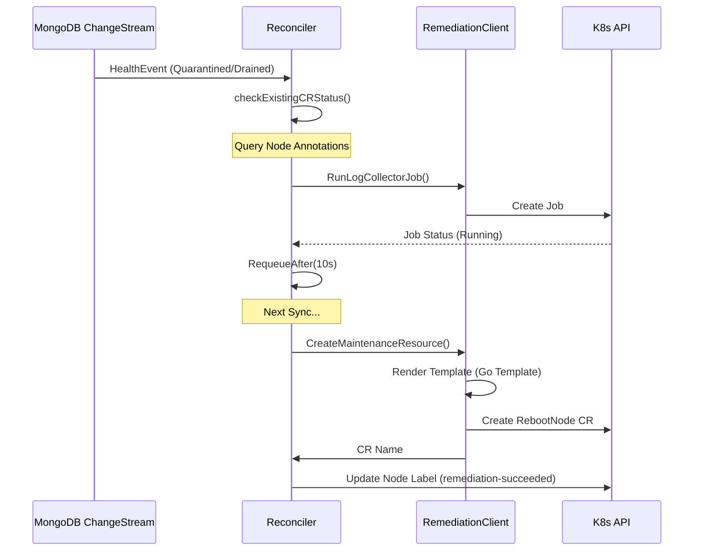

<!-- source: DeepWiki mcp.deepwiki.com · repo NVIDIA/NVSentinel · page 6.3 Fault Remediation Module · fetched 2026-10-26 -->

# Fault Remediation Module

<details>
<summary>Relevant source files</summary>

The following files were used as context for generating this wiki page:

- [distros/kubernetes/nvsentinel/charts/fault-remediation/files/log-collector-job.yaml](distros/kubernetes/nvsentinel/charts/fault-remediation/files/log-collector-job.yaml)
- [distros/kubernetes/nvsentinel/charts/fault-remediation/values.yaml](distros/kubernetes/nvsentinel/charts/fault-remediation/values.yaml)
- [distros/kubernetes/nvsentinel/charts/janitor/templates/networkpolicy.yaml](distros/kubernetes/nvsentinel/charts/janitor/templates/networkpolicy.yaml)
- [distros/kubernetes/nvsentinel/templates/networkpolicy.yaml](distros/kubernetes/nvsentinel/templates/networkpolicy.yaml)
- [docs/fault-remediation.md](docs/fault-remediation.md)
- [docs/log-collection.md](docs/log-collection.md)
- [fault-remediation/main.go](fault-remediation/main.go)
- [fault-remediation/pkg/annotation/annotation.go](fault-remediation/pkg/annotation/annotation.go)
- [fault-remediation/pkg/annotation/annotation_interface.go](fault-remediation/pkg/annotation/annotation_interface.go)
- [fault-remediation/pkg/annotation/annotation_test.go](fault-remediation/pkg/annotation/annotation_test.go)
- [fault-remediation/pkg/common/equivalence_groups.go](fault-remediation/pkg/common/equivalence_groups.go)
- [fault-remediation/pkg/common/equivalence_groups_test.go](fault-remediation/pkg/common/equivalence_groups_test.go)
- [fault-remediation/pkg/config/config.go](fault-remediation/pkg/config/config.go)
- [fault-remediation/pkg/config/config_test.go](fault-remediation/pkg/config/config_test.go)
- [fault-remediation/pkg/config/equivalence_test.go](fault-remediation/pkg/config/equivalence_test.go)
- [fault-remediation/pkg/crstatus/checker.go](fault-remediation/pkg/crstatus/checker.go)
- [fault-remediation/pkg/initializer/init.go](fault-remediation/pkg/initializer/init.go)
- [fault-remediation/pkg/reconciler/reconciler.go](fault-remediation/pkg/reconciler/reconciler.go)
- [fault-remediation/pkg/reconciler/reconciler_e2e_test.go](fault-remediation/pkg/reconciler/reconciler_e2e_test.go)
- [fault-remediation/pkg/reconciler/reconciler_test.go](fault-remediation/pkg/reconciler/reconciler_test.go)
- [fault-remediation/pkg/reconciler/templates/gpureset-template.yaml](fault-remediation/pkg/reconciler/templates/gpureset-template.yaml)
- [fault-remediation/pkg/remediation/fault_remediation_client_interface.go](fault-remediation/pkg/remediation/fault_remediation_client_interface.go)
- [fault-remediation/pkg/remediation/remediation.go](fault-remediation/pkg/remediation/remediation.go)
- [fault-remediation/pkg/remediation/remediation_test.go](fault-remediation/pkg/remediation/remediation_test.go)
- [log-collector/entrypoint.sh](log-collector/entrypoint.sh)

</details>


## Purpose and Scope

The Fault Remediation Module creates and manages Kubernetes Custom Resources (CRs) that represent maintenance operations for faulty nodes. After a node has been quarantined ([Fault Quarantine Module](#6.1)) and drained ([Node Drainer Module](#6.2)), this module translates the recommended action from the Health Events Analyzer into concrete maintenance CRs that are executed by the Janitor ([Janitor and Maintenance Execution](#6.4)).

Key technical capabilities include:
- **Event-driven reconciliation**: Processes health events from MongoDB change streams via `FaultRemediationReconciler` [fault-remediation/pkg/reconciler/reconciler.go:69-79]().
- **Template-based CR creation**: Renders Kubernetes resources using Go templates defined in `remediation.go` [fault-remediation/pkg/remediation/remediation.go:17-25]().
- **Equivalence groups**: Implements deduplication logic to prevent redundant maintenance operations [fault-remediation/pkg/config/config.go:44-61]().
- **Log collection**: Orchestrates diagnostic log collection jobs before remediation starts [fault-remediation/pkg/reconciler/reconciler.go:170-192]().

---

## Architecture Overview

### Component Structure


**Sources:** [fault-remediation/pkg/reconciler/reconciler.go:69-79](), [fault-remediation/pkg/remediation/remediation.go:64-75](), [fault-remediation/pkg/initializer/init.go:151-179](), [distros/kubernetes/nvsentinel/charts/fault-remediation/values.yaml:99-130]()

### Key Code Entities

| Component | Code Entity | Role |
|-----------|-------------|------|
| **Reconciler** | `FaultRemediationReconciler` | Main loop processing events from `ChangeStreamWatcher` [fault-remediation/pkg/reconciler/reconciler.go:69-79](). |
| **Remediation Client** | `FaultRemediationClient` | Handles template rendering and K8s API calls [fault-remediation/pkg/remediation/remediation.go:64-75](). |
| **Annotation Manager** | `NodeAnnotationManager` | Manages the remediation state JSON on Nodes [fault-remediation/pkg/annotation/annotation.go:46-48](). |
| **Config** | `TomlConfig` | Defines `MaintenanceResource` mappings for actions like `RESTART_BM` [fault-remediation/pkg/config/config.go:76-88](). |
| **Status Checker** | `CRStatusChecker` | Verifies if existing CRs are in terminal states [fault-remediation/pkg/crstatus/checker.go:28-33](). |

---

## Event Processing Pipeline

### Reconciliation Flow

The reconciler follows a strict pipeline to move a node from "Quarantined/Drained" to "Remediated".


**Sources:** [fault-remediation/pkg/reconciler/reconciler.go:106-158](), [fault-remediation/pkg/reconciler/reconciler.go:260-346](), [fault-remediation/pkg/reconciler/reconciler.go:170-192]()

### Logic Details
1. **Cancellation Handling**: If a node is unquarantined or cancelled, the reconciler calls `ClearRemediationState` to remove tracking annotations [fault-remediation/pkg/reconciler/reconciler.go:348-360]().
2. **Deduplication**: Before creating a CR, the system checks `checkExistingCRStatus`. If an equivalent CR is already in progress (based on Equivalence Groups), it skips creation [fault-remediation/pkg/reconciler/reconciler.go:464-475]().
3. **Log Collection**: If `EnableLogCollector` is true, the reconciler triggers `RunLogCollectorJob` and returns a requeue result until the job reaches a terminal state [fault-remediation/pkg/reconciler/reconciler.go:170-192]().

---

## CR Creation and Templating

### Template Rendering

The `FaultRemediationClient` uses Go `text/template` to generate YAML manifests from configured templates [fault-remediation/pkg/remediation/remediation.go:138-160]().

```go
// From fault-remediation/pkg/remediation/remediation.go:294-309
func (c *FaultRemediationClient) renderMaintenanceFromTemplate(
    tmpl *template.Template, 
    data *TemplateData,
) (*unstructured.Unstructured, string, error)
```

The `TemplateData` struct provides context to the template [fault-remediation/pkg/remediation/remediation.go:40-57]():
- `NodeName`: The target node.
- `HealthEventID`: Unique ID for the event.
- `RecommendedAction`: The action enum (e.g., `RESTART_BM`).
- `TraceID`/`SpanID`: For distributed tracing correlation.
- `Namespace`: Target namespace for the CR (if namespaced).

### Maintenance Resource Configuration

Remediation actions are mapped to CRDs in `values.yaml` and loaded into `MaintenanceResource` structs [distros/kubernetes/nvsentinel/charts/fault-remediation/values.yaml:51-89]().

| Action | Kind | Equivalence Group | Template |
|--------|------|-------------------|----------|
| `COMPONENT_RESET` | `RebootNode` | `restart` | `nvidia-reboot.yaml` |
| `REPLACE_VM` | `TerminateNode` | `terminate` | `terminate-node.yaml` |

**Sources:** [fault-remediation/pkg/config/config.go:31-61](), [distros/kubernetes/nvsentinel/charts/fault-remediation/values.yaml:51-89]()

---

## Equivalence Groups and Deduplication

### Concept

Equivalence groups allow the system to treat different actions as redundant. For example, a `RESTART_BM` (Bare Metal Restart) can supersede a `COMPONENT_RESET` (GPU Reset) if configured in `SupersedingEquivalenceGroups` [fault-remediation/pkg/config/config.go:56-60]().

### Effective Group Calculation
- **Global Groups**: Actions like `RESTART_BM` use a static group like `"restart"`.
- **Scoped Groups**: If `impactedEntityScope` is set (e.g., `GPU_UUID`), the group becomes `restart-GPU-<UUID>`. This allows concurrent resets on different GPUs while deduplicating resets on the same GPU [fault-remediation/pkg/config/config.go:48-54]().

### Node Annotations
State is persisted in node annotations using the `NodeAnnotationManager` [fault-remediation/pkg/annotation/annotation.go:97-143]().


**Sources:** [fault-remediation/pkg/annotation/annotation.go:18-32](), [fault-remediation/pkg/annotation/annotation.go:108-112]()

---

## Log Collection Coordination

The `FaultRemediationClient` manages a Kubernetes Job for log collection when enabled [fault-remediation/pkg/remediation/remediation.go:386-390]().

1. **Launch**: It renders a log-collector job manifest and sets the `nodeName` to target the faulty node [fault-remediation/pkg/remediation/remediation.go:405-427]().
2. **Monitoring**: The reconciler polls the job status until completion or timeout [fault-remediation/pkg/reconciler/reconciler.go:170-192]().
3. **Terminal States**:
   - **JobComplete**: Proceeds to remediation [fault-remediation/pkg/remediation/remediation.go:557-565]().
   - **JobFailed**: Proceeds to remediation but logs error [fault-remediation/pkg/remediation/remediation.go:572-580]().
   - **Timeout**: If the job exceeds the configured timeout (default 10m), the reconciler continues to remediation to avoid blocking recovery [fault-remediation/pkg/remediation/remediation.go:616-625]().

**Sources:** [fault-remediation/pkg/remediation/remediation.go:386-658](), [distros/kubernetes/nvsentinel/charts/fault-remediation/values.yaml:153-177]()

---

## Data Flow: Event to CR


**Sources:** [fault-remediation/pkg/reconciler/reconciler.go:106-158](), [fault-remediation/pkg/remediation/remediation.go:170-211]()

---

