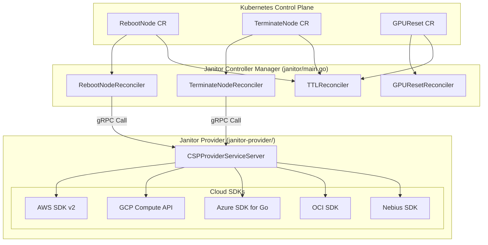
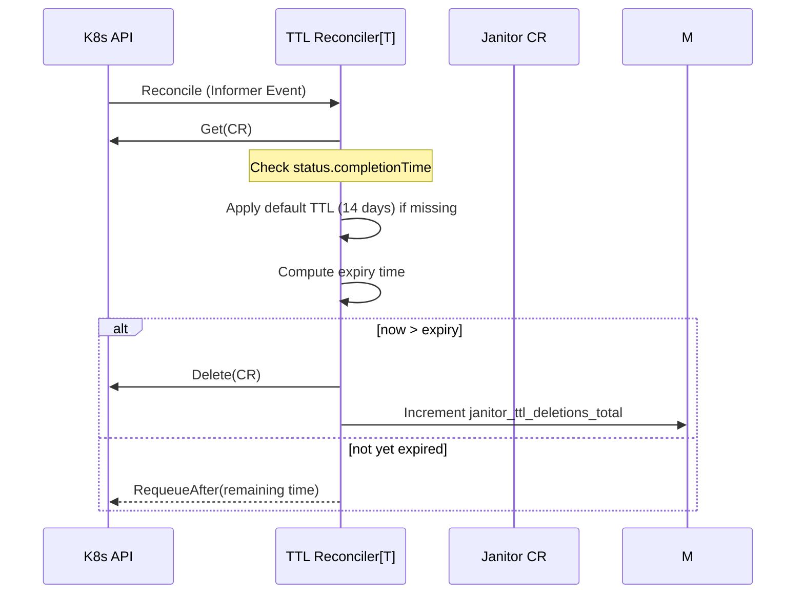

<!-- source: DeepWiki mcp.deepwiki.com · repo NVIDIA/NVSentinel · page 6.4 Janitor and Maintenance Execution · fetched 2026-10-26 -->

# Janitor and Maintenance Execution

Relevant source files

The following files were used as context for generating this wiki page:

- [distros/kubernetes/nvsentinel/charts/janitor-provider/templates/certificate.yaml](distros/kubernetes/nvsentinel/charts/janitor-provider/templates/certificate.yaml)
- [distros/kubernetes/nvsentinel/charts/janitor-provider/templates/deployment.yaml](distros/kubernetes/nvsentinel/charts/janitor-provider/templates/deployment.yaml)
- [distros/kubernetes/nvsentinel/charts/janitor-provider/values.yaml](distros/kubernetes/nvsentinel/charts/janitor-provider/values.yaml)
- [distros/kubernetes/nvsentinel/charts/janitor/crds/janitor.dgxc.nvidia.com_gpuresets.yaml](distros/kubernetes/nvsentinel/charts/janitor/crds/janitor.dgxc.nvidia.com_gpuresets.yaml)
- [distros/kubernetes/nvsentinel/charts/janitor/crds/janitor.dgxc.nvidia.com_rebootnodes.yaml](distros/kubernetes/nvsentinel/charts/janitor/crds/janitor.dgxc.nvidia.com_rebootnodes.yaml)
- [distros/kubernetes/nvsentinel/charts/janitor/crds/janitor.dgxc.nvidia.com_terminatenodes.yaml](distros/kubernetes/nvsentinel/charts/janitor/crds/janitor.dgxc.nvidia.com_terminatenodes.yaml)
- [distros/kubernetes/nvsentinel/charts/janitor/templates/configmap.yaml](distros/kubernetes/nvsentinel/charts/janitor/templates/configmap.yaml)
- [distros/kubernetes/nvsentinel/charts/janitor/templates/deployment.yaml](distros/kubernetes/nvsentinel/charts/janitor/templates/deployment.yaml)
- [distros/kubernetes/nvsentinel/charts/janitor/values.yaml](distros/kubernetes/nvsentinel/charts/janitor/values.yaml)
- [docs/designs/037-janitor-cr-ttl-cleanup.md](docs/designs/037-janitor-cr-ttl-cleanup.md)
- [fault-quarantine/Makefile](fault-quarantine/Makefile)
- [janitor-provider/go.mod](janitor-provider/go.mod)
- [janitor-provider/go.sum](janitor-provider/go.sum)
- [janitor-provider/main.go](janitor-provider/main.go)
- [janitor-provider/pkg/csp/generic/generic.go](janitor-provider/pkg/csp/generic/generic.go)
- [janitor-provider/pkg/csp/kind/kind.go](janitor-provider/pkg/csp/kind/kind.go)
- [janitor/Makefile](janitor/Makefile)
- [janitor/api/v1alpha1/gpureset_types.go](janitor/api/v1alpha1/gpureset_types.go)
- [janitor/api/v1alpha1/rebootnode_types.go](janitor/api/v1alpha1/rebootnode_types.go)
- [janitor/api/v1alpha1/rebootnode_types_test.go](janitor/api/v1alpha1/rebootnode_types_test.go)
- [janitor/api/v1alpha1/terminatenode_types.go](janitor/api/v1alpha1/terminatenode_types.go)
- [janitor/main.go](janitor/main.go)
- [janitor/pkg/config/config.go](janitor/pkg/config/config.go)
- [janitor/pkg/config/config_test.go](janitor/pkg/config/config_test.go)
- [janitor/pkg/config/default.go](janitor/pkg/config/default.go)
- [janitor/pkg/controller/gpureset_controller.go](janitor/pkg/controller/gpureset_controller.go)
- [janitor/pkg/controller/gpureset_controller_test.go](janitor/pkg/controller/gpureset_controller_test.go)
- [janitor/pkg/controller/rebootnode_controller.go](janitor/pkg/controller/rebootnode_controller.go)
- [janitor/pkg/controller/rebootnode_controller_test.go](janitor/pkg/controller/rebootnode_controller_test.go)
- [janitor/pkg/controller/terminatenode_controller.go](janitor/pkg/controller/terminatenode_controller.go)
- [janitor/pkg/controller/terminatenode_controller_test.go](janitor/pkg/controller/terminatenode_controller_test.go)
- [janitor/pkg/controller/utils.go](janitor/pkg/controller/utils.go)
- [janitor/pkg/metrics/metrics.go](janitor/pkg/metrics/metrics.go)
- [janitor/pkg/ttl/reconciler.go](janitor/pkg/ttl/reconciler.go)
- [janitor/pkg/ttl/reconciler_test.go](janitor/pkg/ttl/reconciler_test.go)
- [janitor/pkg/ttl/setup.go](janitor/pkg/ttl/setup.go)
- [janitor/pkg/webhook/v1alpha1/janitor_webhook.go](janitor/pkg/webhook/v1alpha1/janitor_webhook.go)
- [janitor/pkg/webhook/v1alpha1/janitor_webhook_test.go](janitor/pkg/webhook/v1alpha1/janitor_webhook_test.go)
- [plugins/mock-slurm-operator/go.mod](plugins/mock-slurm-operator/go.mod)
- [plugins/mock-slurm-operator/go.sum](plugins/mock-slurm-operator/go.sum)
- [plugins/slinky-drainer/go.mod](plugins/slinky-drainer/go.mod)
- [plugins/slinky-drainer/go.sum](plugins/slinky-drainer/go.sum)
- [tests/gpu_reset_test.go](tests/gpu_reset_test.go)
- [tests/janitor_test.go](tests/janitor_test.go)
- [tests/scale-tests/cmd/fqm-scale-test/go.mod](tests/scale-tests/cmd/fqm-scale-test/go.mod)
- [tests/scale-tests/cmd/fqm-scale-test/go.sum](tests/scale-tests/cmd/fqm-scale-test/go.sum)
- [tests/smoke_test.go](tests/smoke_test.go)

## Purpose and Scope

The Janitor module executes maintenance operations on Kubernetes nodes and hardware components by watching Custom Resources (CRs) created by the Fault Remediation module. It serves as the final execution layer in NVSentinel's fault response pipeline, performing physical operations like node reboots, terminations, and GPU resets through Cloud Service Provider (CSP) APIs or direct host commands. [docs/designs/037-janitor-cr-ttl-cleanup.md:5-12]()

The system is decoupled into two primary components:
1.  **Janitor Controller**: A Kubernetes controller manager that runs multiple reconcilers for the lifecycle of maintenance CRs (`RebootNode`, `TerminateNode`, `GPUReset`) and coordinates with the provider. [janitor/main.go:182-197]()
2.  **Janitor Provider**: A gRPC-based service that abstracts CSP-specific APIs (AWS, GCP, Azure, OCI, Nebius, and Generic/K8s-native) into a unified interface for node lifecycle management. [janitor-provider/go.mod:7-31]()

**Sources:** [docs/designs/037-janitor-cr-ttl-cleanup.md:5-12](), [janitor/main.go:182-197](), [janitor-provider/go.mod:7-31]()

## Architecture and Integration

### Multi-Cloud Execution Layer

The Janitor architecture uses a provider pattern to support diverse cloud environments. The Janitor Controller communicates with the Janitor Provider via gRPC to trigger actions and check node status.

**Key Components:**
*   **Manager**: The `janitor` binary initializes a controller-runtime manager that hosts the maintenance reconcilers and a TTL-based cleanup service. [janitor/main.go:182-192]()
*   **TTL Reconciler**: A generic reconciler that monitors completed maintenance CRs and deletes them after a configured duration to prevent etcd bloat. [janitor/pkg/ttl/reconciler.go:20-35]()
*   **CSPProviderServiceClient**: The gRPC client used by controllers to communicate with the provider, supporting TLS and ServiceAccount token authentication. [distros/kubernetes/nvsentinel/charts/janitor/values.yaml:106-122]()

**Sources:** [janitor/main.go:182-192](), [janitor/pkg/ttl/reconciler.go:20-35](), [distros/kubernetes/nvsentinel/charts/janitor/values.yaml:106-122](), [janitor-provider/go.mod:7-31]()

## Janitor Provider and Multi-Cloud Support

The Janitor Provider implements the gRPC interface for cloud-specific operations. It is configured via environment variables to select the active CSP. [distros/kubernetes/nvsentinel/charts/janitor-provider/templates/deployment.yaml:79-81]()

### Supported Providers

| Provider | Implementation Details | Configuration |
| :--- | :--- | :--- |
| **AWS** | Uses `github.com/aws/aws-sdk-go-v2/service/ec2`. | `AWS_REGION` [janitor-provider/go.mod:13]() |
| **GCP** | Uses `cloud.google.com/go/compute`. | `GCP_PROJECT`, `GCP_ZONE` [janitor-provider/go.mod:8]() |
| **Azure** | Uses `github.com/Azure/azure-sdk-for-go/sdk/resourcemanager/compute/armcompute`. | `AZURE_SUBSCRIPTION_ID`, `AZURE_RESOURCE_GROUP` [janitor-provider/go.mod:11]() |
| **OCI** | Uses `github.com/oracle/oci-go-sdk/v65`. | `OCI_REGION`, `OCI_COMPARTMENT` [janitor-provider/go.mod:18]() |
| **Nebius** | Uses `github.com/nebius/gosdk`. | `NEBIUS_SA_KEY_FILE` [janitor-provider/go.mod:15]() |
| **Generic** | Executes reboots via Kubernetes Jobs (e.g., `systemctl reboot`). | `GENERIC_REBOOT_IMAGE` [distros/kubernetes/nvsentinel/charts/janitor-provider/templates/deployment.yaml:83-84]() |

**Sources:** [janitor-provider/go.mod:7-31](), [distros/kubernetes/nvsentinel/charts/janitor-provider/templates/deployment.yaml:79-155]()

## Maintenance Lifecycle and Cleanup

### TTL-Based Cleanup
To prevent etcd growth and maintain informer efficiency, the Janitor includes a TTL (Time-To-Live) cleanup mechanism for terminal CRs. [docs/designs/037-janitor-cr-ttl-cleanup.md:14-19]()

**Configuration:**
*   **Default TTL**: 14 days (`336h`), configurable via `--default-ttl`. [distros/kubernetes/nvsentinel/charts/janitor/values.yaml:195]()
*   **Manual Override**: Individual CRs can opt-out using the annotation `nvsentinel.nvidia.com/preserve: "true"`. [docs/designs/037-janitor-cr-ttl-cleanup.md:27]()
*   **Enabling**: Controlled by `--enable-ttl`. [janitor/main.go:62]()

**Sources:** [docs/designs/037-janitor-cr-ttl-cleanup.md:1-45](), [distros/kubernetes/nvsentinel/charts/janitor/values.yaml:184-195](), [janitor/main.go:62]()

### GPU Reset Workflow
For `GPUReset` CRs, the Janitor executes a localized remediation instead of a cloud-level reboot. [distros/kubernetes/nvsentinel/charts/janitor/values.yaml:161-164]()

1.  **Job Creation**: The controller creates a Kubernetes Job on the specific node where the fault occurred. [distros/kubernetes/nvsentinel/charts/janitor/values.yaml:167-173]()
2.  **Runtime Class**: Uses the `nvidia` runtime class to ensure GPU access. [distros/kubernetes/nvsentinel/charts/janitor/values.yaml:168]()
3.  **Service Management**: Integrates with the `gpu-operator` to handle driver/service restarts if necessary. [distros/kubernetes/nvsentinel/charts/janitor/values.yaml:166]()

**Sources:** [distros/kubernetes/nvsentinel/charts/janitor/values.yaml:161-180]()

## Configuration and Observability

### Deployment Settings
The Janitor and Provider are deployed via Helm charts with extensive security and connectivity options. [distros/kubernetes/nvsentinel/charts/janitor/templates/deployment.yaml:14-15]()

*   **gRPC Security**: Supports mTLS and audience-restricted ServiceAccount tokens (`nvsentinel-csp-provider`). [distros/kubernetes/nvsentinel/charts/janitor/values.yaml:106-122]()
*   **Node Exclusions**: Specific nodes can be excluded from Janitor operations using label selectors. [distros/kubernetes/nvsentinel/charts/janitor/values.yaml:128-137]()
*   **Audit Logging**: Integrated auditing for all maintenance operations. [distros/kubernetes/nvsentinel/charts/janitor/templates/deployment.yaml:43-50]()

**Sources:** [distros/kubernetes/nvsentinel/charts/janitor/values.yaml:106-137](), [distros/kubernetes/nvsentinel/charts/janitor/templates/deployment.yaml:43-50]()

### Metrics
The Janitor exposes detailed metrics for tracking remediation performance and cleanup activity. [janitor/pkg/metrics/metrics.go:15-23]()

| Metric | Type | Description |
| :--- | :--- | :--- |
| `janitor_actions_count` | Counter | Total actions by `action_type` (reboot/terminate) and `status`. [janitor/pkg/metrics/metrics.go:42-48]() |
| `janitor_action_mttr_seconds` | Histogram | Time from CR creation to terminal completion. [janitor/pkg/metrics/metrics.go:51-58]() |
| `gpu_reset_duration_seconds` | Histogram | End-to-end duration of GPU reset workflows. [janitor/pkg/metrics/metrics.go:70-75]() |
| `janitor_ttl_deletions_total` | Counter | Number of CRs deleted by the TTL cleanup service. [janitor/pkg/metrics/metrics.go:89-92]() |

**Sources:** [janitor/pkg/metrics/metrics.go:41-93](), [janitor/main.go:155-163]()

---

