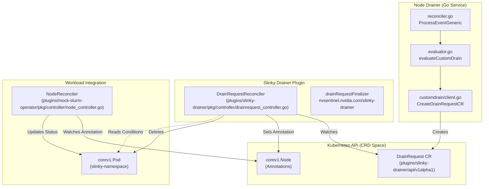
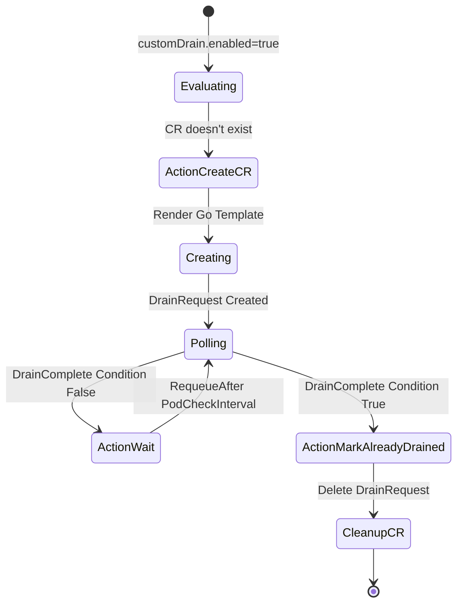

<!-- source: DeepWiki mcp.deepwiki.com · repo NVIDIA/NVSentinel · page 7 Plugin System · fetched 2026-10-26 -->

# Plugin System

<details>
<summary>Relevant source files</summary>

The following files were used as context for generating this wiki page:

- [janitor-provider/go.mod](janitor-provider/go.mod)
- [janitor-provider/go.sum](janitor-provider/go.sum)
- [plugins/mock-slurm-operator/go.mod](plugins/mock-slurm-operator/go.mod)
- [plugins/mock-slurm-operator/go.sum](plugins/mock-slurm-operator/go.sum)
- [plugins/mock-slurm-operator/pkg/controller/node_controller.go](plugins/mock-slurm-operator/pkg/controller/node_controller.go)
- [plugins/slinky-drainer/.gitignore](plugins/slinky-drainer/.gitignore)
- [plugins/slinky-drainer/Makefile](plugins/slinky-drainer/Makefile)
- [plugins/slinky-drainer/config/crd/nvsentinel.nvidia.com_drainrequests.yaml](plugins/slinky-drainer/config/crd/nvsentinel.nvidia.com_drainrequests.yaml)
- [plugins/slinky-drainer/config/default/kustomization.yaml](plugins/slinky-drainer/config/default/kustomization.yaml)
- [plugins/slinky-drainer/config/drain-template/drain-template-configmap.yaml](plugins/slinky-drainer/config/drain-template/drain-template-configmap.yaml)
- [plugins/slinky-drainer/config/drain-template/kustomization.yaml](plugins/slinky-drainer/config/drain-template/kustomization.yaml)
- [plugins/slinky-drainer/config/manager/deployment.yaml](plugins/slinky-drainer/config/manager/deployment.yaml)
- [plugins/slinky-drainer/go.mod](plugins/slinky-drainer/go.mod)
- [plugins/slinky-drainer/go.sum](plugins/slinky-drainer/go.sum)
- [plugins/slinky-drainer/main.go](plugins/slinky-drainer/main.go)
- [plugins/slinky-drainer/pkg/controller/drainrequest_controller.go](plugins/slinky-drainer/pkg/controller/drainrequest_controller.go)
- [plugins/slinky-drainer/pkg/controller/drainrequest_controller_test.go](plugins/slinky-drainer/pkg/controller/drainrequest_controller_test.go)
- [tests/scale-tests/cmd/fqm-scale-test/go.mod](tests/scale-tests/cmd/fqm-scale-test/go.mod)
- [tests/scale-tests/cmd/fqm-scale-test/go.sum](tests/scale-tests/cmd/fqm-scale-test/go.sum)

</details>


This page describes NVSentinel's plugin system for extending drain behavior through external controllers. The plugin system allows custom workload managers (like Slurm) to handle pod eviction using their own drain logic instead of the built-in immediate/timeout/completion modes.

For details, see:
- [Custom Drain Plugins](#7.1) — DrainRequest CRD, custom drain workflow, and plugin architecture.
- [Slinky Drainer Plugin](#7.2) — Slurm workload manager integration, pod condition monitoring, and drain coordination.

---

## Overview

The plugin system enables `node-drainer` to delegate pod eviction to external controllers by creating Custom Resources (CRs). This allows workload-specific drain behavior while maintaining integration with NVSentinel's event-driven architecture.

**Key Capabilities:**
- Custom drain logic for specialized workloads (HPC, batch systems, etc.)
- CR-based communication between `node-drainer` and external controllers
- Status polling to determine drain completion via Kubernetes conditions
- Automatic cleanup of CRs after node recovery

Sources: [plugins/slinky-drainer/pkg/controller/drainrequest_controller.go:41-57](), [plugins/slinky-drainer/pkg/controller/drainrequest_controller.go:81-131]()

---

## Architecture

### Component Interaction

The following diagram bridges the high-level plugin concepts to the specific code entities involved in the custom drain workflow.

**Natural Language to Code Entity Mapping**


Sources: [plugins/slinky-drainer/pkg/controller/drainrequest_controller.go:59-131](), [plugins/mock-slurm-operator/pkg/controller/node_controller.go:38-53](), [plugins/slinky-drainer/pkg/controller/drainrequest_controller.go:159-185]()

### Plugin Lifecycle States



Sources: [plugins/slinky-drainer/pkg/controller/drainrequest_controller.go:81-131](), [plugins/slinky-drainer/pkg/controller/drainrequest_controller.go:59-65]()

---

## DrainRequest Custom Resource

The `DrainRequest` CRD serves as the contract between `node-drainer` and plugin controllers. `node-drainer` creates instances when custom drain is enabled; external controllers watch and update their status.

For details, see [Custom Drain Plugins](#7.1).

**Generation and Deployment:**
```bash
cd plugins/slinky-drainer
make generate  # Runs controller-gen [Makefile:36-40]
make manifests # Runs kustomize [Makefile:60-63]
make deploy    # Applies to cluster [Makefile:65-67]
```

Sources: [plugins/slinky-drainer/Makefile:36-67]()

---

## Slinky Drainer Plugin

The Slinky Drainer is a reference plugin implementation for draining Slurm workload manager pods. It demonstrates how to build a custom controller that coordinates with external systems via pod conditions.

For details, see [Slinky Drainer Plugin](#7.2).

### Pod Drain Detection

The Slinky drainer determines when a pod is drained by checking Slurm-specific conditions. A pod is only deleted when it is both marked for drain and no longer "busy" (allocated/mixed/completing).

| Condition Type | Source | Purpose |
|----------------|--------|---------|
| `SlurmNodeStateDrain` | Slurm Operator | Node is marked for draining in Slurm [plugins/slinky-drainer/pkg/controller/drainrequest_controller.go:43]() |
| `SlurmNodeStateAllocated` | Slurm Operator | Node has active job allocations [plugins/slinky-drainer/pkg/controller/drainrequest_controller.go:53]() |
| `SlurmNodeStateMixed` | Slurm Operator | Node has partial job allocations [plugins/slinky-drainer/pkg/controller/drainrequest_controller.go:54]() |
| `SlurmNodeStateCompleting` | Slurm Operator | Jobs are currently finishing [plugins/slinky-drainer/pkg/controller/drainrequest_controller.go:55]() |

Sources: [plugins/slinky-drainer/pkg/controller/drainrequest_controller.go:41-57](), [plugins/slinky-drainer/pkg/controller/drainrequest_controller.go:301-354]()

---

## Configuration

### Slinky Drainer Flags

The Slinky Drainer binary supports several flags for tuning its behavior:

| Flag | Default | Description |
|------|---------|-------------|
| `--pod-check-interval` | `5s` | Polling interval for checking pod conditions [plugins/slinky-drainer/pkg/controller/drainrequest_controller.go:62]() |
| `--drain-timeout` | `30m` | Overall timeout for the drain operation [plugins/slinky-drainer/pkg/controller/drainrequest_controller.go:63]() |
| `--slinky-namespace` | `slinky` | Namespace where Slurm workload pods reside [plugins/slinky-drainer/pkg/controller/drainrequest_controller.go:64]() |

Sources: [plugins/slinky-drainer/pkg/controller/drainrequest_controller.go:59-65](), [plugins/slinky-drainer/Makefile:32-34]()

---

## Development and Testing

### Integration Testing with EnvTest

The Slinky Drainer uses `sigs.k8s.io/controller-runtime/pkg/envtest` to run integration tests against a real Kubernetes control plane.

**Test Coverage:**
- **Full Cycle:** Verifies annotation setting, condition waiting, pod deletion, and finalizer removal [plugins/slinky-drainer/pkg/controller/drainrequest_controller_test.go:51-89]().
- **State Preservation:** Ensures pre-existing annotations are not overwritten [plugins/slinky-drainer/pkg/controller/drainrequest_controller_test.go:91-105]().
- **Busy Pod Handling:** Confirms pods are NOT deleted while in a "draining" (busy) state [plugins/slinky-drainer/pkg/controller/drainrequest_controller_test.go:107-129]().

Sources: [plugins/slinky-drainer/pkg/controller/drainrequest_controller_test.go:1-208](), [plugins/slinky-drainer/Makefile:80-82]()

---

