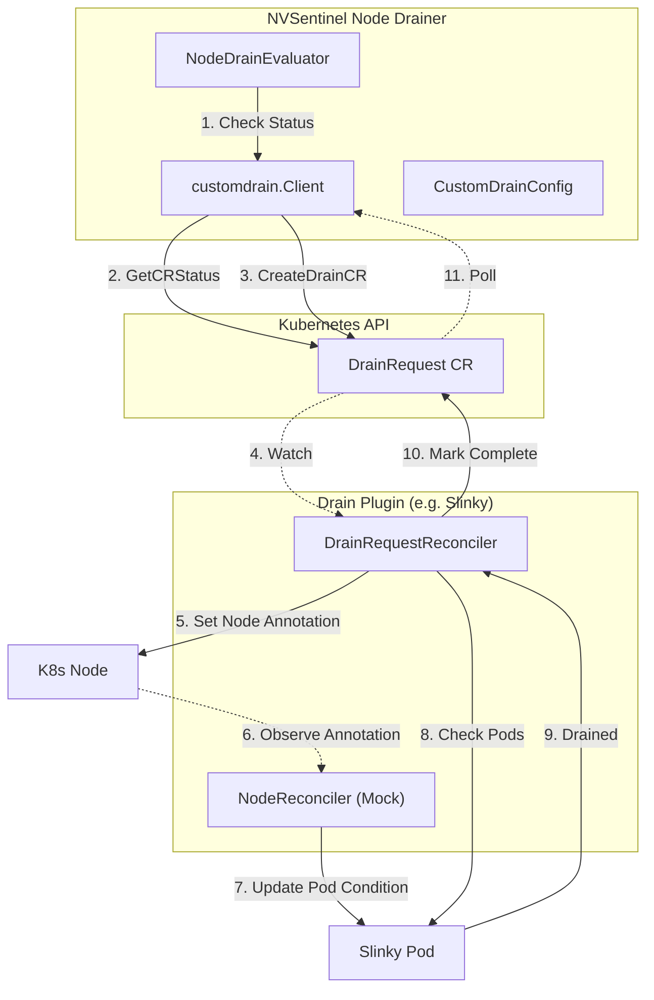
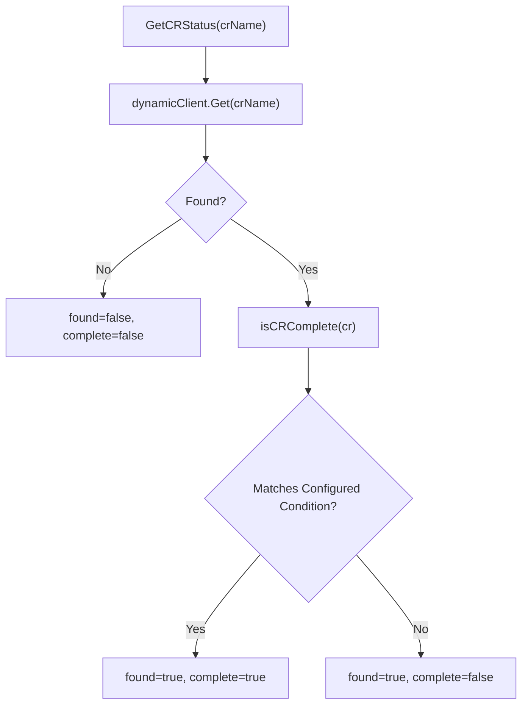
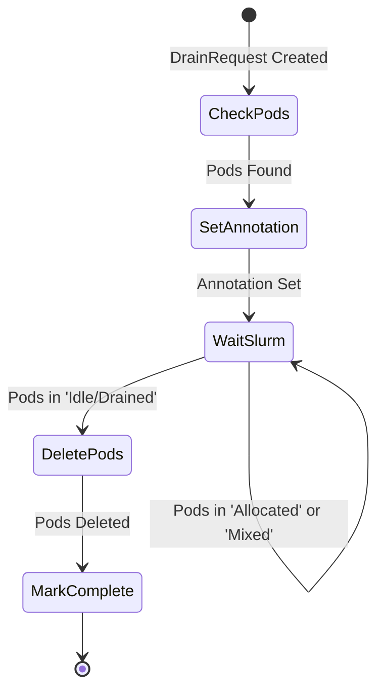

<!-- source: DeepWiki mcp.deepwiki.com · repo NVIDIA/NVSentinel · page 7.1 Custom Drain Plugins · fetched 2026-10-26 -->

# Custom Drain Plugins

Relevant source files

The following files were used as context for generating this wiki page:

- [distros/kubernetes/nvsentinel/charts/csp-health-monitor/templates/configmap.yaml](distros/kubernetes/nvsentinel/charts/csp-health-monitor/templates/configmap.yaml)
- [distros/kubernetes/nvsentinel/charts/fault-quarantine/templates/configmap.yaml](distros/kubernetes/nvsentinel/charts/fault-quarantine/templates/configmap.yaml)
- [distros/kubernetes/nvsentinel/charts/fault-remediation/templates/configmap.yaml](distros/kubernetes/nvsentinel/charts/fault-remediation/templates/configmap.yaml)
- [distros/kubernetes/nvsentinel/charts/health-events-analyzer/templates/configmap.yaml](distros/kubernetes/nvsentinel/charts/health-events-analyzer/templates/configmap.yaml)
- [distros/kubernetes/nvsentinel/charts/incluster-file-server/templates/deployment.yaml](distros/kubernetes/nvsentinel/charts/incluster-file-server/templates/deployment.yaml)
- [distros/kubernetes/nvsentinel/charts/node-drainer/templates/configmap.yaml](distros/kubernetes/nvsentinel/charts/node-drainer/templates/configmap.yaml)
- [distros/kubernetes/nvsentinel/charts/node-drainer/values.yaml](distros/kubernetes/nvsentinel/charts/node-drainer/values.yaml)
- [node-drainer/pkg/config/config.go](node-drainer/pkg/config/config.go)
- [node-drainer/pkg/customdrain/client.go](node-drainer/pkg/customdrain/client.go)
- [node-drainer/pkg/customdrain/client_integration_test.go](node-drainer/pkg/customdrain/client_integration_test.go)
- [node-drainer/pkg/customdrain/types.go](node-drainer/pkg/customdrain/types.go)
- [node-drainer/pkg/evaluator/types.go](node-drainer/pkg/evaluator/types.go)
- [plugins/mock-slurm-operator/pkg/controller/node_controller.go](plugins/mock-slurm-operator/pkg/controller/node_controller.go)
- [plugins/slinky-drainer/.gitignore](plugins/slinky-drainer/.gitignore)
- [plugins/slinky-drainer/Makefile](plugins/slinky-drainer/Makefile)
- [plugins/slinky-drainer/config/crd/nvsentinel.nvidia.com_drainrequests.yaml](plugins/slinky-drainer/config/crd/nvsentinel.nvidia.com_drainrequests.yaml)
- [plugins/slinky-drainer/config/default/kustomization.yaml](plugins/slinky-drainer/config/default/kustomization.yaml)
- [plugins/slinky-drainer/config/drain-template/drain-template-configmap.yaml](plugins/slinky-drainer/config/drain-template/drain-template-configmap.yaml)
- [plugins/slinky-drainer/config/drain-template/kustomization.yaml](plugins/slinky-drainer/config/drain-template/kustomization.yaml)
- [plugins/slinky-drainer/config/manager/deployment.yaml](plugins/slinky-drainer/config/manager/deployment.yaml)
- [plugins/slinky-drainer/main.go](plugins/slinky-drainer/main.go)
- [plugins/slinky-drainer/pkg/controller/drainrequest_controller.go](plugins/slinky-drainer/pkg/controller/drainrequest_controller.go)
- [plugins/slinky-drainer/pkg/controller/drainrequest_controller_test.go](plugins/slinky-drainer/pkg/controller/drainrequest_controller_test.go)
- [tests/fault_remediation_test.go](tests/fault_remediation_test.go)

This page describes the custom drain plugin architecture in NVSentinel, which allows external controllers to handle pod eviction workflows for specialized workload managers. This extensibility point enables integration with systems like Slurm, Kubernetes batch schedulers, or proprietary orchestrators that require custom drain coordination logic beyond NVSentinel's built-in eviction strategies.

---

## Purpose and Scope

The custom drain plugin system serves two primary use cases:

1.  **External Workload Manager Integration**: Allows workload managers (e.g., Slurm via the Slinky project) to receive drain notifications and coordinate graceful pod termination according to their own scheduling policies.
2.  **Custom Drain Logic**: Enables implementation of specialized drain workflows that cannot be expressed through NVSentinel's declarative namespace configuration.

When custom drain is enabled, the Node Drainer module delegates pod eviction responsibility to an external controller via a Kubernetes Custom Resource (CR). The Node Drainer creates a `DrainRequest` CR, monitors its completion status via defined conditions, and updates the health event accordingly.

**Sources:** [node-drainer/pkg/config/config.go:46-57](), [node-drainer/pkg/evaluator/types.go:49-52]()

---

## Architecture Overview

The custom drain architecture introduces a contract-based workflow where NVSentinel acts as the orchestrator and external plugins (like `slinky-drainer`) act as executors.

### System Interaction Diagram

"Code Entity Space" mapping for Custom Drain:

| System Name | Code Entity | File Path |
| :--- | :--- | :--- |
| **Drain Evaluator** | `NodeDrainEvaluator` | [node-drainer/pkg/evaluator/types.go:36-40]() |
| **Custom Drain Client** | `customdrain.Client` | [node-drainer/pkg/customdrain/client.go:38-43]() |
| **Drain Request CR** | `DrainRequest` | [plugins/slinky-drainer/api/v1alpha1/drainrequest_types.go]() (inferred) |
| **Plugin Controller** | `DrainRequestReconciler` | [plugins/slinky-drainer/pkg/controller/drainrequest_controller.go:59-65]() |

Title: Custom Drain Workflow

**Sources:** [node-drainer/pkg/evaluator/types.go:36-52](), [node-drainer/pkg/customdrain/client.go:92-141](), [plugins/slinky-drainer/pkg/controller/drainrequest_controller.go:81-131]()

---

## DrainRequest Custom Resource

The `DrainRequest` CR is the primary interface. It contains metadata about the fault and expects the plugin to update the status once the node is cleared.

### Specification and Status

| Field | Description | Source |
| :--- | :--- | :--- |
| `spec.nodeName` | Target node for the drain operation. | [node-drainer/pkg/customdrain/client.go:117]() |
| `status.conditions` | List of conditions indicating progress. | [node-drainer/pkg/customdrain/client.go:181-194]() |
| `complete` | Logical check performed by `isCRComplete`. | [node-drainer/pkg/customdrain/client.go:180-194]() |

The `customdrain.Client` determines completion by looking for a specific condition type and status defined in the configuration.

**Sources:** [node-drainer/pkg/customdrain/client.go:196-203](), [node-drainer/pkg/config/config.go:55-56]()

---

## Custom Drain Client Implementation

The `customdrain.Client` manages the lifecycle of the `DrainRequest` CR using a Kubernetes dynamic client and Go templates.

### CR Creation and Naming
The client generates a unique name for each request using the node name and the unique event ID:
`drain-{nodeName}-{eventID}`.

**Sources:** [node-drainer/pkg/customdrain/types.go:31-33](), [node-drainer/pkg/customdrain/client.go:105-106]()

### Template Rendering
The client renders the CR from a template file provided in the configuration. It injects `TemplateData` containing the `HealthEvent`, `EventID`, and optionally a map of pods to drain.

**Sources:** [node-drainer/pkg/customdrain/types.go:25-29](), [node-drainer/pkg/customdrain/client.go:92-101]()

### Status Polling
The `GetCRStatus` function is used by the evaluator to check if the plugin has finished its task.

Title: GetCRStatus Logic

**Sources:** [node-drainer/pkg/customdrain/client.go:207-232](), [node-drainer/pkg/customdrain/client.go:180-194]()

---

## Plugin Implementation: Slinky Drainer

The `slinky-drainer` is a reference implementation of a custom drain plugin. It coordinates with the Slinky Slurm operator to ensure Slurm jobs are gracefully drained before pods are deleted.

### Reconciler Logic
The `DrainRequestReconciler` implements the following workflow:

1.  **Finalizer Management**: Ensures the `DrainRequest` isn't deleted until cleanup is done. [plugins/slinky-drainer/pkg/controller/drainrequest_controller.go:159-167]()
2.  **Node Annotation**: Sets `nodeset.slinky.slurm.net/node-cordon-reason` on the Node object to signal Slurm to stop scheduling. [plugins/slinky-drainer/pkg/controller/drainrequest_controller.go:96-99]()
3.  **Pod Monitoring**: Lists pods in the Slinky namespace on the target node. [plugins/slinky-drainer/pkg/controller/drainrequest_controller.go:101-105]()
4.  **Condition Check**: Waits until all pods report they are no longer running Slurm jobs. It specifically checks for `SlurmNodeStateAllocated`, `Mixed`, and `Completing` conditions. [plugins/slinky-drainer/pkg/controller/drainrequest_controller.go:53-56](), [plugins/slinky-drainer/pkg/controller/drainrequest_controller.go:112-121]()
5.  **Pod Deletion**: Once Slurm confirms the node is idle, the plugin deletes the Slinky pods. [plugins/slinky-drainer/pkg/controller/drainrequest_controller.go:123-126]()
6.  **Completion**: Marks the `DrainRequest` as complete by setting the `DrainComplete` condition. [plugins/slinky-drainer/pkg/controller/drainrequest_controller.go:130]()

### Slinky Drainer State Transitions

Title: Slinky Drainer Pod Lifecycle

**Sources:** [plugins/slinky-drainer/pkg/controller/drainrequest_controller.go:81-131](), [plugins/slinky-drainer/pkg/controller/drainrequest_controller.go:49-57]()

---

## Configuration

Custom drain behavior is configured in the `node-drainer` TOML configuration.

| Parameter | Description | Source |
| :--- | :--- | :--- |
| `customDrain.enabled` | Master toggle for the custom drain feature. | [node-drainer/pkg/config/config.go:47]() |
| `customDrain.apiGroup` | The API group of the `DrainRequest` CRD. | [node-drainer/pkg/config/config.go:52]() |
| `customDrain.statusConditionType` | The condition type to look for in the CR status (e.g., "Complete"). | [node-drainer/pkg/config/config.go:55]() |
| `customDrain.statusConditionStatus` | The status value that indicates completion (e.g., "True"). | [node-drainer/pkg/config/config.go:56]() |
| `customDrain.templateFileName` | Path to the Go template used to render the CR. | [node-drainer/pkg/config/config.go:49]() |

**Validation Note**: If `customDrain.enabled` is set to `true`, the `userNamespaces` configuration must be empty to avoid conflicting drain strategies.

**Sources:** [node-drainer/pkg/config/config.go:107-114](), [distros/kubernetes/nvsentinel/charts/node-drainer/templates/configmap.yaml:36-48]()

---

## Integration Testing

The system is validated using `envtest` to simulate a Kubernetes API server. The integration tests verify:
1.  CRD registration and validation. [node-drainer/pkg/customdrain/client_integration_test.go:74-82]()
2.  Template rendering and CR creation. [node-drainer/pkg/customdrain/client_integration_test.go:140-153]()
3.  Status condition matching logic (including case-insensitivity). [node-drainer/pkg/customdrain/client_integration_test.go:207-221]()
4.  The full drain cycle from annotation to pod deletion in the Slinky plugin. [plugins/slinky-drainer/pkg/controller/drainrequest_controller_test.go:51-89]()

**Sources:** [node-drainer/pkg/customdrain/client_integration_test.go:93-104](), [plugins/slinky-drainer/pkg/controller/drainrequest_controller_test.go:107-129]()

---

