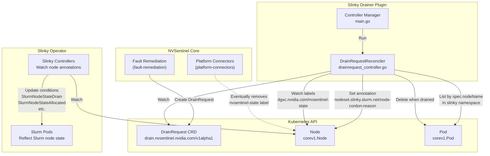
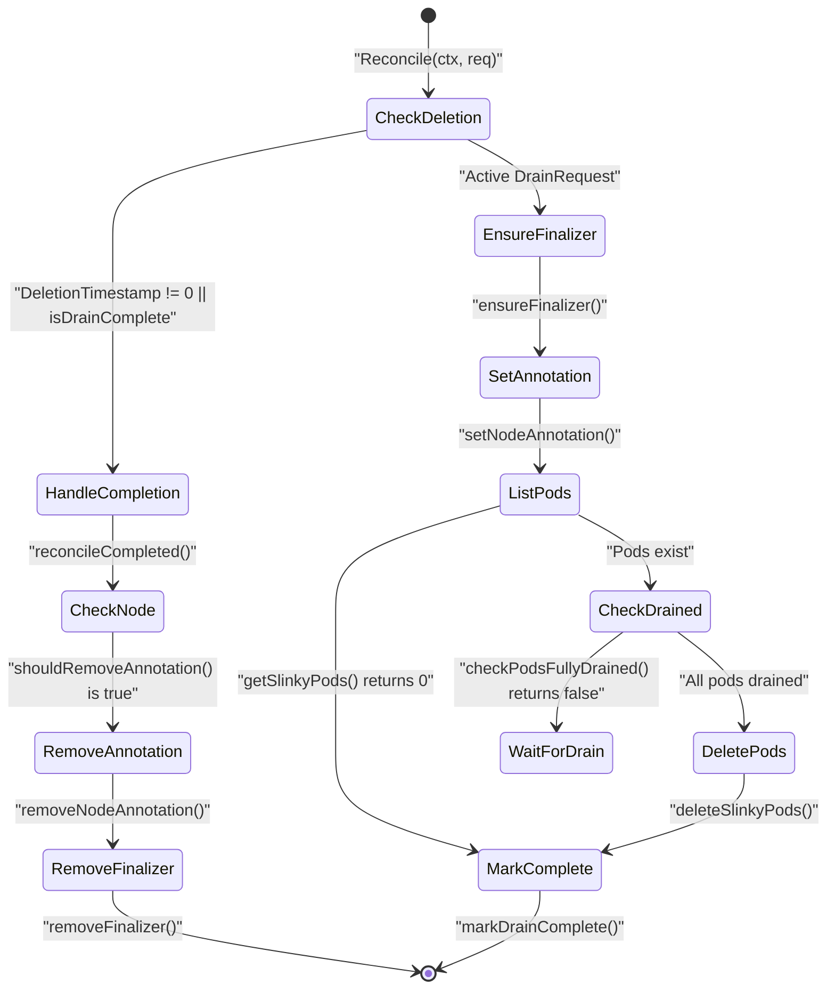
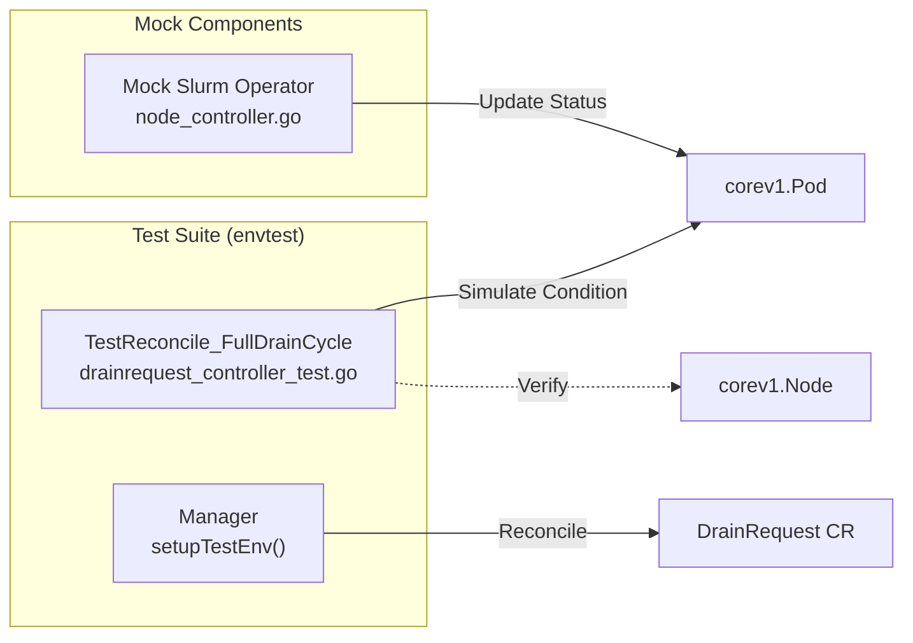

<!-- source: DeepWiki mcp.deepwiki.com · repo NVIDIA/NVSentinel · page 7.2 Slinky Drainer Plugin · fetched 2026-10-26 -->

# Slinky Drainer Plugin

Relevant source files

The following files were used as context for generating this wiki page:

- [demos/local-slinky-drain-demo/README.md](demos/local-slinky-drain-demo/README.md)
- [demos/local-slinky-drain-demo/scripts/02-inject-health-event.sh](demos/local-slinky-drain-demo/scripts/02-inject-health-event.sh)
- [demos/local-slinky-drain-demo/scripts/03-verify-drain.sh](demos/local-slinky-drain-demo/scripts/03-verify-drain.sh)
- [demos/local-slinky-drain-demo/scripts/99-cleanup.sh](demos/local-slinky-drain-demo/scripts/99-cleanup.sh)
- [docs/designs/029-slurm-external-drain-health-monitor.md](docs/designs/029-slurm-external-drain-health-monitor.md)
- [health-monitors/Makefile](health-monitors/Makefile)
- [health-monitors/slurm-drain-monitor/Makefile](health-monitors/slurm-drain-monitor/Makefile)
- [health-monitors/slurm-drain-monitor/config.example.toml](health-monitors/slurm-drain-monitor/config.example.toml)
- [health-monitors/slurm-drain-monitor/go.mod](health-monitors/slurm-drain-monitor/go.mod)
- [health-monitors/slurm-drain-monitor/main.go](health-monitors/slurm-drain-monitor/main.go)
- [health-monitors/slurm-drain-monitor/pkg/config/loader.go](health-monitors/slurm-drain-monitor/pkg/config/loader.go)
- [health-monitors/slurm-drain-monitor/pkg/config/types.go](health-monitors/slurm-drain-monitor/pkg/config/types.go)
- [health-monitors/slurm-drain-monitor/pkg/controller/reconciler.go](health-monitors/slurm-drain-monitor/pkg/controller/reconciler.go)
- [plugins/mock-slurm-operator/pkg/controller/node_controller.go](plugins/mock-slurm-operator/pkg/controller/node_controller.go)
- [plugins/slinky-drainer/.gitignore](plugins/slinky-drainer/.gitignore)
- [plugins/slinky-drainer/Makefile](plugins/slinky-drainer/Makefile)
- [plugins/slinky-drainer/config/crd/nvsentinel.nvidia.com_drainrequests.yaml](plugins/slinky-drainer/config/crd/nvsentinel.nvidia.com_drainrequests.yaml)
- [plugins/slinky-drainer/config/default/kustomization.yaml](plugins/slinky-drainer/config/default/kustomization.yaml)
- [plugins/slinky-drainer/config/drain-template/drain-template-configmap.yaml](plugins/slinky-drainer/config/drain-template/drain-template-configmap.yaml)
- [plugins/slinky-drainer/config/drain-template/kustomization.yaml](plugins/slinky-drainer/config/drain-template/kustomization.yaml)
- [plugins/slinky-drainer/config/manager/deployment.yaml](plugins/slinky-drainer/config/manager/deployment.yaml)
- [plugins/slinky-drainer/config/rbac/rbac.yaml](plugins/slinky-drainer/config/rbac/rbac.yaml)
- [plugins/slinky-drainer/main.go](plugins/slinky-drainer/main.go)
- [plugins/slinky-drainer/pkg/controller/drainrequest_controller.go](plugins/slinky-drainer/pkg/controller/drainrequest_controller.go)
- [plugins/slinky-drainer/pkg/controller/drainrequest_controller_test.go](plugins/slinky-drainer/pkg/controller/drainrequest_controller_test.go)

## Purpose and Scope

The Slinky Drainer Plugin provides workload-aware node draining for clusters running the [Slinky Slurm Operator](https://github.com/SlinkyProject/slurm-operator). Unlike NVSentinel's standard Node Drainer module (see [Node Drainer Module]()), which forcibly evicts pods, this plugin monitors Slurm job completion via pod conditions before deleting Slinky pods [plugins/slinky-drainer/pkg/controller/drainrequest_controller.go:112-121](). This ensures graceful workload termination in HPC environments where jobs may take hours or days to complete.

The plugin implements a Kubernetes controller that watches `DrainRequest` custom resources created by NVSentinel's fault management pipeline (see [Custom Drain Plugins]() and [Fault Remediation Module]()). It coordinates with the Slinky operator by setting node annotations and waiting for Slurm to drain jobs naturally before removing pods [plugins/slinky-drainer/pkg/controller/drainrequest_controller.go:49-57]().

---

## Architecture Overview

The Slinky Drainer Plugin operates as a standalone Kubernetes controller that bridges NVSentinel's fault management system with Slurm workload orchestration. The plugin watches `DrainRequest` CRs and Kubernetes nodes, coordinating drain operations by setting annotations that trigger Slurm draining and monitoring pod conditions that reflect Slurm job states [plugins/slinky-drainer/pkg/controller/drainrequest_controller.go:173-181]().

### Component Relationships

The following diagram maps the logical components to their specific code entities.

**Diagram: Slinky Drainer Component Mapping**

**Sources:** [plugins/slinky-drainer/pkg/controller/drainrequest_controller.go:59-80](), [plugins/slinky-drainer/main.go:67-103](), [plugins/slinky-drainer/config/rbac/rbac.yaml:11-37]()

### Key Design Principles

1.  **Non-Invasive Draining**: The plugin does not forcibly evict pods. It sets node annotations that signal the Slinky operator to drain Slurm jobs, then waits for natural job completion before deleting pods [plugins/slinky-drainer/pkg/controller/drainrequest_controller.go:112-121]().
2.  **Slurm State Awareness**: Pod conditions maintained by the Slinky operator (e.g., `SlurmNodeStateDrain`, `SlurmNodeStateAllocated`) reflect the underlying Slurm node state. The plugin only deletes pods when both the DRAIN flag is set and no jobs are running [plugins/slinky-drainer/pkg/controller/drainrequest_controller.go:49-57]().
3.  **Lifecycle Management**: Finalizers ensure proper cleanup. The plugin removes node annotations only after the node returns to a healthy state, indicated by the absence of the `dgxc.nvidia.com/nvsentinel-state` label [plugins/slinky-drainer/pkg/controller/drainrequest_controller.go:187-191]().
4.  **Namespace Isolation**: The plugin only manages pods in a configurable Slinky namespace (default: `slinky`), avoiding interference with other workloads [plugins/slinky-drainer/pkg/controller/drainrequest_controller.go:77-78]().

---

## DrainRequest Custom Resource

The `DrainRequest` CRD defines the contract between NVSentinel's fault remediation and the Slinky drainer. Fault Remediation creates these resources when a node requires Slurm-aware draining [demos/local-slinky-drain-demo/README.md:154-176]().

### Spec Fields

| Field | Type | Description |
| :--- | :--- | :--- |
| `nodeName` | `string` | Target node name for draining |
| `errorCode` | `[]string` | Error codes from health events (e.g., `["79"]` for XID 79) |
| `entitiesImpacted` | `[]EntityImpacted` | Hardware components affected (e.g., GPU:0) |
| `reason` | `string` | Human-readable reason for drain |

**Sources:** [plugins/slinky-drainer/pkg/controller/drainrequest_controller.go:82-85](), [plugins/slinky-drainer/pkg/controller/drainrequest_controller_test.go:61-66](), [demos/local-slinky-drain-demo/README.md:154-176]()

---

## Reconciliation Logic

The `DrainRequestReconciler` implements a state machine that progresses drain operations from annotation setup through pod monitoring to completion cleanup.

**Diagram: Reconcile Loop Logic**

**Sources:** [plugins/slinky-drainer/pkg/controller/drainrequest_controller.go:81-131](), [plugins/slinky-drainer/pkg/controller/drainrequest_controller.go:133-157]()

### Key Reconciliation Functions

*   **Reconcile Entry Point**: `Reconcile` [plugins/slinky-drainer/pkg/controller/drainrequest_controller.go:81-131]() checks for completion, manages finalizers, and orchestrates pod deletion.
*   **Completed DrainRequest Handling**: `reconcileCompleted` [plugins/slinky-drainer/pkg/controller/drainrequest_controller.go:133-157]() removes node annotations only when the node is healthy (absence of `nvsentinelStateLabelKey`).
*   **Finalizer Management**: `ensureFinalizer` and `removeFinalizer` [plugins/slinky-drainer/pkg/controller/drainrequest_controller.go:159-185]() manage the `nvsentinel.nvidia.com/slinky-drainer` finalizer.

---

## Slurm Pod Condition Monitoring

The plugin evaluates Slurm node state by inspecting pod conditions set by the Slinky operator.

### Slurm State Conditions

The plugin uses these conditions [plugins/slinky-drainer/pkg/controller/drainrequest_controller.go:42-57]() to determine drain readiness:

| Condition Type | Meaning | Used By |
| :--- | :--- | :--- |
| `SlurmNodeStateDrain` | Slurm DRAIN flag set | `isNodeDrain()` |
| `SlurmNodeStateAllocated` | Node has allocated jobs | `isPodBusy()` - blocks deletion |
| `SlurmNodeStateMixed` | Node has mixed job states | `isPodBusy()` - blocks deletion |
| `SlurmNodeStateCompleting` | Jobs are completing | `isPodBusy()` - blocks deletion |
| `SlurmNodeStateUndrain` | Slurm UNDRAIN flag set | `isNodeDrain()` |

**Sources:** [plugins/slinky-drainer/pkg/controller/drainrequest_controller.go:42-57](), [plugins/slinky-drainer/pkg/controller/drainrequest_controller.go:331-354]()

---

## Node Annotation Management

The plugin communicates drain intent via the `nodeset.slinky.slurm.net/node-cordon-reason` annotation [plugins/slinky-drainer/pkg/controller/drainrequest_controller.go:44]().

### Annotation Format

**Value Format**: `[J] [NVSentinel] <error-codes> <entities> - <reason>`

*   **Prefix**: `[J] [NVSentinel]` [plugins/slinky-drainer/pkg/controller/drainrequest_controller.go:45]()
*   **Logic**: `buildCordonReason` [plugins/slinky-drainer/pkg/controller/drainrequest_controller.go:243-267]() constructs the string using `spec.errorCode`, `spec.entitiesImpacted`, and `spec.reason`.

### Preservation and Removal

*   **Preservation**: `setNodeAnnotation` [plugins/slinky-drainer/pkg/controller/drainrequest_controller.go:210-241]() skips overwriting if an annotation already exists.
*   **Removal**: `shouldRemoveAnnotation` [plugins/slinky-drainer/pkg/controller/drainrequest_controller.go:187-191]() checks if the `dgxc.nvidia.com/nvsentinel-state` label is gone before allowing annotation removal.

---

## Integration and Deployment

### Deployment Configuration

The plugin is deployed as a Kubernetes Deployment [plugins/slinky-drainer/config/manager/deployment.yaml:1-77]().

| Flag | Default | Description |
| :--- | :--- | :--- |
| `--pod-check-interval` | `5s` | Polling interval for pod conditions [plugins/slinky-drainer/main.go:60]() |
| `--drain-timeout` | `30m` | Overall drain operation timeout [plugins/slinky-drainer/main.go:61]() |
| `--slinky-namespace` | `slinky` | Namespace where Slinky pods run [plugins/slinky-drainer/main.go:64]() |

### RBAC Requirements

The controller requires `ClusterRole` permissions [plugins/slinky-drainer/config/rbac/rbac.yaml:11-37]() for:
*   `drainrequests` (CRUD)
*   `nodes` (get, list, watch, update, patch)
*   `pods` (get, list, delete, watch)

---

## Testing and Simulation

The plugin includes an `envtest` suite [plugins/slinky-drainer/pkg/controller/drainrequest_controller_test.go:135-208]() and a `mock-slurm-operator` [plugins/mock-slurm-operator/pkg/controller/node_controller.go:38-53]().

**Diagram: Test Environment Orchestration**

**Sources:** [plugins/slinky-drainer/pkg/controller/drainrequest_controller_test.go:51-89](), [plugins/mock-slurm-operator/pkg/controller/node_controller.go:55-114](), [demos/local-slinky-drain-demo/README.md:138-150]()

---

