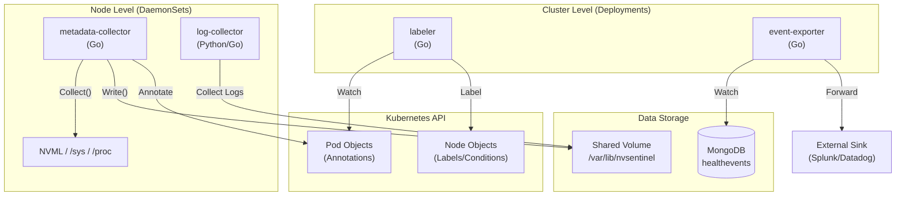

<!-- source: DeepWiki mcp.deepwiki.com · repo NVIDIA/NVSentinel · page 8 Support Services · fetched 2026-10-26 -->

# Support Services

Relevant source files

The following files were used as context for generating this wiki page:

- [data-models/pkg/model/pod_device_annotation.go](data-models/pkg/model/pod_device_annotation.go)
- [distros/kubernetes/nvsentinel/charts/labeler/templates/deployment.yaml](distros/kubernetes/nvsentinel/charts/labeler/templates/deployment.yaml)
- [distros/kubernetes/nvsentinel/charts/labeler/values.yaml](distros/kubernetes/nvsentinel/charts/labeler/values.yaml)
- [distros/kubernetes/nvsentinel/charts/metadata-collector/templates/clusterrole.yaml](distros/kubernetes/nvsentinel/charts/metadata-collector/templates/clusterrole.yaml)
- [distros/kubernetes/nvsentinel/charts/metadata-collector/templates/clusterrolebinding.yaml](distros/kubernetes/nvsentinel/charts/metadata-collector/templates/clusterrolebinding.yaml)
- [distros/kubernetes/nvsentinel/charts/metadata-collector/templates/daemonset.yaml](distros/kubernetes/nvsentinel/charts/metadata-collector/templates/daemonset.yaml)
- [distros/kubernetes/nvsentinel/charts/metadata-collector/templates/serviceaccount.yaml](distros/kubernetes/nvsentinel/charts/metadata-collector/templates/serviceaccount.yaml)
- [distros/kubernetes/nvsentinel/charts/metadata-collector/values.yaml](distros/kubernetes/nvsentinel/charts/metadata-collector/values.yaml)
- [docs/configuration/metadata-collector.md](docs/configuration/metadata-collector.md)
- [docs/labeler.md](docs/labeler.md)
- [docs/metadata-collector.md](docs/metadata-collector.md)
- [labeler/main.go](labeler/main.go)
- [labeler/pkg/initializer/init.go](labeler/pkg/initializer/init.go)
- [labeler/pkg/labeler/labeler.go](labeler/pkg/labeler/labeler.go)
- [labeler/pkg/labeler/labeler_test.go](labeler/pkg/labeler/labeler_test.go)
- [metadata-collector/pkg/mapper/httpsclient.go](metadata-collector/pkg/mapper/httpsclient.go)
- [metadata-collector/pkg/mapper/httpsclient_test.go](metadata-collector/pkg/mapper/httpsclient_test.go)

Support services provide the foundational data and operational infrastructure required for NVSentinel's fault detection and remediation logic. These components handle hardware metadata collection, node labeling based on software versions, diagnostic log aggregation, and external event streaming.

For detailed implementation and configuration of each service, refer to the child pages:
- **[Metadata Collector](#8.1)** — GPU topology, PCI addresses, UUIDs, and pod-to-GPU mapping.
- **[Labeler](#8.2)** — Automatic node labeling for DCGM, drivers, and runtime configurations.
- **[Log Collector](#8.3)** — Collection of diagnostic GPU reports and system logs for troubleshooting.
- **[Event Exporter](#8.4)** — Streaming health events to external monitoring and incident management systems.

---

## Service Overview

The Support Services layer operates primarily as a set of background controllers and collectors that enrich the system's understanding of the GPU fleet.

| Service | Primary Role | Key Code Entities |
| :--- | :--- | :--- |
| **Metadata Collector** | hardware/pod mapping | `Collector`, `PodDeviceMapper`, `KubeletHTTPSClient` |
| **Labeler** | software capability discovery | `Labeler`, `InitializationParams`, `PodInformer` |
| **Log Collector** | diagnostic data gathering | `LogCollector`, `FileServer` |
| **Event Exporter** | external integration | `EventExporter`, `ChangeStream` |

### System Integration Map

The following diagram illustrates how Support Services bridge the gap between low-level hardware/container data and high-level Kubernetes orchestration.

**Sources:** [distros/kubernetes/nvsentinel/charts/metadata-collector/templates/daemonset.yaml:43-55](), [labeler/pkg/labeler/labeler.go:57-67](), [distros/kubernetes/nvsentinel/charts/labeler/templates/deployment.yaml:53-67]()

---

## Metadata Collector

The Metadata Collector is a critical daemon that runs on every GPU node. It performs hardware discovery via NVML and pod-to-GPU mapping by querying the local Kubelet.

- **Hardware Discovery**: It queries NVML to gather GPU UUIDs, PCI bus IDs, and NVSwitch topology, writing this to a JSON file (configured via `--output-path`) for use by other monitors. [distros/kubernetes/nvsentinel/charts/metadata-collector/templates/daemonset.yaml:53-54](), [docs/metadata-collector.md:25-34]()
- **Pod Mapping**: The `PodDeviceMapper` identifies which specific GPU UUIDs are assigned to which pods by calling the Kubelet `/pods` endpoint using the `KubeletHTTPSClient`. [metadata-collector/pkg/mapper/httpsclient.go:33-43](), [metadata-collector/pkg/mapper/httpsclient.go:109-170]()
- **Annotation**: It updates the pod-to-GPU mapping as an annotation on each pod requesting GPUs, allowing external components to discover device allocation. [docs/metadata-collector.md:36-42]()

For details, see **[Metadata Collector](#8.1)**.

**Sources:** [metadata-collector/pkg/mapper/httpsclient.go:109-170](), [docs/metadata-collector.md:5-10](), [distros/kubernetes/nvsentinel/charts/metadata-collector/values.yaml:30-47]()

---

## Labeler

The `Labeler` is a cluster-wide controller that watches Pod and Node events to apply standardized labels. These labels allow NVSentinel to target specific software versions or hardware capabilities.

- **Version Detection**: It identifies DCGM and Driver versions by inspecting container images in pods with specific app labels, such as `nvidia-dcgm` or `nvidia-driver-daemonset`. [labeler/pkg/labeler/labeler.go:37-55](), [labeler/pkg/labeler/labeler_test.go:40-75]()
- **Capability Labeling**: It applies labels such as `nvsentinel.dgxc.nvidia.com/driver.installed` and `nvsentinel.dgxc.nvidia.com/kata.enabled` to nodes based on pod status and node configurations. [labeler/pkg/labeler/labeler.go:37-41](), [labeler/pkg/labeler/labeler.go:105-107]()
- **Pre-installed Drivers**: Can be configured via `assumeDriverInstalled` to skip detection and unconditionally set the driver label on clusters with host-installed drivers. [labeler/main.go:130-134](), [labeler/pkg/initializer/init.go:30-37]()

For details, see **[Labeler](#8.2)**.

**Sources:** [labeler/pkg/labeler/labeler.go:37-50](), [labeler/main.go:66-96](), [labeler/pkg/initializer/init.go:43-71]()

---

## Log Collector

The Log Collector service manages the gathering of diagnostic information when a fault is detected. It ensures that transient error states are captured before a node is rebooted or remediated.

- **GPU Reports**: Triggers the generation of hardware diagnostic outputs, such as `nvidia-bug-report.sh`. [docs/metadata-collector.md:5-7]()
- **Storage Management**: Manages diagnostic logs in a shared volume (default `/var/lib/nvsentinel`) accessible by health monitor sidecars. [distros/kubernetes/nvsentinel/charts/metadata-collector/templates/daemonset.yaml:67-80]()
- **Integration**: Works with the remediation workflow to ensure logs are collected before destructive actions (like node termination) are taken.

For details, see **[Log Collector](#8.3)**.

**Sources:** [distros/kubernetes/nvsentinel/charts/metadata-collector/templates/daemonset.yaml:77-88](), [docs/metadata-collector.md:98-103]()

---

## Event Exporter

The Event Exporter provides the bridge to external observability stacks. It operates as a consumer of the NVSentinel datastore.

- **Change Stream Monitoring**: It watches the datastore for new health event insertions to stream them to external sinks.
- **OIDC Integration**: Supports secure transmission to external monitoring and incident management systems.
- **Audit Logging**: Integrates with the `auditlogger` to track external communications and export actions. [labeler/main.go:47-50](), [labeler/pkg/initializer/init.go:79-81]()

For details, see **[Event Exporter](#8.4)**.

**Sources:** [labeler/main.go:47-50](), [labeler/pkg/initializer/init.go:79-81]() (Common integration patterns for support services)

---

