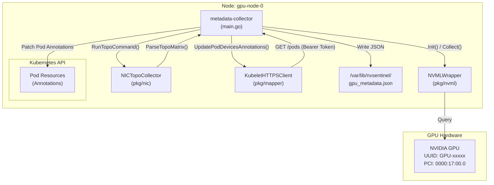

<!-- source: DeepWiki mcp.deepwiki.com · repo NVIDIA/NVSentinel · page 8.1 Metadata Collector · fetched 2026-10-26 -->

# Metadata Collector

<details>
<summary>Relevant source files</summary>

The following files were used as context for generating this wiki page:

- [data-models/pkg/model/gpu_metadata.go](data-models/pkg/model/gpu_metadata.go)
- [data-models/pkg/model/pod_device_annotation.go](data-models/pkg/model/pod_device_annotation.go)
- [distros/kubernetes/nvsentinel/charts/metadata-collector/templates/clusterrole.yaml](distros/kubernetes/nvsentinel/charts/metadata-collector/templates/clusterrole.yaml)
- [distros/kubernetes/nvsentinel/charts/metadata-collector/templates/clusterrolebinding.yaml](distros/kubernetes/nvsentinel/charts/metadata-collector/templates/clusterrolebinding.yaml)
- [distros/kubernetes/nvsentinel/charts/metadata-collector/templates/daemonset.yaml](distros/kubernetes/nvsentinel/charts/metadata-collector/templates/daemonset.yaml)
- [distros/kubernetes/nvsentinel/charts/metadata-collector/templates/serviceaccount.yaml](distros/kubernetes/nvsentinel/charts/metadata-collector/templates/serviceaccount.yaml)
- [distros/kubernetes/nvsentinel/charts/metadata-collector/values.yaml](distros/kubernetes/nvsentinel/charts/metadata-collector/values.yaml)
- [docs/configuration/metadata-collector.md](docs/configuration/metadata-collector.md)
- [docs/metadata-collector.md](docs/metadata-collector.md)
- [metadata-collector/go.mod](metadata-collector/go.mod)
- [metadata-collector/go.sum](metadata-collector/go.sum)
- [metadata-collector/main.go](metadata-collector/main.go)
- [metadata-collector/pkg/collector/collector.go](metadata-collector/pkg/collector/collector.go)
- [metadata-collector/pkg/collector/collector_test.go](metadata-collector/pkg/collector/collector_test.go)
- [metadata-collector/pkg/mapper/httpsclient.go](metadata-collector/pkg/mapper/httpsclient.go)
- [metadata-collector/pkg/mapper/httpsclient_test.go](metadata-collector/pkg/mapper/httpsclient_test.go)
- [metadata-collector/pkg/nic/topo_parser.go](metadata-collector/pkg/nic/topo_parser.go)
- [metadata-collector/pkg/nic/topo_parser_test.go](metadata-collector/pkg/nic/topo_parser_test.go)
- [metadata-collector/pkg/nvml/wrapper.go](metadata-collector/pkg/nvml/wrapper.go)

</details>


## Purpose and Scope

The Metadata Collector is a Go-based DaemonSet that gathers GPU hardware topology, PCI addresses, and UUIDs from the NVIDIA Management Library (NVML) and the `nvidia-smi topo -m` matrix. It writes this structured information to a shared JSON file for consumption by other monitors. [metadata-collector/main.go:34-36](). It also serves as a pod-to-device mapper by annotating Kubernetes Pods with the specific GPU UUIDs allocated to them by the Kubelet. [metadata-collector/main.go:62-64]().

This component enables health monitors to correlate low-level hardware identifiers (PCI addresses, NUMA nodes) with high-level Kubernetes identifiers (GPU UUIDs, Pod names) required for accurate fault tracking and remediation.

**Key Responsibilities:**
- **Hardware Discovery**: Querying NVML for GPU UUIDs, PCI addresses, and NVSwitch topology. [metadata-collector/pkg/collector/collector.go:88-115]()
- **NIC Topology Enrichment**: Parsing the `nvidia-smi topo -m` matrix to capture GPU-to-NIC relationships and NUMA affinity. [metadata-collector/pkg/collector/collector.go:134-141]()
- **Metadata Persistence**: Writing topology to a host-path JSON file. [metadata-collector/main.go:128-135]()
- **Pod-Device Mapping**: Querying the local Kubelet to determine which Pods are using which physical GPUs and annotating them accordingly. [metadata-collector/main.go:74-94]()

---

## Architecture and Data Flow

### System Integration

The Metadata Collector interacts with three primary interfaces: NVML for hardware data, the Kubelet for Pod resource allocation, and the host filesystem for data persistence.

**Metadata Collection and Mapping Flow**


**Sources:** [metadata-collector/main.go:74-95](), [metadata-collector/main.go:113-137](), [metadata-collector/pkg/mapper/httpsclient.go:109-121](), [metadata-collector/pkg/collector/collector.go:41-53]()

### Data Entity Mapping

The collector bridges different hardware and software namespaces to allow health monitors to identify faulty hardware.

| Natural Language Concept | Code Entity / Symbol | Source |
| :--- | :--- | :--- |
| **GPU Metadata** | `model.GPUMetadata` | [data-models/pkg/model/gpu_metadata.go:17]() |
| **NIC Topology** | `GPUMetadata.NICTopology` | [data-models/pkg/model/gpu_metadata.go:32]() |
| **GPU NUMA Node** | `GPUInfo.NUMANode` | [data-models/pkg/model/gpu_metadata.go:47]() |
| **Chassis Serial** | `GPUMetadata.ChassisSerial` | [data-models/pkg/model/gpu_metadata.go:22]() |
| **Pod Allocation** | `dgxc.nvidia.com/devices` | [metadata-collector/pkg/mapper/httpsclient_test.go:55]() |

**Sources:** [data-models/pkg/model/gpu_metadata.go:17-55](), [metadata-collector/pkg/mapper/httpsclient_test.go:53-56]()

---

## Implementation Details

### Metadata Collection (NVML & nvidia-smi)

The `Collector` uses an `NVMLWrapper` and a `NICTopoCollector` to build the node hardware profile. [metadata-collector/pkg/collector/collector.go:76-79]().

- **NVML Discovery**: Extracts `UUID`, `PCIAddress`, and `DeviceName`. [metadata-collector/pkg/collector/collector_test.go:71-79]().
- **Chassis Serial**: For driver versions ≥ R560, the collector gathers the chassis serial number. [metadata-collector/pkg/collector/collector_test.go:106-108]().
- **NIC Topology Parsing**: The `nic` package parses the `nvidia-smi topo -m` output. It handles both modern `mlx5_N` column names and older `NICn` placeholders via a "NIC Legend" block. [metadata-collector/pkg/nic/topo_parser.go:35-46]().
- **NUMA Affinity**: The parser extracts the `NUMA Affinity` column from the topo matrix and populates `GPUInfo.NUMANode`. This is used by the NIC Health Monitor to exclude management NICs. [metadata-collector/pkg/collector/collector.go:181-187]().

**Sources:** [metadata-collector/pkg/collector/collector.go:88-128](), [metadata-collector/pkg/nic/topo_parser.go:89-131](), [metadata-collector/pkg/collector/collector_test.go:138-154]()

### Pod-Device Mapper

The `PodDeviceMapper` reconciles physical GPU UUIDs with Kubernetes Pods. This is critical for "Partial Drain" scenarios where only specific Pods affected by a GPU failure are evicted.

1. **Kubelet Communication**: The `kubeletHTTPSClient` connects to the local Kubelet's secure port (10250) using the Pod's service account token. [metadata-collector/pkg/mapper/httpsclient.go:33-38]().
2. **Pod Resource Query**: It calls the `/pods` endpoint to retrieve the list of running pods and their resource allocations. [metadata-collector/pkg/mapper/httpsclient.go:109-122]().
3. **Annotation**: For pods consuming GPUs, it calculates the mapping and applies the `dgxc.nvidia.com/devices` annotation. [metadata-collector/main.go:87-92]().

**Sources:** [metadata-collector/pkg/mapper/httpsclient.go:58-80](), [metadata-collector/main.go:73-95]()

### Output and Persistence

The collected metadata is written to a JSON file (default: `/var/lib/nvsentinel/gpu_metadata.json`). [metadata-collector/main.go:36](). This file is then mounted read-only by other monitors.

```json
{
  "node_name": "node-1",
  "driver_version": "560.35.03",
  "chassis_serial": "CHASSIS-1234",
  "gpus": [
    {
      "gpu_id": 0,
      "uuid": "GPU-455d8f70-2051-db6c-0430-ffc457bff834",
      "pci_address": "0000:17:00.0",
      "numa_node": 0
    }
  ],
  "nic_topology": {
    "mlx5_0": ["PIX", "SYS"]
  }
}
```
**Sources:** [metadata-collector/main.go:45](), [data-models/pkg/model/gpu_metadata.go:17-33]()

---

## Deployment and Configuration

### DaemonSet Specification

The Metadata Collector runs as a privileged DaemonSet with `hostNetwork: true` and `hostPID: true`. [distros/kubernetes/nvsentinel/charts/metadata-collector/templates/daemonset.yaml:43-44]().

- **Privileged Security Context**: Required for NVML and hardware access. [distros/kubernetes/nvsentinel/charts/metadata-collector/templates/daemonset.yaml:47-50]().
- **Volume Mounts**: 
    - `/var/lib/nvsentinel`: For writing the metadata JSON. [distros/kubernetes/nvsentinel/charts/metadata-collector/templates/daemonset.yaml:68-69]().
    - `/sys`: For hardware discovery. [distros/kubernetes/nvsentinel/charts/metadata-collector/templates/daemonset.yaml:70-72]().
    - `/var/lib/kubelet/pod-resources`: For device mapping discovery. [distros/kubernetes/nvsentinel/charts/metadata-collector/templates/daemonset.yaml:73-75]().
- **Node Selector**: Targets nodes where GPUs are present and drivers are installed. [distros/kubernetes/nvsentinel/charts/metadata-collector/templates/daemonset.yaml:89-91]().

**Sources:** [distros/kubernetes/nvsentinel/charts/metadata-collector/templates/daemonset.yaml:15-105]()

### Helm Configuration

| Parameter | Default | Description |
| :--- | :--- | :--- |
| `image.repository` | `ghcr.io/nvidia/nvsentinel/metadata-collector` | Container image. [distros/kubernetes/nvsentinel/charts/metadata-collector/values.yaml:16]() |
| `global.metadataPath` | `/var/lib/nvsentinel/gpu_metadata.json` | Destination for the JSON file. [distros/kubernetes/nvsentinel/charts/metadata-collector/templates/daemonset.yaml:54]() |
| `kubeletHost` | `{}` | Override for Kubelet connection (e.g., using `status.hostIP`). [distros/kubernetes/nvsentinel/charts/metadata-collector/values.yaml:47]() |
| `runtimeClassName` | `"nvidia"` | Runtime class for the pod. [distros/kubernetes/nvsentinel/charts/metadata-collector/values.yaml:31]() |

**Sources:** [distros/kubernetes/nvsentinel/charts/metadata-collector/values.yaml:15-47]()

---

