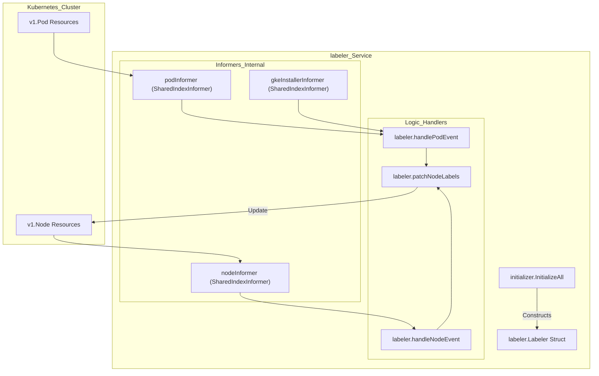
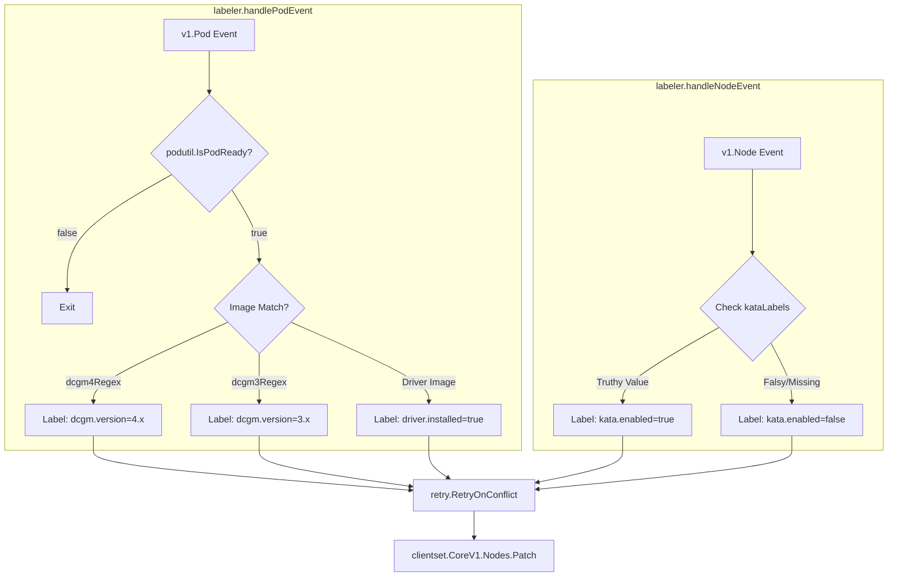

<!-- source: DeepWiki mcp.deepwiki.com · repo NVIDIA/NVSentinel · page 8.2 Labeler · fetched 2026-10-26 -->

# Labeler

Relevant source files

The following files were used as context for generating this wiki page:

- [distros/kubernetes/nvsentinel/charts/labeler/templates/deployment.yaml](distros/kubernetes/nvsentinel/charts/labeler/templates/deployment.yaml)
- [distros/kubernetes/nvsentinel/charts/labeler/values.yaml](distros/kubernetes/nvsentinel/charts/labeler/values.yaml)
- [docs/labeler.md](docs/labeler.md)
- [labeler/go.mod](labeler/go.mod)
- [labeler/go.sum](labeler/go.sum)
- [labeler/main.go](labeler/main.go)
- [labeler/pkg/initializer/init.go](labeler/pkg/initializer/init.go)
- [labeler/pkg/labeler/labeler.go](labeler/pkg/labeler/labeler.go)
- [labeler/pkg/labeler/labeler_test.go](labeler/pkg/labeler/labeler_test.go)
- [tests/go.mod](tests/go.mod)
- [tests/go.sum](tests/go.sum)

The Labeler is a Kubernetes component that enables NVSentinel to self-configure by automatically detecting GPU infrastructure details across cluster nodes. It identifies DCGM versions, NVIDIA driver installation status, and container runtime capabilities (e.g., Kata Containers), applying standardized labels that other NVSentinel modules use to adapt their behavior dynamically [docs/labeler.md:1-7]().

## Overview

Different clusters often have varying GPU software stacks, such as different DCGM major versions (3.x vs 4.x) or different driver installation methods (GPU Operator vs. CSP-managed installers) [docs/labeler.md:9-16](). The Labeler eliminates the need for manual per-cluster configuration by:
- **Watching Pods**: Monitoring DCGM and NVIDIA driver pods to extract version information from container images [docs/labeler.md:28-31]().
- **Labeling Nodes**: Applying discovered metadata to Kubernetes Node objects [docs/labeler.md:32-33]().
- **Adapting Runtimes**: Detecting Kata Containers to adjust log collection and monitoring strategies [docs/labeler.md:34-36]().

**Sources**: [docs/labeler.md:1-41](), [labeler/pkg/labeler/labeler.go:37-50]()

---

## Component Architecture

The Labeler is implemented as a Go-based controller using the `k8s.io/client-go` library. It utilizes multiple `SharedIndexInformer` instances to react to cluster changes efficiently without polling [labeler/pkg/labeler/labeler.go:58-67]().

### Data Flow and Code Entities

The diagram below maps the interaction between Kubernetes resources and the internal Go structures and functions within the `labeler` package.

**Sources**: [labeler/main.go:84-96](), [labeler/pkg/labeler/labeler.go:80-124](), [labeler/pkg/labeler/labeler.go:204-228](), [labeler/pkg/initializer/init.go:43-71]()

---

## Implementation Details

### Labeling Logic
The `Labeler` struct manages the lifecycle of node labels. It registers event handlers for Pods and Nodes to trigger labeling logic whenever relevant infrastructure changes occur [labeler/pkg/labeler/labeler.go:109-115]().

#### 1. DCGM Version Detection
The Labeler watches for pods with the `nvidia-dcgm` app label [labeler/main.go:123](). It inspects the container image strings using regular expressions to distinguish between major versions:
- **DCGM 4.x**: Matched via `dcgm4Regex` (`.*dcgm:4\..*`) [labeler/pkg/labeler/labeler.go:53]().
- **DCGM 3.x**: Matched via `dcgm3Regex` (`.*dcgm:3\..*`) [labeler/pkg/labeler/labeler.go:54]().
The result is stored in the `DCGMVersionLabel` (`nvsentinel.dgxc.nvidia.com/dcgm.version`) [labeler/pkg/labeler/labeler.go:38]().

#### 2. Driver Installation Detection
The controller identifies driver presence by monitoring:
- Standard NVIDIA driver DaemonSet pods via `NodeDriverIndex` [labeler/pkg/labeler/labeler.go:44]().
- GKE-specific driver installer pods (`nvidia-driver-installer`) via `NodeGKEDriverInstallerIndex` [labeler/pkg/labeler/labeler.go:45]().
- **Assume Mode**: If `assumeDriverInstalled` is true, the Labeler skips pod detection and marks GPU nodes (where `nvidia.com/gpu.present=true`) as having drivers installed [labeler/main.go:130-133](), [labeler/pkg/labeler/labeler.go:117-119]().

#### 3. Kata Containers Detection
The Labeler checks for the presence of the `KataRuntimeDefaultLabel` (`katacontainers.io/kata-runtime`) on nodes [labeler/pkg/labeler/labeler.go:41](). Users can provide a `kataLabelOverride` to check additional custom labels via `buildKataLabels` [labeler/pkg/labeler/labeler.go:126-133](). If a truthy value is found, `KataEnabledLabel` (`nvsentinel.dgxc.nvidia.com/kata.enabled`) is set to `true` [labeler/pkg/labeler/labeler.go:40]().

### Labeler Event Processing Loop

The following diagram illustrates the decision matrix inside the event handlers.

**Sources**: [labeler/pkg/labeler/labeler.go:204-228](), [labeler/pkg/labeler/labeler_test.go:40-162](), [labeler/pkg/labeler/labeler.go:52-55]()

---

## Configuration Reference

The Labeler is configured via CLI flags, which are typically mapped from Helm `values.yaml` [distros/kubernetes/nvsentinel/charts/labeler/templates/deployment.yaml:57-66]().

| Flag | Helm Value | Default | Description |
| :--- | :--- | :--- | :--- |
| `--dcgm-app-label` | N/A | `nvidia-dcgm` | Label key used to identify DCGM pods [labeler/main.go:123](). |
| `--driver-app-label` | N/A | `nvidia-driver-daemonset` | Label key used to identify driver pods [labeler/main.go:124](). |
| `--kata-label` | `kataLabelOverride` | `""` | Custom node label to check for Kata support [labeler/main.go:127-129](). |
| `--assume-driver-installed` | `assumeDriverInstalled` | `false` | Unconditionally label GPU nodes as driver-ready [labeler/main.go:130-133](). |
| `--metrics-port` | `global.metricsPort` | `2112` | Port for Prometheus metrics and health checks [labeler/main.go:122](). |

**Sources**: [labeler/main.go:121-135](), [distros/kubernetes/nvsentinel/charts/labeler/values.yaml:30-43]()

---

## Integration and Deployment

### Metrics and Health
The Labeler exposes a `/healthz` endpoint and Prometheus metrics using the `server.NewServer` component [labeler/main.go:78-82](). It tracks:
- **Events Processed**: `metrics.EventsProcessed` tracks Success/Failure counts for pod and node event handling [labeler/pkg/labeler/labeler.go:208-212]().

### Deployment Design
The Labeler runs as a single-replica Deployment [distros/kubernetes/nvsentinel/charts/labeler/values.yaml:19](). It is not required to run on every node because it uses Kubernetes Informers to monitor the entire cluster state from a central point [labeler/pkg/labeler/labeler.go:82-93](). The initialization process uses `initializer.InitializeAll` to set up the Kubernetes clientset with an `AuditingRoundTripper` [labeler/pkg/initializer/init.go:79-81]().

**Sources**: [labeler/main.go:78-82](), [distros/kubernetes/nvsentinel/charts/labeler/templates/deployment.yaml:24](), [labeler/pkg/initializer/init.go:53-61](), [labeler/pkg/initializer/init.go:73-89]()

---

