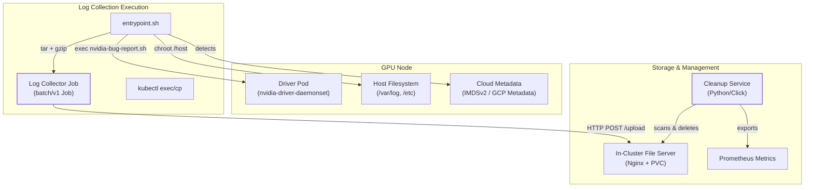
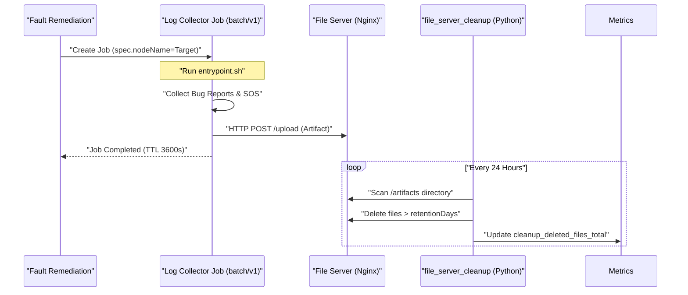

<!-- source: DeepWiki mcp.deepwiki.com · repo NVIDIA/NVSentinel · page 8.3 Log Collector · fetched 2026-10-26 -->

# Log Collector

Relevant source files

The following files were used as context for generating this wiki page:

- [demos/local-custom-remediation-demo/memory-pressure-monitor/Dockerfile](demos/local-custom-remediation-demo/memory-pressure-monitor/Dockerfile)
- [demos/local-custom-remediation-demo/memory-reclaim-controller/Dockerfile](demos/local-custom-remediation-demo/memory-reclaim-controller/Dockerfile)
- [distros/kubernetes/nvsentinel/charts/fault-remediation/files/log-collector-job.yaml](distros/kubernetes/nvsentinel/charts/fault-remediation/files/log-collector-job.yaml)
- [distros/kubernetes/nvsentinel/charts/janitor/templates/networkpolicy.yaml](distros/kubernetes/nvsentinel/charts/janitor/templates/networkpolicy.yaml)
- [distros/kubernetes/nvsentinel/templates/networkpolicy.yaml](distros/kubernetes/nvsentinel/templates/networkpolicy.yaml)
- [docs/log-collection.md](docs/log-collection.md)
- [gpu-reset/Dockerfile](gpu-reset/Dockerfile)
- [health-monitors/gpu-health-monitor/poetry.lock](health-monitors/gpu-health-monitor/poetry.lock)
- [health-monitors/gpu-health-monitor/pyproject.toml](health-monitors/gpu-health-monitor/pyproject.toml)
- [health-monitors/syslog-health-monitor/Dockerfile](health-monitors/syslog-health-monitor/Dockerfile)
- [log-collector/Dockerfile](log-collector/Dockerfile)
- [log-collector/entrypoint.sh](log-collector/entrypoint.sh)
- [log-collector/poetry.lock](log-collector/poetry.lock)
- [log-collector/pyproject.toml](log-collector/pyproject.toml)
- [metadata-collector/Dockerfile](metadata-collector/Dockerfile)
- [preflight-checks/nccl-loopback/Dockerfile](preflight-checks/nccl-loopback/Dockerfile)
- [tilt/csp-api-mock/Dockerfile](tilt/csp-api-mock/Dockerfile)
- [tilt/event-exporter-mock/Dockerfile](tilt/event-exporter-mock/Dockerfile)
- [tilt/event-exporter-mock/go.mod](tilt/event-exporter-mock/go.mod)
- [tilt/simple-health-client/Dockerfile](tilt/simple-health-client/Dockerfile)

## Purpose and Scope

The Log Collector module provides diagnostic artifact collection, GPU health reporting, and file server management for NVSentinel. It is responsible for gathering deep diagnostics (like NVIDIA bug reports and GPU Operator must-gather) when faults are detected, storing them in an in-cluster file server, and managing the lifecycle of these artifacts through an automated cleanup service.

**Sources:** [log-collector/pyproject.toml:1-4](), [docs/log-collection.md:3-7]()

---

## System Architecture

The Log Collector infrastructure consists of three primary functional components: the **Collection Job**, the **In-Cluster File Server**, and the **Cleanup Service**.

### High-Level Data Flow

The following diagram illustrates the flow from fault detection to log archival:

**Sources:** [log-collector/entrypoint.sh:18-31](), [docs/log-collection.md:20-32](), [distros/kubernetes/nvsentinel/charts/fault-remediation/files/log-collector-job.yaml:18-47]()

---

## Log Collector Job

The Log Collector is deployed as a Kubernetes `batch/v1 Job` targeting the specific node where a fault was detected. It runs with privileged security contexts to access host diagnostics.

### Entrypoint Logic (`entrypoint.sh`)

The `entrypoint.sh` script manages the collection sequence:

1.  **Environment Detection**: Determines if the node is running on AWS (using IMDSv2 tokens) or GCP (using `Metadata-Flavor: Google`).
2.  **NVIDIA Bug Report**:
    *   **GCP COS**: Attempts to run `/host/home/kubernetes/bin/nvidia/bin/nvidia-bug-report.sh` directly via the privileged host mount.
    *   **Standard**: Locates the `nvidia-driver-daemonset` pod on the node and executes `nvidia-bug-report.sh` inside the driver container.
3.  **Cloud SOS Reports**: If enabled via `ENABLE_GCP_SOS_COLLECTION` or `ENABLE_AWS_SOS_COLLECTION`, it runs system-level SOS reports (e.g., `sos report` on COS 105+).
4.  **GPU Operator Must-Gather**: If enabled, downloads and executes the `must-gather.sh` script to collect cluster-wide GPU operator state.
5.  **Artifact Packaging**: Archives all logs into `nvidia-bug-report-${NODE_NAME}-${TIMESTAMP}.log.gz`.

**Sources:** [log-collector/entrypoint.sh:56-147](), [log-collector/entrypoint.sh:150-180](), [distros/kubernetes/nvsentinel/charts/fault-remediation/files/log-collector-job.yaml:43-63]()

### Job Configuration

| Parameter | Environment Variable | Default |
|-----------|----------------------|---------|
| Target Node | `NODE_NAME` | `unknown-node` |
| Driver Container | `DRIVER_CONTAINER_NAME` | `nvidia-driver-ctr` |
| Upload Endpoint | `UPLOAD_URL_BASE` | (Required for upload) |
| GCP SOS Enable | `ENABLE_GCP_SOS_COLLECTION`| `false` |
| AWS SOS Enable | `ENABLE_AWS_SOS_COLLECTION`| `false` |

**Sources:** [log-collector/entrypoint.sh:23-31](), [distros/kubernetes/nvsentinel/charts/fault-remediation/files/log-collector-job.yaml:47-67]()

---

## File Server Cleanup Service

The Cleanup Service is a Python application designed to manage the persistent volume where logs are stored. It ensures the file server does not run out of disk space by enforcing retention policies.

### Implementation Details

The service is built using the `click` CLI framework and `prometheus-client` for observability. It is defined in the `file-server-cleanup` Python package.

**Key Components:**
*   **CLI Interface**: Defined in `file_server_cleanup.cli:cli`.
*   **Retention Logic**: Scans the artifact directory and removes files older than the configured `retentionDays`.
*   **Metrics**: Exports cleanup statistics to Prometheus.

**Sources:** [log-collector/pyproject.toml:1-10](), [log-collector/pyproject.toml:21-22]()

### Dependency Management

The service uses `poetry` for dependency management, ensuring a consistent runtime environment for the cleanup logic.

| Dependency | Version | Purpose |
|------------|---------|---------|
| `python` | `^3.10` | Runtime environment |
| `click` | `^8.3.2` | CLI command structure |
| `prometheus-client` | `^0.25.0` | Metrics exportation |

**Sources:** [log-collector/pyproject.toml:7-10](), [log-collector/poetry.lock:57-62]()

---

## Storage and Networking

### In-Cluster File Server

Logs are stored in an NGINX-based file server. Access is typically managed via a `NetworkPolicy` to restrict ingress to metrics scrapers and internal NVSentinel components.

**Sources:** [docs/log-collection.md:166-168](), [distros/kubernetes/nvsentinel/templates/networkpolicy.yaml:15-43]()

### Network Policy Configuration

The `metrics-access` NetworkPolicy allows ingress on specific ports:
*   **Metrics Port**: `global.metricsPort` (Standard NVSentinel metrics)
*   **MongoDB Metrics**: `9216`
*   **File Server Metrics**: `global.inclusterFileServer.metricsPort`
*   **Cleanup Metrics**: `global.inclusterFileServer.cleanupMetricsPort`

**Sources:** [distros/kubernetes/nvsentinel/templates/networkpolicy.yaml:32-42]()

---

## Log Lifecycle Management

The following sequence diagram describes the interaction between the collector job, the file server, and the cleanup service:

**Sources:** [docs/log-collection.md:20-28](), [docs/log-collection.md:120-124](), [distros/kubernetes/nvsentinel/charts/fault-remediation/files/log-collector-job.yaml:26-26]()

---

## Summary of Collected Artifacts

| Artifact Name | Source | Contents |
|---------------|--------|----------|
| `nvidia-bug-report.log.gz` | `nvidia-bug-report.sh` | GPU state, XIDs, driver logs, dmesg |
| `gpu-operator-must-gather.tar.gz` | `must-gather.sh` | Operator logs, CRD states, pod logs |
| `gcp-sos-report.tar.xz` | `sos report` | GCP-specific system diagnostics |
| `aws-sos-report.tar.xz` | `sos report` | AWS-specific system diagnostics |

**Sources:** [log-collector/entrypoint.sh:102-105](), [log-collector/entrypoint.sh:150-165](), [docs/log-collection.md:36-58]()

---

