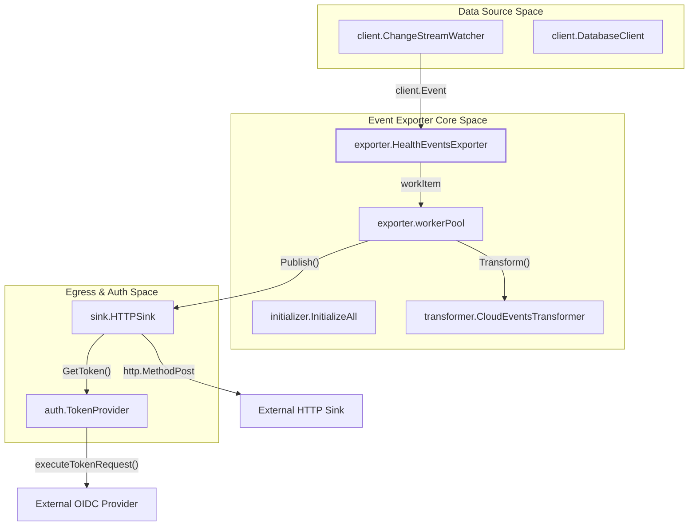
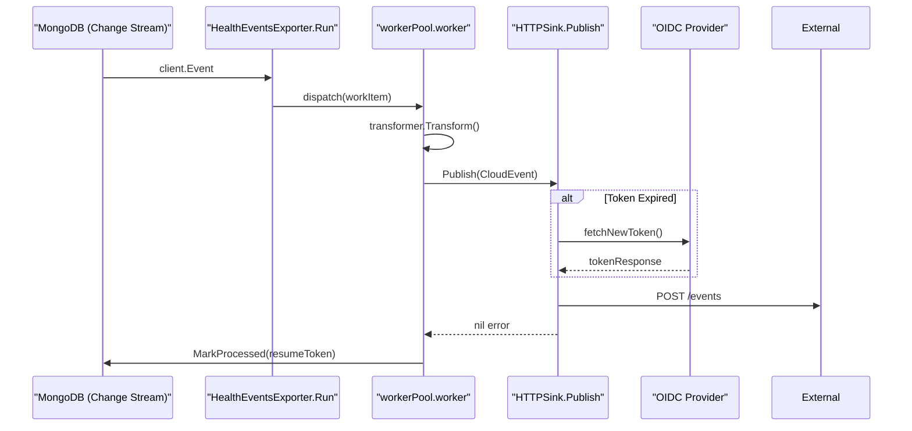

<!-- source: DeepWiki mcp.deepwiki.com · repo NVIDIA/NVSentinel · page 8.4 Event Exporter · fetched 2026-10-26 -->

# Event Exporter

Relevant source files

The following files were used as context for generating this wiki page:

- [distros/kubernetes/nvsentinel/charts/event-exporter/templates/configmap.yaml](distros/kubernetes/nvsentinel/charts/event-exporter/templates/configmap.yaml)
- [distros/kubernetes/nvsentinel/charts/event-exporter/values.yaml](distros/kubernetes/nvsentinel/charts/event-exporter/values.yaml)
- [event-exporter/main.go](event-exporter/main.go)
- [event-exporter/pkg/auth/oidc.go](event-exporter/pkg/auth/oidc.go)
- [event-exporter/pkg/auth/oidc_test.go](event-exporter/pkg/auth/oidc_test.go)
- [event-exporter/pkg/config/config.go](event-exporter/pkg/config/config.go)
- [event-exporter/pkg/exporter/exporter.go](event-exporter/pkg/exporter/exporter.go)
- [event-exporter/pkg/exporter/worker_pool.go](event-exporter/pkg/exporter/worker_pool.go)
- [event-exporter/pkg/initializer/initializer.go](event-exporter/pkg/initializer/initializer.go)
- [event-exporter/pkg/sink/http.go](event-exporter/pkg/sink/http.go)
- [event-exporter/pkg/sink/http_test.go](event-exporter/pkg/sink/http_test.go)
- [event-exporter/pkg/transformer/cloudevents.go](event-exporter/pkg/transformer/cloudevents.go)
- [event-exporter/pkg/transformer/cloudevents_test.go](event-exporter/pkg/transformer/cloudevents_test.go)
- [event-exporter/pkg/transformer/types.go](event-exporter/pkg/transformer/types.go)

## Purpose and Scope

The Event Exporter is a specialized service designed to stream NVSentinel health events to external monitoring systems and observability platforms. It acts as a bridge between the internal MongoDB/PostgreSQL event store and external sinks (such as HTTP endpoints), ensuring that GPU health incidents, remediation actions, and system faults are visible to centralized enterprise monitoring tools.

The module supports real-time streaming via database change streams, historical backfilling of events, and robust authentication using OpenID Connect (OIDC).

---

## Architecture and Data Flow

The Event Exporter follows a producer-consumer pattern utilizing a worker pool for concurrent processing. It transforms internal Protobuf-based `HealthEvent` objects into industry-standard `CloudEvents` before transmission.

### System Components and Code Entities

**Diagram: Component Interaction and Code Entities**

**Sources:** [event-exporter/pkg/initializer/initializer.go:50-96](), [event-exporter/pkg/exporter/exporter.go:37-65](), [event-exporter/pkg/exporter/worker_pool.go:67-93](), [event-exporter/pkg/auth/oidc.go:160-171]()

### Logical Data Flow

1.  **Initialization**: `InitializeAll` sets up the `DatabaseClient`, `TokenProvider`, and `HTTPSink` [event-exporter/pkg/initializer/initializer.go:50-89]().
2.  **Backfill (Optional)**: If enabled and no resume token exists, the exporter queries historical events using `runBackfill` [event-exporter/pkg/exporter/exporter.go:93-138]().
3.  **Streaming**: The `ChangeStreamWatcher` monitors the database for new inserts [event-exporter/pkg/exporter/exporter.go:88-90]().
4.  **Worker Dispatch**: Events are wrapped in a `workItem` with a sequence number and sent to the `workerPool` [event-exporter/pkg/exporter/worker_pool.go:28-32]().
5.  **Transformation**: The `CloudEventsTransformer` converts the internal `pb.HealthEvent` to a `CloudEvent` JSON structure [event-exporter/pkg/transformer/types.go:41-57]().
6.  **Publication**: The `HTTPSink` fetches a Bearer token from the `TokenProvider` and POSTs the event to the configured endpoint [event-exporter/pkg/sink/http.go:75-110]().
7.  **Checkpointing**: After successful publication, the `tokenWriter` advances the resume token in the database to ensure exactly-once delivery across restarts [event-exporter/pkg/exporter/worker_pool.go:150-179]().

**Sources:** [event-exporter/pkg/exporter/exporter.go:67-91](), [event-exporter/pkg/exporter/worker_pool.go:48-66](), [event-exporter/pkg/sink/http.go:75-110]()

---

## Key Implementation Details

### Worker Pool and Ordering
To maintain high throughput while ensuring the database resume token (checkpoint) is only advanced for contiguous processed events, the `workerPool` uses a `sequenceTracker`.

- **Concurrency**: Multiple workers process events in parallel via `dispatchCh` [event-exporter/pkg/exporter/worker_pool.go:101-105]().
- **Ordered Checkpointing**: The `tokenWriter` collects `workResult` objects. It only updates the `ChangeStreamWatcher` with a resume token if all preceding sequence numbers have been successfully processed [event-exporter/pkg/exporter/worker_pool.go:150-176]().

**Sources:** [event-exporter/pkg/exporter/worker_pool.go:101-179]()

### Authentication (OIDC)
The `TokenProvider` handles OAuth2 Client Credentials flow to secure the egress traffic.

- **Caching**: Tokens are cached in memory and refreshed only when nearing expiration (1-minute buffer) [event-exporter/pkg/auth/oidc.go:63-72]().
- **Resilience**: Token fetching implements an exponential backoff strategy for retriable HTTP statuses (429, 5xx) [event-exporter/pkg/auth/oidc.go:74-125]().

**Sources:** [event-exporter/pkg/auth/oidc.go:74-133]()

### Event Transformation
The `CloudEventsTransformer` maps internal fields to the `com.nvidia.nvsentinel.health.v1` event type.

| CloudEvent Field | Source / Value |
| :--- | :--- |
| `specversion` | `1.0` [event-exporter/pkg/transformer/cloudevents.go:97]() |
| `type` | `com.nvidia.nvsentinel.health.v1` [event-exporter/pkg/transformer/cloudevents.go:98]() |
| `source` | `nvsentinel://{cluster}/healthevents` [event-exporter/pkg/transformer/cloudevents.go:99]() |
| `data.healthEvent` | Full `pb.HealthEvent` details (Agent, Component, Node, etc.) [event-exporter/pkg/transformer/cloudevents.go:102-105]() |
| `data.metadata` | Custom metadata from configuration (Cluster, Environment) [event-exporter/pkg/transformer/cloudevents.go:103]() |

**Sources:** [event-exporter/pkg/transformer/types.go:31-57](), [event-exporter/pkg/transformer/cloudevents.go:96-106](), [event-exporter/pkg/transformer/cloudevents_test.go:71-130]()

---

## Configuration

The module is configured via `config.toml` (typically mapped from a Kubernetes ConfigMap).

| Section | Key | Description |
| :--- | :--- | :--- |
| `exporter.sink` | `endpoint` | The target HTTP URL for event delivery [distros/kubernetes/nvsentinel/charts/event-exporter/values.yaml:58]() |
| `exporter.oidc` | `token_url` | OIDC provider token endpoint [distros/kubernetes/nvsentinel/charts/event-exporter/values.yaml:64]() |
| `exporter.backfill` | `max_age` | How far back to look for historical events during startup [distros/kubernetes/nvsentinel/charts/event-exporter/values.yaml:72]() |
| `exporter.backfill` | `rate_limit` | Max events per second during backfill [distros/kubernetes/nvsentinel/charts/event-exporter/values.yaml:75]() |
| `exporter` | `workers` | Number of parallel HTTP upload workers [distros/kubernetes/nvsentinel/charts/event-exporter/values.yaml:86]() |

**Sources:** [distros/kubernetes/nvsentinel/charts/event-exporter/templates/configmap.yaml:24-61](), [distros/kubernetes/nvsentinel/charts/event-exporter/values.yaml:45-93]()

---

## Observability

The Event Exporter exposes a Prometheus metrics endpoint (default port `2112`) via `createMetricsServer` [event-exporter/main.go:140-153]().

### Key Metrics
- `backfill_in_progress`: Gauge indicating if historical data is being synced [event-exporter/pkg/exporter/exporter.go:103]().
- `backfill_duration_seconds`: Histogram of time taken to complete backfill [event-exporter/pkg/exporter/exporter.go:134]().
- `token_refresh_errors_total`: Counter for OIDC authentication failures [event-exporter/pkg/auth/oidc.go:117]().
- `resume_token_update_timestamp`: Timestamp of the last successful checkpoint [event-exporter/pkg/exporter/worker_pool.go:171]().

**Sources:** [event-exporter/main.go:94-109](), [event-exporter/pkg/exporter/exporter.go:103-134](), [event-exporter/pkg/auth/oidc.go:117-119]()

---

## Summary of Operation

**Diagram: Real-time Event Export Sequence**

**Sources:** [event-exporter/pkg/exporter/exporter.go:88-91](), [event-exporter/pkg/exporter/worker_pool.go:133-176](), [event-exporter/pkg/sink/http.go:75-110](), [event-exporter/pkg/auth/oidc.go:74-125]()

---

