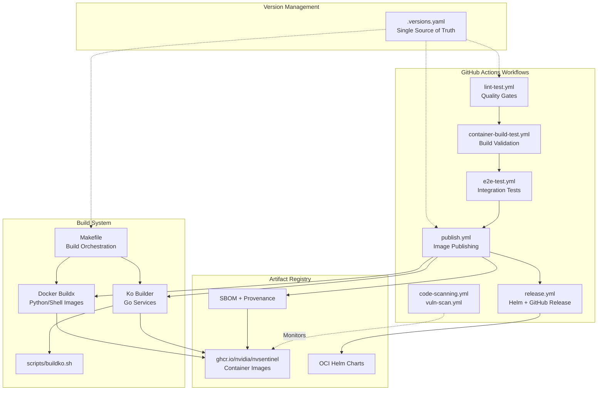
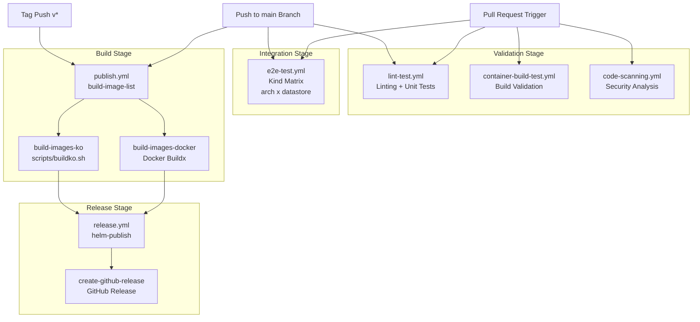

<!-- source: DeepWiki mcp.deepwiki.com · repo NVIDIA/NVSentinel · page 9 CI/CD and Build System · fetched 2026-10-26 -->

# CI/CD and Build System

Relevant source files

The following files were used as context for generating this wiki page:

- [.github/actions/publish-container/action.yml](.github/actions/publish-container/action.yml)
- [.github/actions/sbom-and-attest/action.yml](.github/actions/sbom-and-attest/action.yml)
- [.github/workflows/code-scanning.yml](.github/workflows/code-scanning.yml)
- [.github/workflows/container-build-test.yml](.github/workflows/container-build-test.yml)
- [.github/workflows/e2e-test.yml](.github/workflows/e2e-test.yml)
- [.github/workflows/integration-aws.yml](.github/workflows/integration-aws.yml)
- [.github/workflows/integration-gcp.yml](.github/workflows/integration-gcp.yml)
- [.github/workflows/lint-test.yml](.github/workflows/lint-test.yml)
- [.github/workflows/publish.yml](.github/workflows/publish.yml)
- [.github/workflows/release.yml](.github/workflows/release.yml)
- [.gitignore](.gitignore)
- [.ko.yaml](.ko.yaml)
- [Makefile](Makefile)
- [distros/kubernetes/nvsentinel/policies/must-have-sbom.yaml](distros/kubernetes/nvsentinel/policies/must-have-sbom.yaml)
- [distros/kubernetes/nvsentinel/policies/must-have-slsa.yaml](distros/kubernetes/nvsentinel/policies/must-have-slsa.yaml)
- [make/docker.mk](make/docker.mk)
- [scripts/build-image-list.sh](scripts/build-image-list.sh)
- [scripts/buildko.sh](scripts/buildko.sh)
- [scripts/check-image-attestations.sh](scripts/check-image-attestations.sh)
- [scripts/verify-image-provenance.sh](scripts/verify-image-provenance.sh)

## Overview

The NVSentinel CI/CD and build system automates the complete lifecycle from code validation to production release. The system consists of GitHub Actions workflows, a centralized Makefile-based build system, dual container build strategies (Docker and Ko), version management through `.versions.yaml`, and comprehensive security attestation.

This page provides an architectural overview of the CI/CD and build infrastructure. For detailed information on specific subsystems:

- **[CI/CD Pipeline Overview](#9.1)**: Workflow architecture, trigger patterns, and job dependencies.
- **[Lint and Test Workflows](#9.2)**: Code quality checks, unit tests, and coverage reporting.
- **[End-to-End Testing](#9.3)**: Multi-architecture and multi-datastore E2E validation.
- **[Container Build and Publishing](#9.4)**: Docker and Ko build strategies, multi-platform images.
- **[Security and Supply Chain](#9.5)**: SBOM generation, provenance attestation, and vulnerability scanning.
- **[Build System and Makefile](#9.6)**: Makefile structure, build targets, and Ko configuration.
- **[Version Management](#9.7)**: `.versions.yaml` as the single source of truth.

**Sources**: [.github/workflows/lint-test.yml:15-40](), [.github/workflows/publish.yml:15-41](), [.github/workflows/e2e-test.yml:15-40](), [.github/workflows/release.yml:15-36]()

## System Architecture

The CI/CD system is organized around three core pillars: validation (lint/test), build (containers), and release (publish). Version management is centralized in `.versions.yaml` to ensure consistency across all environments.

### High-Level Component Diagram

**Sources**: [.github/workflows/lint-test.yml:15-24](), [.github/workflows/publish.yml:15-29](), [.github/workflows/release.yml:15-27](), [.ko.yaml:15-20](), [scripts/buildko.sh:18-75]()

### Workflow Trigger Matrix

The CI/CD system consists of multiple GitHub Actions workflows with specific trigger patterns to balance validation speed with resource usage.

| Workflow | Pull Request | Main Push | Tag Push | Schedule | Manual |
|----------|-------------|-----------|----------|----------|--------|
| `lint-test.yml` | ✓ | ✓ | ✓ | - | ✓ |
| `container-build-test.yml` | ✓ (path filter) | - | - | - | ✓ |
| `code-scanning.yml` | ✓ | ✓ | ✓ | - | ✓ |
| `e2e-test.yml` | ✓ | ✓ | - | - | ✓ |
| `publish.yml` | - | ✓ | ✓ | - | ✓ |
| `release.yml` | - | - | ✓ | - | ✓ |
| `vuln-scan.yml` | ✓ (PR test) | - | - | Daily | ✓ |
| `integration-aws.yml` | - | ✓ | - | Daily | ✓ |

**Sources**: [.github/workflows/lint-test.yml:17-24](), [.github/workflows/container-build-test.yml:17-36](), [.github/workflows/e2e-test.yml:26-31](), [.github/workflows/publish.yml:17-29](), [.github/workflows/release.yml:17-27](), [.github/workflows/integration-aws.yml:17-23]()

### Workflow Execution Flow

Workflows execute in stages with explicit dependencies to ensure quality gates pass before expensive build and integration operations.

**Sources**: [.github/workflows/lint-test.yml:41-210](), [.github/workflows/container-build-test.yml:48-158](), [.github/workflows/e2e-test.yml:42-80](), [.github/workflows/publish.yml:43-165](), [.github/workflows/release.yml:38-169]()

## Build Strategies

NVSentinel employs two distinct container build strategies based on component implementation:

### Docker Build Strategy (Python/Shell)
Used for components with specific system dependencies or those written in Python. This strategy utilizes Docker Buildx for multi-platform support.
- **Components**: `gpu-health-monitor`, `syslog-health-monitor`, `log-collector`, `gpu-reset`, and `preflight-checks`.
- **Command**: Typically `make docker-build` or `make docker-publish`.
- **Logic**: Defined in `make/docker.mk` and invoked via component-specific Makefiles.

**Sources**: [.github/workflows/publish.yml:88-131](), [.github/workflows/container-build-test.yml:56-77](), [Makefile:65-68]()

### Ko Build Strategy (Go)
Used for the majority of Go-based services to produce minimal, distroless images without requiring Dockerfiles.
- **Components**: `platform-connectors`, `health-events-analyzer`, `fault-quarantine`, `node-drainer`, `janitor`, etc.
- **Command**: Orchestrated via `scripts/buildko.sh` which handles parallel builds and OCI manifest generation.
- **Base Image**: Uses `cgr.dev/chainguard/static:latest` as the default base image.

**Sources**: [.github/workflows/publish.yml:166-215](), [scripts/buildko.sh:1-75](), [.ko.yaml:1-20](), [.ko.yaml:16-16]()

## Version Management

The system uses a centralized versioning strategy to ensure consistency across the monorepo.

- **`.versions.yaml`**: Acts as the single source of truth for all tool versions including Go, Python, and testing tools like Helm.
- **`scripts/build-image-list.sh`**: Dynamically generates `versions.txt` during the build process to map specific commits/tags to image references.
- **`SAFE_REF_NAME`**: A sanitized reference name (replacing `/` with `-`) used across Makefiles and Workflows to ensure Docker tag compatibility.

**Sources**: [.github/workflows/release.yml:87-96](), [scripts/build-image-list.sh:23-41](), [scripts/buildko.sh:22-26](), [Makefile:23-38](), [.github/actions/publish-container/action.yml:77-77]()

## Quality Gates and Security

### Quality Gates
- **Linting**: Parallel jobs in `lint-test.yml` for `protos-lint`, `license-headers-lint`, `gomod-lint`, and `helm-lint`.
- **Testing**: Matrix-based unit and integration testing with consolidated coverage reporting using `gotestsum`.
- **E2E Validation**: Comprehensive matrix of architecture (AMD64/ARM64) and datastore (MongoDB/PostgreSQL) using Kind clusters and `ctlptl`.

**Sources**: [.github/workflows/lint-test.yml:41-80](), [.github/workflows/e2e-test.yml:42-80](), [Makefile:7-7](), [.github/workflows/e2e-test.yml:146-154]()

### Supply Chain Security
- **SBOM**: Software Bill of Materials generation handled by the `sbom-and-attest` action.
- **Attestation**: SLSA provenance attestation using GitHub's native attestation support and Cosign.
- **Scanning**: Static analysis via CodeQL integrated into the PR and baseline workflows.
- **Verification**: Policies in `distros/kubernetes/nvsentinel/policies/` ensure that deployed images must have valid SBOMs and SLSA attestations.

**Sources**: [.github/actions/publish-container/action.yml:116-121](), [.github/workflows/code-scanning.yml:15-30](), [distros/kubernetes/nvsentinel/policies/must-have-slsa.yaml:1-10](), [distros/kubernetes/nvsentinel/policies/must-have-sbom.yaml:1-10]()

---

