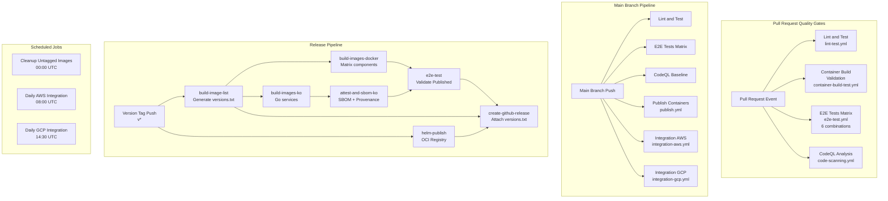
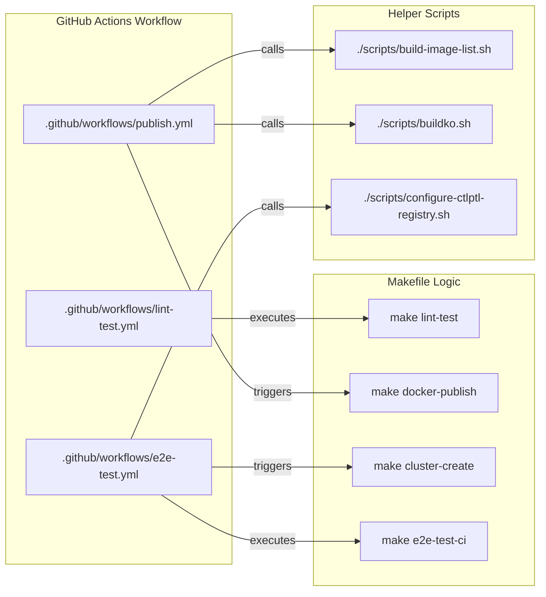

<!-- source: DeepWiki mcp.deepwiki.com · repo NVIDIA/NVSentinel · page 9.1 CI/CD Pipeline Overview · fetched 2026-10-26 -->

# CI/CD Pipeline Overview

Relevant source files

The following files were used as context for generating this wiki page:

- [.github/copy-pr-bot.yaml](.github/copy-pr-bot.yaml)
- [.github/dependabot.yml](.github/dependabot.yml)
- [.github/workflows/cleanup-untagged-images.yml](.github/workflows/cleanup-untagged-images.yml)
- [.github/workflows/code-scanning.yml](.github/workflows/code-scanning.yml)
- [.github/workflows/container-build-test.yml](.github/workflows/container-build-test.yml)
- [.github/workflows/e2e-test.yml](.github/workflows/e2e-test.yml)
- [.github/workflows/integration-aws.yml](.github/workflows/integration-aws.yml)
- [.github/workflows/integration-gcp.yml](.github/workflows/integration-gcp.yml)
- [.github/workflows/lint-test.yml](.github/workflows/lint-test.yml)
- [.github/workflows/publish.yml](.github/workflows/publish.yml)
- [.github/workflows/release.yml](.github/workflows/release.yml)
- [health-monitors/nic-health-monitor/Makefile](health-monitors/nic-health-monitor/Makefile)
- [health-monitors/nic-health-monitor/Tiltfile](health-monitors/nic-health-monitor/Tiltfile)
- [health-monitors/nic-health-monitor/main.go](health-monitors/nic-health-monitor/main.go)
- [health-monitors/nic-health-monitor/pkg/config/config.go](health-monitors/nic-health-monitor/pkg/config/config.go)

## Purpose and Scope

This document provides an overview of the complete CI/CD pipeline for NVSentinel, covering workflow triggers, quality gates, build stages, and artifact flows. The pipeline implements a multi-stage validation and release process with parallel execution, comprehensive testing across architectures and datastores, and integrated security scanning.

For detailed information on specific pipeline components, refer to:
- Lint and test workflows (page 9.2)
- E2E test matrix and validation strategies (page 9.3)
- Container build systems and multi-platform publishing (page 9.4)
- SBOM generation, attestations, and supply chain security (page 9.5)
- Build system, Makefile structure, and Ko configuration (page 9.6)
- Version management and synchronization (page 9.7)

## Workflow Trigger Matrix

The CI/CD system consists of several GitHub Actions workflows that execute based on different trigger conditions:

| Workflow | File | PR Branches | Main Branch | Tags | Schedule | Manual |
|----------|------|-------------|-------------|------|----------|--------|
| **Lint and Test** | `lint-test.yml` | ✓ | ✓ | ✓ | - | ✓ |
| **Container Build Validation** | `container-build-test.yml` | ✓ | - | - | - | ✓ |
| **E2E Tests** | `e2e-test.yml` | ✓ | ✓ | - | - | ✓ |
| **CodeQL Analysis** | `code-scanning.yml` | ✓ | ✓ | ✓ | - | ✓ |
| **Publish Containers** | `publish.yml` | - | ✓ | ✓ | - | ✓ |
| **Release** | `release.yml` | - | - | ✓ | - | ✓ |
| **Integration AWS** | `integration-aws.yml` | - | ✓ | - | Daily 08:00 UTC | ✓ |
| **Integration GCP** | `integration-gcp.yml` | - | ✓ | - | Daily 14:30 UTC | ✓ |
| **Cleanup Images** | `cleanup-untagged-images.yml`| - | - | - | Daily 00:00 UTC | ✓ |

**Sources:** [.github/workflows/lint-test.yml:17-24](), [.github/workflows/e2e-test.yml:26-31](), [.github/workflows/publish.yml:17-23](), [.github/workflows/release.yml:17-26](), [.github/workflows/code-scanning.yml:17-25](), [.github/workflows/container-build-test.yml:17-36](), [.github/workflows/integration-aws.yml:17-23](), [.github/workflows/integration-gcp.yml:17-23](), [.github/workflows/cleanup-untagged-images.yml:17-22]()

## Pipeline Stages and Dependencies

**Diagram: High-Level Workflow Architecture**

**Sources:** [.github/workflows/publish.yml:42-164](), [.github/workflows/release.yml:37-169](), [.github/workflows/lint-test.yml:40-110](), [.github/workflows/e2e-test.yml:41-82](), [.github/workflows/cleanup-untagged-images.yml:19-20]()

## Quality Gates for Pull Requests

The pull request pipeline implements parallel quality gates to minimize feedback time. All gates must pass before merging.

### Lint and Test Jobs

The `lint-test.yml` workflow executes multiple matrix jobs in parallel:

**simple-lint** (Matrix including):
- Component validation: `protos-lint`, `license-headers-lint`, `gomod-lint` [48-56]()
- Python/shell modules: `log-collector`, `gpu-reset`, `file-server-cleanup` [57-68]()
- Infrastructure: `kubernetes-distro-lint`, `helm-charts`, `postgres-schema` [69-77]()
- Scripts: shellcheck on all scripts in `scripts/` [78-80]()

**health-monitors-lint-test** (Matrix including):
- `syslog-health-monitor`: Go-based journalctl parser [118]()
- `csp-health-monitor`: Cloud provider API integration [119]()
- `kubernetes-object-monitor`: CEL policy evaluation [120]()
- `nic-health-monitor`: Network interface health monitoring [121]()
- `gpu-health-monitor`: Python DCGM bindings [122-125]()

**preflight-checks-lint-test**:
- `dcgm-diag`, `nccl-allreduce`, `nccl-loopback` [150-153]()

**modules-lint-test** (Matrix including):
- Core processing: `platform-connectors`, `health-events-analyzer`, `fault-quarantine`, `node-drainer`, `fault-remediation`, `janitor` [170-181]()
- Support services: `event-exporter`, `store-client`, `commons`, `data-models`, `labeler`, `metadata-collector` [171-179]()

Each matrix job executes `make -C <component> lint-test` (or similar) and uploads coverage artifacts [133-143, 191-201]().

**Sources:** [.github/workflows/lint-test.yml:41-210]()

### Container Build Validation

The `container-build-test.yml` workflow validates that all containers build successfully without publishing.

**container-build-test** (Matrix including):
Docker-based builds for:
- `gpu-health-monitor-dcgm3/4` [57-60]()
- `syslog-health-monitor` [61-62]()
- `log-collector` and `file-server-cleanup` [64-67]()
- Preflight checks and `gpu-reset` [69-80]()

**ko-build-test**:
Ko-based builds for Go services including `platform-connectors`, `health-events-analyzer`, `fault-quarantine`, `node-drainer`, `janitor`, etc [112-147]().

**Sources:** [.github/workflows/container-build-test.yml:48-160]()

### E2E Test Matrix

The `e2e-test.yml` workflow runs a matrix covering architecture and datastore combinations:

| Architecture | Datastore | Runner |
|--------------|-----------|--------|
| amd64 | mongodb | `linux-amd64-cpu32` |
| arm64 | mongodb | `linux-arm64-cpu32` |
| amd64 | mongodb-no-tls | `linux-amd64-cpu32` |
| arm64 | mongodb-no-tls | `linux-arm64-cpu32` |
| amd64 | postgresql | `linux-amd64-cpu32` |
| arm64 | postgresql | `linux-arm64-cpu32` |

Each job:
1. Creates isolated Kind cluster with unique suffix [151-153]()
2. Runs `make cluster-create` [153]()
3. Sets `USE_POSTGRESQL` or `DISABLE_TLS` based on matrix [168-170]()
4. Executes E2E tests [161]()

**Sources:** [.github/workflows/e2e-test.yml:42-171]()

## Code Entity Association

**Diagram: CI/CD Workflow to Build System Association**

**Sources:** [.github/workflows/lint-test.yml:133](), [.github/workflows/publish.yml:78](), [.github/workflows/publish.yml:160](), [.github/workflows/publish.yml:189](), [.github/workflows/e2e-test.yml:135](), [.github/workflows/e2e-test.yml:153](), [.github/workflows/e2e-test.yml:172]()

## Main Branch and Release Pipelines

### Publish and Release

The `publish.yml` and `release.yml` workflows handle the generation of final artifacts.

**Artifact Generation:**
1. **versions.txt**: Generated by `scripts/build-image-list.sh` [publish.yml:78](), [release.yml:67]().
2. **Container Images**: Built via Docker [publish.yml:156]() or Ko [publish.yml:189]().
3. **Helm Charts**: Packaged via `make -C distros/kubernetes helm-publish` [release.yml:125]().

**Sources:** [.github/workflows/publish.yml:72-194](), [.github/workflows/release.yml:62-125]()

### Cloud Integration Testing

Integration tests run on real CSP environments:

- **AWS Integration** (`integration-aws.yml`): Uses `eksctl` to create a cluster and runs UAT scripts [92, 143, 152]().
- **GCP Integration** (`integration-gcp.yml`): Uses Terraform to provision GKE and runs UAT scripts [92, 135, 144]().

**Sources:** [.github/workflows/integration-aws.yml:31-152](), [.github/workflows/integration-gcp.yml:31-144]()

## Security and Maintenance

### Supply Chain Security
Ko-built images are attested with SBOM and provenance using GitHub's attestation features [publish.yml:201-224]().

### Image Lifecycle Management
The `cleanup-untagged-images.yml` workflow targets GHCR packages like `nvsentinel/platform-connectors` and `nvsentinel/gpu-health-monitor` [58, 60](). It uses a retention policy to delete untagged images older than 30 days while keeping the 5 most recent untagged versions as a safety buffer [103-105]().

**Sources:** [.github/workflows/publish.yml:201-224](), [.github/workflows/cleanup-untagged-images.yml:47-111]()

---

