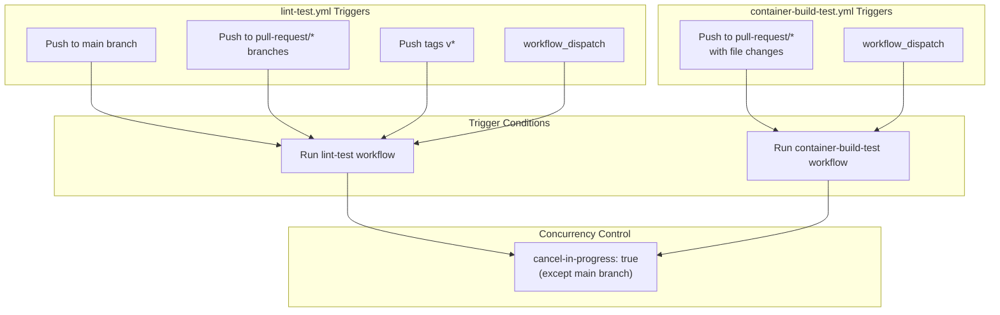
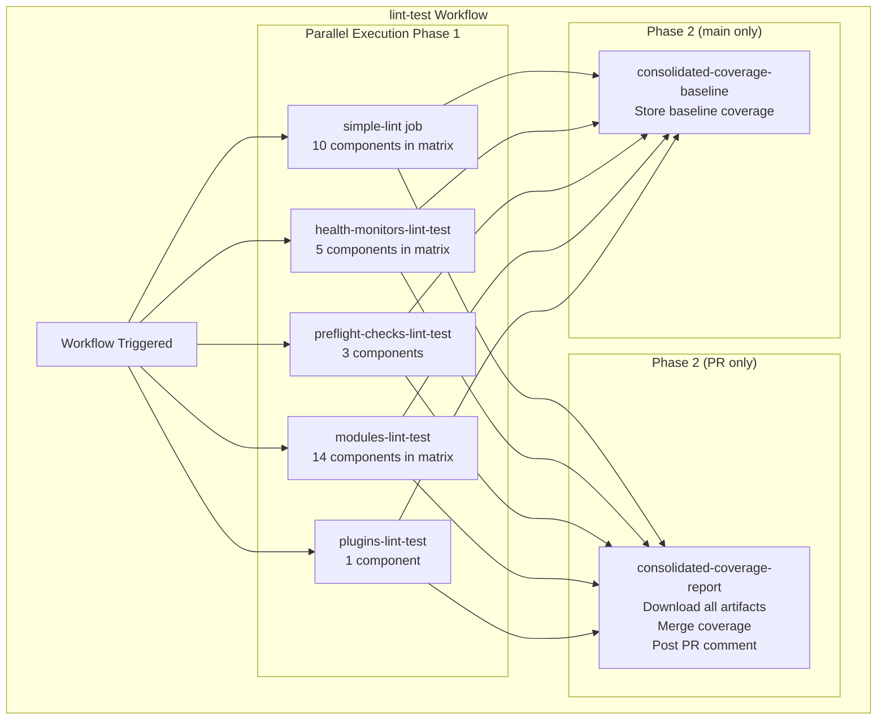
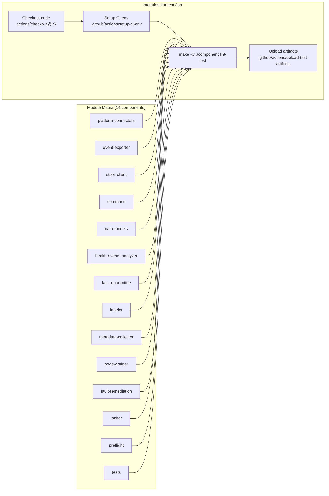
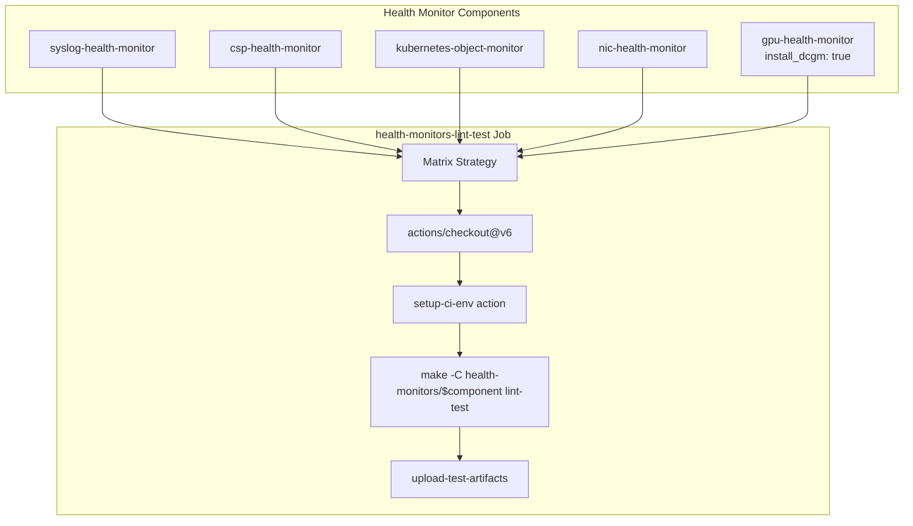
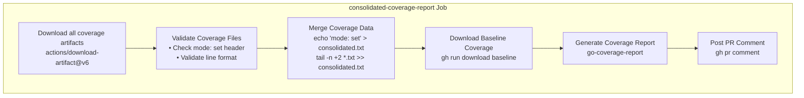
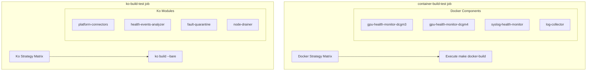

<!-- source: DeepWiki mcp.deepwiki.com · repo NVIDIA/NVSentinel · page 9.2 Lint and Test Workflows · fetched 2026-10-26 -->

# Lint and Test Workflows

Relevant source files

The following files were used as context for generating this wiki page:

- [.github/workflows/code-scanning.yml](.github/workflows/code-scanning.yml)
- [.github/workflows/container-build-test.yml](.github/workflows/container-build-test.yml)
- [.github/workflows/e2e-test.yml](.github/workflows/e2e-test.yml)
- [.github/workflows/integration-aws.yml](.github/workflows/integration-aws.yml)
- [.github/workflows/integration-gcp.yml](.github/workflows/integration-gcp.yml)
- [.github/workflows/lint-test.yml](.github/workflows/lint-test.yml)
- [.github/workflows/publish.yml](.github/workflows/publish.yml)
- [.github/workflows/release.yml](.github/workflows/release.yml)
- [labeler/go.mod](labeler/go.mod)
- [labeler/go.sum](labeler/go.sum)
- [tests/go.mod](tests/go.mod)
- [tests/go.sum](tests/go.sum)

## Purpose and Scope

The lint and test workflows provide automated quality gates that run on every pull request and push to validate code quality, correctness, and build integrity. These workflows execute linting checks, unit tests, and coverage reporting for all Go, Python, and shell components in the codebase. This page documents the linting and unit testing workflows defined in [.github/workflows/lint-test.yml]() and [.github/workflows/container-build-test.yml](). For end-to-end testing, see [End-to-End Testing (9.3)](). For security scanning workflows, see [Security and Supply Chain (9.5)]().

**Sources**: [.github/workflows/lint-test.yml:1-456](), [.github/workflows/container-build-test.yml:1-174]()

---

## Workflow Triggers and Concurrency Control

### Trigger Configuration

Title: Workflow Trigger and Concurrency Logic

The `lint-test.yml` workflow executes on all pushes to `main` and pull request branches matching the pattern `pull-request/[0-9]+` [.github/workflows/lint-test.yml:18-21](). The workflow also triggers on version tags (`v*`) and supports manual dispatch via `workflow_dispatch` [.github/workflows/lint-test.yml:22-24](). The `container-build-test.yml` workflow runs on pull request branches when files affecting container builds (Dockerfiles, Go/Python sources, Makefiles) are modified [.github/workflows/container-build-test.yml:18-31]().

Concurrency control uses `group: ${{ github.workflow }}-${{ github.ref }}` with `cancel-in-progress` set to true for all branches except `main` [.github/workflows/lint-test.yml:26-28](), ensuring that new pushes to a PR automatically cancel older workflow runs to save resources.

**Sources**: [.github/workflows/lint-test.yml:17-28](), [.github/workflows/container-build-test.yml:17-40]()

---

## Job Architecture and Parallelization

### Lint and Test Job Matrix

Title: Parallel Job Execution Flow

The workflow executes in two phases. Phase 1 runs five parallel jobs using matrix strategies. The `simple-lint` job validates 10 components including protos, license headers, and Helm charts [.github/workflows/lint-test.yml:41-80](). The `health-monitors-lint-test` job tests 5 monitor implementations [.github/workflows/lint-test.yml:111-125](). The `modules-lint-test` job validates 14 Go modules [.github/workflows/lint-test.yml:163-184](). 

Phase 2 executes conditionally after Phase 1 completes. For pull requests, the `consolidated-coverage-report` job downloads all coverage artifacts, merges them, and posts a PR comment [.github/workflows/lint-test.yml:226-234](). For pushes to `main`, the `consolidated-coverage-baseline` job stores the merged coverage as a baseline [.github/workflows/lint-test.yml:423-424]().

**Sources**: [.github/workflows/lint-test.yml:40-456]()

---

## Component Linting Pipeline

### Simple Lint Job Matrix

| Component | Make Command | Description |
|-----------|-------------|-------------|
| `protos` | `make protos-lint` | Validates Protocol Buffer definitions using `buf` [.github/workflows/lint-test.yml:48-49]() |
| `license-headers` | `make license-headers-lint` | Checks Apache 2.0 license headers in all source files [.github/workflows/lint-test.yml:51-52]() |
| `gomod` | `make gomod-lint` | Validates `go.mod` consistency across all Go modules [.github/workflows/lint-test.yml:54-55]() |
| `log-collector` | `make -C log-collector lint-log-collector` | Lints Python code in log-collector [.github/workflows/lint-test.yml:57-58]() |
| `gpu-reset` | `make -C gpu-reset lint` | Lints the GPU reset utility [.github/workflows/lint-test.yml:61-62]() |
| `kubernetes-distro` | `make kubernetes-distro-lint` | Validates Kubernetes manifest syntax [.github/workflows/lint-test.yml:69-70]() |
| `helm-charts` | `make helm-lint` | Validates Helm chart templates and values [.github/workflows/lint-test.yml:72-73]() |
| `postgres-schema` | `make validate-postgres-schema` | Ensures PostgreSQL schema migrations are consistent [.github/workflows/lint-test.yml:75-76]() |
| `scripts` | `make -C scripts lint` | Runs `shellcheck` on all shell scripts [.github/workflows/lint-test.yml:78-79]() |

The `simple-lint` job executes these validation tasks in parallel on `linux-amd64-cpu16` runners [.github/workflows/lint-test.yml:43](). The job uses the `.github/actions/setup-ci-env` composite action to prepare the build environment [.github/workflows/lint-test.yml:85]().

**Sources**: [.github/workflows/lint-test.yml:41-110]()

---

### Go Module Linting and Testing

Title: Go Module Test Pipeline

The `modules-lint-test` job executes `make lint-test` for each Go module [.github/workflows/lint-test.yml:191](). Each module generates three artifacts: `coverage.xml`, `coverage.txt`, and `report.xml` [.github/workflows/lint-test.yml:198-200](). The matrix includes core Go services: `platform-connectors`, `health-events-analyzer`, `fault-quarantine`, `node-drainer`, and `fault-remediation` [.github/workflows/lint-test.yml:170-184]().

**Sources**: [.github/workflows/lint-test.yml:163-201](), [platform-connectors/go.mod:1-120](), [fault-quarantine/go.mod:1-121](), [fault-remediation/go.mod:1-119]()

---

### Python Health Monitor Testing

Title: Health Monitor Testing Strategy

The `health-monitors-lint-test` job tests five monitor implementations [.github/workflows/lint-test.yml:118-122](). The `gpu-health-monitor` component requires `install_dcgm: 'true'` to provide libraries needed for testing GPU monitoring logic [.github/workflows/lint-test.yml:123](). Each monitor's Makefile includes a `lint-test` target [.github/workflows/lint-test.yml:133]().

**Sources**: [.github/workflows/lint-test.yml:111-143](), [health-monitors/syslog-health-monitor/go.mod:1-20]()

---

## Coverage Consolidation and Reporting

### Coverage File Merging Process

Title: Coverage Consolidation Pipeline

The `consolidated-coverage-report` job implements a multi-stage pipeline [.github/workflows/lint-test.yml:226-391](). It downloads all coverage artifacts using the pattern `*-results` [.github/workflows/lint-test.yml:236-239](). It merges all valid coverage data by initializing a file with `mode: set` and appending data lines [.github/workflows/lint-test.yml:247-262]().

For baseline comparison, the job queries the GitHub API to find the most recent successful run on the `main` branch and downloads the `consolidated-code-coverage` artifact [.github/workflows/lint-test.yml:281-304](). The `go-coverage-report` tool generates a markdown report comparing coverage [.github/workflows/lint-test.yml:335-345]().

**Sources**: [.github/workflows/lint-test.yml:226-391]()

---

## Container Build Validation

### Docker and Ko Build Matrices

Title: Container Build Validation Matrix

The `container-build-test` workflow validates Docker-based builds for components like `gpu-health-monitor` (variants for DCGM 3.x and 4.x) and `log-collector` [.github/workflows/container-build-test.yml:57-77](). The `ko-build-test` job validates Go services like `platform-connectors`, `health-events-analyzer`, and `fault-quarantine` for both `linux/amd64` and `linux/arm64` [.github/workflows/container-build-test.yml:117-154]().

**Sources**: [.github/workflows/container-build-test.yml:48-157]()

---

## Integration and Release Workflows

### Integration Tests (CSP)

Integration tests are executed against real Cloud Service Provider (CSP) environments to ensure the `csp-health-monitor` and `janitor` modules function correctly under live conditions.

*   **AWS Integration**: Executes daily and on manual dispatch [.github/workflows/integration-aws.yml:17-20](). It provisions an EKS cluster using `eksctl` [.github/workflows/integration-aws.yml:67-92](), installs NVSentinel via `tests/uat/install-apps.sh` [.github/workflows/integration-aws.yml:143](), and runs User Acceptance Tests (UAT) [.github/workflows/integration-aws.yml:152]().
*   **GCP Integration**: Executes daily and on manual dispatch [.github/workflows/integration-gcp.yml:17-20](). It uses Terraform to provision GKE clusters with specific GPU node pools (e.g., `a3-megagpu-8g`) [.github/workflows/integration-gcp.yml:48-92]().

### Release and Publishing

When a new version tag (`v*`) is pushed, the release pipeline is triggered:

1.  **Container Publishing**: The `publish.yml` workflow builds and pushes multi-platform images to GHCR [.github/workflows/publish.yml:15-180](). It uses `ko` for Go services and standard `docker` builds for monitors and utilities [.github/workflows/publish.yml:88-166]().
2.  **Helm Publishing**: The `release.yml` workflow packages the Helm chart and publishes it to the OCI registry at `ghcr.io/nvidia/nvsentinel` [.github/workflows/release.yml:77-126]().
3.  **GitHub Release**: Creates a formal GitHub release containing the `versions.txt` artifact which maps component names to specific container image tags [.github/workflows/release.yml:141-168]().

**Sources**: [.github/workflows/integration-aws.yml:1-173](), [.github/workflows/integration-gcp.yml:1-164](), [.github/workflows/publish.yml:1-180](), [.github/workflows/release.yml:1-169]()

---

## Environment and Tooling

### CI Environment Setup

The workflows use the `.github/actions/setup-ci-env` composite action for consistent environment preparation [.github/workflows/lint-test.yml:85, 130, 158, 188](). This action configures Go module caching using `GOPATH: /home/runner/go` and `GOCACHE: /home/runner/.cache/go-build` [.github/workflows/lint-test.yml:37-38]().

### Runner Configuration

| Job Type | Runner | Timeout |
|----------|--------|---------|
| `simple-lint` | `linux-amd64-cpu16` | 30 min [.github/workflows/lint-test.yml:43-44]() |
| `modules-lint-test` | `linux-amd64-cpu16` | 30 min [.github/workflows/lint-test.yml:165-166]() |
| `container-build-test` | `linux-amd64-cpu32` | 45 min [.github/workflows/container-build-test.yml:50-51]() |
| `ko-build-test` | `linux-amd64-cpu32` | 30 min [.github/workflows/container-build-test.yml:111-112]() |

**Sources**: [.github/workflows/lint-test.yml:40-195](), [.github/workflows/container-build-test.yml:48-157]()

---

