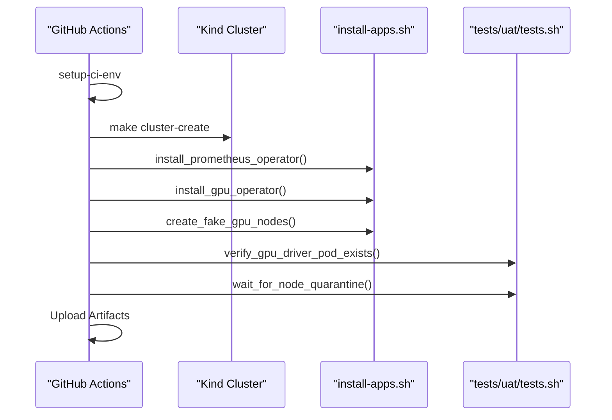

<!-- source: DeepWiki mcp.deepwiki.com · repo NVIDIA/NVSentinel · page 9.3 End-to-End Testing · fetched 2026-10-26 -->

# End-to-End Testing

<details>
<summary>Relevant source files</summary>

The following files were used as context for generating this wiki page:

- [.coderabbit.yaml](.coderabbit.yaml)
- [.github/workflows/code-scanning.yml](.github/workflows/code-scanning.yml)
- [.github/workflows/container-build-test.yml](.github/workflows/container-build-test.yml)
- [.github/workflows/e2e-test.yml](.github/workflows/e2e-test.yml)
- [.github/workflows/integration-aws.yml](.github/workflows/integration-aws.yml)
- [.github/workflows/integration-gcp.yml](.github/workflows/integration-gcp.yml)
- [.github/workflows/lint-test.yml](.github/workflows/lint-test.yml)
- [.github/workflows/publish.yml](.github/workflows/publish.yml)
- [.github/workflows/release.yml](.github/workflows/release.yml)
- [SECURITY.md](SECURITY.md)
- [health-monitors/syslog-health-monitor/pkg/syslog-monitor/syslogmonitor.go](health-monitors/syslog-health-monitor/pkg/syslog-monitor/syslogmonitor.go)
- [tests/scale_test.go](tests/scale_test.go)
- [tests/uat/README.md](tests/uat/README.md)
- [tests/uat/aws/eks-cluster-config.yaml.template](tests/uat/aws/eks-cluster-config.yaml.template)
- [tests/uat/aws/nvsentinel-values.yaml](tests/uat/aws/nvsentinel-values.yaml)
- [tests/uat/gcp/nvsentinel-values.yaml](tests/uat/gcp/nvsentinel-values.yaml)
- [tests/uat/install-apps.sh](tests/uat/install-apps.sh)
- [tests/uat/kind/nvsentinel-values.yaml](tests/uat/kind/nvsentinel-values.yaml)
- [tests/uat/run.sh](tests/uat/run.sh)
- [tests/uat/tests.sh](tests/uat/tests.sh)

</details>


## Purpose and Scope

This document describes NVSentinel's end-to-end (E2E) testing infrastructure, which validates complete workflows from health event detection through quarantine, drain, and remediation. E2E tests run in isolated Kind clusters with simulated GPU nodes using KWOK, testing all components together under realistic conditions.

For unit and integration testing practices, see [Testing Strategy](#10.3). For test execution in CI workflows, see [Lint and Test Workflows](#9.2). For local test development, see [Writing and Running Tests](#10.4).

**Coverage**: E2E tests validate critical workflows including:
- Health Events Analyzer pattern detection (XID burst detection, multiple remediations)
- Fault Quarantine node cordoning with circuit breaker logic
- Node Drainer pod eviction with namespace-specific strategies
- Fault Remediation CR creation with equivalence groups and log collection
- CSP Health Monitor maintenance event handling
- Kubernetes Object Monitor policy evaluation
- Cross-component integration scenarios

Sources: [.github/workflows/e2e-test.yml:15-25]()

## E2E Test Matrix Architecture

E2E tests execute in a comprehensive matrix testing multiple dimensions to ensure compatibility across hardware architectures and database backends.

**Test Matrix Dimension Diagram**
```mermaid
graph TB
    subgraph "Matrix_Dimensions"
        [E2E_Matrix] --> [AMD64_Mongo]
        [E2E_Matrix] --> [ARM64_Mongo]
        [E2E_Matrix] --> [AMD64_Mongo_NoTLS]
        [E2E_Matrix] --> [ARM64_Mongo_NoTLS]
        [E2E_Matrix] --> [AMD64_Postgres]
        [E2E_Matrix] --> [ARM64_Postgres]
    end
    
    subgraph "Environment_Setup"
        [Kind_Cluster] --> [KWOK_Simulation]
        [KWOK_Simulation] --> [NVSentinel_Tilt]
    end
    
    subgraph "Test_Execution_Entities"
        [NVSentinel_Tilt] --> [HealthEventsAnalyzer_Test]
        [NVSentinel_Tilt] --> [FaultQuarantine_Test]
        [NVSentinel_Tilt] --> [NodeDrainer_Test]
        [NVSentinel_Tilt] --> [FaultRemediation_Test]
    end

    [AMD64_Mongo] --- [Kind_Cluster]
    [ARM64_Mongo] --- [Kind_Cluster]
    [AMD64_Postgres] --- [Kind_Cluster]
```

**Test Matrix Dimensions**:

| Dimension | Values | Purpose |
|-----------|--------|---------|
| Architecture | `amd64`, `arm64` | Validate multi-platform container images [[.github/workflows/e2e-test.yml:49-78]()] |
| Datastore | `mongodb`, `mongodb-no-tls`, `postgresql` | Validate cross-database compatibility [[.github/workflows/e2e-test.yml:52-77]()] |
| Runner | `linux-amd64-cpu32`, `linux-arm64-cpu32` | Use high-performance self-hosted runners [[.github/workflows/e2e-test.yml:50-76]()] |
| Cluster Name | `nvsentinel-e2e-{arch}-{datastore}` | Unique cluster per matrix combination [[.github/workflows/e2e-test.yml:151-166]()] |

Sources: [.github/workflows/e2e-test.yml:42-81]()

## Test Infrastructure Components

### Kind Cluster Setup

E2E tests use Kind (Kubernetes in Docker) to create isolated multi-node Kubernetes clusters. The workflow includes specific system-level prep to handle high-density node simulation.

**Cluster Preparation Workflow**
```mermaid
graph LR
    subgraph "Host_Preparation"
        [sysctl_Config] --> [IPTables_Reset]
        [IPTables_Reset] --> [Docker_Restart]
    end
    
    subgraph "Cluster_Lifecycle"
        [ctlptl_apply] --> [Local_Registry]
        [ctlptl_apply] --> [Kind_Cluster_Node]
    end
    
    subgraph "Node_Simulation"
        [Kind_Cluster_Node] --> [KWOK_Controller]
        [KWOK_Controller] --> [Fake_GPU_Nodes]
    end
```

**Key Configuration Steps**:

1. **System Preparation** ([.github/workflows/e2e-test.yml:102-121]()):
   - Stop AppArmor to prevent profile conflicts.
   - Configure network forwarding (`net.ipv4.ip_forward=1`) and bridge-nf settings for multi-node Kind.
   - Set high inotify limits (`fs.inotify.max_user_watches=524288`) for file watching on large simulated clusters.
   - Reset iptables to a clean state to avoid networking interference.

2. **Cluster Creation** ([.github/workflows/e2e-test.yml:146-153]()):
   - `make cluster-create` uses `.ctlptl.yaml` configuration.
   - `CLUSTER_NAME_SUFFIX` ensures unique clusters for parallel jobs.

3. **Database Selection** ([.github/workflows/e2e-test.yml:161-170]()):
   - `USE_POSTGRESQL` environment variable toggles the database backend.
   - `DISABLE_TLS` toggles security modes for MongoDB.
   - ARM64 uses an alternative MongoDB image: `dlavrenuek/bitnami-mongodb-arm` ([.github/workflows/e2e-test.yml:155-159]()).

Sources: [.github/workflows/e2e-test.yml:102-170]()

## Test Helper Functions and Utilities

The testing framework provides reusable utilities for validating node states and health monitor health.

### Node Selection and Management

| Function | Purpose | Implementation Detail |
|----------|---------|-----------------------|
| `get_gpu_node_with_healthy_monitor` | Selects a node running a specific monitor | Filters by `app.kubernetes.io/name` and `Running` status [[tests/uat/tests.sh:65-91]()] |
| `is_node_ready_and_uncordoned` | Validates node availability | Checks `.status.conditions` for Ready=True and `.spec.unschedulable` [[tests/uat/tests.sh:37-63]()] |
| `wait_for_node_condition` | Polls for specific node condition | Uses `jq` to filter `.status.conditions` until match or timeout [[tests/uat/tests.sh:121-144]()] |
| `wait_for_node_quarantine` | Validates cordoning | Checks `.spec.unschedulable == true` [[tests/uat/tests.sh:176-197]()] |

Sources: [tests/uat/tests.sh:37-197]()

### Health Monitor Verification

E2E tests verify that monitors are correctly initialized and processing data from the system journal.

**Syslog Monitor Internal Logic**
```mermaid
graph TD
    subgraph "syslogmonitor_go_Entity_Space"
        [NewSyslogMonitor] --> [initHandlers]
        [initHandlers] --> [xid_NewXIDHandler]
        [initHandlers] --> [sxid_NewSXIDHandler]
        [initHandlers] --> [gpufallen_NewGPUFallenHandler]
        [NewSyslogMonitor] --> [handleBootIDChange]
        [Run] --> [executeCheck]
    end
    
    subgraph "Journal_Data_Flow"
        [JournalFactory] --> [Journal_Cursor]
        [Journal_Cursor] --> [executeCheck]
    end
```

**Key Verification Steps**:
- **Boot ID Tracking**: The `SyslogMonitor` tracks the system `boot_id` via `fetchCurrentBootID` to detect reboots and reset cursors [[health-monitors/syslog-health-monitor/pkg/syslog-monitor/syslogmonitor.go:82-113]()].
- **Handler Initialization**: Each check (e.g., `XIDErrorCheck`) is mapped to a specific handler that parses journal entries via `initHandlerForCheck` [[health-monitors/syslog-health-monitor/pkg/syslog-monitor/syslogmonitor.go:150-190]()].

Sources: [health-monitors/syslog-health-monitor/pkg/syslog-monitor/syslogmonitor.go:41-190]()

## E2E Test Workflow Execution

### CI/CD Pipeline Integration

The E2E tests are integrated into the main CI pipeline and triggered on PRs and merges to main.

**Execution Sequence**


**Execution Steps**:
1. **Tool Installation**: Installs `kind`, `kubectl`, `helm`, and `yq` via the `install-e2e-tools` action [[.github/workflows/e2e-test.yml:123-125]()].
2. **App Installation**: The `tests/uat/install-apps.sh` script handles the deployment of dependencies like `kube-prometheus-stack`, `cert-manager`, and `gpu-operator` [[tests/uat/install-apps.sh:88-181]()].
3. **Simulation**: `install_kwok` and `create_fake_gpu_nodes` provide the hardware-agnostic testbed by generating nodes with `nvidia.com/gpu.present=true` labels [[tests/uat/install-apps.sh:134-179]()].
4. **Validation**: `tests/uat/tests.sh` executes the actual test logic, such as waiting for node conditions and verifying driver pod presence in the `gpu-operator` namespace [[tests/uat/tests.sh:102-118]()].

Sources: [.github/workflows/e2e-test.yml:123-153](), [tests/uat/install-apps.sh:88-181](), [tests/uat/tests.sh:102-118]()

## Debugging and Artifacts

When E2E tests fail, the workflow collects comprehensive debug data.

**Collected Artifacts**:
- **JUnit Reports**: XML files for test visualization [[.github/workflows/e2e-test.yml:164-171]()].
- **Kind Logs**: Exported cluster state via `kind export logs` [[.github/workflows/e2e-test.yml:173-180]()].
- **Container Logs**: Detailed logs pulled from all Kind containers [[.github/workflows/e2e-test.yml:182-194]()].
- **Cluster Dump**: Full `kubectl cluster-info dump` and resource lists collected only on failure [[.github/workflows/e2e-test.yml:196-229]()].

Sources: [.github/workflows/e2e-test.yml:164-229]()

## Integration Testing - Cloud Providers (AWS & GCP)

NVSentinel runs daily integration tests on real AWS EKS and GCP GKE clusters to validate CSP-specific logic.

**Cloud Integration Matrix**:
- **AWS**: Uses `eksctl` to provision clusters and validates integration with AWS-specific health events [[.github/workflows/integration-aws.yml:67-92]()].
- **GCP**: Uses Terraform for provisioning and validates GKE-specific behaviors [[.github/workflows/integration-gcp.yml:84-93]()].

**Key Procedures**:
- **Authentication**: Uses OIDC-based role assumption for secure cloud access [[.github/workflows/integration-aws.yml:58-64](), [.github/workflows/integration-gcp.yml:71-78]()].
- **Cleanup**: Meticulous cleanup logic (e.g., `delete-eks-cluster.sh`) ensures no orphaned CloudFormation stacks or OIDC providers remain [[.github/workflows/integration-aws.yml:155-163]()].

Sources: [.github/workflows/integration-aws.yml:15-173](), [.github/workflows/integration-gcp.yml:15-163]()

---

