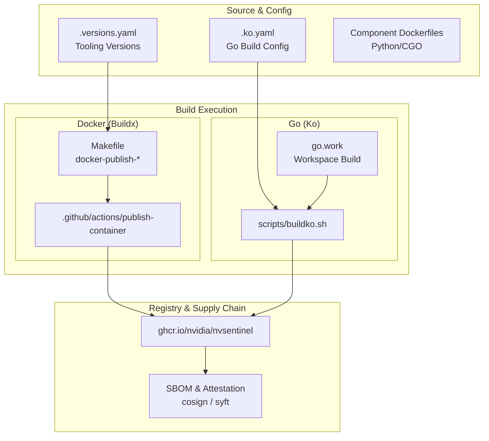
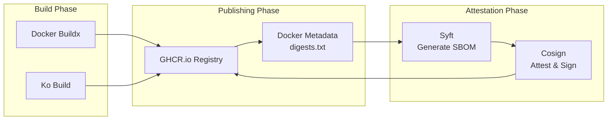

<!-- source: DeepWiki mcp.deepwiki.com · repo NVIDIA/NVSentinel · page 9.4 Container Build and Publishing · fetched 2026-10-26 -->

# Container Build and Publishing

<details>
<summary>Relevant source files</summary>

The following files were used as context for generating this wiki page:

- [.github/actions/publish-container/action.yml](.github/actions/publish-container/action.yml)
- [.github/actions/sbom-and-attest/action.yml](.github/actions/sbom-and-attest/action.yml)
- [.github/actions/setup-ci-env/action.yml](.github/actions/setup-ci-env/action.yml)
- [.gitignore](.gitignore)
- [.ko.yaml](.ko.yaml)
- [.versions.yaml](.versions.yaml)
- [Makefile](Makefile)
- [demos/local-custom-remediation-demo/memory-pressure-monitor/Dockerfile](demos/local-custom-remediation-demo/memory-pressure-monitor/Dockerfile)
- [demos/local-custom-remediation-demo/memory-reclaim-controller/Dockerfile](demos/local-custom-remediation-demo/memory-reclaim-controller/Dockerfile)
- [distros/kubernetes/nvsentinel/charts/preflight/templates/mutatingwebhook.yaml](distros/kubernetes/nvsentinel/charts/preflight/templates/mutatingwebhook.yaml)
- [distros/kubernetes/nvsentinel/charts/preflight/tests/mutatingwebhook_test.yaml](distros/kubernetes/nvsentinel/charts/preflight/tests/mutatingwebhook_test.yaml)
- [distros/kubernetes/nvsentinel/policies/must-have-sbom.yaml](distros/kubernetes/nvsentinel/policies/must-have-sbom.yaml)
- [distros/kubernetes/nvsentinel/policies/must-have-slsa.yaml](distros/kubernetes/nvsentinel/policies/must-have-slsa.yaml)
- [gpu-reset/Dockerfile](gpu-reset/Dockerfile)
- [health-monitors/gpu-health-monitor/Dockerfile](health-monitors/gpu-health-monitor/Dockerfile)
- [health-monitors/syslog-health-monitor/Dockerfile](health-monitors/syslog-health-monitor/Dockerfile)
- [log-collector/Dockerfile](log-collector/Dockerfile)
- [log-collector/Dockerfile.cleanup](log-collector/Dockerfile.cleanup)
- [make/docker.mk](make/docker.mk)
- [metadata-collector/Dockerfile](metadata-collector/Dockerfile)
- [preflight-checks/dcgm-diag/Dockerfile](preflight-checks/dcgm-diag/Dockerfile)
- [preflight-checks/nccl-allreduce/Dockerfile](preflight-checks/nccl-allreduce/Dockerfile)
- [preflight-checks/nccl-loopback/Dockerfile](preflight-checks/nccl-loopback/Dockerfile)
- [scripts/build-image-list.sh](scripts/build-image-list.sh)
- [scripts/buildko.sh](scripts/buildko.sh)
- [scripts/check-image-attestations.sh](scripts/check-image-attestations.sh)
- [scripts/verify-image-provenance.sh](scripts/verify-image-provenance.sh)
- [tilt/csp-api-mock/Dockerfile](tilt/csp-api-mock/Dockerfile)
- [tilt/event-exporter-mock/Dockerfile](tilt/event-exporter-mock/Dockerfile)
- [tilt/event-exporter-mock/go.mod](tilt/event-exporter-mock/go.mod)
- [tilt/simple-health-client/Dockerfile](tilt/simple-health-client/Dockerfile)

</details>


This page documents NVSentinel's container build and publishing pipeline, including dual build strategies (Ko for Go, Docker for Python/CGO), multi-platform image generation, registry publishing, and SBOM attestation.

---

## Overview

NVSentinel employs a **dual build strategy** to optimize for different language ecosystems and dependency requirements:

| Build System | Language | Components | Base Image | Output Type |
|-------------|----------|------------|------------|-------------|
| **Ko** | Go | 15+ services | `cgr.dev/chainguard/static:latest` | Distroless OCI |
| **Docker Buildx** | Python, CGO | 10+ components | `nvidia/cuda`, `nvidia/pytorch`, `debian` | Layered Docker |

**Key characteristics:**
- **Multi-platform**: Images are built for `linux/amd64` and `linux/arm64` [[.ko.yaml:17](), [.github/actions/publish-container/action.yml:45-49]()].
- **Registry**: Primary publishing target is `ghcr.io/nvidia/nvsentinel` [[.github/actions/publish-container/action.yml:61-63]()].
- **Tooling Single Source of Truth**: All build tool versions (Ko, Docker Buildx, Go, Python) are managed in `.versions.yaml` [[.versions.yaml:33-71]()] and loaded via Makefile [[Makefile:23-38]()].
- **Security**: Automated SBOM generation and provenance attestation via Sigstore/Cosign [[.github/actions/publish-container/action.yml:116-121]()].

**Sources:** [.ko.yaml:15-18](), [.versions.yaml:1-88](), [.github/actions/publish-container/action.yml:1-121]()

---

## Build Architecture



**Workflow logic:**
1. **Tooling Setup**: The Makefile uses `yq` to parse `.versions.yaml` and ensure consistent versions of `ko` and `docker_buildx` across environments [[Makefile:17-38]()].
2. **Go Services**: Services listed in `GO_MODULES` [[Makefile:41-57]()] are typically built via Ko for minimal footprints.
3. **Complex Services**: Services requiring system libraries (like `syslog-health-monitor` requiring `libsystemd-dev`) or GPU drivers (like `gpu-health-monitor`) use traditional Dockerfiles [[health-monitors/syslog-health-monitor/Dockerfile:43-46](), health-monitors/gpu-health-monitor/Dockerfile:43-54]()].

**Sources:** [Makefile:15-58](), [.versions.yaml:67-71](), [scripts/buildko.sh:1-93]()

---

## Ko Build System (Go Services)

Ko is used to produce minimal, secure, distroless images for Go-based services without requiring a local Docker daemon or complex Dockerfiles.

### Ko Configuration

The `.ko.yaml` file defines the build parameters for every Go module in the repository.

```yaml
defaultBaseImage: cgr.dev/chainguard/static:latest
platforms: [linux/amd64, linux/arm64]
env: [CGO_ENABLED=0]

builds:
  - id: fault-quarantine
    dir: fault-quarantine
    main: .
    ldflags:
      - "-s -w"
      - "-X main.version={{.Env.VERSION}} -X main.commit={{.Env.GIT_COMMIT}} -X main.date={{.Env.BUILD_DATE}}"
```

**Key Elements:**
- **Base Image**: Uses Chainguard's static image to minimize the attack surface [[.ko.yaml:16]()].
- **LDFlags**: Injects versioning metadata directly into the binaries during the build [[.ko.yaml:24-26]()].
- **Multi-platform**: Configured for both `amd64` and `arm64` architectures [[.ko.yaml:17]()].

### buildko.sh Implementation
The `scripts/buildko.sh` script automates the build of the entire Go workspace.

1. **Workspace Sync**: It ensures a `go.work` file exists and includes all 15+ Go modules [[scripts/buildko.sh:40-58]()].
2. **Parallel Build**: Executes `ko build` across the entire suite of Go services [[scripts/buildko.sh:60-75]()].
3. **Digest Capture**: Outputs `digests.txt` which is then converted to `images.json` for downstream attestation steps [[scripts/buildko.sh:80-92]()].

**Sources:** [.ko.yaml:1-274](), [scripts/buildko.sh:1-93]()

---

## Docker Build System (Complex Services)

For services with non-Go dependencies, NVSentinel uses standard Dockerfiles orchestrated by GitHub Actions and Makefiles.

### Specialized Base Images
NVSentinel utilizes specific base images to ensure compatibility with NVIDIA hardware:

- **DCGM-based**: `gpu-health-monitor` and `preflight-dcgm-diag` use `nvcr.io/nvidia/cloud-native/dcgm` [[health-monitors/gpu-health-monitor/Dockerfile:43](), preflight-checks/dcgm-diag/Dockerfile:41]()].
- **PyTorch/NCCL**: `nccl-loopback` and `nccl-allreduce` use `nvcr.io/nvidia/pytorch` for optimized communication libraries [[preflight-checks/nccl-loopback/Dockerfile:66](), preflight-checks/nccl-allreduce/Dockerfile:66]()].
- **Systemd**: `syslog-health-monitor` uses `debian:trixie-slim` to access `libsystemd0` [[health-monitors/syslog-health-monitor/Dockerfile:52-57]()].

### Publish Composite Action
The `.github/actions/publish-container` action encapsulates the Docker build logic:

- **Buildx Setup**: Configures the Docker buildx driver with `network=host` [[.github/actions/publish-container/action.yml:45-49]()].
- **Layer Caching**: Uses a local directory `/tmp/.buildx-cache` to persist layers across CI runs [[.github/actions/publish-container/action.yml:50-57]()].
- **Digest Extraction**: Uses `jq` to parse the `DOCKER_METADATA_FILE` to get the precise image digest for attestation [[.github/actions/publish-container/action.yml:79-84]()].

**Sources:** [health-monitors/gpu-health-monitor/Dockerfile:1-70](), [health-monitors/syslog-health-monitor/Dockerfile:1-65](), [.github/actions/publish-container/action.yml:1-121]()

---

## Publishing and Supply Chain



### SBOM and Attestation
NVSentinel enforces a secure supply chain by attaching a Software Bill of Materials (SBOM) to every published image.

- **Trigger**: Immediately follows the container push in the `publish-container` action [[.github/actions/publish-container/action.yml:116-121]()].
- **Data Flow**: The image digest is passed to the `sbom-and-attest` action, which uses `syft` to scan the image layers and `cosign` to upload the attestation to the registry [[.github/actions/publish-container/action.yml:119-120]()].

### Disk Space Management
Given the large size of GPU-enabled images (e.g., PyTorch base images), the publishing workflow includes aggressive cleanup steps to prevent runner disk exhaustion:
- Removes Android, Dotnet, and CodeQL tools [[.github/actions/publish-container/action.yml:35-44]()].
- Prunes Docker system and buildx cache immediately after push [[.github/actions/publish-container/action.yml:100-114]()].

**Sources:** [.github/actions/publish-container/action.yml:35-121](), [preflight-checks/nccl-loopback/Dockerfile:66-85]()

---

## Summary of Containerized Modules

| Module | Build System | Base Image | Purpose |
| :--- | :--- | :--- | :--- |
| `metadata-collector` | Docker | `cuda:13.2.0-base` | Collects GPU topology [[metadata-collector/Dockerfile:34]()] |
| `syslog-health-monitor` | Docker | `debian:trixie-slim` | Parses journald logs [[health-monitors/syslog-health-monitor/Dockerfile:52]()] |
| `gpu-health-monitor` | Docker | `dcgm:4.4.2-1` | DCGM health checks [[health-monitors/gpu-health-monitor/Dockerfile:43]()] |
| `nccl-loopback` | Docker | `pytorch:26.03-py3` | GPU interconnect tests [[preflight-checks/nccl-loopback/Dockerfile:66]()] |
| `fault-quarantine` | Ko | `chainguard/static` | Node cordoning [[.ko.yaml:21]()] |
| `platform-connectors` | Ko | `chainguard/static` | gRPC event gateway [[.ko.yaml:207]()] |

**Sources:** [metadata-collector/Dockerfile:1-45](), [health-monitors/syslog-health-monitor/Dockerfile:51-65](), [.ko.yaml:20-274]()

---

