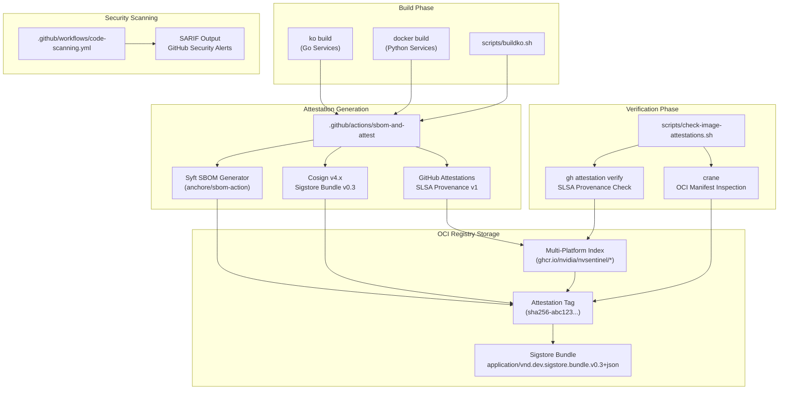

<!-- source: DeepWiki mcp.deepwiki.com · repo NVIDIA/NVSentinel · page 9.5 Security and Supply Chain · fetched 2026-10-26 -->

# Security and Supply Chain

<details>
<summary>Relevant source files</summary>

The following files were used as context for generating this wiki page:

- [.github/actions/publish-container/action.yml](.github/actions/publish-container/action.yml)
- [.github/actions/sbom-and-attest/action.yml](.github/actions/sbom-and-attest/action.yml)
- [.github/workflows/code-scanning.yml](.github/workflows/code-scanning.yml)
- [.github/workflows/container-build-test.yml](.github/workflows/container-build-test.yml)
- [.github/workflows/e2e-test.yml](.github/workflows/e2e-test.yml)
- [.github/workflows/integration-aws.yml](.github/workflows/integration-aws.yml)
- [.github/workflows/integration-gcp.yml](.github/workflows/integration-gcp.yml)
- [.github/workflows/lint-test.yml](.github/workflows/lint-test.yml)
- [.github/workflows/publish.yml](.github/workflows/publish.yml)
- [.github/workflows/release.yml](.github/workflows/release.yml)
- [.gitignore](.gitignore)
- [.ko.yaml](.ko.yaml)
- [Makefile](Makefile)
- [distros/kubernetes/nvsentinel/policies/must-have-sbom.yaml](distros/kubernetes/nvsentinel/policies/must-have-sbom.yaml)
- [distros/kubernetes/nvsentinel/policies/must-have-slsa.yaml](distros/kubernetes/nvsentinel/policies/must-have-slsa.yaml)
- [make/docker.mk](make/docker.mk)
- [scripts/build-image-list.sh](scripts/build-image-list.sh)
- [scripts/buildko.sh](scripts/buildko.sh)
- [scripts/check-image-attestations.sh](scripts/check-image-attestations.sh)
- [scripts/verify-image-provenance.sh](scripts/verify-image-provenance.sh)

</details>


## Purpose and Scope

This document describes NVSentinel's supply chain security practices, including SBOM (Software Bill of Materials) generation, provenance attestation, vulnerability scanning, and attestation verification. These mechanisms ensure that container images are traceable, auditable, and free from known vulnerabilities.

NVSentinel provides supply chain security artifacts for all container images, including a complete inventory of packages via SBOM and verifiable build information via SLSA Build Provenance.

---

## Supply Chain Security Architecture

NVSentinel implements a comprehensive supply chain security strategy with multiple layers of verification and attestation. The system bridges the gap between the build environment and the runtime environment through cryptographic signatures and structured metadata.

### Security Pipeline Overview

The following diagram illustrates the flow from build entities to security artifacts:



**Sources**: [.github/actions/sbom-and-attest/action.yml:47-86](), [scripts/check-image-attestations.sh:183-241](), [.github/workflows/code-scanning.yml:32-62](), [scripts/buildko.sh:80-92]()

---

## SBOM Generation

NVSentinel generates Software Bill of Materials (SBOM) for all container images using the `anchore/sbom-action`, attached as OCI attestations in CycloneDX format [.github/actions/sbom-and-attest/action.yml:47-55]().

### SBOM Generation Workflow

The SBOM generation occurs as a composite action `sbom-and-attest` called during the container publishing workflow [.github/actions/publish-container/action.yml:116-121]().

1.  **Trigger**: The `Publish Containers` workflow invokes the `publish-container` action for Docker-based builds [.github/workflows/publish.yml:156-164]() or handles Go-based builds via `ko` [.github/workflows/publish.yml:181-224]().
2.  **Execution**: The `sbom-and-attest` action runs `anchore/sbom-action` to generate a CycloneDX JSON file [.github/actions/sbom-and-attest/action.yml:47-55]().
3.  **Attestation**: The action uses `cosign attest` to upload the SBOM as a predicate to the container image in the registry [.github/actions/sbom-and-attest/action.yml:57-80]().

### Image Metadata and Annotations

Go-based images built with `ko` are configured via `.ko.yaml` to include standard OCI annotations and labels, ensuring traceability back to the source repository and specific build commit [.ko.yaml:24-36]().

| Label/Annotation | Value | Source |
|------------------|-------|--------|
| `org.opencontainers.image.source` | `https://github.com/nvidia/nvsentinel` | [.ko.yaml:30]() |
| `org.opencontainers.image.revision` | `{{.Env.GIT_COMMIT}}` | [.ko.yaml:35]() |
| `org.opencontainers.image.version` | `{{.Env.VERSION}}` | [.ko.yaml:34]() |
| `org.opencontainers.image.created` | `{{.Env.BUILD_DATE}}` | [.ko.yaml:36]() |

**Sources**: [.ko.yaml:20-138](), [.github/workflows/publish.yml:181-224]()

---

## Provenance Attestation

NVSentinel uses `actions/attest-build-provenance` to generate SLSA (Supply-chain Levels for Software Artifacts) Build Provenance v1 attestations [.github/actions/sbom-and-attest/action.yml:81-86]().

### Attestation Storage (OCI 1.1)

Attestations are stored in OCI 1.1 referrers format with `sha256-DIGEST` tags [scripts/check-image-attestations.sh:22-25](). This modern approach replaces legacy `.att` or `.sig` file naming conventions.

The `check-image-attestations.sh` script validates these by:
1.  Converting the image digest to a `sha256-` prefixed tag [scripts/check-image-attestations.sh:191-193]().
2.  Checking the registry for the existence of this tag via `crane ls` [scripts/check-image-attestations.sh:197-199]().
3.  Verifying the manifest media type is `application/vnd.oci.image.index.v1+json` [scripts/check-image-attestations.sh:214-216]().

**Sources**: [scripts/check-image-attestations.sh:184-216](), [.github/workflows/publish.yml:165-174]()

---

## Security Scanning and Analysis

NVSentinel employs automated scanning to detect vulnerabilities and coding errors early in the lifecycle.

### CodeQL Static Analysis

The `CodeQL` workflow performs static analysis on the Go codebase to identify security vulnerabilities and logic errors [.github/workflows/code-scanning.yml:15-26]().

-   **PR Analysis**: Runs on every pull request to `main` [.github/workflows/code-scanning.yml:32-36]().
-   **Baseline Analysis**: Runs on every push to `main` to maintain a security baseline [.github/workflows/code-scanning.yml:83-87]().
-   **Manual Build**: CodeQL is configured with `build-mode: manual` and executes `make build-all` to ensure all components are analyzed [.github/workflows/code-scanning.yml:52-58]().

### Container Validation

The `Container Build Validation` workflow ensures that all `Dockerfiles` and `ko` configurations are valid before merging code [.github/workflows/container-build-test.yml:15-37]().

**Sources**: [.github/workflows/code-scanning.yml:48-62](), [.github/workflows/container-build-test.yml:48-110]()

---

## Manual Verification

Users can manually verify the integrity and provenance of NVSentinel images using standard CLI tools.

### Using GitHub CLI
The GitHub CLI is the recommended way to verify SLSA provenance:
```shell
gh attestation verify "oci://ghcr.io/nvidia/nvsentinel/fault-quarantine" --owner nvidia
```
[scripts/check-image-attestations.sh:173-181]()

### Automated Verification Script
The repository includes `scripts/check-image-attestations.sh` to automate the verification of all NVSentinel images for a specific release tag [scripts/check-image-attestations.sh:17-21]().

**Key Functions:**
- `get_platform_info`: Resolves multi-platform index digests to architecture-specific digests (AMD64/ARM64) [scripts/check-image-attestations.sh:138-170]().
- `verify_cosign_attestation`: Validates OCI 1.1 referrers and Sigstore bundle manifests [scripts/check-image-attestations.sh:184-241]().
- `verify_github_attestation`: Wraps the `gh attestation verify` logic [scripts/check-image-attestations.sh:173-181]().

**Sources**: [scripts/check-image-attestations.sh:138-241](), [.github/workflows/publish.yml:43-80]()

---

## Vulnerability Reporting

NVIDIA manages security vulnerabilities through a coordinated disclosure policy.

- **Submission Form**: [NVIDIA Security Vulnerability Submission](https://www.nvidia.com/object/submit-security-vulnerability.html)
- **Email**: `psirt@nvidia.com` (PGP encrypted)

**Sources**: [.github/workflows/code-scanning.yml:71-79]() (Implicitly via security event writing permissions)

---

