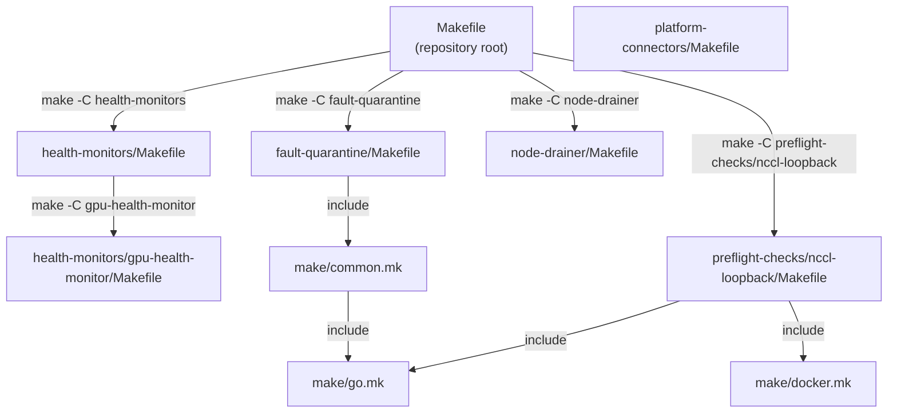
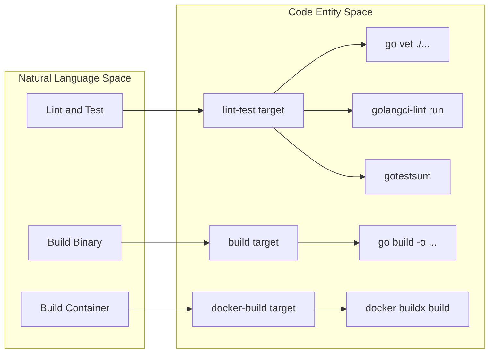
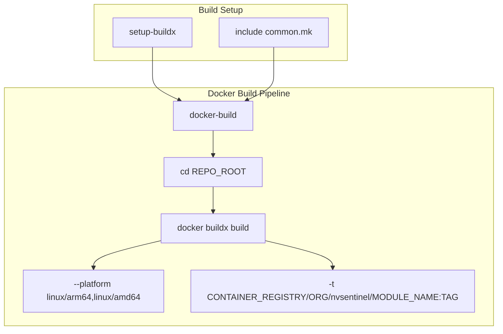

<!-- source: DeepWiki mcp.deepwiki.com · repo NVIDIA/NVSentinel · page 9.6 Build System and Makefile · fetched 2026-10-26 -->

# Build System and Makefile

<details>
<summary>Relevant source files</summary>

The following files were used as context for generating this wiki page:

- [.github/actions/publish-container/action.yml](.github/actions/publish-container/action.yml)
- [.github/actions/sbom-and-attest/action.yml](.github/actions/sbom-and-attest/action.yml)
- [.gitignore](.gitignore)
- [.ko.yaml](.ko.yaml)
- [Makefile](Makefile)
- [distros/kubernetes/nvsentinel/policies/README.md](distros/kubernetes/nvsentinel/policies/README.md)
- [distros/kubernetes/nvsentinel/policies/must-have-sbom.yaml](distros/kubernetes/nvsentinel/policies/must-have-sbom.yaml)
- [distros/kubernetes/nvsentinel/policies/must-have-slsa.yaml](distros/kubernetes/nvsentinel/policies/must-have-slsa.yaml)
- [make/common.mk](make/common.mk)
- [make/docker.mk](make/docker.mk)
- [preflight-checks/nccl-loopback/Makefile](preflight-checks/nccl-loopback/Makefile)
- [scripts/build-image-list.sh](scripts/build-image-list.sh)
- [scripts/buildko.sh](scripts/buildko.sh)
- [scripts/check-image-attestations.sh](scripts/check-image-attestations.sh)
- [scripts/verify-image-provenance.sh](scripts/verify-image-provenance.sh)

</details>


## Overview

NVSentinel uses a unified build system based on GNU Make that coordinates builds across 17 Go modules, 1 Python module, and several container-only components [Makefile:41-67](). The build system provides consistent targets for linting, testing, and container image creation, supporting both Docker Buildx (for Python/shell/specialized components) and Ko (for Go services).

This page documents the Makefile structure, build targets, Ko configuration, and Docker build system configuration. For related topics, see:
- **CI/CD Pipeline Overview** (9.1) - GitHub Actions workflow architecture
- **Container Build and Publishing** (9.4) - Multi-platform image builds and registry publishing
- **Version Management** (9.7) - `.versions.yaml` as single source of truth

## Makefile Structure

NVSentinel's build system consists of three layers of Makefiles with shared build logic provided by `make/common.mk`, `make/go.mk`, and `make/docker.mk`.

### Makefile Hierarchy



**Three-Layer Organization**:

| Layer | Files | Purpose |
|-------|-------|---------|
| **Root Coordinator** | `Makefile` | Orchestrates builds, defines module lists, delegates to subsystems [Makefile:1-80]() |
| **Module Makefiles** | `*/Makefile` | Module-specific targets, include shared definitions [preflight-checks/nccl-loopback/Makefile:37-39]() |
| **Shared Logic** | `make/*.mk` | Reusable targets for Go and Docker [make/common.mk:1-5](), [make/docker.mk:1-5]() |

**Sources**: [Makefile:1-80](), [make/common.mk:1-18](), [make/docker.mk:1-10](), [preflight-checks/nccl-loopback/Makefile:37-39]()

### Root Makefile Organization

The root `Makefile` defines module classifications and provides orchestration targets:

```makefile
# Go modules with specific patterns from CI
GO_MODULES := \
	api \
	health-monitors/syslog-health-monitor \
	...
	commons

# Python modules
PYTHON_MODULES := \
	health-monitors/gpu-health-monitor

# Container-only modules
CONTAINER_MODULES := \
	log-collector \
    gpu-reset
```

**Key Sections**:
- **Version Loading** [Makefile:23-39](): Loads tool versions from `.versions.yaml` using `yq`.
- **Tool Installation** [Makefile:131-156](): Targets for installing development tools like `golangci-lint`, `gotestsum`, and `gocover-cobertura`.
- **Module Classification**: Categorizes modules into `GO_MODULES`, `PYTHON_MODULES`, and `CONTAINER_MODULES` [Makefile:41-67]().
- **Special Module Handling**: Identifies `PRIVATE_MODULES` and `KUBEBUILDER_MODULES` for specific test environments [Makefile:70-82]().

**Sources**: [Makefile:23-82](), [Makefile:131-156]()

## Shared Build Logic (make/common.mk)

The `make/common.mk` file provides standardized variables and environment detection used across all modules.

### Standard Variables

```makefile
# Repository root path calculation
REPO_ROOT := $(shell git rev-parse --show-toplevel)

# Auto-detect current module name and path
MODULE_NAME ?= $(shell basename $(CURDIR))
MODULE_PATH := $(subst $(REPO_ROOT)/,,$(CURDIR))

# Container registry configuration
CONTAINER_REGISTRY ?= ghcr.io
CONTAINER_ORG      ?= nvidia
```

**Variable Precedence**:
1. Environment variables (CI or command line).
2. Module Makefile definitions (before `include`).
3. `common.mk` defaults [make/common.mk:24-36]().

**Sources**: [make/common.mk:11-36]()

### Version Management

The build system uses `.versions.yaml` as the single source of truth for all tool and language versions. Makefiles access these versions using a helper function:

```makefile
# Helper to read versions from .versions.yaml
VERSIONS_FILE := $(REPO_ROOT)/.versions.yaml
get-version = $(shell yq '.$(1)' $(VERSIONS_FILE) 2>/dev/null || echo "")
```

**Sources**: [make/common.mk:60-65]()

## Common Build Targets

All modules implement a standardized set of Make targets, though implementation varies by module type (Go vs Python).

### Standard Target Set

| Target | Purpose | Go Implementation | Docker Implementation |
|--------|---------|-------------------|-----------------------|
| `all` | Default target | → `lint-test` [Makefile:85-86]() | → `lint-test` [preflight-checks/nccl-loopback/Makefile:45-46]() |
| `lint-test` | Full CI validation | `vet` + `lint` + `test` + `coverage` | Module-specific checks |
| `build` | Compile binary | `go build` | N/A |
| `docker-build` | Build container | `docker buildx build` [make/docker.mk:25-47]() | `docker buildx build` |
| `docker-publish` | Push to registry | `docker buildx build --push` [make/docker.mk:71-94]() | `docker buildx build --push` |

### Target Execution Flow (Natural Language to Code Entity)

**Go Module Build Flow**:



**Sources**: [make/common.mk:90-105](), [make/docker.mk:24-47](), [preflight-checks/nccl-loopback/Makefile:45-64]()

## Ko Build System Configuration

Go services primarily use Ko to build container images without Dockerfiles in CI. This is managed via the root `scripts/buildko.sh` and the `.ko.yaml` configuration.

### Ko Configuration Structure

The `.ko.yaml` file defines build settings, base images, and OCI annotations for Go components.

| Component | Main Directory | Base Image |
|-----------|----------------|------------|
| `fault-quarantine` | `fault-quarantine` | `cgr.dev/chainguard/static:latest` |
| `fault-remediation` | `fault-remediation` | `cgr.dev/chainguard/static:latest` |
| `health-events-analyzer`| `health-events-analyzer`| `cgr.dev/chainguard/static:latest` |
| `node-drainer` | `node-drainer` | `cgr.dev/chainguard/static:latest` |

**Execution Logic**:
`scripts/buildko.sh` initializes a `go.work` file if it doesn't exist [scripts/buildko.sh:40-58]() and then executes `ko build` with specific flags for platforms and image digests [scripts/buildko.sh:60-75]().

**Sources**: [.ko.yaml:16-138](), [scripts/buildko.sh:33-75]()

## Docker Build System

Python and specialized Go modules (like preflight checks) use Docker Buildx for multi-platform container builds, facilitated by `make/docker.mk`.

### Standardized Docker Targets

The `make/docker.mk` file provides:
- `setup-buildx`: Configures a `docker-container` builder with host network access [make/docker.mk:14-21]().
- `docker-build`: Performs a multi-platform build with registry caching [make/docker.mk:25-47]().
- `docker-publish`: Builds and pushes images to the registry, optionally generating a metadata file for SBOM generation [make/docker.mk:71-94]().

**Sources**: [make/docker.mk:14-94]()

### Specialized Preflight Build: NCCL Loopback

The `preflight-checks/nccl-loopback` module overrides `MODULE_NAME` to match naming conventions and includes the standard Docker logic [preflight-checks/nccl-loopback/Makefile:22-39]().



**Sources**: [make/docker.mk:25-47](), [preflight-checks/nccl-loopback/Makefile:22-64]()

## Supply Chain Security Integration

The build system integrates directly with SBOM and attestation tools.

### Image List Generation
The `scripts/build-image-list.sh` script dynamically generates a list of all NVSentinel images by combining hardcoded dynamic images with static images extracted from the Helm `values.yaml` [scripts/build-image-list.sh:44-120]().

### Attestation Verification
The `scripts/check-image-attestations.sh` script validates SBOM attestations in the OCI registry using `crane` to detect OCI 1.1 referrers [scripts/check-image-attestations.sh:183-200](). It also verifies GitHub Build Provenance via `gh attestation verify` [scripts/check-image-attestations.sh:173-181]().

**Sources**: [scripts/build-image-list.sh:44-120](), [scripts/check-image-attestations.sh:173-200](), [distros/kubernetes/nvsentinel/policies/README.md:1-161]()

## Summary of Module Types

| Module Type | Primary Build Tool | Container Tool | Configuration File |
|-------------|--------------------|----------------|--------------------|
| **Go Service** | `go build` | `ko` | `.ko.yaml` |
| **Python Service**| `poetry` | `docker buildx` | `Dockerfile` |
| **Preflight (Go)**| `go build` | `docker buildx` | `Dockerfile` |
| **Specialized** | `make` | `docker buildx` | `make/docker.mk` |

**Sources**: [Makefile:41-67](), [.ko.yaml:16-138](), [make/docker.mk:1-96](), [preflight-checks/nccl-loopback/Makefile:23-40]()

---

